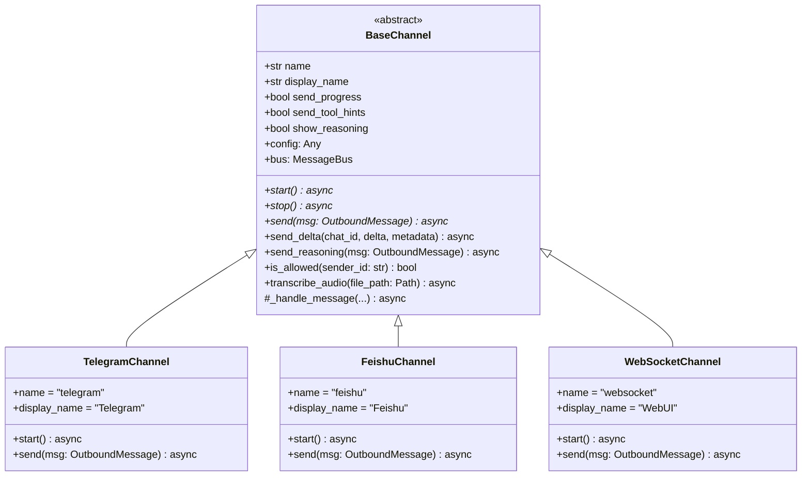
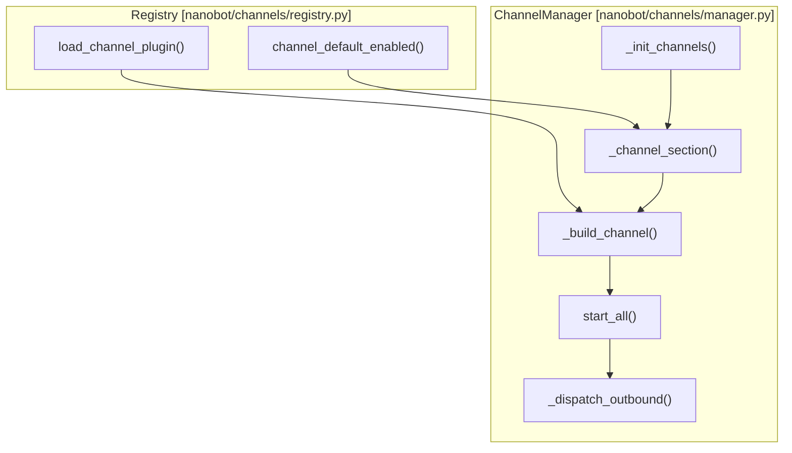

<!-- source: DeepWiki mcp.deepwiki.com · repo HKUDS/nanobot · page 5.1 Channel Architecture · fetched 2026-11-09 -->

# Channel Architecture

<details>
<summary>Relevant source files</summary>

The following files were used as context for generating this wiki page:

- [conftest.py](conftest.py)
- [nanobot/audio/transcription.py](nanobot/audio/transcription.py)
- [nanobot/audio/transcription_registry.py](nanobot/audio/transcription_registry.py)
- [nanobot/channels/base.py](nanobot/channels/base.py)
- [nanobot/channels/manager.py](nanobot/channels/manager.py)
- [nanobot/channels/registry.py](nanobot/channels/registry.py)
- [nanobot/config/loader.py](nanobot/config/loader.py)
- [nanobot/pairing/__init__.py](nanobot/pairing/__init__.py)
- [nanobot/pairing/store.py](nanobot/pairing/store.py)
- [nanobot/providers/transcription.py](nanobot/providers/transcription.py)
- [tests/agent/conftest.py](tests/agent/conftest.py)
- [tests/agent/test_workspace_scope.py](tests/agent/test_workspace_scope.py)
- [tests/bus/test_outbound_events.py](tests/bus/test_outbound_events.py)
- [tests/channels/test_base_channel.py](tests/channels/test_base_channel.py)
- [tests/channels/test_channel_manager_delta_coalescing.py](tests/channels/test_channel_manager_delta_coalescing.py)
- [tests/channels/test_channel_plugins.py](tests/channels/test_channel_plugins.py)
- [tests/config/test_config_migration.py](tests/config/test_config_migration.py)
- [tests/config/test_dream_config.py](tests/config/test_dream_config.py)
- [tests/config/test_env_interpolation.py](tests/config/test_env_interpolation.py)
- [tests/pairing/test_store.py](tests/pairing/test_store.py)
- [tests/providers/test_openai_compat_timeout.py](tests/providers/test_openai_compat_timeout.py)
- [tests/providers/test_proxy_env.py](tests/providers/test_proxy_env.py)
- [tests/providers/test_stepfun_asr.py](tests/providers/test_stepfun_asr.py)
- [tests/providers/test_transcription.py](tests/providers/test_transcription.py)
- [tests/session/test_session_location.py](tests/session/test_session_location.py)

</details>


This page explains the channel architecture that enables nanobot to connect to multiple messaging platforms through a unified interface. It covers the `BaseChannel` abstraction, the `ChannelManager` lifecycle, common features like Access Control Lists (ACL), pairing mechanisms, and integration with the `MessageBus`.

---

## BaseChannel Abstraction

All messaging platform integrations inherit from the `BaseChannel` abstract class, which defines the contract for receiving and sending messages. Each concrete channel implementation handles platform-specific protocols while exposing a uniform interface to the rest of the system.

### Class Hierarchy

The following diagram illustrates how specific channel implementations extend the base abstraction.

**Channel Entity Mapping**

**Sources:** [nanobot/channels/base.py:21-37](), [nanobot/channels/manager.py:169-181](), [tests/channels/test_channel_plugins.py:47-66]()

### Core Interface Methods

| Method | Responsibility | Implementation |
|--------|---------------|----------------|
| `start()` | Initialize platform client, establish connection (polling or WebSocket). **Must block forever.** | [nanobot/channels/base.py:74-84]() |
| `stop()` | Cleanly disconnect and release resources | [nanobot/channels/base.py:87-89]() |
| `send(msg)` | Send an `OutboundMessage` to the platform | [nanobot/channels/base.py:91-102]() |
| `send_delta(...)` | Deliver a streaming text chunk (optional override) | [nanobot/channels/base.py:129-152]() |
| `send_reasoning(...)` | Deliver model thinking process (defaults to `send_reasoning_delta`) | [nanobot/channels/base.py:201-215]() |
| `is_allowed(sender_id)` | Check if sender passes ACL or has an approved pairing | [nanobot/channels/base.py:236-257]() |
| `transcribe_audio(...)` | Convert voice to text using configured provider | [nanobot/channels/base.py:48-60]() |

---

## Channel Management

The `ChannelManager` [nanobot/channels/manager.py:83-114]() coordinates the lifecycle of all enabled channels and manages the flow of outbound messages.

### Discovery and Initialization
Channels are discovered dynamically using package scanning and entry point plugins. The manager resolves configuration sections for each channel using `_channel_section` [nanobot/channels/manager.py:152-173](). It also handles special initialization for the `websocket` channel by building gateway services [nanobot/channels/manager.py:175-186]().

**Channel Discovery and Boot Flow**

**Sources:** [nanobot/channels/manager.py:152-186](), [nanobot/channels/registry.py:35-71](), [tests/channels/test_channel_plugins.py:149-176]()

### Delta Coalescing

The `ChannelManager` implements delta coalescing to optimize streaming responses. When multiple `StreamDeltaEvent` messages arrive in quick succession for the same chat and stream, the manager merges them into a single `OutboundMessage` before sending to the channel. This reduces the number of network calls and improves perceived latency for streaming text.

The `_coalesce_stream_deltas` method [nanobot/channels/manager.py:438-485]() performs this merging. Coalescing is terminated by events such as:
- A `StreamEndEvent` [nanobot/channels/manager.py:450-451]()
- A `StreamedResponseEvent` [nanobot/channels/manager.py:452-453]()
- A `ProgressEvent` [nanobot/channels/manager.py:454-455]()
- A change in `response_sources` metadata [nanobot/channels/manager.py:460-463]()
- A change in `chat_id` or `stream_id` [nanobot/channels/manager.py:464-465]()

**Delta Coalescing Flow**
```mermaid
graph TD
    A[OutboundMessage StreamDeltaEvent] --> B{_coalesce_stream_deltas()};
    B -- "Same chat, stream, and metadata" --> C[Merge content];
    C --> B;
    B -- "Different chat/stream/metadata or EndEvent" --> D[Send merged message to channel];
    D --> E[Remaining messages re-published to bus];
```
**Sources:** [nanobot/channels/manager.py:438-485](), [tests/channels/test_channel_manager_delta_coalescing.py:112-212]()

---

## Access Control and Pairing

Channels implement security through a multi-tier Access Control List (ACL) and a dynamic pairing system managed via `pairing.json`.

### ACL (Access Control List)
The `BaseChannel.is_allowed(sender_id)` method [nanobot/channels/base.py:236-257]() checks permissions in order:
1. **Wildcard (`"*"`):** If `allow_from` contains `*`, all senders are permitted [nanobot/channels/base.py:242-243]().
2. **Explicit Allowlist:** Senders in the `allow_from` or `allowFrom` list are permitted [nanobot/channels/base.py:236-241]().
3. **Pairing Store:** If the sender is not in the static config, it checks the persistent `pairing.json` store via `is_approved()` [nanobot/channels/base.py:245-246]().

### Pairing Workflow
When an unapproved user sends a Direct Message (DM), the system can generate a temporary pairing code:
1. **Code Generation:** `generate_code()` [nanobot/pairing/store.py:113-136]() creates an 8-character code (e.g., `ABCD-EFGH`) with a 10-minute (600s) default TTL [nanobot/pairing/store.py:28-29]().
2. **Notification:** The channel sends a `format_pairing_reply()` [nanobot/pairing/store.py:15-16]() to the user containing the code.
3. **Approval:** The bot owner approves the code via `approve_code()` [nanobot/pairing/store.py:139-158]() or the `/pairing approve` command.
4. **Persistence:** Approved senders are saved to `~/.nanobot/pairing.json` using atomic writes [nanobot/pairing/store.py:73-85]().

**Sources:** [nanobot/channels/base.py:236-257](), [nanobot/pairing/store.py:1-158](), [tests/pairing/test_store.py:23-63]()

---

## Message Flow and Bus Integration

The `MessageBus` [nanobot/bus/queue.py:25]() (referenced in [nanobot/channels/manager.py:26]()) decouples the `AgentLoop` from transport details.

### Inbound Flow (User → Agent)
1. **Normalization:** Platform-specific logic wraps data into an `InboundMessage` [nanobot/bus/events.py:25]().
2. **Media Handling:** Audio is transcribed via `transcribe_audio()` [nanobot/channels/base.py:48-60]() if a provider is configured. The transcription provider includes retry logic for transient errors [nanobot/providers/transcription.py:97-110]().
3. **Publication:** The normalized message is published to the bus via `self.bus.publish_inbound()` [nanobot/channels/base.py:277]().

### Outbound Flow (Agent → User)
1. **Consumption:** `ChannelManager` consumes messages from the bus in a dedicated dispatch task `_dispatch_outbound` [nanobot/channels/manager.py:141]().
2. **Coalescing:** The manager implements `_coalesce_stream_deltas` to merge multiple small `StreamDeltaEvent` chunks into a single delivery to reduce transport overhead and latency [nanobot/channels/manager.py:438-485]().
3. **Delivery:** The manager calls the channel's `send()`, `send_delta()`, or `send_reasoning()`. It implements an exponential backoff retry policy (1s, 2s, 4s) for message delivery [nanobot/channels/manager.py:60]().

**Sources:** [nanobot/channels/base.py:48-60](), [nanobot/channels/manager.py:60-141](), [nanobot/bus/events.py:25](), [tests/channels/test_channel_manager_delta_coalescing.py:112-212](), [nanobot/providers/transcription.py:97-110]()

---

## Common Features

### Reasoning Support
Channels can render model thinking process using `send_reasoning_delta()`. Channels with native low-emphasis primitives (like Slack context blocks, Telegram expandable blockquotes, or WebUI italic bubbles) override this to provide in-place updates [nanobot/channels/base.py:153-171](). The default implementation reuses the streaming pair [nanobot/channels/base.py:201-215]().

### Session Integration
Channels, particularly the `WebSocketChannel`, integrate with the `SessionManager` to provide context. The `SessionManager` ensures that session files are stored outside the agent's workspace for isolation and persistence [tests/session/test_session_location.py:48-50](). This prevents session data from being accidentally exposed or modified by agent actions within the workspace. The `SessionManager` also handles workspace moves by preserving session identity [tests/session/test_session_location.py:140-156]() and recovers from deleted workspace identity markers [tests/session/test_session_location.py:159-174]().

### Media and Attachments
The architecture supports rich media. For example, the `WebSocketChannel` handles base64-encoded data URLs for client attachment uploads [nanobot/channels/websocket/tests/test_websocket_envelope_media.py:1-7](). It projects these attachments to other clients to ensure conversation consistency [nanobot/channels/websocket/tests/test_websocket_envelope_media.py:140-173]().

### Restart Notifications
The `ChannelManager` can notify users when a restart has completed. It consumes restart notices from environment variables and formats the message with `format_restart_completed_message` [nanobot/utils/restart.py:40-41]() (imported in [nanobot/channels/manager.py:40-41]()).

**Sources:** [nanobot/channels/base.py:153-215](), [nanobot/channels/manager.py:40-60](), [nanobot/channels/websocket/tests/test_websocket_envelope_media.py:140-173](), [tests/session/test_session_location.py:48-50](), [tests/session/test_session_location.py:140-156](), [tests/session/test_session_location.py:159-174]()

---

