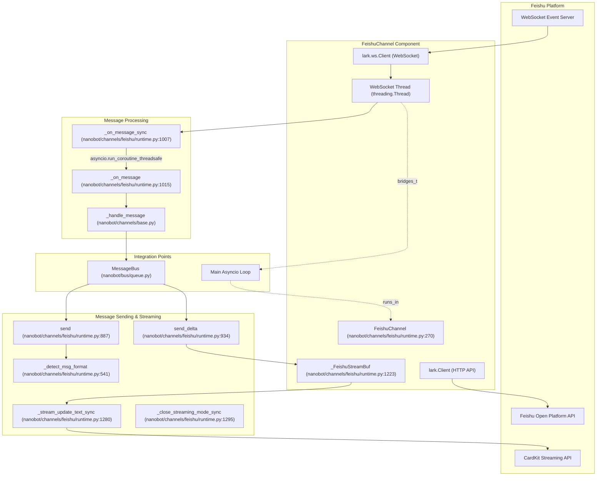
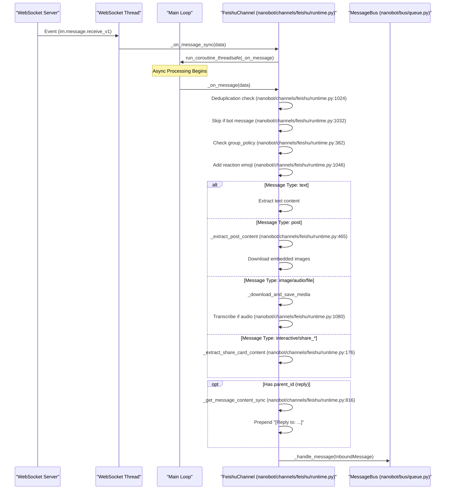
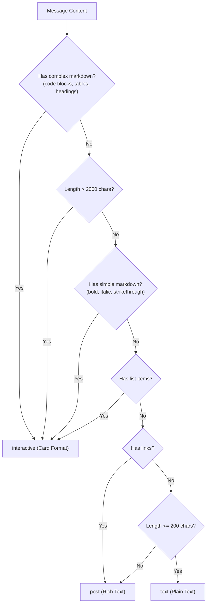

<!-- source: DeepWiki mcp.deepwiki.com · repo HKUDS/nanobot · page 5.3 Feishu · fetched 2026-11-09 -->

# Feishu

<details>
<summary>Relevant source files</summary>

The following files were used as context for generating this wiki page:

- [nanobot/channels/feishu/runtime.py](nanobot/channels/feishu/runtime.py)
- [nanobot/channels/feishu/tests/test_feishu_card_extraction.py](nanobot/channels/feishu/tests/test_feishu_card_extraction.py)
- [nanobot/channels/feishu/tests/test_feishu_markdown_rendering.py](nanobot/channels/feishu/tests/test_feishu_markdown_rendering.py)
- [tests/channels/test_feishu_login_url.py](tests/channels/test_feishu_login_url.py)

</details>


This document describes the Feishu/Lark channel implementation, which enables nanobot to communicate through the Feishu (known as Lark internationally) messaging platform. The implementation uses WebSocket long connections for event reception, eliminating the need for public IP addresses or webhook configuration.

For other communication channels, see [Telegram](#5.2), [Matrix](#5.4), and [Other Channels](#5.5). For the general channel architecture, see [Channel Architecture](#5.1).

---

## Overview

The `FeishuChannel` class provides integration with Feishu's messaging platform through the `lark-oapi` SDK. Unlike traditional webhook-based integrations, this implementation uses WebSocket connections to receive events, making it suitable for deployments behind firewalls or NAT. It supports rich content rendering, streaming responses via Feishu's CardKit, and intelligent message format detection.

**Key Components:**

| Component | Class/Module | Purpose |
|-----------|--------------|---------|
| Channel Implementation | `FeishuChannel` | Main channel adapter implementing `BaseChannel` [nanobot/channels/feishu/runtime.py:270-284]() |
| Configuration Schema | `FeishuConfig` | Pydantic model for channel settings, including streaming and topic isolation [nanobot/channels/feishu/config.py:10-36]() |
| Message Format Detection | `_detect_msg_format()` | Intelligent routing between text/post/card formats [nanobot/channels/feishu/runtime.py:541-610]() |
| Content Extraction | `_extract_post_content()`, `_extract_interactive_content()` | Parse complex message structures from Feishu [nanobot/channels/feishu/runtime.py:465-513](), [nanobot/channels/feishu/runtime.py:196-264]() |
| Card Rendering | `_build_card_elements()` | Convert markdown to Feishu interactive cards [nanobot/channels/feishu/runtime.py:612-686]() |
| Streaming Buffer | `_FeishuStreamBuf` | Manages state for incremental CardKit updates [nanobot/channels/feishu/runtime.py:1223-1230]() |
| Connection Store | `FeishuConnectStore` | Manages short-lived QR connection sessions for WebUI onboarding [nanobot/channels/feishu/connect.py:37-46]() |

**Sources:** [nanobot/channels/feishu/runtime.py:1-46](), [nanobot/channels/feishu/config.py:10-36](), [nanobot/channels/feishu/runtime.py:1223-1230](), [nanobot/channels/feishu/connect.py:37-46]()

---

## Architecture and Integration

### System-to-Code Entity Mapping

The following diagram bridges the high-level Feishu integration concepts to specific classes and methods in the codebase.

Title: "Feishu Integration Architecture"


**Thread Safety Design:**

The implementation addresses a critical challenge: `lark-oapi` expects to manage its own event loop, but nanobot already has a running asyncio loop. The solution uses a dedicated thread with its own event loop for WebSocket handling:

1. **Main Thread**: Runs nanobot's primary asyncio loop.
2. **WebSocket Thread**: Created in `start()`, runs `lark.ws.Client` with a dedicated event loop [nanobot/channels/feishu/runtime.py:291-369]().
3. **Bridge Mechanism**: `asyncio.run_coroutine_threadsafe()` schedules async handlers in the main loop [nanobot/channels/feishu/runtime.py:1013]().

**Sources:** [nanobot/channels/feishu/runtime.py:291-369](), [nanobot/channels/feishu/runtime.py:1007-1013]()

---

## Configuration

The `FeishuConfig` schema defines all channel settings:

| Field | Type | Purpose | Default |
|-------|------|---------|---------|
| `app_id` | `str` | Application ID from Feishu Open Platform | Required |
| `app_secret` | `str` | Application secret for authentication | Required |
| `streaming` | `bool` | Enable incremental updates via CardKit | `True` |
| `domain` | `str` | API domain selector (`feishu` or `lark`) | `"feishu"` |
| `encrypt_key` | `str` | Encryption key for event payload decryption | `None` |
| `verification_token` | `str` | Token for verifying webhook requests | `None` |
| `allow_from` | `list[str]` | Sender ID allowlist (empty = allow all) | `[]` |
| `react_emoji` | `str` | Emoji to react with on received messages | `"THUMBSUP"` |
| `group_policy` | `Literal` | `"open"` (all messages) or `"mention"` (only @mentions) | `"mention"` |
| `reply_to_message` | `bool` | Quote user's message in bot replies | `False` |
| `topic_isolation` | `bool` | Use message threads for session isolation | `True` |

**Sources:** [nanobot/channels/feishu/config.py:10-36]()

---

## Message Reception Flow

Title: "Feishu Message Inbound Pipeline"


**Message Deduplication:**

The channel maintains an `OrderedDict` cache of processed message IDs to prevent duplicate processing. The cache is bounded to 1000 entries using FIFO eviction [nanobot/channels/feishu/runtime.py:1024-1030]().

**Group Message Filtering:**

Group messages are filtered based on `group_policy`:
- `"open"`: Process all messages in the group.
- `"mention"`: Process only messages where bot is @mentioned.

Mention detection checks for `MentionEvent` objects where the `open_id` starts with bot user IDs [nanobot/channels/feishu/runtime.py:382-401]().

**Sources:** [nanobot/channels/feishu/runtime.py:1015-1132](), [nanobot/channels/feishu/runtime.py:382-401]()

---

## Streaming Support (CardKit)

If `streaming` is enabled in `FeishuConfig`, the channel implements `send_delta` using Feishu's CardKit streaming API [nanobot/channels/feishu/runtime.py:934-1006]().

**Streaming Workflow:**

1. **Initialization**: On the first delta, `_create_streaming_card_sync` creates a new CardKit instance and sends the initial message card [nanobot/channels/feishu/runtime.py:1238-1278]().
2. **Buffering**: Content is accumulated in `_FeishuStreamBuf`. Updates are throttled to a maximum of 1 update per second to respect API rate limits [nanobot/channels/feishu/runtime.py:962-969]().
3. **Update**: `_stream_update_text_sync` pushes incremental text to the active card [nanobot/channels/feishu/runtime.py:1280-1293]().
4. **Finalization**: When `_stream_end` is detected in metadata, `_close_streaming_mode_sync` is called to finalize the card state [nanobot/channels/feishu/runtime.py:988-1004]().

**Sources:** [nanobot/channels/feishu/runtime.py:934-1006](), [nanobot/channels/feishu/runtime.py:1223-1293]()

---

## Message Format Detection

The implementation automatically selects the optimal Feishu message format based on content characteristics in `_detect_msg_format` [nanobot/channels/feishu/runtime.py:541-610]().

**Format Decision Flow:**

Title: "Message Format Decision Tree"


**Regex Patterns Used:**

- **Complex Markdown**: `` ``` `` (code blocks), `^\|.+\|.*\n\s*\|[-:\s|]+\|` (tables), `^#{1,6}\s+` (headings) [nanobot/channels/feishu/runtime.py:543-548]().
- **Simple Markdown**: `\*\*.+?\*\*` (bold), `__.+?__` (bold alt), `\*(?!\*)(.+?)\*` (italic), `~~.+?~~` (strikethrough) [nanobot/channels/feishu/runtime.py:551-557]().

**Sources:** [nanobot/channels/feishu/runtime.py:541-610]()

---

## Interactive Card Rendering

When the format detector selects `"interactive"`, markdown content is converted to Feishu's card JSON structure in `_build_card_elements` [nanobot/channels/feishu/runtime.py:612-686]().

**Table Limit Handling:**

Feishu cards have a hard limit of **one table per card** (API error 11310). The `_split_elements_by_table_limit()` method splits elements into multiple cards when multiple tables are present [nanobot/channels/feishu/runtime.py:627-652]().

**Element Mapping:**

| Markdown Construct | Feishu Element | Conversion Logic |
|-------------------|----------------|-------------------|
| `# Heading` | `div` with `lark_md` | Strips MD markers and applies bolding [nanobot/channels/feishu/runtime.py:424-439]() |
| Tables | `table` | Parses MD table rows into Feishu columns via `_parse_md_table` [nanobot/channels/feishu/runtime.py:441-463]() |
| Code blocks | `markdown` | Wrapped in Feishu markdown tag [nanobot/channels/feishu/runtime.py:434-439]() |

**Sources:** [nanobot/channels/feishu/runtime.py:612-686](), [nanobot/channels/feishu/runtime.py:424-463]()

---

## Media Handling

The channel supports bidirectional media transfer with automatic type detection. Outbound files use specific Feishu message types based on file extensions.

| Extension | Message Type | Upload Method |
|-----------|--------------|---------------|
| `.png`, `.jpg`, `.gif` | `image` | `_upload_image_sync()` [nanobot/channels/feishu/runtime.py:703]() |
| `.opus` | `audio` | `_upload_file_sync()` [nanobot/channels/feishu/runtime.py:736]() |
| `.mp4` | `media` | `_upload_file_sync()` [nanobot/channels/feishu/runtime.py:736]() |

**Sources:** [nanobot/channels/feishu/runtime.py:703-814]()

---

## Tool Hint Display

Tool hints (progress indicators showing which tools the agent is calling) are rendered as interactive cards with code blocks to provide visual separation from the main conversation [nanobot/channels/feishu/runtime.py:1147-1190]().

**Formatting Logic:**

The `_format_tool_hint_lines()` method identifies top-level commas to split tool calls while keeping arguments intact, ensuring readable multi-tool call displays [nanobot/channels/feishu/runtime.py:1147-1190](). It specifically handles commas inside quoted strings to avoid incorrect line splits.

**Sources:** [nanobot/channels/feishu/runtime.py:1147-1220]()

---

## Connection and Onboarding

Feishu supports a QR-code based onboarding flow for the WebUI. This is managed by the `FeishuConnectStore` [nanobot/channels/feishu/connect.py:37-46]().

**Onboarding Workflow:**

1. **Start**: `start()` initiates the registration flow by calling `_begin_registration`, which returns a `device_code` and `qr_url` [nanobot/channels/feishu/connect.py:68-105](). The `_begin_registration` function also rewrites `/page/launcher` URLs to `/page/cli` to ensure the correct page is used for device code entry [tests/channels/test_feishu_login_url.py:28-37]().
2. **Polling**: The WebUI calls `poll()` periodically. The store calls `poll_registration_once` to check authorization status [nanobot/channels/feishu/connect.py:107-171]().
3. **Completion**: Upon success, `save_registration_result()` persists the `app_id` and `app_secret` to the local configuration [nanobot/channels/feishu/connect.py:145-149]().

**Thread Safety in Connection:**
The `FeishuConnectStore` uses a `threading.Lock` (`_completion_lock`) to ensure that cancellation and completion do not interleave, preventing the accidental saving of cancelled registration results [nanobot/channels/feishu/connect.py:47](), [nanobot/channels/feishu/tests/test_connect.py:69-122]().

**Sources:** [nanobot/channels/feishu/connect.py:37-182](), [nanobot/channels/feishu/tests/test_connect.py:69-122](), [tests/channels/test_feishu_login_url.py:28-37]()

---

## Reply Quoting and Topic Isolation

When `reply_to_message` is enabled, the bot quotes the user's original message in its responses using `_reply_message_sync` [nanobot/channels/feishu/runtime.py:870-885]().

**Topic Isolation:**
If `topic_isolation` is enabled, nanobot uses Feishu's `root_id` and `parent_id` to maintain conversation threads. This ensures that interactions within a specific message thread are isolated from other threads in the same chat.

**Reply Context Extraction:**
Incoming replies trigger `_get_message_content_sync`, which fetches the parent message content and truncates it to provide context for the LLM [nanobot/channels/feishu/runtime.py:816-868]().

**Sources:** [nanobot/channels/feishu/runtime.py:816-885]()

---

## Event Registration

Handlers are registered using an `EventDispatcherHandler` builder [nanobot/channels/feishu/runtime.py:286-328]().

| Event | Method | Logic |
|-------|--------|-------|
| `im.message.receive_v1` | `_on_message_sync` | Main processing entry point [nanobot/channels/feishu/runtime.py:1007]() |
| `im.message.reaction.created_v1` | `_on_reaction_created` | No-op handler [nanobot/channels/feishu/runtime.py:1133]() |
| `im.chat.access_event...` | `_on_bot_p2p_chat_entered` | Logs bot entry into private chats [nanobot/channels/feishu/runtime.py:1140]() |

**Sources:** [nanobot/channels/feishu/runtime.py:286-328](), [nanobot/channels/feishu/runtime.py:1007-1144]()

---

