<!-- source: DeepWiki mcp.deepwiki.com · repo HKUDS/nanobot · page 5.4 Matrix · fetched 2026-11-09 -->

# Matrix

<details>
<summary>Relevant source files</summary>

The following files were used as context for generating this wiki page:

- [nanobot/channels/dingtalk/runtime.py](nanobot/channels/dingtalk/runtime.py)
- [nanobot/channels/dingtalk/tests/test_dingtalk_channel.py](nanobot/channels/dingtalk/tests/test_dingtalk_channel.py)
- [nanobot/channels/matrix/runtime.py](nanobot/channels/matrix/runtime.py)
- [nanobot/channels/matrix/tests/test_matrix_channel.py](nanobot/channels/matrix/tests/test_matrix_channel.py)

</details>


## Purpose and Scope

The Matrix channel provides integration with the Matrix protocol (commonly used through Element clients), enabling nanobot to communicate in Matrix rooms with support for end-to-end encryption (E2EE), media attachments, threading, and typing indicators. This document covers the `MatrixChannel` implementation, configuration options, encryption handling, and message flow patterns.

For general channel architecture concepts, see [5.1 Channel Architecture](). For other channel implementations, see [5.5 Other Channels]().

---

## Configuration Schema

The `MatrixConfig` class defines all Matrix-specific settings, inheriting from the common `Base` configuration.

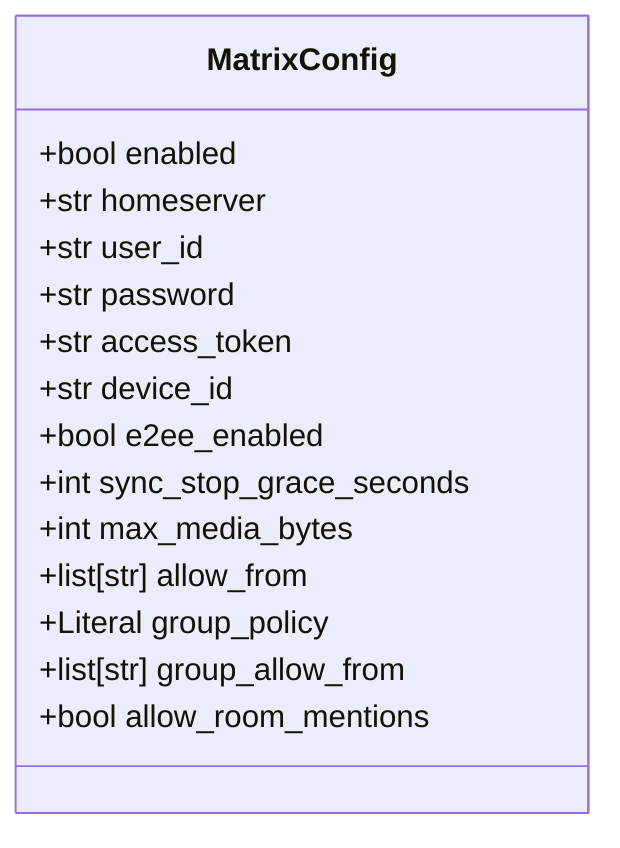

| Field | Type | Default | Description |
|-------|------|---------|-------------|
| `enabled` | bool | `false` | Enable/disable the Matrix channel |
| `homeserver` | str | `"https://matrix.org"` | Matrix homeserver URL |
| `user_id` | str | `""` | Fully qualified Matrix user ID (e.g., `@bot:matrix.org`) |
| `password` | str | `""` | Password for initial login if access_token is missing |
| `access_token` | str | `""` | Matrix access token for authentication |
| `device_id` | str | `""` | Device ID for E2EE session persistence |
| `e2ee_enabled` | bool | `true` (platform dependent) | Enable end-to-end encryption support. Defaults to `sys.platform != "win32"`. |
| `sync_stop_grace_seconds` | int | `2` | Timeout for graceful sync shutdown |
| `max_media_bytes` | int | `20971520` | Maximum media file size (20 MB default) |
| `allow_from` | list[str] | `[]` | User allowlist (supports `["*"]` wildcard) |
| `group_policy` | Literal | `"open"` | Group chat policy: `"open"`, `"mention"`, or `"allowlist"` |
| `group_allow_from` | list[str] | `[]` | Room allowlist when `group_policy="allowlist"` |
| `allow_room_mentions` | bool | `false` | Respond to `@room` mentions in `mention` policy mode |

**Sources:** [nanobot/channels/matrix/runtime.py:236-271](), [nanobot/channels/matrix/tests/test_matrix_channel.py:32-33]()

---

## Channel Architecture

### Class Hierarchy and Lifecycle

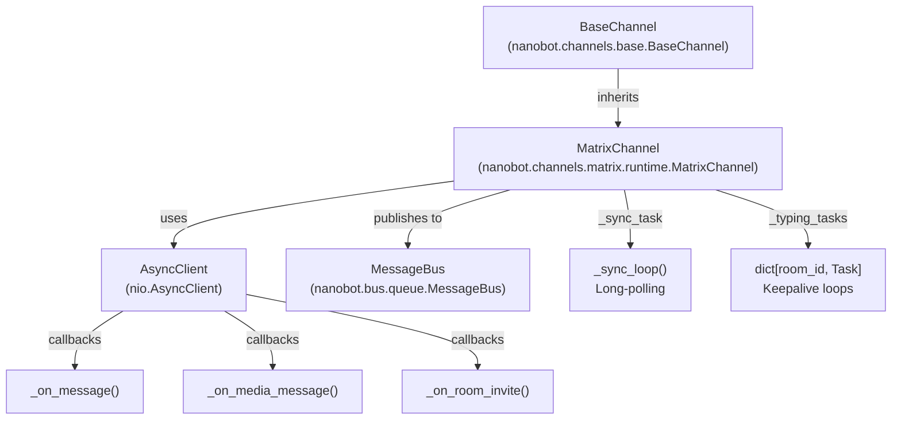

The `MatrixChannel` class implements the `BaseChannel` interface and manages:

- **AsyncClient**: The `matrix-nio` library client instance for Matrix protocol communication [nanobot/channels/matrix/runtime.py:350-350]().
- **Sync Loop**: A background task (`_sync_task`) that runs `sync_forever()` to receive events [nanobot/channels/matrix/runtime.py:351-351](), [nanobot/channels/matrix/runtime.py:387-397]().
- **Typing Indicators**: Per-room keepalive tasks that refresh typing status every 20 seconds [nanobot/channels/matrix/runtime.py:352-352](), [nanobot/channels/matrix/runtime.py:650-669]().
- **Event Callbacks**: Handlers for text messages, media messages, and room invites [nanobot/channels/matrix/runtime.py:399-416]().

**Sources:** [nanobot/channels/matrix/runtime.py:332-385](), [nanobot/channels/matrix/runtime.py:387-416]()

---

## Message Flow

### Inbound Message Processing

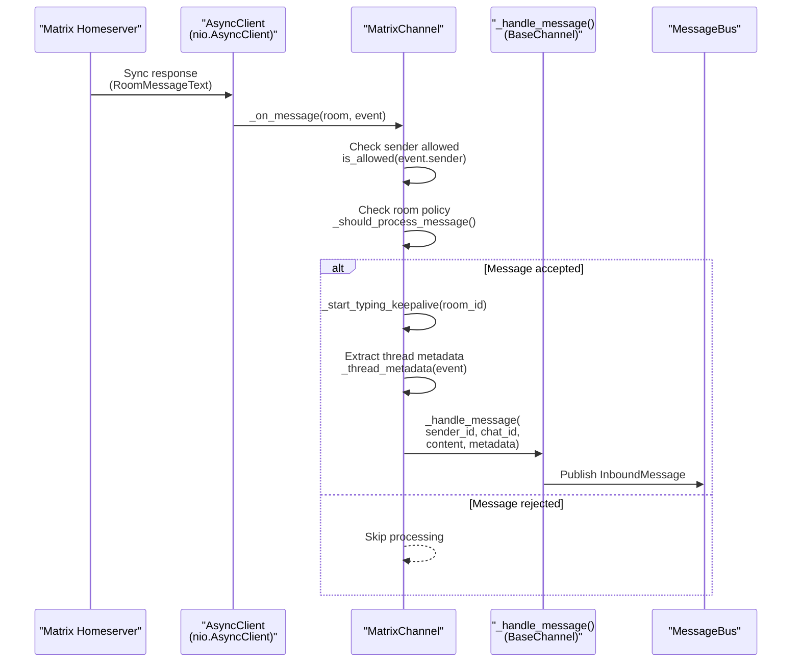

**Text Message Handler Flow:**

1. **Event Reception**: `_on_message()` receives `RoomMessageText` events from the sync loop [nanobot/channels/matrix/runtime.py:918-918]().
2. **Self-Message Filter**: Skips messages from the bot's own `user_id` [nanobot/channels/matrix/runtime.py:923-924]().
3. **Access Control**: Validates sender via `is_allowed()` against the `allow_from` list [nanobot/channels/matrix/runtime.py:925-926]().
4. **Room Policy Check**: `_should_process_message()` enforces `group_policy` rules [nanobot/channels/matrix/runtime.py:927-928]().
5. **Typing Indicator**: Starts typing keepalive via `_start_typing_keepalive()` [nanobot/channels/matrix/runtime.py:949-949]().
6. **Metadata Extraction**: Extracts thread information from `m.relates_to` payload via `_thread_metadata()` [nanobot/channels/matrix/runtime.py:950-950]().
7. **Message Forwarding**: Calls `_handle_message()` which publishes to the MessageBus [nanobot/channels/matrix/runtime.py:951-961]().

**Sources:** [nanobot/channels/matrix/runtime.py:918-929](), [nanobot/channels/matrix/runtime.py:718-732]()

### Media Message Processing

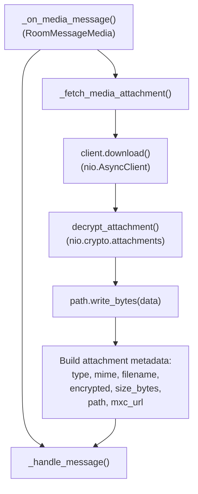

**Media Attachment Flow:**

1. **Size Validation**: Checks declared size against `max_media_bytes` limit [nanobot/channels/matrix/runtime.py:867-871]().
2. **Download**: Fetches media via `client.download(mxc_url)` [nanobot/channels/matrix/runtime.py:791-795]().
3. **Decryption**: If event has encryption metadata (`key`, `hashes`, `iv`), decrypts using `decrypt_attachment()` [nanobot/channels/matrix/runtime.py:854-859]().
4. **Size Recheck**: Validates actual downloaded size against limit [nanobot/channels/matrix/runtime.py:883-887]().
5. **File Persistence**: Saves to `get_media_dir("matrix")` with sanitized filename [nanobot/channels/matrix/runtime.py:888-889]().
6. **Metadata Assembly**: Builds attachment dictionary with all file details [nanobot/channels/matrix/runtime.py:890-900]().
7. **Message Forwarding**: Passes to `_handle_message()` with attachment in metadata [nanobot/channels/matrix/runtime.py:958-961]().

**Sources:** [nanobot/channels/matrix/runtime.py:931-962](), [nanobot/channels/matrix/runtime.py:862-905]()

### Outbound Message Delivery

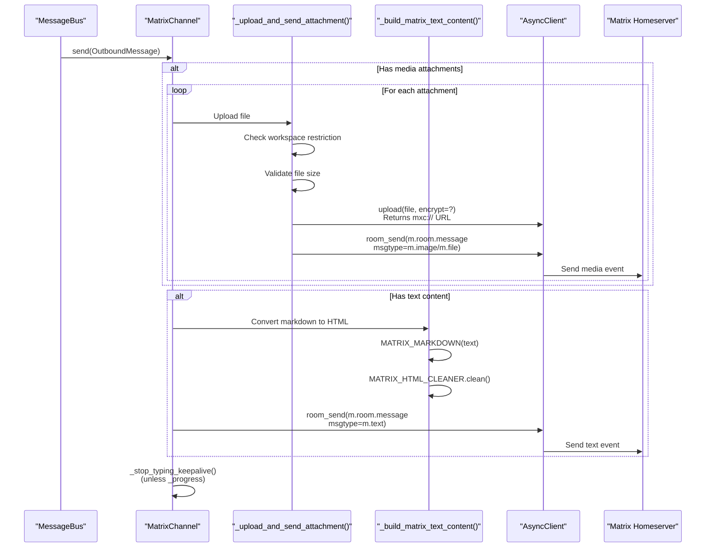

**Outbound Processing Steps:**

1. **Media Upload Loop**: For each attachment path in `msg.media` [nanobot/channels/matrix/runtime.py:579-588]():
   - Resolve and validate file path [nanobot/channels/matrix/runtime.py:530-534]().
   - Check workspace restriction if enabled via `is_path_within()` [nanobot/channels/matrix/runtime.py:535-536]().
   - Verify file size against `_effective_media_limit_bytes()` [nanobot/channels/matrix/runtime.py:539-544]().
   - Upload via `client.upload()` with optional encryption [nanobot/channels/matrix/runtime.py:549-555]().
   - Send media event with `msgtype` based on MIME type [nanobot/channels/matrix/runtime.py:561-573]().

2. **Text Rendering**:
   - Convert markdown to HTML using `MATRIX_MARKDOWN` (mistune) [nanobot/channels/matrix/runtime.py:98-101]().
   - Sanitize HTML with `MATRIX_HTML_CLEANER` (nh3) [nanobot/channels/matrix/runtime.py:144-151]().
   - Build message content with optional `formatted_body` field [nanobot/channels/matrix/runtime.py:216-217]().
   - Add `m.relates_to` for thread support if metadata present [nanobot/channels/matrix/runtime.py:603-604]().

3. **Typing Indicator Cleanup**:
   - If `metadata["_progress"]` is `True`, keeps typing indicator active [nanobot/channels/matrix/runtime.py:606-606]().
   - Otherwise, calls `_stop_typing_keepalive()` to clear indicator [nanobot/channels/matrix/runtime.py:608-608]().

**Sources:** [nanobot/channels/matrix/runtime.py:578-609](), [nanobot/channels/matrix/runtime.py:523-576](), [nanobot/channels/matrix/runtime.py:191-232]()

---

## Access Control and Room Policies

### Group Policy Decision Tree

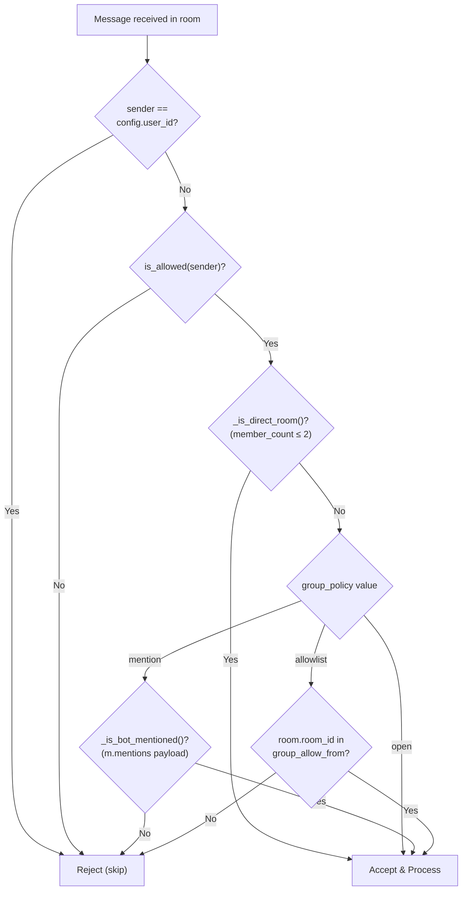

### Policy Modes

| Policy | Behavior | Use Case |
|--------|----------|----------|
| `"open"` | Accept all messages from allowed senders | Public bot in trusted communities |
| `"mention"` | Require `m.mentions` payload with bot's `user_id` or `room: true` | Shared rooms where bot should be quiet unless explicitly invoked |
| `"allowlist"` | Only process messages in rooms listed in `group_allow_from` | Strict room access control |

**Mention Detection Logic:**

The `_is_bot_mentioned()` method checks the `m.mentions` field in the event's `source.content` [nanobot/channels/matrix/runtime.py:704-716]().

```python
# Mentions extraction from event content
mentions = event.source.get("content", {}).get("m.mentions", {})
user_ids = mentions.get("user_ids", [])
room_mention = mentions.get("room", False)
```

**Sources:** [nanobot/channels/matrix/runtime.py:718-732](), [nanobot/channels/matrix/runtime.py:704-716](), [nanobot/channels/matrix/runtime.py:700-702]()

---

## End-to-End Encryption (E2EE)

### Encryption Architecture

```mermaid
graph TB
    subgraph "Channel Initialization"
        Config["MatrixConfig<br/>e2ee_enabled=true"]
        ClientConfig["AsyncClientConfig<br/>encryption_enabled=true"]
        Store["Crypto Store<br/>get_data_dir()/matrix-store"]
    end
    
    subgraph "Message Encryption"
        SendCheck{"_is_encrypted_room()?"}
        EncryptMsg["room_send(<br/>ignore_unverified_devices=True)"]
    end
    
    subgraph "Media Encryption"
        UploadCheck{"encrypt parameter"}
        UploadEncrypted["client.upload(encrypt=True)<br/>Returns (mxc_url, encryption_info)"]
        FileContent["content['file'] = {<br/>url, v, iv, hashes, key<br/>}"]
    end
    
    subgraph "Media Decryption"
        Download["client.download(mxc_url)"]
        DecryptCheck{"_is_encrypted_media_event()?<br/>(has key, hashes, iv)"}
        Decrypt["decrypt_attachment(<br/>ciphertext, key, sha256, iv)"]
    end
    
    Config --> ClientConfig
    ClientConfig --> Store
    
    SendCheck -->|Yes| EncryptMsg
    UploadCheck -->|Yes| UploadEncrypted
    UploadEncrypted --> FileContent
    
    Download --> DecryptCheck
    DecryptCheck -->|Yes| Decrypt
```

### E2EE Components

**1. Crypto Store Initialization**

On channel `start()`, if `device_id` is configured:
- Creates store directory at `get_data_dir() / "matrix-store"` [nanobot/channels/matrix/runtime.py:366-369]().
- Loads existing crypto store via `client.load_store()` to restore device keys [nanobot/channels/matrix/runtime.py:379-379]().
- If `device_id` is empty, warns that message replay may occur on restart [nanobot/channels/matrix/runtime.py:370-375]().

**Sources:** [nanobot/channels/matrix/runtime.py:360-385]()

**2. Encrypted Room Detection**

The `_is_encrypted_room()` method checks if a room has encryption enabled via the `nio` room object [nanobot/channels/matrix/runtime.py:479-483]().

**3. Encrypted Media Upload**

When uploading attachments to encrypted rooms:
- Passes `encrypt=True` to `client.upload()` [nanobot/channels/matrix/runtime.py:549-555]().
- Receives tuple: `(UploadResponse, encryption_info_dict)` [nanobot/channels/matrix/runtime.py:555-555]().
- Stores `mxc://` URL in `content["file"]["url"]` instead of `content["url"]` [nanobot/channels/matrix/runtime.py:563-565]().
- Includes encryption metadata: `v`, `iv`, `hashes`, `key` [nanobot/channels/matrix/runtime.py:461-477]().

**Sources:** [nanobot/channels/matrix/runtime.py:523-576](), [nanobot/channels/matrix/runtime.py:461-477]()

**4. Encrypted Media Download**

When receiving encrypted media events:
- Detects encryption via `_is_encrypted_media_event()` (checks for `key`, `hashes`, `iv` attributes) [nanobot/channels/matrix/runtime.py:850-860]().
- Downloads ciphertext via `client.download(mxc_url)` [nanobot/channels/matrix/runtime.py:791-795]().
- Decrypts using `decrypt_attachment()` from `nio.crypto.attachments` [nanobot/channels/matrix/runtime.py:854-859]().
- Handles `EncryptionError` by logging and returning failure marker [nanobot/channels/matrix/runtime.py:786-789]().

**Sources:** [nanobot/channels/matrix/runtime.py:850-860](), [nanobot/channels/matrix/runtime.py:786-789]()

---

## Typing Indicators

### Keepalive Mechanism

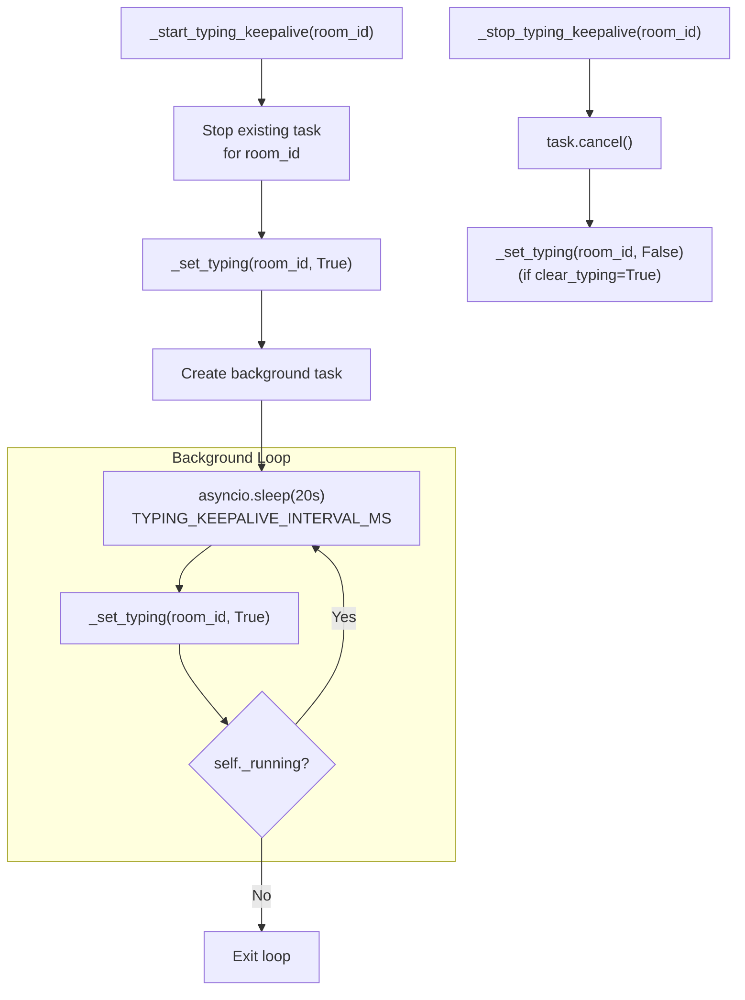

**Timing Constants:**

| Constant | Value | Purpose |
|----------|-------|---------|
| `TYPING_NOTICE_TIMEOUT_MS` | 30,000 ms | Matrix spec timeout for typing indicators [nanobot/channels/matrix/runtime.py:68]() |
| `TYPING_KEEPALIVE_INTERVAL_MS` | 20,000 ms | Refresh interval (must be < timeout) [nanobot/channels/matrix/runtime.py:70]() |

**Lifecycle:**

1. **On Inbound Message**: Calls `_start_typing_keepalive()` when processing allowed messages [nanobot/channels/matrix/runtime.py:949-949]().
2. **Periodic Refresh**: Background task calls `client.room_typing()` every 20 seconds [nanobot/channels/matrix/runtime.py:658-662]().
3. **On Outbound Send**: 
   - If `metadata["_progress"]=True`: Keeps typing active (for multi-step operations) [nanobot/channels/matrix/runtime.py:606-606]().
   - Otherwise: Calls `_stop_typing_keepalive(clear_typing=True)` to clear indicator [nanobot/channels/matrix/runtime.py:608-608]().
4. **On Error**: Finally block in `_on_message()` ensures typing is cleared even on exceptions [nanobot/channels/matrix/runtime.py:962-962]().

**Sources:** [nanobot/channels/matrix/runtime.py:650-681](), [nanobot/channels/matrix/runtime.py:636-648](), [nanobot/channels/matrix/runtime.py:68-70]()

---

## Threading Support

### Thread Metadata Flow

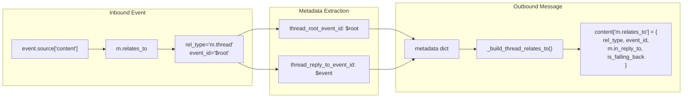

**Thread Detection:**

The `_event_thread_root_id()` method extracts thread information from incoming events [nanobot/channels/matrix/runtime.py:747-761]().

**Thread Reply Construction:**

When sending messages in a thread, `_build_thread_relates_to()` constructs the `m.relates_to` payload [nanobot/channels/matrix/runtime.py:764-775]().

This structure is added to both text messages and media uploads, maintaining thread continuity [nanobot/channels/matrix/runtime.py:567-568](), [nanobot/channels/matrix/runtime.py:603-604]().

**Sources:** [nanobot/channels/matrix/runtime.py:747-761](), [nanobot/channels/matrix/runtime.py:764-775](), [nanobot/channels/matrix/runtime.py:567-568](), [nanobot/channels/matrix/runtime.py:603-604]()

---

## Markdown Rendering and HTML Sanitization

### Rendering Pipeline

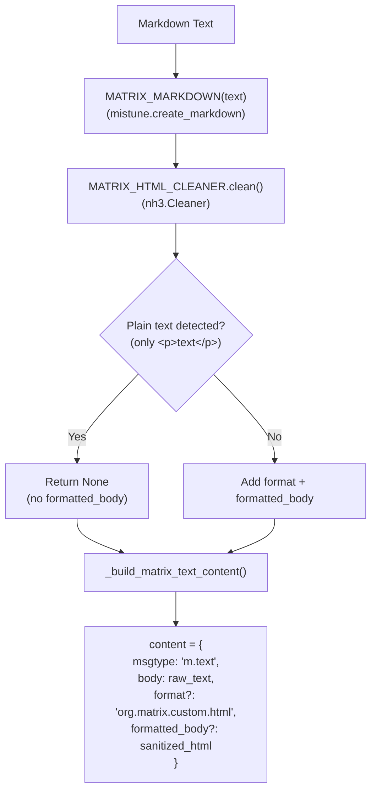

**Supported Markdown Features:**

The `MATRIX_MARKDOWN` renderer (mistune) enables:
- Tables
- Strikethrough (`~~text~~`)
- Automatic URL linking
- Superscript (`x^2^`) and subscript (`H~2~O`)
- Code blocks with syntax highlighting class hints [nanobot/channels/matrix/runtime.py:98-101]().

**HTML Sanitization Rules:**

The `MATRIX_HTML_CLEANER` (nh3) restricts output to a safe subset of tags and attributes [nanobot/channels/matrix/runtime.py:103-112]().

**Attribute Filtering:**

The `_filter_matrix_html_attribute()` function enforces scheme restrictions and CSS class filtering for syntax highlighting [nanobot/channels/matrix/runtime.py:129-141]().

**Sources:** [nanobot/channels/matrix/runtime.py:98-151](), [nanobot/channels/matrix/runtime.py:103-112](), [nanobot/channels/matrix/runtime.py:129-141]()

---

## Media Handling

### Upload Limit Resolution

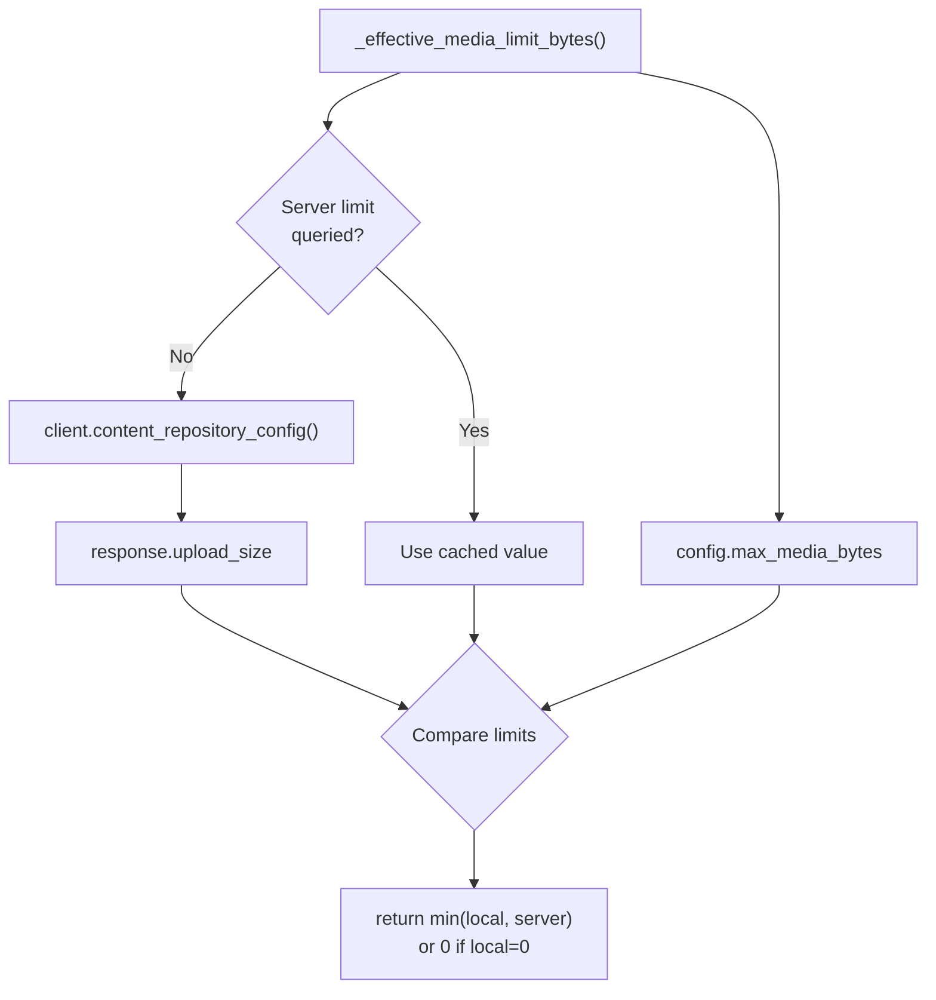

**Upload Limit Logic:**

1. **Local Configuration**: `max_media_bytes` defaults to 20 MB [nanobot/channels/matrix/runtime.py:247-247]().
2. **Server Query**: Calls `client.content_repository_config()` once per channel lifecycle [nanobot/channels/matrix/runtime.py:500-505]().
3. **Effective Limit**: Uses `min(local_limit, server_limit)` to respect both constraints [nanobot/channels/matrix/runtime.py:512-518]().

**Sources:** [nanobot/channels/matrix/runtime.py:495-518]()

### Attachment Filename Sanitization

The `_build_attachment_path()` method constructs safe filenames using `safe_filename()` and event ID prefixes [nanobot/channels/matrix/runtime.py:808-819]().

**Sources:** [nanobot/channels/matrix/runtime.py:808-819]()

### Workspace Restriction

When `restrict_to_workspace=True`, the channel verifies that outbound file paths are relative to the configured workspace directory via `is_path_within()` [nanobot/channels/matrix/runtime.py:418-426](), [nanobot/channels/matrix/runtime.py:535-536]().

**Sources:** [nanobot/channels/matrix/runtime.py:418-426](), [nanobot/channels/matrix/runtime.py:535-536]()

---

## Error Handling

### Response Error Callbacks

The channel registers callbacks for Matrix SDK errors via `add_response_callback()` [nanobot/channels/matrix/runtime.py:411-416]().

**Error Severity Classification:**

- **ERROR level**: Authentication failures (`M_UNKNOWN_TOKEN`, `M_FORBIDDEN`, `M_UNAUTHORIZED`) or soft logout [nanobot/channels/matrix/runtime.py:615-622]().
- **WARNING level**: Transient failures (network errors, rate limits, etc.) [nanobot/channels/matrix/runtime.py:624-625]().

**Sources:** [nanobot/channels/matrix/runtime.py:615-634]()

### Media Download/Upload Failures

Media operations return failure markers on error, such as `_ATTACH_TOO_LARGE` or `_ATTACH_FAILED` [nanobot/channels/matrix/runtime.py:73-75]().

**Sources:** [nanobot/channels/matrix/runtime.py:73-75](), [nanobot/channels/matrix/runtime.py:862-905]()

---

## Key Classes and Methods Reference

| Class/Method | Purpose | Location |
|--------------|---------|----------|
| `MatrixChannel` | Main channel implementation | [nanobot/channels/matrix/runtime.py:332]() |
| `MatrixConfig` | Configuration schema | [nanobot/channels/matrix/runtime.py:236-271]() |
| `_on_message()` | Text message event handler | [nanobot/channels/matrix/runtime.py:918-929]() |
| `_on_media_message()` | Media event handler | [nanobot/channels/matrix/runtime.py:931-962]() |
| `_on_room_invite()` | Room invitation handler | [nanobot/channels/matrix/runtime.py:696-698]() |
| `_should_process_message()` | ACL and policy enforcement | [nanobot/channels/matrix/runtime.py:718-732]() |
| `_is_bot_mentioned()` | Mention detection | [nanobot/channels/matrix/runtime.py:704-716]() |
| `_fetch_media_attachment()` | Download and decrypt media | [nanobot/channels/matrix/runtime.py:862-905]() |
| `_upload_and_send_attachment()` | Upload and send media | [nanobot/channels/matrix/runtime.py:523-576]() |
| `_start_typing_keepalive()` | Begin typing indicator | [nanobot/channels/matrix/runtime.py:650-669]() |
| `_stop_typing_keepalive()` | Clear typing indicator | [nanobot/channels/matrix/runtime.py:671-681]() |
| `_build_matrix_text_content()` | Matrix content structure | [nanobot/channels/matrix/runtime.py:191-232]() |
| `_render_markdown_html()` | Markdown-to-HTML conversion | [nanobot/channels/matrix/runtime.py:203-214]() |
| `_build_thread_relates_to()` | Thread reply structure | [nanobot/channels/matrix/runtime.py:764-775]() |
| `_effective_media_limit_bytes()` | Upload limit resolution | [nanobot/channels/matrix/runtime.py:512-518]() |

**Sources:** [nanobot/channels/matrix/runtime.py:1-963]()

---

