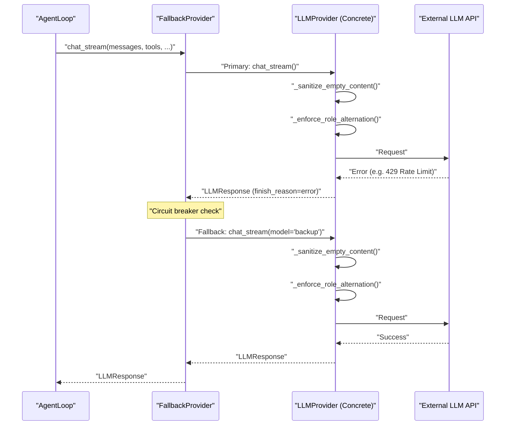

<!-- source: DeepWiki mcp.deepwiki.com · repo HKUDS/nanobot · page 6 LLM Providers · fetched 2026-11-09 -->

# LLM Providers

<details>
<summary>Relevant source files</summary>

The following files were used as context for generating this wiki page:

- [nanobot/providers/__init__.py](nanobot/providers/__init__.py)
- [nanobot/providers/anthropic_provider.py](nanobot/providers/anthropic_provider.py)
- [nanobot/providers/base.py](nanobot/providers/base.py)
- [nanobot/providers/fallback_provider.py](nanobot/providers/fallback_provider.py)
- [tests/agent/test_runner_fallback.py](tests/agent/test_runner_fallback.py)
- [tests/providers/test_anthropic_merge_consecutive.py](tests/providers/test_anthropic_merge_consecutive.py)
- [tests/providers/test_anthropic_tool_result.py](tests/providers/test_anthropic_tool_result.py)
- [tests/providers/test_enforce_role_alternation.py](tests/providers/test_enforce_role_alternation.py)
- [tests/providers/test_provider_retry.py](tests/providers/test_provider_retry.py)
- [tests/providers/test_providers_init.py](tests/providers/test_providers_init.py)

</details>


This page documents the provider abstraction layer: the `LLMProvider` base class, the `LLMResponse` and `ToolCallRequest` data structures, and how the system selects and calls a provider at runtime. Nanobot supports over 25 LLM services through a unified interface, abstracting away differences in API schemas, tool-call formats, and error handling.

---

## Overview

All LLM communication in nanobot is routed through a single abstract interface defined in `nanobot/providers/base.py` [nanobot/providers/base.py:1-10](). The system uses a registry-driven approach to map configuration and environment variables to specific provider implementations. The framework utilizes native SDK implementations (OpenAI, Anthropic, Bedrock) for better streaming and reliability.

| Class | File | Backend |
|---|---|---|
| `AnthropicProvider` | `nanobot/providers/anthropic_provider.py` | Native Anthropic SDK for Claude models (caching, thinking) [nanobot/providers/__init__.py:24]() |
| `OpenAICompatProvider` | `nanobot/providers/openai_compat_provider.py` | Standard OpenAI API and compatible endpoints (DeepSeek, Kimi, etc.) [nanobot/providers/__init__.py:25]() |
| `BedrockProvider` | `nanobot/providers/bedrock_provider.py` | AWS Bedrock Converse API for Claude, Nova, Llama, etc. [nanobot/providers/__init__.py:30]() |
| `OpenAICodexProvider` | `nanobot/providers/openai_codex_provider.py` | OpenAI Codex Responses API via OAuth (GitHub Copilot) [nanobot/providers/__init__.py:26]() |
| `AzureOpenAIProvider` | `nanobot/providers/azure_openai_provider.py` | Microsoft Azure OpenAI Service [nanobot/providers/__init__.py:29]() |
| `XAIGrokProvider` | `nanobot/providers/xai_grok_provider.py` | xAI Grok API with proxy support [nanobot/providers/__init__.py:27]() |
| `GitHubCopilotProvider` | `nanobot/providers/github_copilot_provider.py` | GitHub Copilot Chat API [nanobot/providers/__init__.py:28]() |

The `AgentLoop` holds a reference to one `LLMProvider` instance and calls `chat_with_retry()` [nanobot/providers/base.py:544-593]() or `chat_stream_with_retry()` [nanobot/providers/base.py:595-674]() on each turn to ensure robust communication.

**Architecture: Provider Layer to Code Entities**

```mermaid
graph TD
    subgraph "AgentSystem[Agent System]"
        AgentLoop["AgentLoop\n(nanobot/agent/loop.py)"]
    end

    subgraph "ProviderAbstraction[Provider Abstraction]"
        LLMProvider["LLMProvider (ABC)\n(nanobot/providers/base.py)"]
        LLMResponse["LLMResponse\n(nanobot/providers/base.py)"]
        GenSettings["GenerationSettings\n(nanobot/providers/base.py)"]
        ProviderSpec["ProviderSpec\n(nanobot/providers/registry.py)"]
    end

    subgraph "Implementations"
        AnthropicProvider["AnthropicProvider\n(nanobot/providers/anthropic_provider.py)"]
        OpenAICompatProvider["OpenAICompatProvider\n(nanobot/providers/openai_compat_provider.py)"]
        AzureOpenAIProvider["AzureOpenAIProvider\n(nanobot/providers/azure_openai_provider.py)"]
        BedrockProvider["BedrockProvider\n(nanobot/providers/bedrock_provider.py)"]
        FallbackProvider["FallbackProvider\n(nanobot/providers/fallback_provider.py)"]
        XAIGrokProvider["XAIGrokProvider\n(nanobot/providers/xai_grok_provider.py)"]
        GitHubCopilotProvider["GitHubCopilotProvider\n(nanobot/providers/github_copilot_provider.py)"]
        OpenAICodexProvider["OpenAICodexProvider\n(nanobot/providers/openai_codex_provider.py)"]
    end
    
    AgentLoop -->|"chat_with_retry()"| LLMProvider
    LLMProvider -->|"returns"| LLMResponse
    LLMProvider *-- GenSettings
    
    LLMProvider <|-- AnthropicProvider
    LLMProvider <|-- OpenAICompatProvider
    LLMProvider <|-- FallbackProvider
    LLMProvider <|-- AzureOpenAIProvider
    LLMProvider <|-- BedrockProvider
    LLMProvider <|-- XAIGrokProvider
    LLMProvider <|-- GitHubCopilotProvider
    LLMProvider <|-- OpenAICodexProvider
    
    ProviderSpec -->|"defines metadata for"| LLMProvider
```
Sources: `nanobot/providers/base.py:10-17`, `nanobot/providers/registry.py:32-91`, `nanobot/providers/fallback_provider.py:98-116`, `nanobot/providers/__init__.py:24-30`

---

## Data Structures

The provider interface relies on standardized dataclasses to ensure the agent logic can process responses from any backend consistently.

### `ToolCallRequest`
Represents a tool invocation requested by the LLM. It includes a `to_openai_tool_call()` method [nanobot/providers/base.py:93-115]() to serialize the request back into the OpenAI format required for session persistence. It also preserves provider-specific metadata via `provider_specific_fields` [nanobot/providers/base.py:75-76]().

```python
@dataclass
class ToolCallRequest:
    id: str
    name: str
    arguments: Any
    extra_content: dict[str, Any] | None = None
    provider_specific_fields: dict[str, Any] | None = None
    function_provider_specific_fields: dict[str, Any] | None = None
```
Sources: `nanobot/providers/base.py:70-79`

### `LLMResponse`
The normalized return value from every `chat()` call. It supports modern features like reasoning content (for DeepSeek-R1/Kimi/MiMo) and Anthropic's extended thinking blocks [nanobot/providers/base.py:200-201](). It also includes detailed error metadata for structured retry policies [nanobot/providers/base.py:203-209]().

```python
@dataclass
class LLMResponse:
    content: str | None
    tool_calls: list[ToolCallRequest]
    finish_reason: str # "stop", "length", "tool_calls", "error"
    usage: dict[str, int]
    reasoning_content: str | None
    thinking_blocks: list[dict] | None
    error_status_code: int | None
    error_kind: str | None # "timeout", "connection", "rate_limit", etc.
```
Sources: `nanobot/providers/base.py:192-209`

### `ProviderConversationState`
This dataclass [nanobot/providers/base.py:174-196]() holds opaque, provider-owned continuation state. It can contain encrypted reasoning or other provider-private protocol items in its `payload` field, which is excluded from normal logs and public chat history. The `pending_messages` field stores chat-style messages produced after the most recent provider response, which are then materialized by the owning provider on the next request.

```python
@dataclass
class ProviderConversationState:
    kind: str
    provider: str
    model: str
    version: int
    payload: dict[str, Any] = field(default_factory=dict, repr=False)
    pending_messages: list[dict[str, Any]] = field(default_factory=list, repr=False)
```
Sources: `nanobot/providers/base.py:174-189`

---

## Reliability & Failover

The provider layer includes built-in reliability features, ranging from request-level retries to cross-model failover.

### `FallbackProvider`
When configured with `fallbackModels` in `config.json` [tests/agent/test_runner_fallback.py:142-168](), the system wraps the primary provider in a `FallbackProvider` [nanobot/providers/fallback_provider.py:98-116](). This wrapper transparently fails over to secondary models if the primary returns a "fallbackable" error (e.g., rate limits, server errors, timeouts) [nanobot/providers/fallback_provider.py:32-38](). It includes a circuit breaker that trips after repeated failures to avoid wasting requests on a known-bad endpoint [nanobot/providers/fallback_provider.py:30-31]().

### Message Sanitization
The `_sanitize_empty_content` method [nanobot/providers/base.py:252-299]() ensures that messages containing empty strings or internal `_meta` fields (used for prompt caching or media tracking) are cleaned before being sent to APIs. Concrete providers further implement `_enforce_role_alternation` [nanobot/providers/base.py:301-354]() to handle strict role-alternation requirements, such as merging consecutive messages of the same role [tests/providers/test_enforce_role_alternation.py:42-63](). For Anthropic, `_merge_consecutive` [nanobot/providers/anthropic_provider.py:189-194]() handles similar logic, including stripping trailing assistant messages [tests/providers/test_anthropic_merge_consecutive.py:30-40]().

**Data Flow: Message Sanitization and Request**


Sources: `nanobot/providers/base.py:252-354`, `nanobot/providers/fallback_provider.py:30-31`, `nanobot/providers/fallback_provider.py:98-116`, `nanobot/providers/fallback_provider.py:32-38`, `tests/agent/test_runner_fallback.py:142-168`, `tests/providers/test_enforce_role_alternation.py:42-63`, `nanobot/providers/anthropic_provider.py:189-194`, `tests/providers/test_anthropic_merge_consecutive.py:30-40`

---

## Provider Configuration & Registry

Each provider instance maintains a `GenerationSettings` object [nanobot/providers/base.py:224-231](). Configuration is handled via the `ProviderConfig` Pydantic model.

The `ProviderSpec` in the registry [nanobot/providers/registry.py:32-116]() defines metadata such as:
* `env_key`: The environment variable for the API key (e.g., `DASHSCOPE_API_KEY`) [nanobot/providers/registry.py:43]().
* `is_gateway`: Whether the provider is a router like OpenRouter [nanobot/providers/registry.py:59]().
* `strip_model_prefix`: Whether to remove the provider name before sending the request to a gateway [nanobot/providers/registry.py:66]().
* `thinking_style`: How to inject thinking toggles into the request body [nanobot/providers/registry.py:86-91]().

The registry uses `detect_by_key_prefix` and `detect_by_base_keyword` for multi-stage provider detection [nanobot/providers/registry.py:61-62]().

---

## Child Pages

For more specific details on how providers are managed and implemented:

- **[Provider Selection & Registry](#6.1)**: Detailed look at the `PROVIDERS` registry [nanobot/providers/registry.py:143-152](), `ProviderSpec` metadata, and the multi-stage algorithm used to detect the correct provider based on API keys, bases, or model names. For details, see [Provider Selection & Registry](#6.1).
- **[Provider Implementations](#6.2)**: Technical deep dive into specific implementations like `OpenAICompatProvider` [nanobot/providers/__init__.py:25](), `AnthropicProvider` [nanobot/providers/__init__.py:24](), and `BedrockProvider` [nanobot/providers/__init__.py:30](). Includes details on the OpenAI Responses API module used for high-performance streaming. For details, see [Provider Implementations](#6.2).
- **[Image Generation & Multimodal Providers](#6.3)**: Document the image generation provider abstraction, the `image_generation` tool, artifact storage, and security checks. For details, see [Image Generation & Multimodal Providers](#6.3).

Sources: `nanobot/providers/base.py`, `nanobot/providers/registry.py`, `nanobot/providers/fallback_provider.py`, `nanobot/providers/__init__.py`

---

