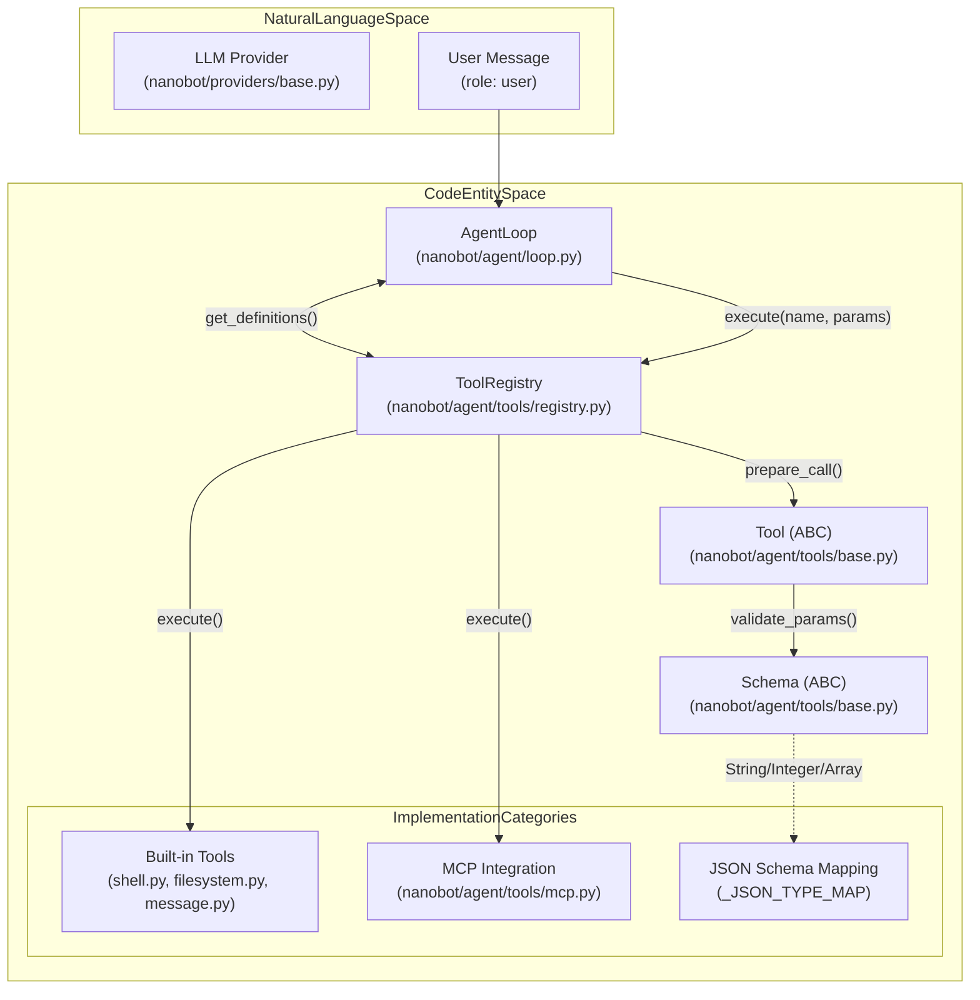

<!-- source: DeepWiki mcp.deepwiki.com · repo HKUDS/nanobot · page 7 Tools & Capabilities · fetched 2026-11-09 -->

# Tools & Capabilities

<details>
<summary>Relevant source files</summary>

The following files were used as context for generating this wiki page:

- [nanobot/agent/tools/__init__.py](nanobot/agent/tools/__init__.py)
- [nanobot/agent/tools/base.py](nanobot/agent/tools/base.py)
- [nanobot/agent/tools/registry.py](nanobot/agent/tools/registry.py)
- [nanobot/agent/tools/schema.py](nanobot/agent/tools/schema.py)
- [tests/tools/test_tool_registry.py](tests/tools/test_tool_registry.py)
- [tests/tools/test_tool_validation.py](tests/tools/test_tool_validation.py)

</details>


This page provides a high-level overview of the **nanobot** tool system, which allows the agent to interact with its environment. The system is built around a unified `Tool` interface, a central `ToolRegistry` for lifecycle management, and robust parameter validation to ensure reliability when driven by LLMs.

---

## Overview

The tool system translates natural language intent into structured code execution. When an LLM generates a tool call, the `AgentLoop` [nanobot/agent/loop.py:7-81]() dispatches it to the `ToolRegistry` [nanobot/agent/tools/registry.py:19-28](), which validates the input against a JSON Schema before executing the underlying logic. The system supports long-running execution sessions through a specialized manager for interactive shell workflows [nanobot/agent/tools/exec_session.py:195-214]().

**Architecture: Tool System Components**


Sources: [nanobot/agent/tools/base.py:30-143](), [nanobot/agent/tools/registry.py:19-51](), [nanobot/agent/tools/base.py:20-27](), [nanobot/agent/tools/exec_session.py:195-214]()

---

## Core Components

### The `Tool` Base Class
All capabilities inherit from the `Tool` abstract base class [nanobot/agent/tools/base.py:159-185](). It defines the interface for identification (`name`), documentation (`description`), and structure (`parameters`). 

- **Parameter Casting and Validation**: The registry uses `tool.cast_params` [nanobot/agent/tools/registry.py:141-141]() to coerce values into the types specified in the tool's JSON Schema.
- **Type Mapping**: Uses `_JSON_TYPE_MAP` [nanobot/agent/tools/base.py:20-27]() to map JSON Schema types (string, integer, number, boolean, array, object) to Python types.
- **Validation Logic**: Handled by `Schema.validate_json_schema_value` [nanobot/agent/tools/base.py:51-121](), checking types, enums, numeric ranges, and nested structures.
- **Result Handling**: Uses `ToolResult` [nanobot/agent/tools/base.py:144-158]() to distinguish between successful output and errors that the LLM should analyze.

### The `ToolRegistry`
The `ToolRegistry` [nanobot/agent/tools/registry.py:19-28]() acts as the central coordinator.
1. **Name Resolution**: Locates tools by name, providing case-insensitive suggestions (e.g., `readFile` -> `read_file`) if a match is missing [nanobot/agent/tools/registry.py:58-69]().
2. **Call Preparation**: Coerces parameters via `_coerce_params` [nanobot/agent/tools/registry.py:171-174]() and unwraps `arguments` payloads common in LLM outputs [nanobot/agent/tools/registry.py:176-185]().
3. **Execution Safety**: Appends a recovery hint [nanobot/agent/tools/registry.py:189-189]() to error messages to help the LLM self-correct.
4. **Stable Definitions**: Returns definitions via `get_definitions` [nanobot/agent/tools/registry.py:86-108](), sorting built-in tools before MCP tools to ensure prompt stability [nanobot/agent/tools/registry.py:99-106]().

### Discovery and Context
- **Context Injection**: Tools that are `ContextAware` [nanobot/agent/tools/context.py:45-49]() receive a `RequestContext` [nanobot/agent/tools/context.py:29-42]() before execution. The `ToolRegistry` facilitates this by calling `set_context` if a context is bound [nanobot/agent/tools/registry.py:128-129]().
- **Runtime Providers**: The registry aggregates `RuntimeContextProvider` instances from tools [nanobot/agent/tools/registry.py:44-51]() to contribute to the agent's dynamic execution environment.

Sources: [nanobot/agent/tools/base.py:20-158](), [nanobot/agent/tools/registry.py:19-185](), [nanobot/agent/tools/context.py:23-75]()

---

## Tool Categories

### Built-in Tools
Essential tools for environment interaction:
- **Filesystem**: Tools for reading, writing, and patching files within the workspace.
- **Shell & Sessions**: `ExecTool` for commands, supported by `ExecSessionManager` for long-running processes [nanobot/agent/tools/exec_session.py:195-214]().
- **Communication**: `MessageTool` [nanobot/agent/tools/message.py:10-10]() for sending messages back to the user, featuring suppression logic for redundant replies [tests/tools/test_message_tool_suppress.py:23-50]().
- **Background Tasks**: `SpawnTool` for creating subagents and `CronTool` for scheduled execution.

For details, see [Built-in Tools](#7.1).

### MCP Integration
Nanobot supports the **Model Context Protocol (MCP)**, allowing it to connect to external tool servers. These tools are dynamically registered and prefixed with `mcp_` in the registry [nanobot/agent/tools/registry.py:99-105]().

For details, see [MCP Integration](#7.2).

### Security & Sandboxing
Safety is enforced through:
- **Workspace Isolation**: Path validation ensures tools stay within allowed directories.
- **Request Context**: The `RequestContext` [nanobot/agent/tools/context.py:29-42]() tracks the origin of the request (channel, chat_id, user) for auditing and access control.
- **Strict Validation**: Parameters are validated against strict schemas before any tool logic runs [nanobot/agent/tools/base.py:51-121]().

For details, see [Security & Sandboxing](#7.3).

### CLI Apps (CLI-Anything)
The agent can discover and run catalogued CLI applications as tools, managed by the `CliAppManager`.

For details, see [CLI Apps (CLI-Anything)](#7.4).

---

## Tool Execution Lifecycle

**Diagram: Execution Flow**

```mermaid
sequenceDiagram
    participant LLM as "LLM Provider"
    participant Loop as "AgentLoop"
    participant Reg as "ToolRegistry"
    participant Tool as "Specific Tool Instance"

    LLM->>Loop: "ToolCallRequest(name, arguments)"
    Loop->>Reg: "execute(name, params)"
    Reg->>Reg: "prepare_call(name, params)"
    Reg->>Reg: "_coerce_params(params)"
    Reg->>Tool: "cast_params(casted)"
    Reg->>Tool: "validate_params(casted)"
    alt "Valid"
        Reg->>Tool: "execute(**casted)"
        Tool-->>Reg: "Result (str/ToolResult)"
        Reg-->>Loop: "Tool Result String"
    else "Invalid"
        Reg-->>Loop: "Error: Invalid parameters + [Hint]"
    end
    Loop->>LLM: "Chat(messages + tool_result)"
```
Sources: [nanobot/agent/tools/registry.py:110-148](), [nanobot/agent/tools/registry.py:187-200](), [nanobot/agent/tools/base.py:136-138]()

---

## Lifecycle Hooks
The agent loop utilizes `AgentHook` [nanobot/agent/hook.py:65-151]() to provide visibility and customization at various stages of tool execution. The `CompositeHook` [nanobot/agent/hook.py:156-220]() allows multiple hooks to be executed in sequence with error isolation [tests/agent/test_hook_composite.py:147-166]().

Key tool-related hooks include:
- `before_execute_tools`: Called before a batch of tool calls [nanobot/agent/hook.py:103-104]().
- `before_execute_tool`: Called before a specific tool execution [nanobot/agent/hook.py:106-113]().
- `after_execute_tool`: Called after a successful tool execution [nanobot/agent/hook.py:115-122]().
- `on_execute_tool_error`: Called when a tool execution fails [nanobot/agent/hook.py:124-133]().

Sources: [nanobot/agent/hook.py:1-220](), [nanobot/agent/turn_hooks.py:45-92]()

---

## Parameter Validation Schema
The system uses an abstract `Schema` class [nanobot/agent/tools/base.py:30-36]() and concrete subclasses to validate parameters against JSON Schema fragments. The `tool_parameters_schema` decorator [nanobot/agent/tools/__init__.py:14-15]() and `tool_parameters` decorator [nanobot/agent/tools/__init__.py:13]() simplify defining tool schemas.

**Diagram: Schema Validation Flow**

```mermaid
graph TD
    ToolCall["Tool Call Parameters (dict)"]
    ToolInstance["Tool Instance\n(e.g., SampleTool)"]
    ToolParameters["Tool.parameters\n(JSON Schema dict)"]
    SchemaValidate["Schema.validate_json_schema_value\n(nanobot/agent/tools/base.py:51-126)"]
    ErrorList["List of Error Messages"]

    ToolCall --> ToolInstance: "Passed to validate_params()"
    ToolInstance --> ToolParameters: "Retrieves schema"
    ToolParameters --> SchemaValidate: "Schema and value"
    SchemaValidate -->|Checks "type"| JSON_TYPE_MAP["_JSON_TYPE_MAP\n(nanobot/agent/tools/base.py:20-27)"]
    SchemaValidate -->|Checks "enum", "minimum", "maximum", "minLength", "maxLength"| SchemaRules["JSON Schema Rules"]
    SchemaValidate -->|Recursively for "object" and "array"| SchemaValidate
    SchemaValidate --> ErrorList: "Returns validation errors"

    subgraph "Schema Definitions"
        SchemaBase["Schema (ABC)\n(nanobot/agent/tools/base.py:30-36)"]
        StringSchema["StringSchema\n(nanobot/agent/tools/schema.py:20-51)"]
        IntegerSchema["IntegerSchema\n(nanobot/agent/tools/schema.py:54-85)"]
        NumberSchema["NumberSchema\n(nanobot/agent/tools/schema.py:88-119)"]
        BooleanSchema["BooleanSchema\n(nanobot/agent/tools/schema.py:122-145)"]
        ArraySchema["ArraySchema\n(nanobot/agent/tools/schema.py:148-180)"]
        ObjectSchema["ObjectSchema\n(nanobot/agent/tools/schema.py:183-201)"]
    end

    SchemaBase <|-- StringSchema
    SchemaBase <|-- IntegerSchema
    SchemaBase <|-- NumberSchema
    SchemaBase <|-- BooleanSchema
    SchemaBase <|-- ArraySchema
    SchemaBase <|-- ObjectSchema
    SchemaBase --> SchemaValidate: "validate_value()"
```
Sources: [nanobot/agent/tools/base.py:30-126](), [nanobot/agent/tools/schema.py:20-201](), [nanobot/agent/tools/__init__.py:13-15](), [tests/tools/test_tool_validation.py:24-130]()

| Feature | JSON Schema Equivalent | Implementation |
| :--- | :--- | :--- |
| **Type Checking** | `type` | `resolve_json_schema_type` [nanobot/agent/tools/base.py:39-44]() |
| **Integer/Number** | `minimum`, `maximum` | `validate_json_schema_value` [nanobot/agent/tools/base.py:77-81]() |
| **String** | `minLength`, `maxLength` | `validate_json_schema_value` [nanobot/agent/tools/base.py:82-87]() |
| **Object** | `properties`, `required` | `validate_json_schema_value` [nanobot/agent/tools/base.py:88-108]() |
| **Array** | `items`, `minItems` | `validate_json_schema_value` [nanobot/agent/tools/base.py:109-120]() |

Sources: [nanobot/agent/tools/base.py:30-121](), [tests/tools/test_tool_validation.py:24-130]()

---

