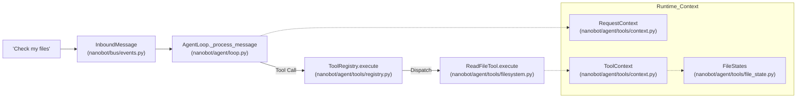

<!-- source: DeepWiki mcp.deepwiki.com · repo HKUDS/nanobot · page 7.1 Built-in Tools · fetched 2026-11-09 -->

# Built-in Tools

<details>
<summary>Relevant source files</summary>

The following files were used as context for generating this wiki page:

- [.agent/security.md](.agent/security.md)
- [docs/my-tool.md](docs/my-tool.md)
- [docs/provider-cookbook.md](docs/provider-cookbook.md)
- [nanobot/agent/__init__.py](nanobot/agent/__init__.py)
- [nanobot/agent/plugins.py](nanobot/agent/plugins.py)
- [nanobot/agent/tools/_search_content.py](nanobot/agent/tools/_search_content.py)
- [nanobot/agent/tools/file_state.py](nanobot/agent/tools/file_state.py)
- [nanobot/agent/tools/filesystem.py](nanobot/agent/tools/filesystem.py)
- [nanobot/agent/tools/message.py](nanobot/agent/tools/message.py)
- [nanobot/agent/tools/path_utils.py](nanobot/agent/tools/path_utils.py)
- [nanobot/agent/tools/runtime_control.py](nanobot/agent/tools/runtime_control.py)
- [nanobot/agent/tools/search.py](nanobot/agent/tools/search.py)
- [nanobot/agent/tools/self.py](nanobot/agent/tools/self.py)
- [nanobot/agent/tools/sessions.py](nanobot/agent/tools/sessions.py)
- [nanobot/bus/events.py](nanobot/bus/events.py)
- [nanobot/channels/websocket/tests/test_websocket_envelope_media.py](nanobot/channels/websocket/tests/test_websocket_envelope_media.py)
- [nanobot/skills/my/SKILL.md](nanobot/skills/my/SKILL.md)
- [nanobot/skills/my/references/examples.md](nanobot/skills/my/references/examples.md)
- [nanobot/utils/runtime.py](nanobot/utils/runtime.py)
- [nanobot/webui/session_access.py](nanobot/webui/session_access.py)
- [tests/agent/test_agent_plugins.py](tests/agent/test_agent_plugins.py)
- [tests/agent/test_attachment_references.py](tests/agent/test_attachment_references.py)
- [tests/agent/test_hook_composite.py](tests/agent/test_hook_composite.py)
- [tests/agent/test_loop_tool_context.py](tests/agent/test_loop_tool_context.py)
- [tests/agent/test_runner_goal_continue.py](tests/agent/test_runner_goal_continue.py)
- [tests/agent/test_runner_persistence.py](tests/agent/test_runner_persistence.py)
- [tests/agent/tools/test_runtime_control.py](tests/agent/tools/test_runtime_control.py)
- [tests/agent/tools/test_self_tool.py](tests/agent/tools/test_self_tool.py)
- [tests/agent/tools/test_session_history_pagination.py](tests/agent/tools/test_session_history_pagination.py)
- [tests/agent/tools/test_sessions.py](tests/agent/tools/test_sessions.py)
- [tests/test_truncate_text_shadowing.py](tests/test_truncate_text_shadowing.py)
- [tests/tools/test_edit_advanced.py](tests/tools/test_edit_advanced.py)
- [tests/tools/test_edit_enhancements.py](tests/tools/test_edit_enhancements.py)
- [tests/tools/test_file_edit_coding_enhancements.py](tests/tools/test_file_edit_coding_enhancements.py)
- [tests/tools/test_filesystem_tools.py](tests/tools/test_filesystem_tools.py)
- [tests/tools/test_message_tool.py](tests/tools/test_message_tool.py)
- [tests/tools/test_message_tool_suppress.py](tests/tools/test_message_tool_suppress.py)
- [tests/tools/test_read_enhancements.py](tests/tools/test_read_enhancements.py)
- [tests/tools/test_search_tools.py](tests/tools/test_search_tools.py)
- [tests/webui/test_session_mentions.py](tests/webui/test_session_mentions.py)

</details>


This document describes the core built-in tools that nanobot provides to the agent. These tools enable the agent to interact with the filesystem, execute shell commands, access the web, and manage scheduled tasks. For information about extending the agent with external tools via MCP (Model Context Protocol), see [MCP Integration](#7.2).

Built-in tools are registered automatically during agent initialization and provide the foundational capabilities that make nanobot a productive personal assistant. All tools follow a common interface defined by the `Tool` base class [nanobot/agent/tools/base.py:12-12]().

---

## Tool Registry

The `ToolRegistry` serves as the central registry for all tools available to the agent. It maintains tool definitions in OpenAI function-calling format and provides a unified execution interface.

**Key Responsibilities:**
- **Tool Registration**: Register tools with their schemas and execution handlers [nanobot/agent/tools/registry.py:20-20]().
- **Definition Management**: Provide tool definitions to the LLM provider in the expected format, ensuring built-in tools are sorted first [nanobot/agent/tools/registry.py:45-63]().
- **Execution Dispatch**: Resolve, validate, and route tool calls to the appropriate handler [nanobot/agent/tools/registry.py:92-106]().
- **Parameter Validation**: Automatically cast and validate parameters against JSON Schema fragments [nanobot/agent/tools/registry.py:84-90]().

The registry is instantiated in `AgentLoop.__init__` [nanobot/agent/loop.py:88-88]() and populated with built-in tools via `_register_default_tools` [nanobot/agent/loop.py:115-131]().

Sources: [nanobot/agent/tools/registry.py:8-118](), [nanobot/agent/loop.py:88-131]()

---

## Tool Registration Flow

The following diagram illustrates how tools are registered and configured during agent initialization.

**Diagram: Agent Tool Initialization**

```mermaid
graph TB
    AgentLoop["AgentLoop.from_config()"]
    RegisterDefault["_register_default_tools()"]
    ToolRegistry["ToolRegistry"]
    
    subgraph "Filesystem_Tools"
        ReadFileTool["ReadFileTool"]
        WriteFileTool["WriteFileTool"]
        EditFileTool["EditFileTool"]
        ListDirTool["ListDirTool"]
        FindFilesTool["FindFilesTool"]
        GrepTool["GrepTool"]
    end
    
    subgraph "Execution_Tools"
        ExecTool["ExecTool"]
        WriteStdinTool["WriteStdinTool"]
    end
    
    subgraph "Web_Tools"
        WebSearchTool["WebSearchTool"]
        WebFetchTool["WebFetchTool"]
    end
    
    subgraph "Communication_Tools"
        MessageTool["MessageTool"]
        SpawnTool["SpawnTool"]
        CronTool["CronTool"]
        ReadSessionTool["ReadSessionTool"]
        SearchSessionsTool["SearchSessionsTool"]
    end

    subgraph "Self_Control_Tools"
        MyTool["MyTool"]
    end
    
    AgentLoop --> RegisterDefault
    RegisterDefault --> ToolRegistry
    
    ToolRegistry --> ReadFileTool
    ToolRegistry --> WriteFileTool
    ToolRegistry --> EditFileTool
    ToolRegistry --> ListDirTool
    ToolRegistry --> FindFilesTool
    ToolRegistry --> GrepTool
    ToolRegistry --> ExecTool
    ToolRegistry --> WriteStdinTool
    ToolRegistry --> WebSearchTool
    ToolRegistry --> WebFetchTool
    ToolRegistry --> MessageTool
    ToolRegistry --> SpawnTool
    ToolRegistry --> CronTool
    ToolRegistry --> ReadSessionTool
    ToolRegistry --> SearchSessionsTool
    ToolRegistry --> MyTool
    
    WorkspaceConfig["workspace: Path<br/>restrict_to_workspace: bool"]
    ExecConfig["ExecToolConfig<br/>timeout, path_append"]
    WebToolsConfig["WebToolsConfig<br/>search.provider, fetch.use_jina_reader"]
    MessageBus["bus: MessageBus"]
    CronService["CronService"]
    SessionManager["SessionManager"]
    RuntimeControl["RuntimeControl"]
    
    WorkspaceConfig -.-> ReadFileTool
    WorkspaceConfig -.-> WriteFileTool
    WorkspaceConfig -.-> EditFileTool
    WorkspaceConfig -.-> ListDirTool
    WorkspaceConfig -.-> FindFilesTool
    WorkspaceConfig -.-> GrepTool
    WorkspaceConfig -.-> ExecTool
    ExecConfig -.-> ExecTool
    WebToolsConfig -.-> WebSearchTool
    WebToolsConfig -.-> WebFetchTool
    MessageBus -.-> MessageTool
    CronService -.-> CronTool
    SessionManager -.-> ReadSessionTool
    SessionManager -.-> SearchSessionsTool
    RuntimeControl -.-> MyTool
```



Sources: [nanobot/agent/loop.py:115-131](), [nanobot/agent/tools/shell.py:195-207](), [nanobot/agent/tools/cron.py:69-73](), [nanobot/agent/tools/web.py:75-81](), [nanobot/agent/tools/filesystem.py:83-104](), [nanobot/agent/tools/search.py:206-206](), [nanobot/agent/tools/sessions.py:100-100](), [nanobot/agent/tools/self.py:71-78]()

---

## Filesystem Tools

Filesystem tools provide file and directory operations. When `restrict_to_workspace` is enabled, all filesystem operations are sandboxed to prevent path traversal via `resolve_workspace_path` [nanobot/agent/tools/path_utils.py:15-15]().

### ReadFileTool
Reads file contents with optional line-based pagination. It supports UTF-8 text, PDFs, and multimodal image blocks [nanobot/agent/tools/filesystem.py:202-202]().
| Property | Value |
|----------|-------|
| **Tool Name** | `read_file` [nanobot/agent/tools/filesystem.py:202-202]() |
| **Pagination** | `offset` (1-indexed), `limit` (default 2000 lines) [nanobot/agent/tools/filesystem.py:246-255]() |
| **Budget** | Truncates output if it exceeds 128,000 characters [nanobot/agent/tools/filesystem.py:211-211]() |
| **Media Handling** | Automatically detects and encodes images (JPEG, PNG, WEBP) [nanobot/agent/tools/filesystem.py:284-306]() |

### WriteFileTool
Writes content to a file, creating parent directories if necessary [nanobot/agent/tools/filesystem.py:410-420](). It updates internal `FileStates` to track modifications [nanobot/agent/tools/filesystem.py:107-110]().

### EditFileTool
Applies targeted patches using a search-and-replace mechanism [nanobot/agent/tools/filesystem.py:476-488](). It includes advanced matching logic to handle indentation and minor whitespace variations.

### ListDirTool
Lists directory contents with file metadata (size, type) [nanobot/agent/tools/filesystem.py:615-635]().

### FindFilesTool
Recursively searches for files and directories matching specified criteria (query, glob patterns, file type, modification time, size) [nanobot/agent/tools/search.py:206-206](). It supports pagination and sorting.

### GrepTool
Searches for patterns within files, similar to the Unix `grep` command [nanobot/agent/tools/search.py:540-540](). It supports regular expressions, glob patterns, and various output modes (e.g., `files_with_matches`, `full_matches`).

Sources: [nanobot/agent/tools/filesystem.py:1-650](), [nanobot/agent/tools/file_state.py:14-14](), [nanobot/agent/tools/search.py:1-864]()

---

## Shell Execution & Exec Sessions

The `ExecTool` allows the agent to execute shell commands. It selects the appropriate shell based on the platform (e.g., `bash` on Unix, `pwsh` or `powershell` on Windows) [nanobot/agent/tools/shell.py:132-143]().

For a deep dive into `ExecTool`, `ExecSessionManager`, and related security features, see [Shell Execution & Exec Sessions](#7.1.1).

Sources: [nanobot/agent/tools/shell.py:1-207]()

---

## Search Tools

Search tools enable the agent to find files and content within the workspace, and perform web searches.

### FindFilesTool
This tool allows the agent to discover files and directories within its workspace. It supports filtering by query, glob patterns, and file type. It can also sort results by modification time or size and paginate the output.
For example, to find all Python files containing "settings" in the `src` directory:
```python
await FindFilesTool(workspace=tmp_path).execute(
    path=".",
    query="settings",
    glob="src/**",
    type="py",
)
```
Sources: [nanobot/agent/tools/search.py:206-206](), [tests/tools/test_search_tools.py:48-61]()

### GrepTool
The `GrepTool` allows the agent to search for specific patterns within the content of files. It supports regular expressions and various output formats.
For example, to find all occurrences of "needle" in Python files:
```python
await GrepTool(workspace=tmp_path).execute(
    pattern="needle",
    path=".",
    glob="**/*.py",
    output_mode="files_with_matches",
)
```
Sources: [nanobot/agent/tools/search.py:540-540](), [tests/tools/test_search_tools.py:86-95]()

### WebSearchTool
Supports multiple providers: Brave, DuckDuckGo, Tavily, SearXNG, Jina, Kagi, Exa, Olostep, Bocha, Volcengine, and Keenable [nanobot/agent/tools/web.py:46-58]().
- **Concurrency**: DuckDuckGo searches are serialized (`exclusive=True`) [tests/tools/test_web_search_tool.py:33-37]().
- **Rate Limiting**: Includes retry logic for 429 errors [tests/tools/test_web_search_tool.py:70-95]().

### WebFetchTool
Fetches URL content and converts HTML to normalized plaintext using regex-based tag stripping [nanobot/agent/tools/web.py:84-95]().
- **SSRF Protection**: Validates resolved IPs via `_resolve_url_safe` to block private/localhost access [nanobot/agent/tools/web.py:118-122]().
- **Credential Protection**: Blocks forwarding URLs to remote readers (like Jina) if they contain sensitive query parameters (e.g., `api_key`, `token`) [nanobot/agent/tools/web.py:156-182]().

Sources: [nanobot/agent/tools/web.py:1-198]()

---

## Message Tool

The `MessageTool` enables the agent to send messages to users, either as a direct reply or proactively to other channels.
- **Context Awareness**: Inherits channel and metadata from the current `RequestContext` to ensure replies stay in the correct thread [nanobot/agent/tools/message.py:12-12]().
- **Media Support**: Delivers files to users via the `media` parameter. It resolves relative paths against the workspace [nanobot/agent/tools/message.py:128-144]().
- **Suppression Logic**: The tool can suppress delivery of messages when an internal check is active, for example, during heartbeat evaluations [nanobot/agent/tools/message.py:89-92](), [tests/tools/test_message_tool_suppress.py:111-124]().
- **Button Support**: Allows sending inline keyboard buttons as a list of rows, each row being a list of button labels [nanobot/agent/tools/message.py:61-64]().

Sources: [nanobot/agent/tools/message.py:1-263](), [tests/tools/test_message_tool.py:11-16](), [tests/tools/test_message_tool_suppress.py:27-57]()

---

## Spawn Tool

The `SpawnTool` allows the agent to delegate tasks to background subagents.
- **Concurrency**: Checks `max_concurrent_subagents` (default 10) before spawning [nanobot/agent/tools/spawn.py:64-71]().
- **Workspace Scope**: Inherits the current workspace scope [nanobot/agent/tools/spawn.py:87-87]().
- **Result Announcement**: Subagents announce their results back to the main agent.

Sources: [nanobot/agent/tools/spawn.py:32-89]()

---

## Self/Runtime-Control Tools

The `MyTool` provides introspection and modification capabilities for the agent's own runtime state and configuration.
- **Inspection**: Allows checking various runtime parameters, including model settings, context window tokens, and subagent status [nanobot/agent/tools/self.py:122-172]().
- **Configuration**: Enables setting certain runtime variables, such as `max_iterations` or `model_preset`, and storing notes in a scratchpad [nanobot/agent/tools/self.py:122-172]().
- **Security**: Implements strict access control, blocking sensitive attributes and enforcing read-only access for critical configurations like `exec_config` and `web_config` [nanobot/agent/tools/self.py:80-104]().
- **Subagent Status**: Provides a snapshot of running subagents, including their task ID, label, description, and phase [nanobot/agent/tools/self.py:42-48]().

Sources: [nanobot/agent/tools/self.py:1-623](), [nanobot/agent/tools/runtime_control.py:1-22](), [nanobot/skills/my/SKILL.md](), [nanobot/skills/my/references/examples.md]()

---

## Sessions Tool

The sessions tools provide read-only access to past conversation sessions. This allows the agent to retrieve information from previous interactions.

### ReadSessionTool
Reads the full transcript of a specified session.
- **Session Key**: Identifies the session to read using a `session_key` [nanobot/agent/tools/sessions.py:100-100]().
- **Content Filtering**: Automatically hides private runtime context and hidden messages from the output to the agent [tests/agent/tools/test_sessions.py:177-195]().

### SearchSessionsTool
Searches across all available sessions for a given query.
- **Query**: Takes a `query` string to find relevant sessions [nanobot/agent/tools/sessions.py:100-100]().
- **Ranking**: Ranks sessions where the query matches the title higher than those matching message content [tests/agent/tools/test_sessions.py:139-173]().
- **Excerpts**: Returns relevant excerpts from matching sessions.
- **Full Transcript Scan**: Ensures that even compacted WebUI transcripts are fully scanned for matches [tests/agent/tools/test_sessions.py:82-108]().

Sources: [nanobot/agent/tools/sessions.py:1-232](), [tests/agent/tools/test_sessions.py:1-370]()

---

## Long Task

The `long_task` tool is a special mechanism for the agent to signal that it is embarking on a potentially long-running operation. This can be used to adjust UI feedback or internal timeouts. While not a traditional tool with direct execution, it influences the agent's operational context.

Sources: [nanobot/utils/runtime.py:13-13]() (indirectly, through `_MAX_REPEAT_EXTERNAL_LOOKUPS` and `_MAX_REPEAT_WORKSPACE_VIOLATIONS` which relate to managing long-running external calls and potential retries)

---

## Cron Tool

The `CronTool` schedules reminders and recurring tasks by interacting with the `CronService` [nanobot/agent/tools/cron.py:59-61]().
- **Actions**: `add`, `list`, `remove` [nanobot/agent/tools/cron.py:147-155]().
- **Scheduling**: Supports intervals (`every_seconds`), cron expressions (`cron_expr`), and one-time execution (`at`) [nanobot/agent/tools/cron.py:33-42]().
- **Safety**: Prevents scheduling new jobs from within a cron job execution to avoid infinite loops [nanobot/agent/tools/cron.py:148-149]().
- **Routing**: Automatically routes callbacks to the session that created the job [nanobot/agent/tools/cron.py:172-176]().

Sources: [nanobot/agent/tools/cron.py:56-185](), [nanobot/cron/service.py:152-203]()

---

## Data Flow: Natural Language to Tool Execution

The following diagram maps natural language requests to specific code entities and data structures.

**Diagram: NL to Code Entity Mapping**



Sources: [nanobot/agent/tools/filesystem.py:218-240](), [nanobot/agent/tools/registry.py:92-106](), [nanobot/agent/loop.py:88-131](), [nanobot/agent/tools/context.py:1-12](), [nanobot/agent/tools/file_state.py:14-14]()

---

## Tool Context Management

Tools requiring routing info (channel, chat_id) receive it via `RequestContext`. This is critical for tools that act asynchronously or across different sessions.

| Tool | Context Usage |
|------|---------------|
| `MessageTool` | Tracks whether a message was sent in the current turn [nanobot/agent/tools/message.py:71-71](). |
| `CronTool` | Captures `session_key` and `origin_channel` for job delivery [nanobot/agent/tools/cron.py:172-176](). |
| `SpawnTool` | Passes `origin_chat_id` and `runtime` to subagents [nanobot/agent/tools/spawn.py:72-88](). |
| `ExecTool` | Uses `current_request_session_key` to own interactive sessions [nanobot/agent/tools/shell.py:23-23](). |
| `MyTool` | Accesses `current_request_context` to retrieve routing metadata [nanobot/agent/tools/self.py:106-106](). |

Sources: [nanobot/agent/tools/message.py:71-75](), [nanobot/agent/tools/cron.py:172-176](), [nanobot/agent/tools/spawn.py:72-88](), [nanobot/agent/tools/shell.py:23-23](), [nanobot/agent/tools/self.py:106-106]()

---

