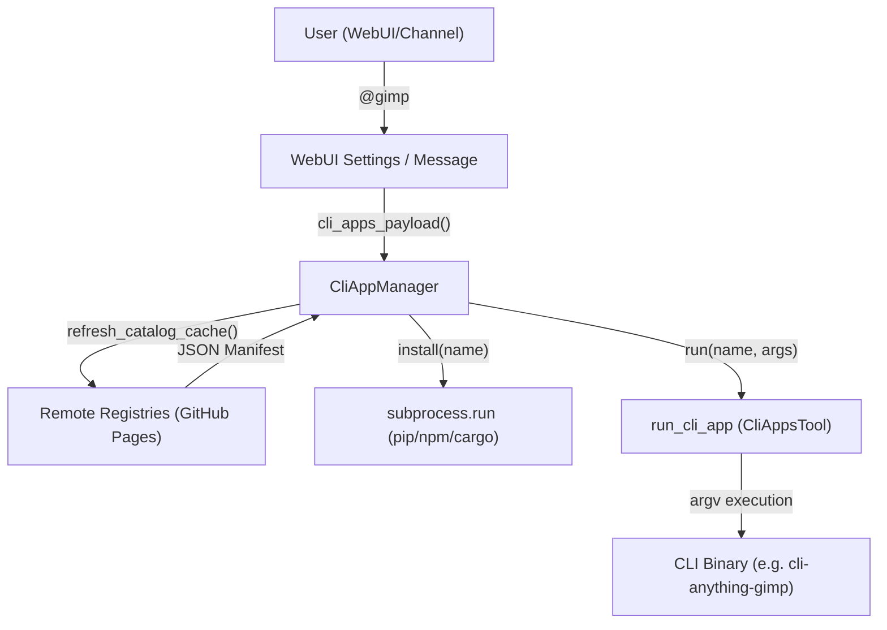
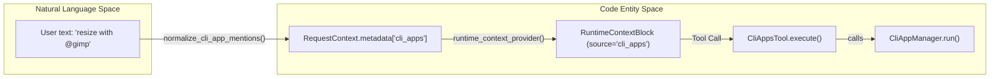
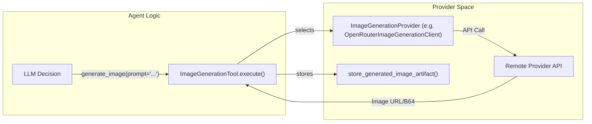

<!-- source: DeepWiki mcp.deepwiki.com · repo HKUDS/nanobot · page 7.4 CLI Apps (CLI-Anything) · fetched 2026-11-09 -->

# CLI Apps (CLI-Anything)

Relevant source files

The following files were used as context for generating this wiki page:

- [nanobot/apps/cli/service.py](nanobot/apps/cli/service.py)
- [nanobot/webui/cli_apps_api.py](nanobot/webui/cli_apps_api.py)
- [nanobot/webui/settings_routes.py](nanobot/webui/settings_routes.py)
- [tests/apps/test_cli_subprocess_env.py](tests/apps/test_cli_subprocess_env.py)
- [tests/cli_apps/test_service.py](tests/cli_apps/test_service.py)
- [tests/cli_apps/test_tool.py](tests/cli_apps/test_tool.py)
- [tests/webui/test_cli_apps_api.py](tests/webui/test_cli_apps_api.py)
- [tests/webui/test_settings_routes.py](tests/webui/test_settings_routes.py)

The CLI-Anything integration allows the Nanobot agent to discover, install, and execute a catalog of specialized command-line applications. These applications are treated as capabilities that extend the agent's functionality beyond its built-in tools, enabling tasks like image editing (GIMP), professional software automation, and integration with third-party services via their official CLIs.

## Overview and Registry Sources

The system relies on a decentralized registry architecture where application manifests are fetched from remote JSON sources. These sources define the installation commands, entry points, and metadata for each application.

| Source | URL | Description |
| :--- | :--- | :--- |
| **harness** | `https://hkuds.github.io/CLI-Anything/registry.json` | Curated core CLI-Anything applications. |
| **public** | `https://hkuds.github.io/CLI-Anything/public_registry.json` | Community-contributed applications. |
| **extensions** | `https://raw.githubusercontent.com/Re-bin/nanobot-extension/main/registry.json` | Nanobot-specific extensions and tools. |

**Sources:** [nanobot/apps/cli/service.py:28-38]()

## CliAppManager Lifecycle

The `CliAppManager` class is the central orchestrator for the CLI-Anything ecosystem. It manages the local cache of remote registries, tracks installation states, and provides a safe execution environment.

### Data Flow: Catalog to Execution

The following diagram illustrates how a user request for a CLI app (e.g., via a `@mention` in the WebUI) flows through the system to execution.

**CLI App Execution Flow**

**Sources:** [nanobot/apps/cli/service.py:210-250](), [nanobot/webui/cli_apps_api.py:106-123](), [nanobot/agent/tools/cli_apps.py:9-40]()

### Key Functions and Classes

- **`CliAppManager`**: Manages the lifecycle of CLI apps, including caching, installation verification, and execution. [nanobot/apps/cli/service.py:210]().
- **`CliAppsRuntimeConfig`**: Configures timeouts for installation (`install_timeout`) and execution (`run_timeout`), and the TTL for the catalog cache. [nanobot/apps/cli/service.py:92-98]().
- **`refresh_catalog_cache`**: Fetches and merges the remote registries into a local cache file. [nanobot/apps/cli/service.py:257]().
- **`install(name)`**: Executes the `install_cmd` defined in the manifest and verifies the `entry_point` is available in the system PATH using `shutil.which`. [nanobot/apps/cli/service.py:545]().

**Sources:** [nanobot/apps/cli/service.py:92-257](), [nanobot/apps/cli/service.py:545]()

## Manifest Format and Capabilities

Applications are described using a manifest format (version `agent-app.v1`). This format maps a human-friendly name to a technical execution strategy.

| Field | Description |
| :--- | :--- |
| `name` | The unique identifier used for installation and tool calls (e.g., `gimp`). |
| `install_cmd` | The command used to install the tool (e.g., `pip install ...`). |
| `entry_point` | The binary name expected to be in the PATH after installation. |
| `skill_md` | (Optional) Path to a `SKILL.md` file that provides the agent with usage instructions. |
| `logo_url` | Automatically generated based on brand aliases (`_BRAND_ALIASES`) or domain mappings (`_BRAND_DOMAINS`). |

**Sources:** [tests/cli_apps/test_service.py:41-127](), [nanobot/apps/cli/service.py:100-202]()

## Tool Integration: `run_cli_app`

The agent interacts with installed apps through the `CliAppsTool` (registered as `run_cli_app`). This tool provides a controlled interface for the LLM to invoke CLI binaries without using a full shell, mitigating shell injection risks.

### Runtime Context Injection

When a user mentions an app using the `@` symbol (e.g., "Use @gimp to resize this image"), the `CliAppsTool` injects a `RuntimeContextBlock` into the agent's prompt. This block informs the agent that the specific CLI capability is available and attached to the current turn.

**Context Association Diagram**

**Sources:** [tests/cli_apps/test_tool.py:131-158](), [nanobot/webui/cli_apps_api.py:58-85](), [nanobot/apps/cli/service.py:642]()

### Security and Sandboxing

- **No Shell**: Commands are executed using `argv` lists via `subprocess.run(shell=False)` to prevent shell injection. [nanobot/apps/cli/service.py:642]().
- **Workspace Restriction**: If `restrict_to_workspace` is enabled, the tool ensures the `working_dir` is within the project root using `is_path_within`. [nanobot/apps/cli/service.py:26](), [nanobot/apps/cli/service.py:642]().
- **Timeout Enforcement**: Every execution is wrapped in a timeout (default 60s) defined in `CliAppsRuntimeConfig` to prevent hanging processes. [nanobot/apps/cli/service.py:96]().
- **Environment Scrubbing**: API keys (e.g., `OPENAI_API_KEY`, `ANTHROPIC_API_KEY`) are explicitly removed from the subprocess environment to prevent credential leakage to CLI apps. [tests/apps/test_cli_subprocess_env.py:10-23]().

**Sources:** [nanobot/apps/cli/service.py:26](), [nanobot/apps/cli/service.py:96](), [nanobot/apps/cli/service.py:642](), [tests/apps/test_cli_subprocess_env.py:10-23]()

## Image Generation Integration

While CLI-Anything handles generic tools, specialized tools like `ImageGenerationTool` (registered as `generate_image`) provide deep integration for media tasks through various providers.

**Image Tool Mapping**

- **Persistence**: Images are stored in the `generated` directory under the nanobot media root. [nanobot/agent/tools/image_generation.py:57]().
- **Network Security**: Downloads from provider URLs use `PinnedDNSAsyncTransport` to prevent SSRF and access to private network ranges. [nanobot/providers/image_generation.py:171]().
- **Iterative Editing**: The tool accepts `reference_images`, allowing the agent to pass previously generated artifact paths back to the provider for refinement. [nanobot/agent/tools/image_generation.py:66-69]().
- **Provider Registry**: Supports a wide range of providers including OpenRouter, OpenAI, Gemini, Ollama, and AIHubMix via `get_image_gen_provider`. [nanobot/providers/image_generation.py:32]().

**Sources:** [nanobot/agent/tools/image_generation.py:49-82](), [nanobot/providers/image_generation.py:154-200](), [nanobot/agent/tools/image_generation.py:134-148]()

## WebUI Integration

The WebUI provides a management interface for CLI apps under the Settings panel. Users can browse the catalog, install/uninstall apps, and run connectivity tests.

- **Payload API**: `cli_apps_payload` returns the merged list of available and installed apps, including metadata for rendering logos and brand colors. [nanobot/webui/cli_apps_api.py:106-123]().
- **Action API**: `cli_apps_action` handles HTTP requests for `install`, `update`, `uninstall`, and `test`. [nanobot/webui/cli_apps_api.py:126-144]().
- **Dispatcher Routing**: Settings routes for CLI apps are handled by `WebUISettingsRouter` which dispatches to the CLI Apps API. [nanobot/webui/settings_routes.py:129-133]().
- **Throttling**: Catalog refreshes are throttled to once every 60 seconds to prevent rate-limiting from registry hosts. [nanobot/webui/cli_apps_api.py:25-46]().

**Sources:** [nanobot/webui/cli_apps_api.py:25-144](), [nanobot/webui/settings_routes.py:129-133]()

---

