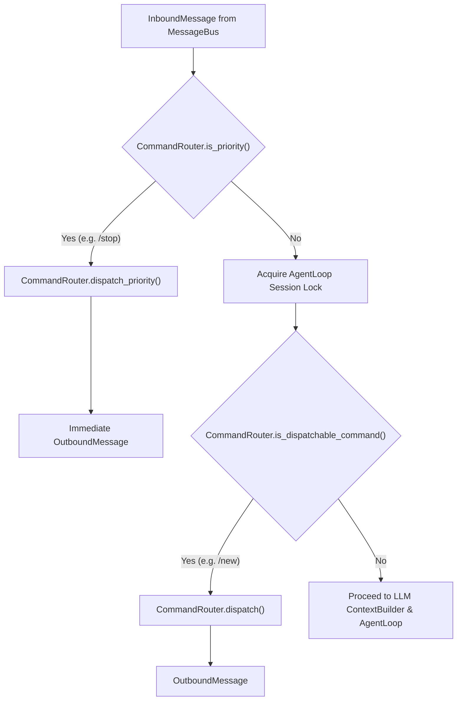
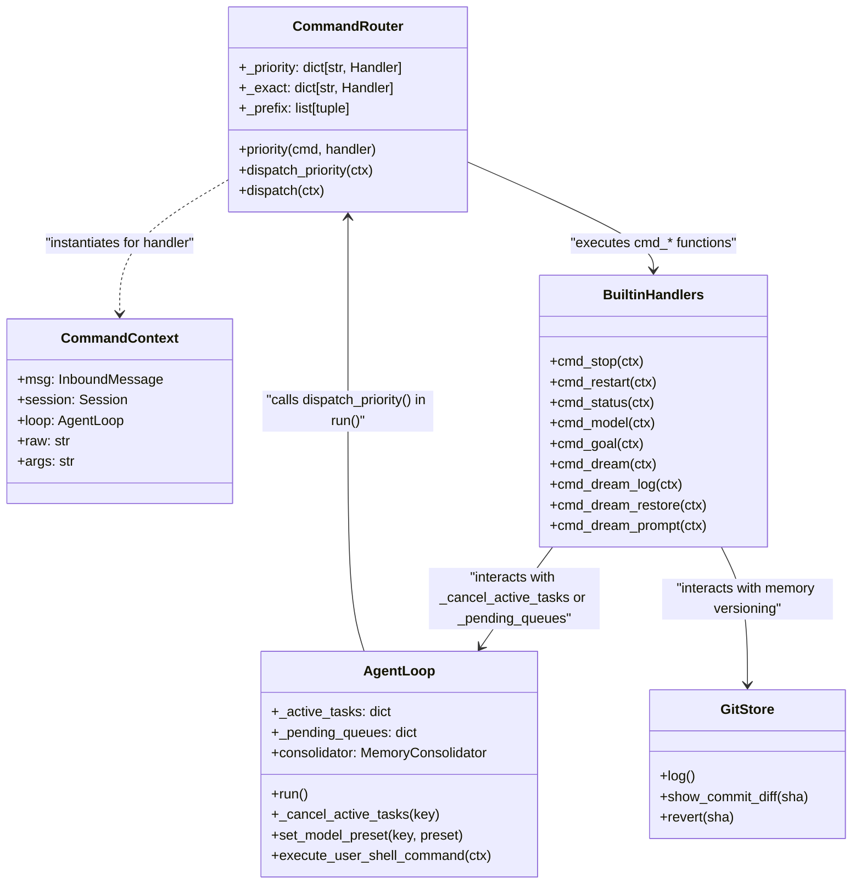
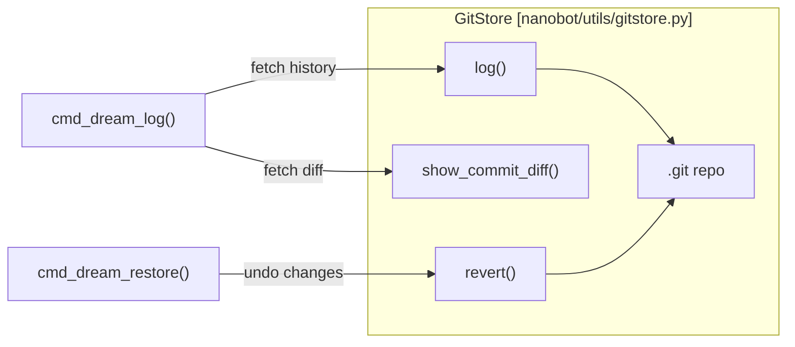

<!-- source: DeepWiki mcp.deepwiki.com · repo HKUDS/nanobot · page 9.1 Command Router & Built-in Commands · fetched 2026-11-09 -->

# Command Router & Built-in Commands

<details>
<summary>Relevant source files</summary>

The following files were used as context for generating this wiki page:

- [nanobot/command/builtin.py](nanobot/command/builtin.py)
- [nanobot/utils/gitstore.py](nanobot/utils/gitstore.py)
- [tests/agent/test_git_store.py](tests/agent/test_git_store.py)
- [tests/agent/test_loop_session_policy.py](tests/agent/test_loop_session_policy.py)
- [tests/command/test_builtin_dream.py](tests/command/test_builtin_dream.py)
- [tests/command/test_user_shell_command.py](tests/command/test_user_shell_command.py)
- [tests/tools/test_private_tool_logging.py](tests/tools/test_private_tool_logging.py)
- [tests/utils/test_gitstore.py](tests/utils/test_gitstore.py)

</details>


The `CommandRouter` is a specialized dispatch system within `nanobot` designed to handle slash commands (e.g., `/stop`, `/status`, `/new`) outside of the standard LLM reasoning loop. This architecture allows for immediate execution of system-level operations, even when the agent is busy or stuck in a long-running task.

## Overview of Command Routing

The system distinguishes between **Priority Commands**, which bypass the agent's execution lock to provide immediate control, and **Standard Commands**, which are handled as part of the normal message processing flow.

### Command Tiers
The `CommandRouter` organizes handlers into three distinct tiers checked in order:

| Tier | Description | Example |
| :--- | :--- | :--- |
| **Priority** | Exact matches handled before the `AgentLoop` dispatch lock. | `/stop`, `/restart` |
| **Exact** | Exact matches handled inside the dispatch lock. | `/new`, `/status` |
| **Prefix** | Longest-prefix-first matches for commands with arguments. | `/model [preset]` |

Sources: [nanobot/command/router.py:57-65](), [nanobot/command/builtin.py:65-181]()

## Technical Implementation

### CommandContext
Every command handler receives a `CommandContext` object, which encapsulates the state required to generate a response without needing to query the LLM.

```python
@dataclass
class CommandContext:
    msg: InboundMessage
    session: Session | None
    key: str
    raw: str
    args: str = ""
    loop: AgentLoop = field(kw_only=True)
    runtime: LLMRuntime | None = None
    is_user_turn: bool = False
    turn_scopes: list[AbstractContextManager[Any]] = field(default_factory=list)
```
Sources: [nanobot/command/router.py:42-55]()

### The Dispatch Flow
The `AgentLoop` interacts with the `CommandRouter` at two different stages. Priority commands are checked using `is_priority` [nanobot/command/router.py:82-83]() and `dispatch_priority` [nanobot/command/router.py:102-108]() before any session locks are acquired. This ensures the bot remains responsive even during heavy computation or tool execution.

**Command Interception Architecture**


Sources: [nanobot/command/router.py:82-108](), [tests/cli/test_restart_command.py:147-187]()

## Built-in Commands

Handlers for built-in slash commands are defined in `nanobot/command/builtin.py`. Metadata for these commands is stored in `BuiltinCommandSpec` objects [nanobot/command/builtin.py:43-62](). The `CommandLifecycle` determines how the command interacts with the WebUI state (e.g., `side_channel` vs `stop_active_turn`) [nanobot/command/builtin.py:32-38]().

### System Control Commands (Priority)
These commands execute regardless of whether the agent is currently processing another request.

*   **`/stop`**: Cancels all active tasks and subagents for the session. It calls `loop._cancel_active_tasks(ctx.key)` [nanobot/command/builtin.py:217]() and drains the `_pending_queues` to prevent mid-turn injection deadlocks. [nanobot/command/builtin.py:213-222]()
*   **`/restart`**: Triggers an in-place process restart. It sets restart metadata in environment variables via `set_restart_notice_to_env` [nanobot/command/builtin.py:230]() and uses either `os.execv` (Unix/Exec mode) or `subprocess.Popen` (Windows/Spawn mode) to replace the current process. [nanobot/command/builtin.py:225-268](), [tests/cli/test_restart_command.py:40-81]()
*   **`/status`**: Provides real-time telemetry, including model name, token usage, and active tasks. [nanobot/command/builtin.py:271-285]()

### Session & Model Commands (Standard)
These commands run within the agent's serial execution queue and are handled by `CommandRouter.dispatch`. [nanobot/command/router.py:110-123]()

*   **`/new`**: Resets the current session. It snapshots existing messages for archival, clears history, and invalidates the session cache. [nanobot/command/builtin.py:302-322]()
*   **`/model`**: Lists current and available model presets. If an argument is provided (e.g., `/model fast`), it switches the active model preset at runtime for the current session via `loop.set_model_preset`. [nanobot/command/builtin.py:334-358]()
*   **`/goal <goal>`**: Rewrites the user message into a long-running goal prompt, marking it with `goal_requested: True` in metadata. [nanobot/command/builtin.py:109-116](), [nanobot/command/builtin.py:382-396]()
*   **`/pairing`**: Manages user access requests. Supports `list`, `approve <code>`, `deny <code>`, and `revoke <user_id>`. [nanobot/command/builtin.py:174-180](), [nanobot/command/builtin.py:534-567]()
*   **`/trigger <name>`**: Creates a named local trigger bound to the current session. [nanobot/command/builtin.py:118-124](), [nanobot/command/builtin.py:399-415]()

### Memory & Dream Commands
*   **`/dream`**: Manually triggers memory consolidation via `loop.consolidator`. [nanobot/command/builtin.py:418-447]()
*   **`/dream-log`**: Shows the latest Dream memory change logs from `GitStore`. [nanobot/command/builtin.py:450-482]()
*   **`/dream-restore`**: Reverts memory to a previous Dream snapshot using `GitStore.revert`. [nanobot/command/builtin.py:485-508](), [nanobot/utils/gitstore.py:218-232]()
*   **`/dream-prompt`**: Configures how Dream organizes workspace memory by initializing the `prompts/dream.md` file. [nanobot/command/builtin.py:511-519]()

Sources: [nanobot/command/builtin.py:65-181](), [nanobot/command/router.py:57-123]()

## Status Telemetry
The `/status` command aggregates data from several core components. It utilizes `build_status_content` [nanobot/utils/helpers.py:17-17]() to format the final output, including cache hit rates [tests/test_build_status.py:7-20]().

| Metric | Source Entity | Implementation Detail |
| :--- | :--- | :--- |
| **Model** | `AgentLoop.model` | The currently active model name or preset. [nanobot/command/builtin.py:273]() |
| **Tokens** | `AgentLoop._last_usage` | Tracks `prompt_tokens`, `completion_tokens`, and `cache_read_tokens`. [nanobot/command/builtin.py:274](), [tests/test_build_status.py:12-12]() |
| **Active Tasks** | `AgentLoop._active_tasks` | Counts pending `asyncio.Task` objects and running subagents. [nanobot/command/builtin.py:274]()

Sources: [nanobot/command/builtin.py:271-285](), [nanobot/utils/helpers.py:17-17](), [tests/test_build_status.py:7-20]()

## Code Entity Mapping

The following diagram maps the command routing logic to the specific classes and functions in the codebase.


Sources: [nanobot/command/router.py:57-123](), [nanobot/command/builtin.py:204-567](), [tests/cli/test_restart_command.py:147-187](), [nanobot/utils/gitstore.py:47-232]()

### Memory Versioning Data Flow

The `/dream-log` and `/dream-restore` commands interact with the `GitStore` to manage memory history.


Sources: [nanobot/utils/gitstore.py:47-232](), [nanobot/command/builtin.py:450-508](), [tests/command/test_builtin_dream.py:56-102]()

---

