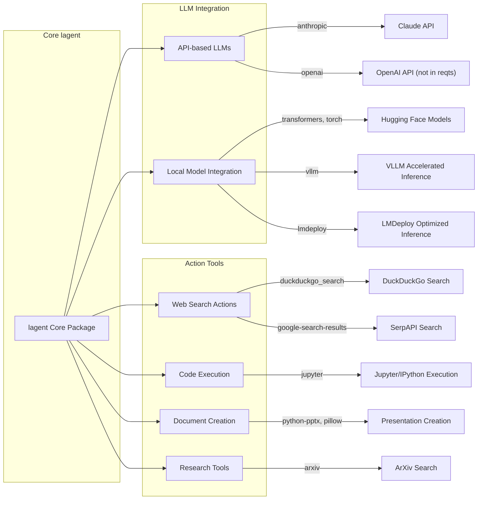
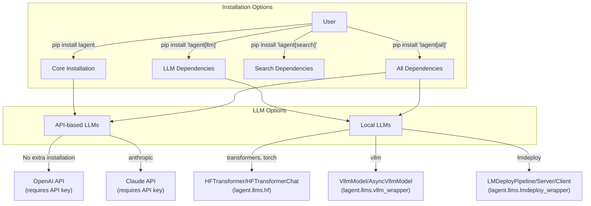
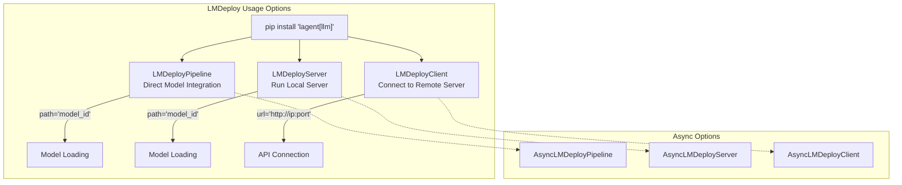

<!-- source: DeepWiki mcp.deepwiki.com · repo InternLM/lagent · page 1.1 Installation and Setup · fetched 2026-11-02 -->

# Installation and Setup

<details>
<summary>Relevant source files</summary>

The following files were used as context for generating this wiki page:

- [docs/en/changelog.md](docs/en/changelog.md)
- [lagent/llms/lmdeploy_wrapper.py](lagent/llms/lmdeploy_wrapper.py)
- [lagent/llms/vllm_wrapper.py](lagent/llms/vllm_wrapper.py)
- [lagent/version.py](lagent/version.py)
- [requirements/optional.txt](requirements/optional.txt)
- [requirements/runtime.txt](requirements/runtime.txt)

</details>


This guide provides instructions for installing lagent and setting up its components. It covers the basic installation process, managing dependencies, and configuring various optional components to enable different agent capabilities.

## Core Installation

You can install lagent directly from PyPI:

```bash
pip install lagent
```

For the latest development version, you can install directly from the GitHub repository:

```bash
pip install git+https://github.com/InternLM/lagent.git
```

The current stable version is 0.5.0rc3.

Sources: [lagent/version.py:1-27]()

## Dependencies

Lagent has both core dependencies and optional dependencies that enable specific functionality.

### Core Dependencies

The following dependencies are automatically installed with lagent:

```bash
pip install -r requirements/runtime.txt
```

Core dependencies include:

| Category | Dependencies |
|----------|--------------|
| Networking | `aiohttp`, `requests` |
| API Clients | `anthropic` |
| Research Tools | `arxiv` |
| Async Support | `asyncache`, `asyncer` |
| System | `distro`, `filelock` |
| Function Execution | `func_timeout`, `timeout-decorator` |
| Documentation | `griffe<1.0` |
| Data Handling | `json5`, `jsonschema`, `pydantic==2.6.4` |
| Interactive Computing | `jupyter==1.0.0`, `jupyter_client==8.6.2`, `jupyter_core==5.7.2` |
| Utilities | `tenacity`, `termcolor`, `tiktoken`, `typing-extensions` |

Sources: [requirements/runtime.txt:1-22]()

### Optional Dependencies

Different features require additional dependencies:

```bash
pip install -r requirements/optional.txt
```

Here are the key optional dependencies:

| Feature | Dependencies | Purpose |
|---------|--------------|---------|
| Web Search | `duckduckgo_search==5.3.1b1`, `google-search-results` | Enable web browsing and search actions |
| Local Model Deployment | `lmdeploy>=0.2.5`, `vllm>=0.3.3` | Run models locally with optimized inference |
| Model Integration | `torch`, `transformers>=4.34,<=4.40` | Support for Hugging Face models |
| Content Creation | `pillow`, `python-pptx` | Enable presentation creation actions |
| Execution Control | `timeout_decorator` | Handle timeouts in actions |

Sources: [requirements/optional.txt:1-10]()

## Installation with Specific Features

You can install lagent with specific optional dependencies using pip extras:

### For all optional dependencies:

```bash
pip install "lagent[all]"
```

### For specific features:

```bash
# For local LLM support
pip install "lagent[llm]"

# For web search capabilities
pip install "lagent[search]"

# For document creation
pip install "lagent[ppt]"
```

## Component Dependencies Diagram



Sources: [requirements/runtime.txt:1-22](), [requirements/optional.txt:1-10]()

## LLM Integration Options

Lagent supports multiple LLM backends through a unified interface. Depending on your needs, you'll need to install and configure different dependencies.

### Model Integration Paths



Sources: [lagent/llms/lmdeploy_wrapper.py:1-802](), [lagent/llms/vllm_wrapper.py:1-177]()

## Configuration for LLM Backends

After installation, you need to configure each LLM backend:

### API-based LLM Configuration

For API-based models like OpenAI, you'll need to set the appropriate API keys:

```python
# Example for OpenAI
import os
os.environ["OPENAI_API_KEY"] = "your-api-key"

# Example for Claude
os.environ["ANTHROPIC_API_KEY"] = "your-api-key"
```

### Local LLM Configuration

For local models, you'll need to provide the appropriate model paths or Hugging Face model ids:

```python
# For Hugging Face models
from lagent.llms import HFTransformer
llm = HFTransformer(path="internlm/internlm-chat-7b")

# For VLLM accelerated inference
from lagent.llms import VllmModel
llm = VllmModel(path="internlm/internlm-chat-7b", tp=2)  # tensor parallel = 2

# For LMDeploy optimized inference
from lagent.llms import LMDeployPipeline
llm = LMDeployPipeline(path="internlm/internlm-chat-7b", tp=2)
```

Sources: [lagent/llms/lmdeploy_wrapper.py:210-266](), [lagent/llms/vllm_wrapper.py:18-42]()

## LMDeploy Setup

If you want to use LMDeploy for optimized inference, additional setup is required. LMDeploy offers three deployment patterns:

1. **Pipeline**: Direct integration with the model
2. **Server**: Running a local server with the model
3. **Client**: Connecting to a remote LMDeploy server



Sources: [lagent/llms/lmdeploy_wrapper.py:210-502]()

## Verification of Installation

You can verify your installation with a simple test:

```python
from lagent import get_version

print(f"Lagent version: {get_version()}")
```

To test a specific LLM connection:

```python
# For API-based models
from lagent.llms import GPTAPI
llm = GPTAPI()
response = llm.generate("Hello, world!")
print(response)

# For local models
from lagent.llms import HFTransformer
llm = HFTransformer(path="internlm/internlm-chat-7b")
response = llm.generate("Hello, world!")
print(response)
```

## Next Steps

After completing the installation and setup:

1. Learn about the Agent System to understand how to create and use different types of agents. See [Agent System](#2.1).
2. Explore the LLM Integration options in more detail. See [LLM Integration](#2.2).
3. Discover the available actions and tools that your agents can use. See [Action System](#2.3).

For practical usage examples, check [Usage Examples](#4).

---

