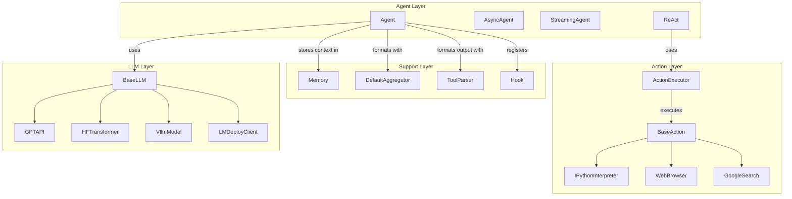
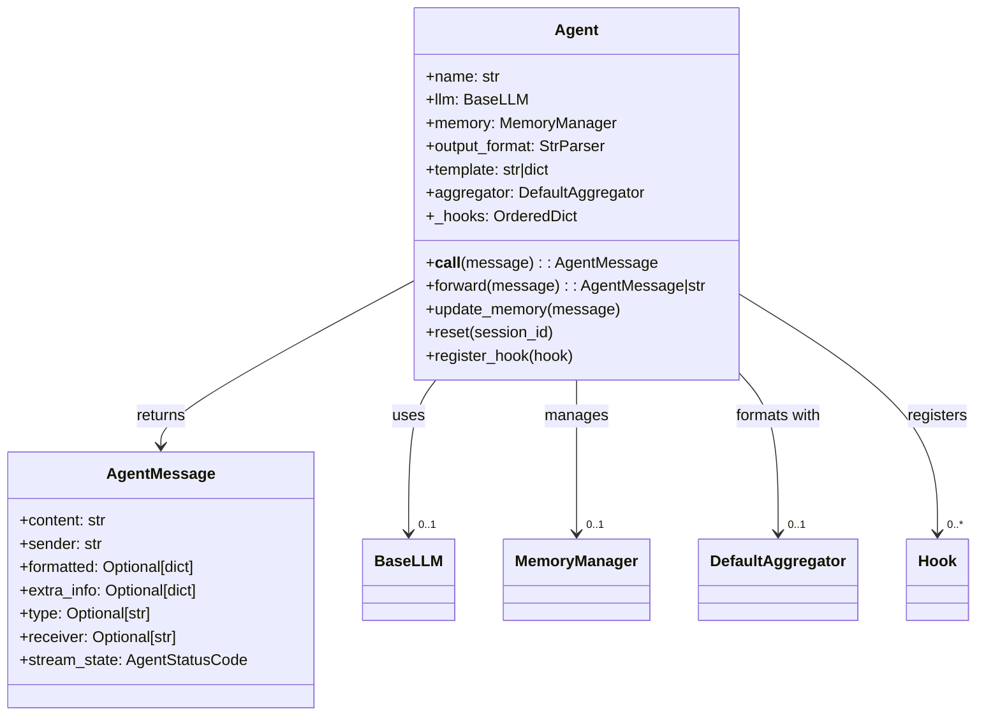
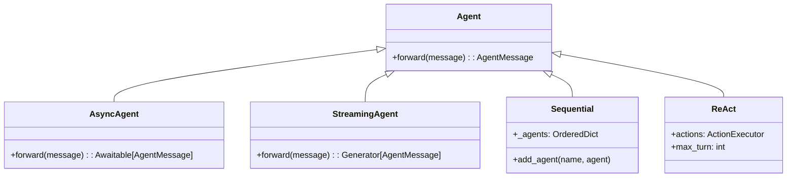
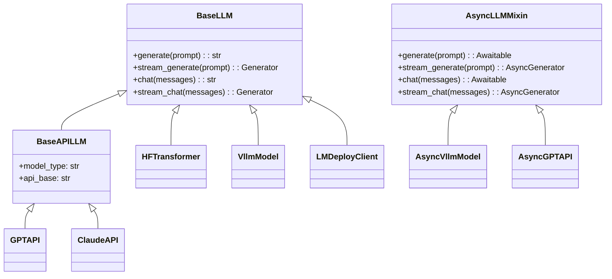
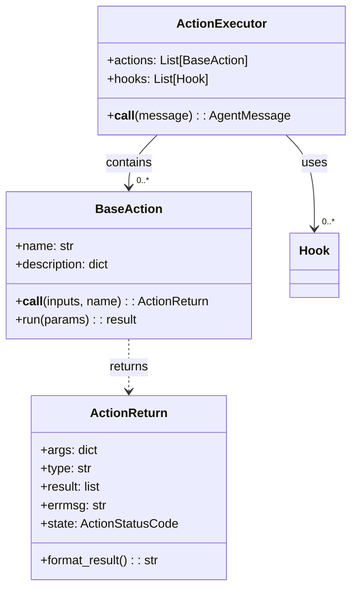
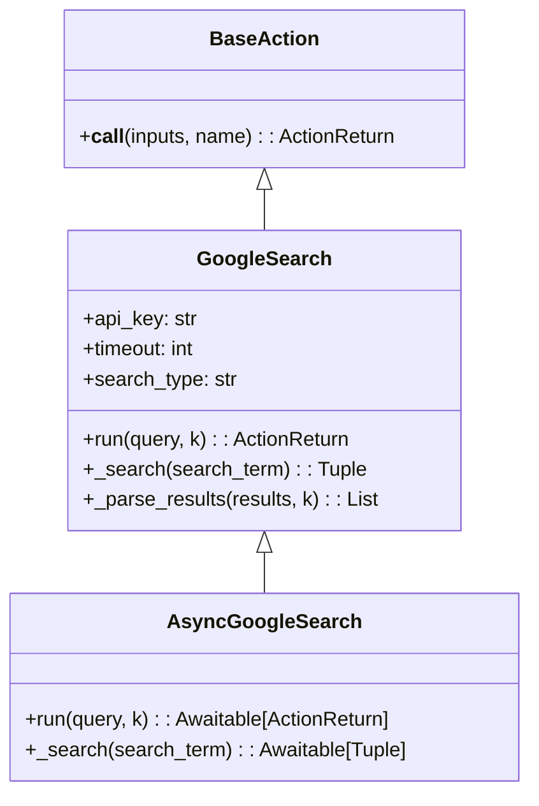
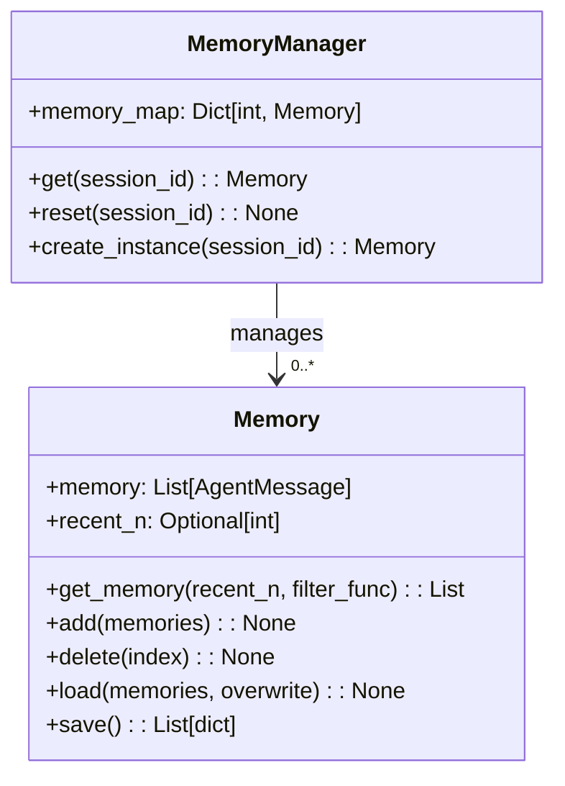
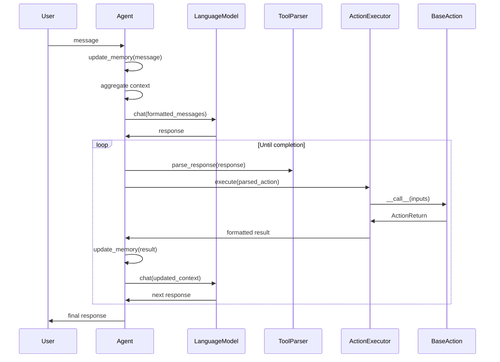

<!-- source: DeepWiki mcp.deepwiki.com · repo InternLM/lagent · page 2 Core Components · fetched 2026-11-02 -->

# Core Components

Relevant source files

The following files were used as context for generating this wiki page:

- [.pre-commit-config.yaml](.pre-commit-config.yaml)
- [README.md](README.md)
- [lagent/actions/base_action.py](lagent/actions/base_action.py)
- [lagent/actions/google_search.py](lagent/actions/google_search.py)
- [lagent/agents/__init__.py](lagent/agents/__init__.py)
- [lagent/agents/agent.py](lagent/agents/agent.py)
- [lagent/llms/__init__.py](lagent/llms/__init__.py)
- [lagent/memory/base_memory.py](lagent/memory/base_memory.py)
- [tests/test_actions/test_google_search.py](tests/test_actions/test_google_search.py)

This page provides an overview of the key components and architecture that make up the LAgent framework. It covers the fundamental building blocks of the system, their responsibilities, and how they work together to enable the creation of LLM-powered agents.

For specific information about individual components, see their dedicated pages: [Agent System](#2.1), [LLM Integration](#2.2), and [Action System](#2.3).

## Core Architecture Overview

LAgent is designed with a modular architecture focused on flexibility and extensibility. The framework is built around several primary components:

- **Agents**: The central orchestrators that manage conversations and tool use
- **Language Models (LLMs)**: The reasoning engines powering agents
- **Actions**: Tools that agents can use to interact with the world
- **Support Systems**: Memory, hooks, parsers, and aggregators that enhance agent capabilities

The following diagram illustrates the high-level relationships between these components:

Sources: [lagent/agents/agent.py:18-177](), [lagent/llms/__init__.py:1-40](), [lagent/actions/base_action.py:277-394]()

## Agent System

The agent system serves as the central orchestration layer of the framework. Agents manage interactions with LLMs, store conversation history, execute actions, and handle message formatting.

### Base Agent Class

The `Agent` class is the foundational component. It processes user messages, sends them to the LLM, interprets responses, and maintains conversation context through a memory system.

Key responsibilities of the `Agent` class include:
- Managing conversation state through a memory system
- Formatting prompts through aggregators
- Communicating with LLMs
- Processing LLM outputs through parsers
- Supporting extension through hooks

Sources: [lagent/agents/agent.py:18-108]()

### Agent Variants

LAgent provides several specialized agent types to handle different scenarios:

- **Agent**: Base synchronous agent for standard interactions
- **AsyncAgent**: Asynchronous variant for non-blocking operations
- **StreamingAgent**: Agent that returns responses in chunks as they're generated
- **Sequential**: Container for chaining multiple agents together
- **ReAct**: Specialized agent implementing the Reasoning and Acting paradigm

Sources: [lagent/agents/__init__.py:1-33](), [lagent/agents/agent.py:210-303](), [lagent/agents/agent.py:315-360]()

## LLM System

The LLM system provides a unified interface for working with various language models, whether they're API-based (OpenAI, Claude) or locally deployed (via Hugging Face, vLLM, or LMDeploy).

### LLM Abstraction

The `BaseLLM` class defines the standard interface that all language models implement:

Sources: [lagent/llms/__init__.py:1-40]()

### LLM Implementation Classes

LAgent supports multiple LLM implementations:

| LLM Type | Implementation Classes | Description |
|----------|------------------------|-------------|
| API-based | `GPTAPI`, `ClaudeAPI`, `SensenovaAPI` | Connect to remote API services like OpenAI, Anthropic |
| Local Models | `HFTransformer`, `VllmModel` | Run models locally using frameworks like Hugging Face, vLLM |
| Deployment | `LMDeployClient`, `LMDeployPipeline`, `LMDeployServer` | Deploy models with optimized inference using LMDeploy |

Each implementation class has both synchronous and asynchronous variants (prefixed with "Async") to support different application requirements.

Sources: [lagent/llms/__init__.py:1-40]()

## Action System

The action system enables agents to interact with the external world through tools. It provides a standardized interface for defining, executing, and handling the results of actions.

### BaseAction and ActionExecutor

The `BaseAction` class is the foundation for all tools in the system. Each action implements functionality that an agent can invoke, such as searching the web, executing code, or retrieving information.

The `ActionExecutor` manages the execution of actions and provides a uniform interface for agents to use them.

Sources: [lagent/actions/base_action.py:277-394]()

### Built-in Actions

LAgent provides several built-in actions for common tasks:

| Action Type | Implementation | Description |
|-------------|---------------|-------------|
| Web Interaction | `WebBrowser`, `GoogleSearch` | Search the web, navigate websites, retrieve content |
| Code Execution | `IPythonInterpreter`, `PythonInterpreter` | Execute Python code in isolated environments |
| Research | `ArxivSearch`, `GoogleScholar` | Access academic papers and research information |
| Content Creation | `PPT` | Create presentations and documents |

Example of the Google Search implementation:

Sources: [lagent/actions/google_search.py:12-244]()

## Support Systems

LAgent includes several support systems that enhance agent capabilities:

### Memory Management

The `Memory` class stores conversation history and provides methods for retrieving, adding, and manipulating stored messages.

Sources: [lagent/memory/base_memory.py:1-60]()

### Message Aggregation

The `DefaultAggregator` class is responsible for formatting messages from the agent's memory into a format suitable for sending to the LLM. It provides methods for:

- Converting agent messages to LLM-compatible formats
- Adding system instructions
- Handling message formatting for different LLM providers

### Hooks

The hook system allows for intercepting and modifying behavior at various points in the agent execution flow. Hooks can be registered with agents to:

- Preprocess messages before they're sent to the LLM
- Postprocess messages after they're received from the LLM
- Modify actions before execution
- Process action results

### Output Parsing

The parsing system extracts structured information from LLM outputs. The `ToolParser` class can be used to identify when an LLM is attempting to use a tool and extract the parameters.

## Key Communication Patterns

The core components of LAgent interact through well-defined patterns:

1. **User Input Flow**:
   - User sends a message to an Agent
   - Agent adds message to Memory
   - Agent uses Aggregator to format conversation context
   - Agent sends formatted context to LLM
   - LLM generates a response

2. **Action Execution Flow**:
   - LLM response indicates an action should be executed
   - Agent extracts action details via Parser
   - Agent passes action to ActionExecutor
   - ActionExecutor invokes the appropriate BaseAction
   - Action results are returned to Agent
   - Agent sends updated context with action results to LLM for next step

Sources: [README.md:30-276](), [lagent/agents/agent.py:80-93]()

## Customization Options

LAgent provides several customization points for extending the framework:

- **Custom Agents**: Create new agent types by inheriting from the `Agent` class
- **Custom Actions**: Create new tools by implementing the `BaseAction` interface
- **Custom Aggregators**: Modify message formatting by creating new aggregator classes
- **Custom Hooks**: Intercept and modify agent behavior by implementing hooks
- **Custom Parsers**: Extract structured information from LLM outputs with custom parsers

## Synchronous vs. Asynchronous APIs

Most components in LAgent provide both synchronous and asynchronous interfaces, allowing developers to choose the appropriate programming model for their application:

- Synchronous APIs are simpler to use and better for debugging
- Asynchronous APIs enable higher throughput and better resource utilization in production

The framework maintains a consistent naming convention, prefixing asynchronous variants with "Async" (e.g., `Agent` vs. `AsyncAgent`).

Sources: [README.md:280-418]()

---

