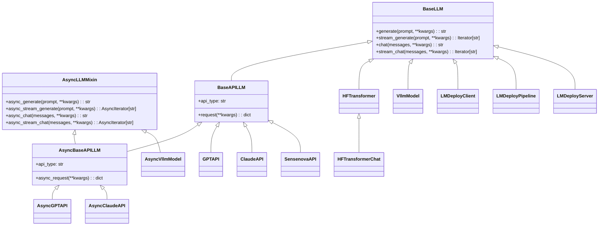
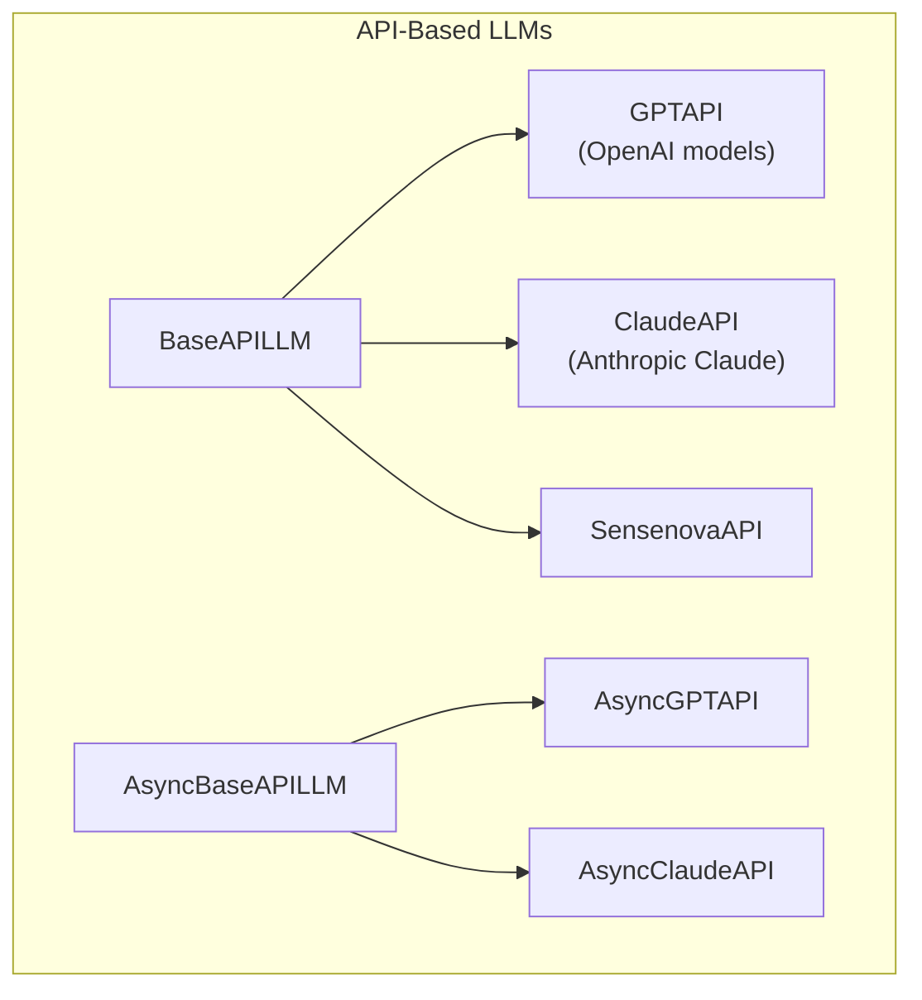
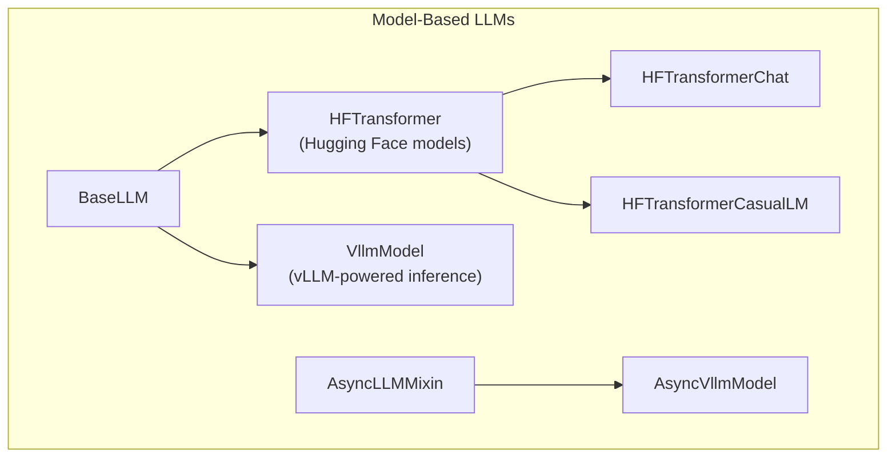
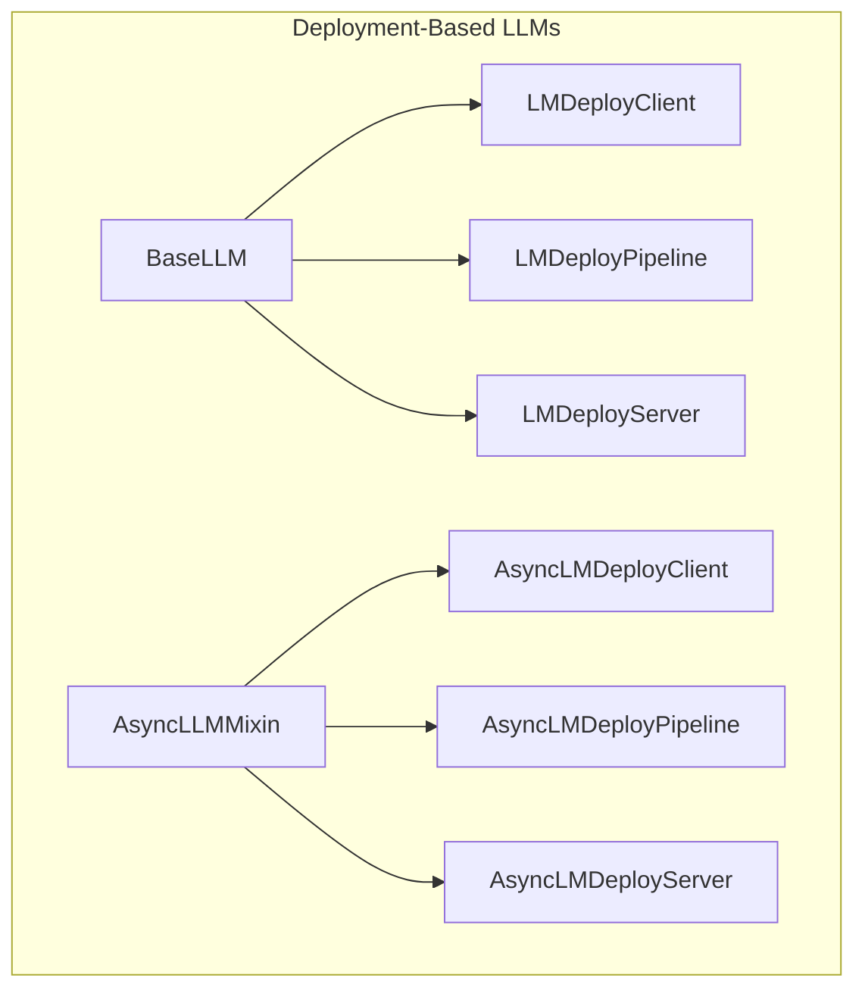
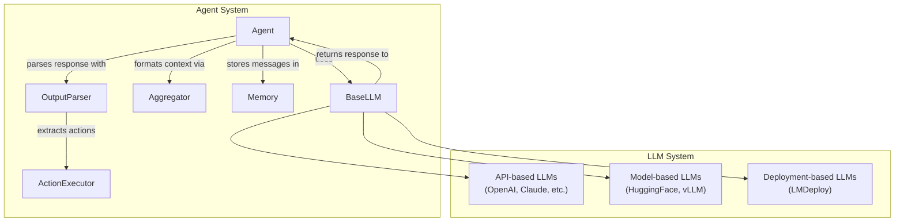
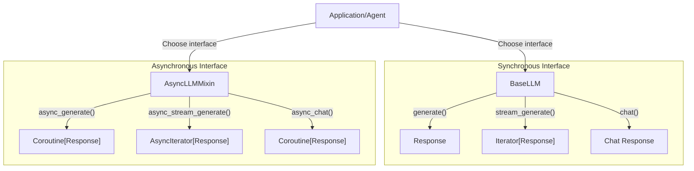
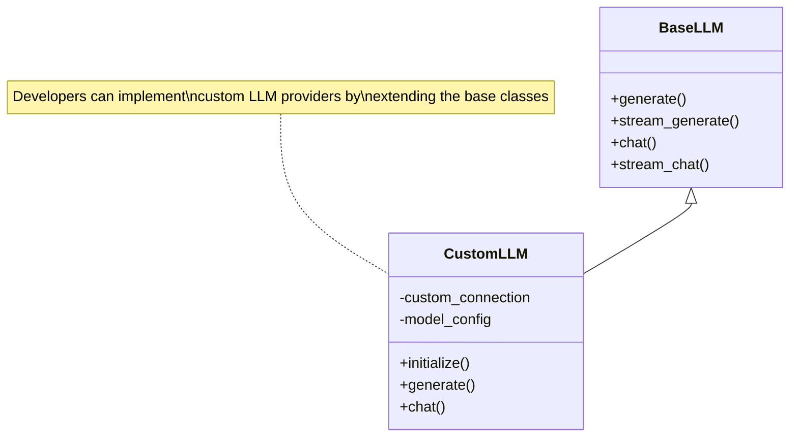

<!-- source: DeepWiki mcp.deepwiki.com · repo InternLM/lagent · page 2.2 LLM Integration · fetched 2026-11-02 -->

# LLM Integration

<details>
<summary>Relevant source files</summary>

The following files were used as context for generating this wiki page:

- [.pre-commit-config.yaml](.pre-commit-config.yaml)
- [README.md](README.md)
- [lagent/llms/__init__.py](lagent/llms/__init__.py)

</details>


This page documents how lagent integrates with different Language Model providers to enable agent capabilities. It covers the LLM abstraction layer architecture, supported LLM providers, and implementation details for both API-based and locally-deployed models.

For information about implementing agents that use these LLMs, see [Agent System](#2.1). For details on action execution capabilities that agents can use, see [Action System](#2.3).

## 1. LLM Abstraction Architecture

The lagent framework implements a flexible abstraction layer that provides a common interface for different types of language models. This allows agents to work with various LLMs interchangeably while maintaining consistent behavior.



Sources: [lagent/llms/__init__.py:1-41]()

The LLM abstraction system defines a consistent interface with core methods for text generation:

1. **Core Interface Methods**:
   - `generate()`: Generate text completion from a prompt
   - `stream_generate()`: Stream text completion from a prompt
   - `chat()`: Generate response to a conversation
   - `stream_chat()`: Stream response to a conversation
   - Async variants of each method (provided by AsyncLLMMixin)

## 2. Types of LLM Implementations

The lagent framework provides three main types of LLM implementations:

### 2.1 API-based LLMs

These implementations connect to cloud-based LLM services through their REST APIs.



Sources: [lagent/llms/__init__.py:1-2](), [lagent/llms/__init__.py:14-15](), [lagent/llms/__init__.py:15-16]()

API-based LLMs handle authentication, request formatting, and response parsing for their respective services. For example, the OpenAI implementation accepts API keys and converts between lagent's message format and the format expected by the OpenAI API.

### 2.2 Model-based LLMs

These implementations support running models locally using frameworks like Hugging Face Transformers and vLLM.



Sources: [lagent/llms/__init__.py:4](), [lagent/llms/__init__.py:16]()

Model-based LLMs typically require model paths and generation parameters, allowing for flexible configuration of locally-deployed models. They handle loading models, tokenization, and generation logic.

### 2.3 Deployment-based LLMs

These implementations support models deployed through optimization frameworks like LMDeploy, focusing on inference efficiency and scalability.



Sources: [lagent/llms/__init__.py:5-12]()

LMDeploy variants offer optimized inference performance with different deployment options:
- Client: Connects to a running LMDeploy service
- Pipeline: Uses LMDeploy's pipeline API for local inference
- Server: Interfaces with a deployed LMDeploy server

## 3. LLM Integration in the Agent Framework

Language models are a core component in the agent architecture, serving as the "brain" that powers agent reasoning and decision-making.



Sources: [README.md:105-116]()

In the agent workflow:
1. The agent receives a user message
2. The message is stored in memory
3. The aggregator formats the conversation history into LLM-compatible messages
4. The LLM generates a response
5. The output parser extracts structured information (like tool calls)
6. If needed, tools are executed and their results are fed back to the LLM

## 4. Configuring LLMs

Each LLM implementation has specific configuration options. Here are common configuration patterns:

### 4.1 API-based LLM Configuration

API-based LLMs typically require API keys and model names:

```python
from lagent.llms import GPTAPI

llm = GPTAPI(
    model_type="gpt-4o",  # Model name
    key="YOUR_API_KEY",   # API key
    retry=5,              # Number of retry attempts
    max_new_tokens=1024   # Maximum tokens to generate
)
```

### 4.2 Local Model Configuration 

Model-based LLMs require model paths and generation parameters:

```python
from lagent.llms import VllmModel, INTERNLM2_META

llm = VllmModel(
    path='Qwen/Qwen2-7B-Instruct',  # Model path
    meta_template=INTERNLM2_META,    # Template configuration
    tp=1,                           # Tensor parallelism
    top_k=1,                        # Top-k sampling parameter
    temperature=1.0,                # Temperature for sampling
    stop_words=['<|im_end|>'],      # Stop tokens
    max_new_tokens=1024             # Maximum tokens to generate
)
```

Sources: [README.md:45-53](), [README.md:308-317]()

### 4.3 Deployment Configuration

LMDeploy implementations connect to optimized deployments:

```python
from lagent.llms import LMDeployClient

llm = LMDeployClient(
    model_path="internlm2-chat-7b",  # Model identifier
    port=23333,                     # Server port
    host="localhost"                # Server host
)
```

## 5. Dual Interface Design

Lagent implements both synchronous and asynchronous interfaces for most LLM implementations, allowing developers to choose based on their application needs.



Sources: [README.md:281-289]()

The dual interface design is particularly useful for:
- **Synchronous**: Debugging, interactive applications, and simpler workflows
- **Asynchronous**: High-throughput applications, backend services, and concurrent processing

## 6. Extension and Customization

The LLM abstraction system is designed to be extensible. Developers can:

1. Implement their own LLM providers by extending `BaseLLM` or `BaseAPILLM`
2. Configure model-specific behavior through templates and parameters
3. Integrate with new model deployment technologies



To implement a custom LLM, developers need to:
1. Extend the appropriate base class (BaseLLM or BaseAPILLM)
2. Implement the required methods (generate, chat, etc.)
3. Handle any specific tokenization, prompting, or response parsing

## Summary

The LLM integration in lagent provides a flexible abstraction over various language model implementations, allowing agents to work with different models through a consistent interface. The system supports API-based models (like OpenAI and Claude), locally-deployed models (via Hugging Face and vLLM), and optimized deployments (via LMDeploy). The dual synchronous/asynchronous interface design accommodates different application needs, making the framework suitable for a wide range of agent-based applications.

Sources: [lagent/llms/__init__.py:1-41](), [README.md:36-62]()

---

