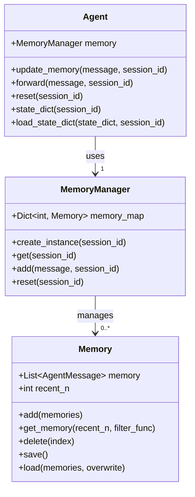
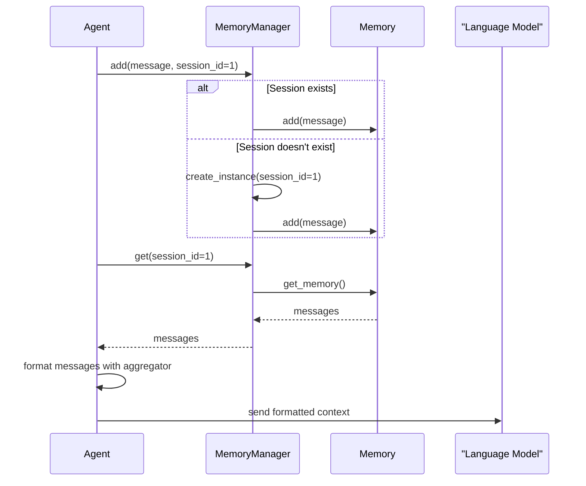
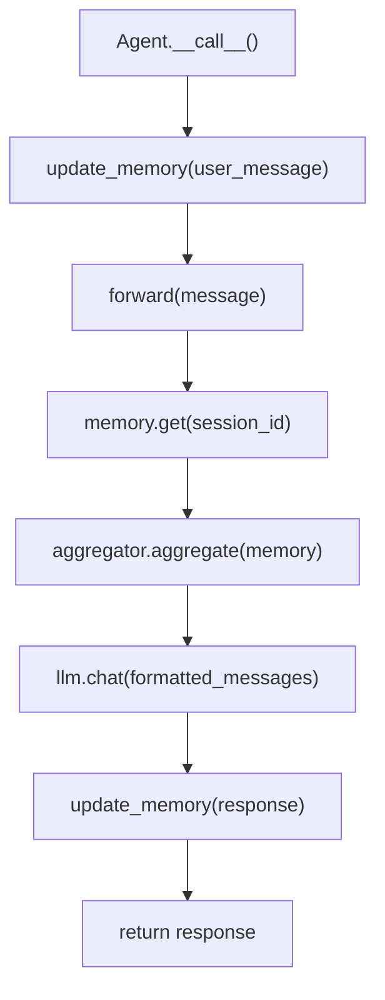
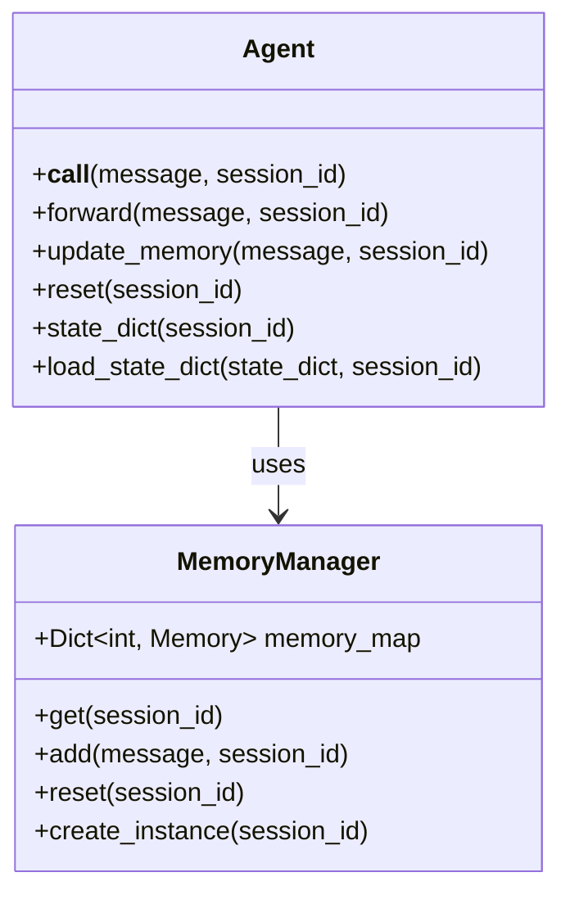
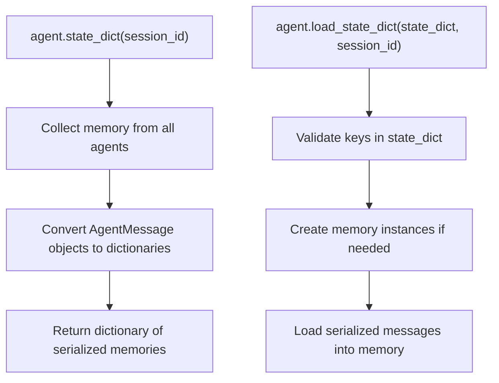
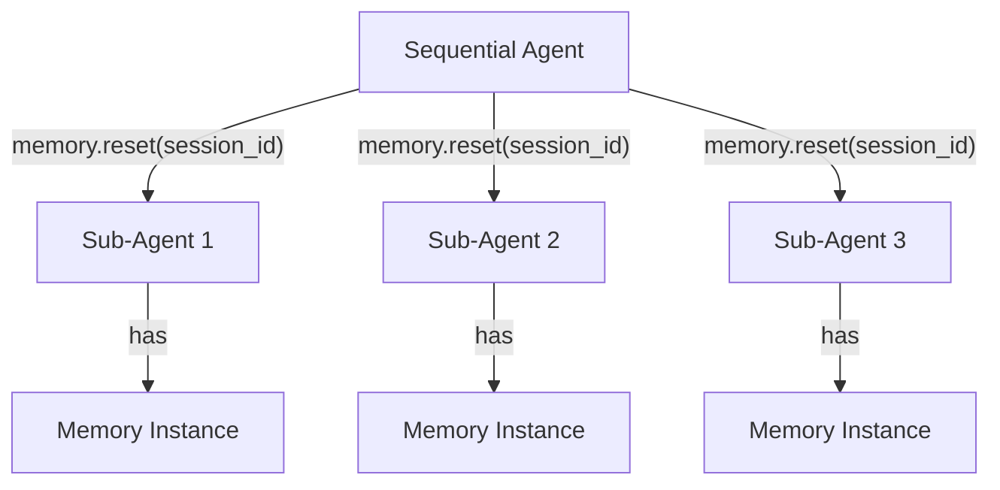

<!-- source: DeepWiki mcp.deepwiki.com · repo InternLM/lagent · page 3.1 Memory Management · fetched 2026-11-02 -->

# Memory Management

<details>
<summary>Relevant source files</summary>

The following files were used as context for generating this wiki page:

- [lagent/agents/__init__.py](lagent/agents/__init__.py)
- [lagent/agents/agent.py](lagent/agents/agent.py)
- [lagent/memory/base_memory.py](lagent/memory/base_memory.py)

</details>


## Purpose and Scope

This document explains the memory management system in the LAgent framework, which enables agents to maintain conversation context and history. Memory management is a critical component that allows agents to retain information across multiple conversation turns, helping them provide more coherent and context-aware responses.

The memory system in LAgent is responsible for:
- Storing conversation history with users and tool interactions
- Providing context to language models during agent operations
- Supporting multiple concurrent conversation sessions
- Enabling state persistence and restoration

For information about hooks and middleware (which can extend memory functionality), see [Hooks and Middleware](#3.2).

## Memory Architecture

The memory management system in LAgent consists of two primary components:
1. **Memory**: The base storage class that maintains a list of conversation messages
2. **MemoryManager**: A manager class that handles multiple memory instances across different sessions



Sources: [lagent/memory/base_memory.py:1-61](), [lagent/agents/agent.py:38-56]()

## Memory Class

The `Memory` class is the fundamental unit of memory storage in LAgent. It maintains an ordered list of `AgentMessage` objects and provides methods for accessing and manipulating this history.

### Key Features

- **Message Storage**: Maintains a chronological list of all messages in a conversation
- **Windowed Access**: Ability to retrieve only the most recent N messages
- **Filtering**: Support for custom filtering functions to select specific messages
- **Serialization**: Methods to save and load conversation history

### Core Methods

| Method | Description |
|--------|-------------|
| `add(memories)` | Adds one or more messages to memory |
| `get_memory(recent_n, filter_func)` | Retrieves messages, optionally filtered and limited to most recent |
| `delete(index)` | Removes messages at specified index(es) |
| `save()` | Serializes memory content to a list of dictionaries |
| `load(memories, overwrite)` | Loads messages from serialized format |

Sources: [lagent/memory/base_memory.py:6-60]()

## Memory Manager

The `MemoryManager` is responsible for managing multiple memory instances, each associated with a different conversation session. It's created when an agent is initialized and serves as the primary interface for memory operations.



Sources: [lagent/agents/agent.py:51-64](), [lagent/agents/agent.py:85-93]()

## Agent Memory Integration

Agents in LAgent integrate memory management directly in their conversation flow:

1. When an agent receives a message, it first stores it in memory
2. The agent then aggregates context from memory to create a prompt for the LLM
3. After receiving a response from the LLM, the agent stores this response in memory
4. This cycle continues, building up conversation history

### Memory Update Flow



Sources: [lagent/agents/agent.py:66-83](), [lagent/agents/agent.py:85-93]()

## Session Management

LAgent's memory system supports multiple concurrent conversations through session IDs:

- Each session has its own independent memory instance
- Session IDs are typically integers, with 0 as the default
- Agents maintain separate conversation history for each session
- Sessions can be independently reset, saved, or loaded

### Session Handling in Agents



Sources: [lagent/agents/agent.py:62-64](), [lagent/agents/agent.py:85-93](), [lagent/agents/agent.py:145-160]()

## State Management

LAgent provides methods to save and load the state of agent conversations, enabling:
- Persistence across application restarts
- Transfer of conversations between agents
- Checkpointing of conversation state

### State Serialization

The `state_dict` method serializes the memory state:



Sources: [lagent/agents/agent.py:102-138]()

## Memory in Agent Containers

LAgent supports composite agents through containers like `Sequential`, `AgentList`, and `AgentDict`. These containers handle memory in special ways:

- Each sub-agent maintains its own independent memory
- State operations cascade to all sub-agents
- Reset operations can target specific sub-agents

### Memory Hierarchy



Sources: [lagent/agents/agent.py:145-160](), [lagent/agents/agent.py:316-359]()

## Usage Examples

### Basic Memory Access

When creating an agent, the memory is automatically initialized:

```python
from lagent.agents import Agent
from lagent.llms import GPTAPI

agent = Agent(llm=GPTAPI())  # Memory instantiated with default settings

# Send messages that get stored in memory
response = agent("What is machine learning?", session_id=1)
response = agent("Can you provide an example?", session_id=1)

# Reset memory for a specific session
agent.reset(session_id=1)
```

### Saving and Loading State

For persistence across sessions:

```python
# After conversation
state = agent.state_dict(session_id=1)

# Save state (e.g., to file)
import json
with open("conversation.json", "w") as f:
    json.dump(state, f)

# Later, load the state back
with open("conversation.json", "r") as f:
    state = json.load(f)
agent.load_state_dict(state, session_id=1)
```

Sources: [lagent/agents/agent.py:102-138](), [lagent/agents/agent.py:145-160]()

## Advanced Memory Management

### Custom Memory Filtering

The memory system supports custom filtering to retrieve specific message types:

```python
# Example: Filter to only show user messages
memory = agent.memory.get(session_id=1)
user_messages = memory.get_memory(filter_func=lambda i, m: m.sender == "user")
```

### Memory Window Limits

To control context length, you can limit to recent messages:

```python
# Create memory with a sliding window of 10 messages
from lagent.agents import Agent
from lagent.memory import Memory

agent = Agent(memory=dict(type=Memory, recent_n=10))
```

Sources: [lagent/memory/base_memory.py:12-24](), [lagent/agents/agent.py:38-51]()

---

