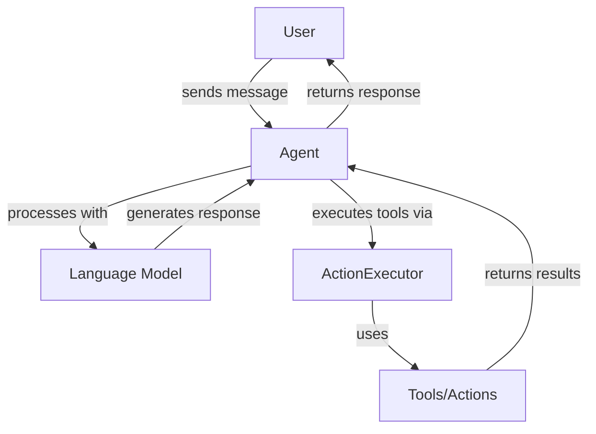
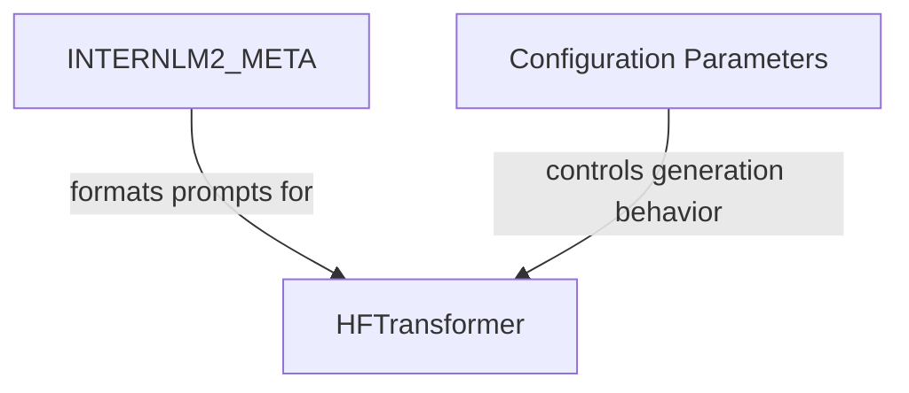
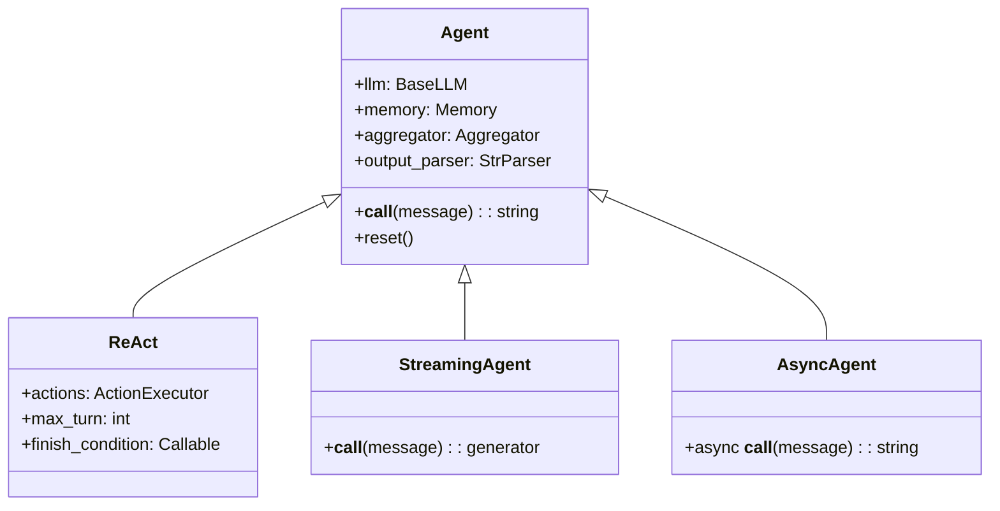
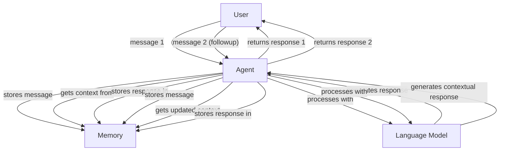
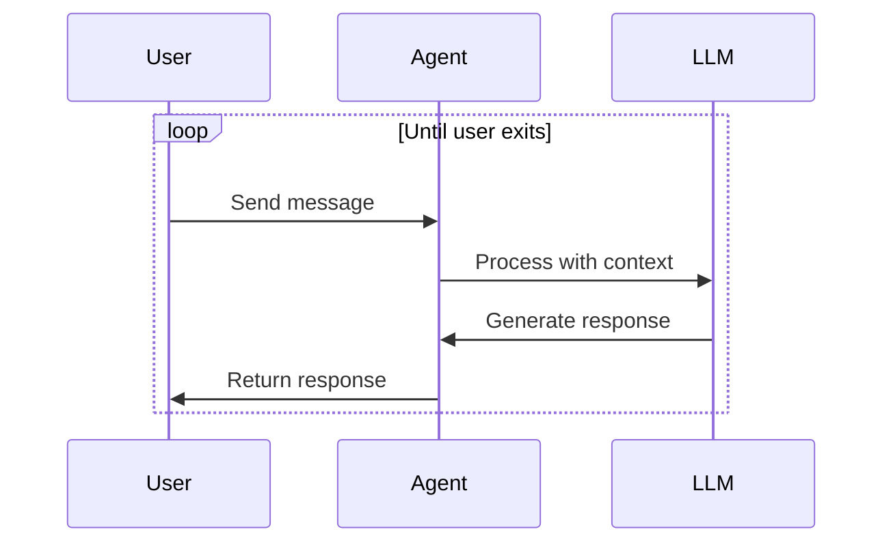
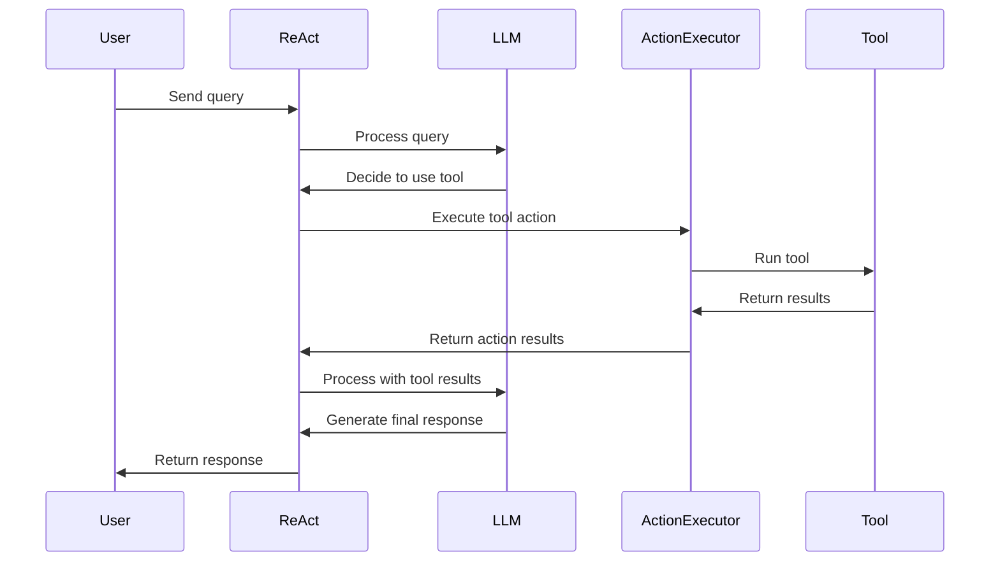
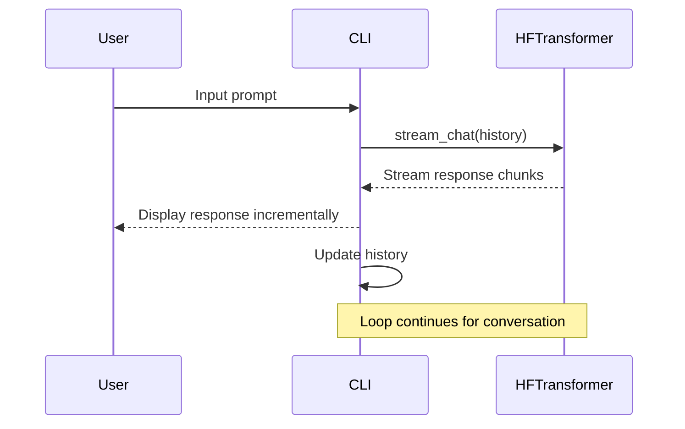

<!-- source: DeepWiki mcp.deepwiki.com · repo InternLM/lagent · page 4.1 Simple Agent Examples · fetched 2026-11-02 -->

# Simple Agent Examples

<details>
<summary>Relevant source files</summary>

The following files were used as context for generating this wiki page:

- [examples/model_cli_demo.py](examples/model_cli_demo.py)

</details>


This page demonstrates how to create and use basic single agents with various Language Model (LLM) backends in the lagent framework. For information about systems with multiple agents working together, see [Multi-Agent Systems](#4.2).

## Introduction

Simple agents in lagent are individual AI assistants that can perform tasks through natural language interaction. They combine language models with optional tools to create intelligent agents capable of reasoning and action. This page focuses on how to create different types of single agents and demonstrates common usage patterns.



Sources: [examples/model_cli_demo.py]()

## Initializing Language Models

The first step in creating an agent is initializing a language model. Lagent supports various LLM backends including:

1. API-based models (OpenAI, Claude)
2. Local models via Hugging Face
3. Optimized inference via LMDeploy and vLLM

Here's an example of initializing a Hugging Face Transformer model:



From [examples/model_cli_demo.py:25-34]():

```python
model = HFTransformer(
    path='internlm/internlm2-chat-20b',  # Model path/identifier
    meta_template=META,                   # Template for formatting prompts
    max_new_tokens=1024,                  # Maximum tokens to generate
    top_p=0.8,                            # Nucleus sampling parameter
    top_k=None,                           # Top-k sampling parameter
    temperature=0.1,                      # Temperature for sampling
    repetition_penalty=1.0,               # Penalty for repetition
    stop_words=['<|im_end|>'])            # Words that signal end of generation
```

Sources: [examples/model_cli_demo.py]()

## Agent Types

Lagent provides several agent types to suit different needs:



### Basic Agent

The simplest agent type provides a conversational interface to an LLM without tools:

```python
from lagent.llms import HFTransformer
from lagent.llms.meta_template import INTERNLM2_META
from lagent.agents import Agent

# Initialize LLM
llm = HFTransformer(
    path='internlm/internlm2-chat-20b',
    meta_template=INTERNLM2_META,
    max_new_tokens=1024,
    temperature=0.1
)

# Create a basic agent
agent = Agent(llm=llm)

# Send a message to the agent
response = agent("Tell me about artificial intelligence")
print(response)
```

### ReAct Agent

The ReAct agent implements the Reasoning+Acting paradigm, allowing the agent to use tools to accomplish tasks:

```python
from lagent.llms import HFTransformer
from lagent.agents import ReAct
from lagent.actions import WebBrowser, PythonInterpreter, ActionExecutor

# Initialize LLM
llm = HFTransformer(
    path='internlm/internlm2-chat-20b',
    meta_template=INTERNLM2_META,
    max_new_tokens=1024
)

# Create action executor with tools
actions = ActionExecutor(actions=[WebBrowser(), PythonInterpreter()])

# Create ReAct agent
agent = ReAct(llm=llm, actions=actions, max_turn=10)

# Use the agent with a task that might require tools
response = agent("Find the population of Tokyo and calculate its square root")
```

### Streaming Agent

For applications that require real-time responses, the StreamingAgent provides incremental output:

```python
from lagent.llms import HFTransformer
from lagent.agents import StreamingAgent

# Create streaming agent
agent = StreamingAgent(llm=llm)

# Process streaming output
for partial_response in agent("Explain quantum computing"):
    print(partial_response, end="", flush=True)
```

The `model_cli_demo.py` example demonstrates handling streaming output:

From [examples/model_cli_demo.py:54-58]():

```python
current_length = 0
for status, response, _ in model.stream_chat(history):
    print(response[current_length:], end='', flush=True)
    current_length = len(response)
```

Sources: [examples/model_cli_demo.py]()

## Managing Conversation History

Agents in lagent maintain conversation history to provide context-aware responses:



The `model_cli_demo.py` example shows a pattern for managing conversation history:

From [examples/model_cli_demo.py:41-58]():

```python
history = []
while True:
    # Get user input
    prompt = input_prompt()
    
    # Add user message to history
    history.append(dict(role='user', content=prompt))
    
    # Generate response with streaming
    for status, response, _ in model.stream_chat(history):
        print(response[current_length:], end='', flush=True)
    
    # Add assistant response to history
    history.append(dict(role='assistant', content=response))
```

When using agents, this history is managed automatically by the agent's memory system, but you can reset it when needed:

```python
# Reset agent memory/history
agent.reset()
```

Sources: [examples/model_cli_demo.py]()

## Common Usage Patterns

### Interactive Chat Loop



Example:

```python
from lagent.agents import Agent

# Create agent (llm initialized previously)
agent = Agent(llm=llm)

# Interactive chat loop
print("Chat with the agent (type 'exit' to end):")
while True:
    user_input = input("> ")
    if user_input.lower() == "exit":
        break
    response = agent(user_input)
    print("Agent:", response)
```

### ReAct Agent with Tools



Example:

```python
from lagent.agents import ReAct
from lagent.actions import WebBrowser, PythonInterpreter, ActionExecutor

# Create action executor with tools
actions = ActionExecutor(actions=[
    WebBrowser(),  # For web search/browsing
    PythonInterpreter()  # For code execution
])

# Create ReAct agent
agent = ReAct(llm=llm, actions=actions, max_turn=10)

# Use the agent for a complex task
response = agent("What's the current weather in Tokyo? Convert the temperature to Fahrenheit.")
print(response)
```

### Batch Processing with Agent

```python
from lagent.agents import Agent

# Create agent
agent = Agent(llm=llm)

# Batch process questions
questions = [
    "What is the capital of France?",
    "How does photosynthesis work?",
    "Explain quantum computing"
]

results = []
for question in questions:
    # Reset agent for each new question (optional)
    agent.reset()
    response = agent(question)
    results.append({"question": question, "answer": response})

# Process results
for item in results:
    print(f"Q: {item['question']}")
    print(f"A: {item['answer']}")
    print("-" * 40)
```

## Model CLI Demo Implementation

The `model_cli_demo.py` example provides a simple CLI interface for interacting with an LLM:



From [examples/model_cli_demo.py:23-63]():

This example demonstrates:
1. Initializing an HFTransformer with specific parameters
2. Accepting user input in a loop
3. Maintaining conversation history
4. Streaming model responses for real-time display
5. Supporting both chat and generate modes

Sources: [examples/model_cli_demo.py]()

## Conclusion

This page has demonstrated how to create and use basic single agents with various Language Model backends in lagent. We've covered:

1. Initializing different types of language models
2. Creating various agent types (basic, ReAct, streaming)
3. Managing conversation history
4. Common usage patterns for agents

For more advanced usage patterns, see:
- [Multi-Agent Systems](#4.2) for examples of setting up systems with multiple agents working together
- [Tool Usage Examples](#4.3) for detailed demonstrations of how to leverage different tools within agents

Sources: [examples/model_cli_demo.py]()

---

