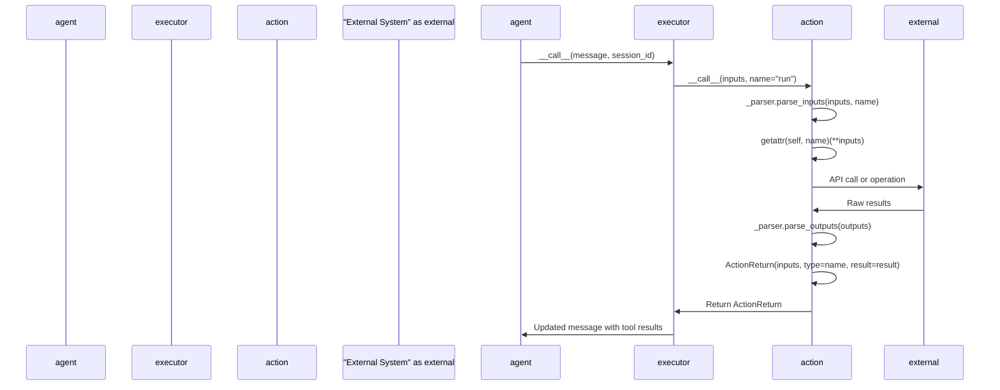
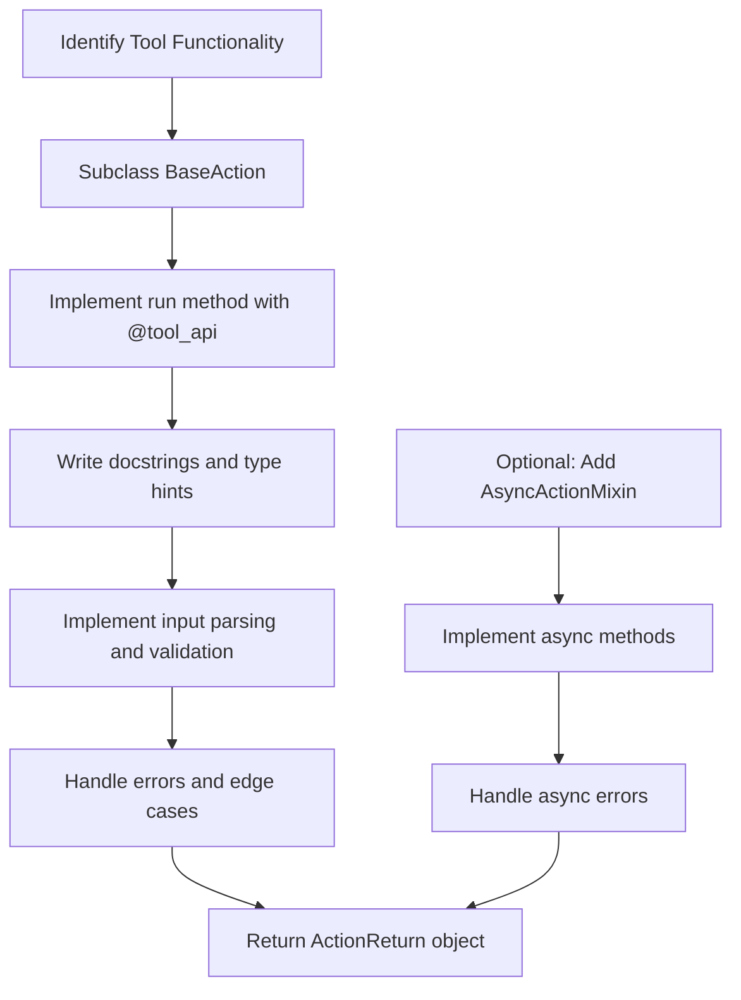
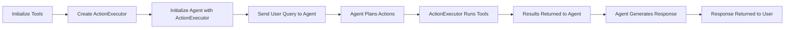
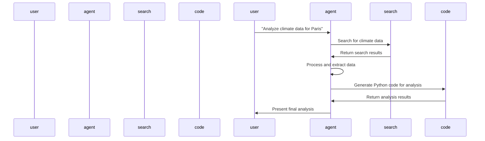

<!-- source: DeepWiki mcp.deepwiki.com · repo InternLM/lagent · page 4.3 Tool Usage Examples · fetched 2026-11-02 -->

# Tool Usage Examples

<details>
<summary>Relevant source files</summary>

The following files were used as context for generating this wiki page:

- [examples/model_cli_demo.py](examples/model_cli_demo.py)
- [lagent/actions/base_action.py](lagent/actions/base_action.py)
- [lagent/actions/google_search.py](lagent/actions/google_search.py)
- [tests/test_actions/test_google_search.py](tests/test_actions/test_google_search.py)

</details>


This document provides practical examples and guidelines for using tools within the LAgent framework. It demonstrates how to leverage different action implementations, integrate them with agents, and build complex tool-based workflows. For information about creating multi-agent systems, see [Multi-Agent Systems](#4.2).

## Understanding the Tool System in LAgent

The LAgent framework provides a robust tool system that allows agents to interact with external systems and execute operations. Tools in LAgent are implemented as subclasses of `BaseAction` and can be organized as either single-function tools or multi-function toolkits.

```mermaid
classDiagram
    class "BaseAction" {
        +__call__(inputs, name): ActionReturn
        +run(params): result
        +name: str
        +description: dict
    }
    
    class "GoogleSearch" {
        +run(query, k): ActionReturn
        +_search(search_term): Tuple[int, dict]
        +_parse_results(results, k): List[str]
    }
    
    class "AsyncGoogleSearch" {
        +async run(query, k): ActionReturn
        +async _search(search_term): Tuple[int, dict]
    }
    
    class "WebBrowser" {
        +search(query): dict
        +select(select_ids): dict
        +open_url(url): dict
    }
    
    class "IPythonInterpreter" {
        +run(command, timeout): ActionReturn
        +reset()
    }
    
    class "ActionExecutor" {
        +actions: List[BaseAction]
        +hooks: List[Hook]
        +__call__(message, session_id): message
    }
    
    "BaseAction" <|-- "GoogleSearch"
    "BaseAction" <|-- "WebBrowser"
    "BaseAction" <|-- "IPythonInterpreter"
    "GoogleSearch" <|-- "AsyncGoogleSearch"
    "ActionExecutor" --> "BaseAction" : contains
```

Sources: [lagent/actions/base_action.py:277-395](), [lagent/actions/google_search.py:12-162]()

## Tool Execution Flow

When an agent uses a tool, it follows a specific execution flow that handles input parsing, execution, and result formatting.



Sources: [lagent/actions/base_action.py:352-375](), [lagent/actions/google_search.py:57-78]()

## Implementing and Using Basic Tools

### Single-Function Tools

The simplest type of tool has a single `run` method that performs a specific operation. The `tool_api` decorator is used to automatically generate the tool description from docstrings and type hints.

```python
class Bold(BaseAction):
    """Make text bold"""

    @tool_api
    def run(self, text: str):
        """
        Args:
            text (str): input text

        Returns:
            str: bold text
        """
        return '**' + text + '**'
```

Sources: [lagent/actions/base_action.py:291-304]()

### Multi-Function Toolkits

For more complex functionality, tools can expose multiple APIs as a toolkit:

```python
class Calculator(BaseAction):
    """Calculator"""

    @tool_api
    def add(self, a, b):
        """Add operation

        Args:
            a (int): augend
            b (int): addend

        Returns:
            int: sum
        """
        return a + b

    @tool_api
    def sub(self, a, b):
        """Subtraction operation

        Args:
            a (int): minuend
            b (int): subtrahend

        Returns:
            int: difference
        """
        return a - b
```

Sources: [lagent/actions/base_action.py:309-339]()

## Using Built-in Tools

### Google Search

The `GoogleSearch` tool provides a convenient interface to search the web using the Serper.dev Google Search API.

```python
from lagent.actions import GoogleSearch
from lagent.agents import ReAct

# Initialize Google Search action
search_tool = GoogleSearch(api_key="your_serper_api_key")

# Create an agent with the search tool
agent = ReAct(
    llm=your_llm,
    actions=[search_tool]
)

# Use the agent
response = agent("What's the capital of France?")
```

Key parameters for the `GoogleSearch` tool:
- `api_key`: Your Serper API key (required)
- `timeout`: Maximum time to wait for search results (default: 5 seconds)
- `search_type`: Type of search to perform (default: 'search')

Sources: [lagent/actions/google_search.py:12-160](), [tests/test_actions/test_google_search.py:8-35]()

### Asynchronous Tools

For applications that need to handle concurrent operations, LAgent provides asynchronous versions of tools:

```python
from lagent.actions import AsyncGoogleSearch
from lagent.agents import AsyncAgent

# Initialize async Google Search
async_search = AsyncGoogleSearch(api_key="your_serper_api_key")

# Create an async agent
async_agent = AsyncAgent(
    llm=your_async_llm,
    actions=[async_search]
)

# Use the async agent
response = await async_agent("What's the weather in New York?")
```

Sources: [lagent/actions/google_search.py:163-244](), [lagent/actions/base_action.py:396-421]()

## Creating Custom Tools

To create a custom tool in LAgent, you need to:

1. Subclass `BaseAction`
2. Implement the `run` method or other methods with the `@tool_api` decorator
3. Handle input parsing and error cases properly



Sources: [lagent/actions/base_action.py:27-233](), [lagent/actions/base_action.py:277-395]()

### Example Custom Tool

Here's a template for creating a custom tool:

```python
from lagent.actions import BaseAction, tool_api
from lagent.schema import ActionReturn, ActionStatusCode

class MyCustomTool(BaseAction):
    """Description of your custom tool"""
    
    def __init__(self, custom_param=None, **kwargs):
        super().__init__(**kwargs)
        self.custom_param = custom_param
        
    @tool_api
    def run(self, input_param: str) -> ActionReturn:
        """Detailed description of what this tool does
        
        Args:
            input_param (str): Description of the input parameter
            
        Returns:
            ActionReturn: The result of the operation
        """
        tool_return = ActionReturn(type=self.name)
        
        try:
            # Implement your tool logic here
            result = self._process(input_param)
            tool_return.result = [dict(type='text', content=str(result))]
            tool_return.state = ActionStatusCode.SUCCESS
        except Exception as e:
            tool_return.errmsg = str(e)
            tool_return.state = ActionStatusCode.API_ERROR
            
        return tool_return
        
    def _process(self, input_param):
        # Internal processing logic
        return f"Processed: {input_param}"
```

Sources: [lagent/actions/google_search.py:57-78](), [lagent/actions/base_action.py:352-375]()

## Integrating Tools with Agents

To use tools with agents in LAgent, you need to:

1. Initialize the tool instances
2. Create an agent with the tools
3. Send messages to the agent



Sources: [lagent/actions/base_action.py:352-375]()

### Tool Selection and Execution

When an agent receives a message, it:

1. Plans which tool to use based on the message content
2. Formats the tool input according to tool requirements
3. Executes the tool through the ActionExecutor
4. Receives and processes the tool results
5. Decides whether to use additional tools or provide a final response

## Error Handling in Tools

All tools in LAgent return an `ActionReturn` object that includes:

- `args`: The arguments passed to the tool
- `type`: The name of the tool
- `result`: The result of the operation (when successful)
- `errmsg`: Error message (when unsuccessful)
- `state`: Status code indicating success or type of failure

The possible status codes are:
- `ActionStatusCode.SUCCESS`: The operation completed successfully
- `ActionStatusCode.API_ERROR`: There was an error in the tool's API
- `ActionStatusCode.ARGS_ERROR`: The arguments provided were invalid
- `ActionStatusCode.HTTP_ERROR`: There was an HTTP error (for web-based tools)

```python
# Example of error handling in a tool
try:
    # Tool operation
    result = some_operation()
    return ActionReturn(inputs, type=self.name, result=result)
except ValueError as e:
    return ActionReturn(
        inputs, 
        type=self.name, 
        errmsg=str(e), 
        state=ActionStatusCode.ARGS_ERROR
    )
except Exception as e:
    return ActionReturn(
        inputs, 
        type=self.name, 
        errmsg=str(e), 
        state=ActionStatusCode.API_ERROR
    )
```

Sources: [lagent/actions/google_search.py:57-78](), [tests/test_actions/test_google_search.py:8-35]()

## Advanced Tool Usage Patterns

### Combining Multiple Tools

Complex tasks often require combining multiple tools. For example, an agent might:
1. Use GoogleSearch to find information
2. Use IPythonInterpreter to analyze the data
3. Use another tool to format and present the results

```python
from lagent.actions import GoogleSearch, IPythonInterpreter
from lagent.agents import ReAct

# Initialize tools
search_tool = GoogleSearch(api_key="your_serper_api_key")
code_tool = IPythonInterpreter()

# Create an agent with multiple tools
agent = ReAct(
    llm=your_llm,
    actions=[search_tool, code_tool]
)

# Use the agent for a complex task
response = agent(
    "Find the population of the 5 largest cities in France and create a bar chart"
)
```

### Sequential Tool Usage

For multi-step workflows, agents can use tools sequentially to build on previous results.



## Best Practices for Tool Usage

1. **Clear Documentation**: Use detailed docstrings and type hints to help the LLM understand when and how to use each tool
2. **Robust Error Handling**: Always handle potential errors in tools and provide meaningful error messages
3. **Appropriate Tool Selection**: Choose the right tools for the task and avoid unnecessary complexity
4. **Performance Considerations**: Use asynchronous tools for I/O-bound operations to improve performance
5. **Security**: Be mindful of security implications, especially for tools that execute code or access external systems
6. **Testing**: Thoroughly test tools with different inputs, including edge cases and error conditions

Sources: [lagent/actions/base_action.py:27-233](), [tests/test_actions/test_google_search.py:8-35]()

## Conclusion

The tools system in LAgent provides a powerful and flexible way to extend agent capabilities beyond simple text generation. By leveraging built-in tools and creating custom tools, you can build sophisticated agents that can search the web, execute code, analyze data, and interact with various external systems.

For more information on implementing multi-agent systems, see [Multi-Agent Systems](#4.2), and for basic agent examples, refer to [Simple Agent Examples](#4.1).