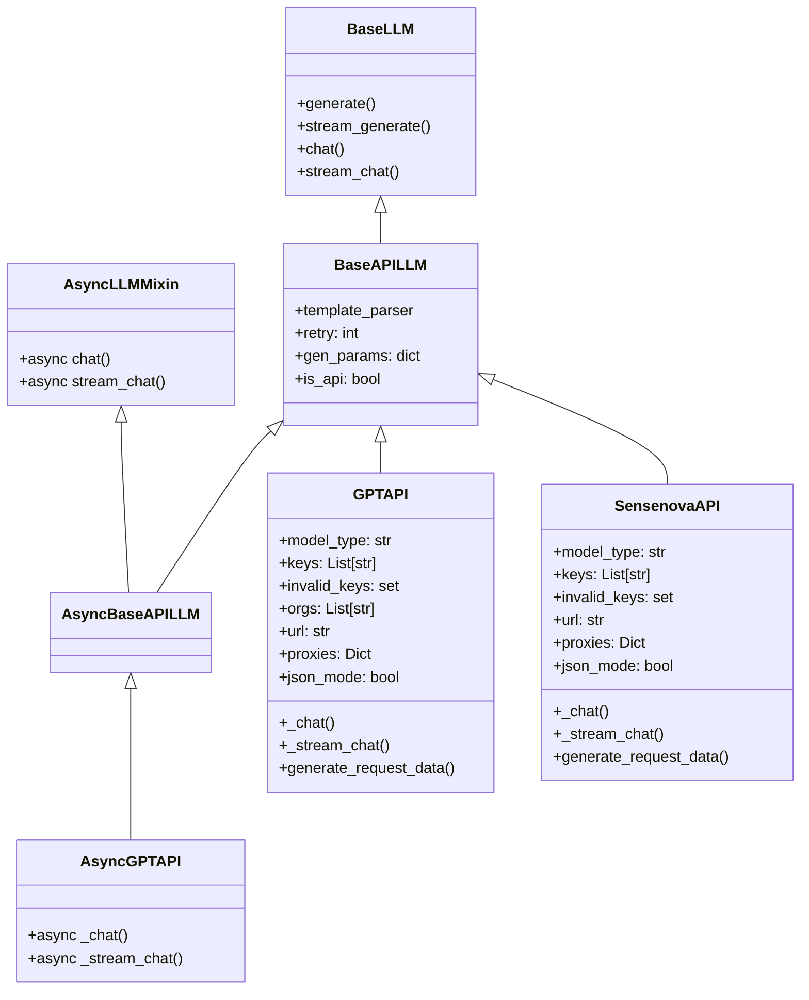
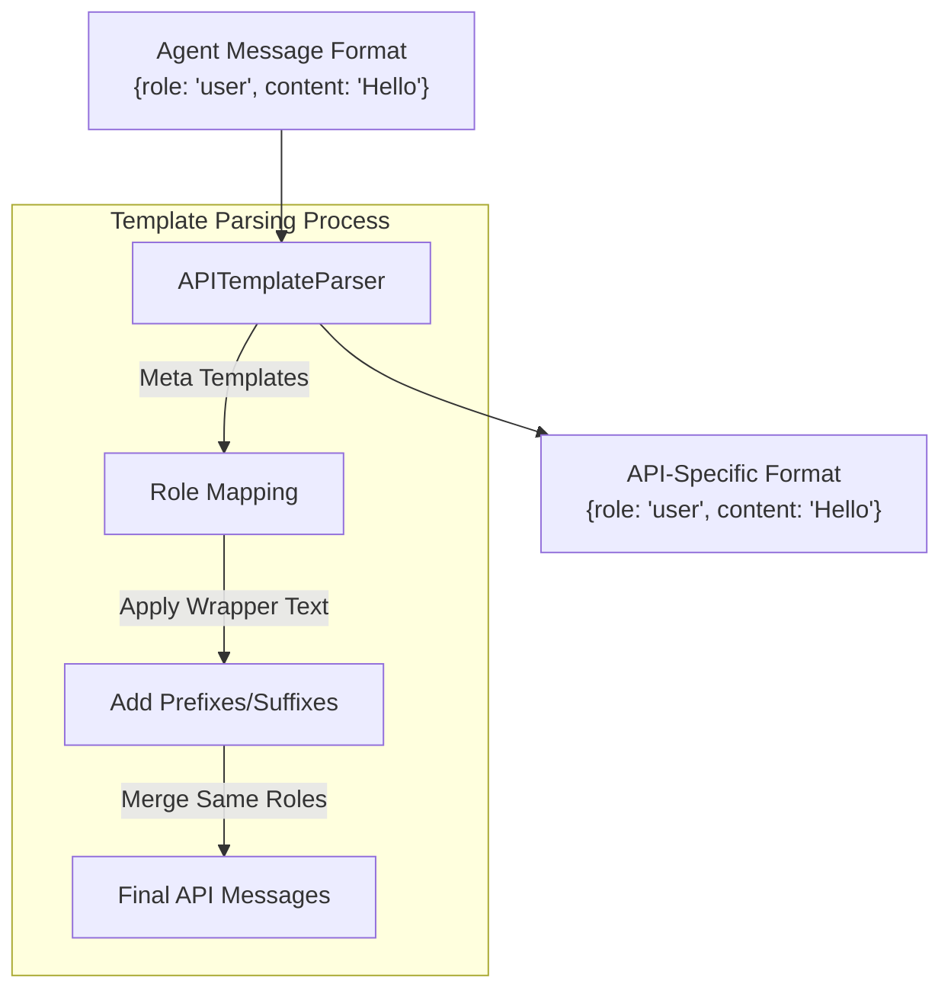
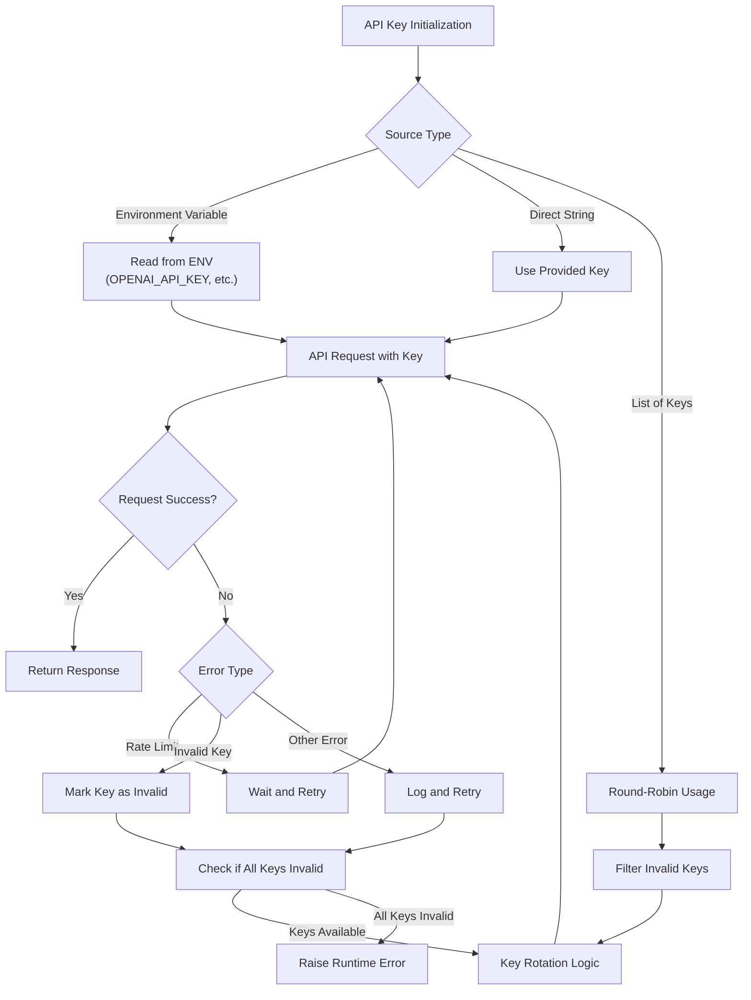

<!-- source: DeepWiki mcp.deepwiki.com · repo InternLM/lagent · extra page API-based LLMs · fetched 2026-11-02 -->

# API-based LLMs

<details>
<summary>Relevant source files</summary>

The following files were used as context for generating this wiki page:

- [lagent/llms/base_api.py](lagent/llms/base_api.py)
- [lagent/llms/openai.py](lagent/llms/openai.py)
- [lagent/llms/sensenova.py](lagent/llms/sensenova.py)
- [lagent/utils/gen_key.py](lagent/utils/gen_key.py)

</details>


This page documents the API-based language model integrations in the lagent framework. It covers how to use and configure LLMs accessed through REST APIs, such as OpenAI's GPT models and SenseNova's models. For information about locally-deployed models, see [Local Model Integration](#2.2.2).

## Overview

API-based LLMs in lagent provide a consistent interface for interacting with language models hosted by third-party providers. These classes handle the complexities of API communication, authentication, retries, error handling, and message formatting, allowing you to focus on building agents rather than managing API details.



Sources: [lagent/llms/base_api.py:131-174](), [lagent/llms/openai.py:24-411](), [lagent/llms/openai.py:413-811](), [lagent/llms/sensenova.py:23-406]()

## Common Base Classes

API-based LLMs share common functionality implemented in base classes:

### BaseAPILLM

This class serves as the foundation for all API-based LLM integrations. It provides:

- Common generation parameters (temperature, top_p, etc.)
- Retry logic for API failures
- Template parsing for converting messages to API-compatible formats

```python
# Example initialization
llm = BaseAPILLM(
    model_type="model-name",
    retry=2,
    meta_template=[...],  # Optional message role mapping
    max_new_tokens=512,
    top_p=0.8,
    temperature=0.8
)
```

Sources: [lagent/llms/base_api.py:131-173]()

### AsyncBaseAPILLM

This class extends `BaseAPILLM` with asynchronous support, allowing for non-blocking API calls when used with async frameworks like FastAPI or asyncio.

Sources: [lagent/llms/base_api.py:174-175]()

## Message Template Handling

API-based LLMs use the `APITemplateParser` to convert message formats:



The parser maps internal role names to provider-specific roles and can add role-specific prefixes or suffixes as needed.

Sources: [lagent/llms/base_api.py:7-129]()

## OpenAI GPT Models

The `GPTAPI` and `AsyncGPTAPI` classes provide integration with OpenAI's GPT models through their Chat Completions API.

### Key Features

- Support for all OpenAI models (gpt-3.5-turbo, gpt-4, etc.)
- API key rotation and load balancing
- Organization ID support
- JSON mode for structured outputs
- Streaming support

### Basic Usage Example

```python
from lagent.llms.openai import GPTAPI

# Initialize with API key from environment variable
llm = GPTAPI(
    model_type="gpt-4",
    temperature=0.7,
    max_new_tokens=1024
)

# Create message format
messages = [
    {"role": "system", "content": "You are a helpful assistant."},
    {"role": "user", "content": "Tell me about deep learning."}
]

# Get completion
response = llm.chat(messages)
print(response)
```

### Async Usage Example

```python
import asyncio
from lagent.llms.openai import AsyncGPTAPI

async def main():
    llm = AsyncGPTAPI(model_type="gpt-4")
    messages = [
        {"role": "system", "content": "You are a helpful assistant."},
        {"role": "user", "content": "Tell me about deep learning."}
    ]
    response = await llm.chat(messages)
    print(response)

asyncio.run(main())
```

Sources: [lagent/llms/openai.py:24-411](), [lagent/llms/openai.py:413-811]()

## SenseNova Models

The `SensenovaAPI` class provides integration with SenseTime's SenseNova models.

### Key Features

- Support for SenseChat-5 and other SenseNova models
- JWT token-based authentication
- Streaming support
- Robust error handling and retries

### Basic Usage Example

```python
from lagent.llms.sensenova import SensenovaAPI

# Initialize with API key from environment variable
llm = SensenovaAPI(
    model_type="SenseChat-5-Cantonese",
    temperature=0.7,
    max_new_tokens=1024
)

# Create message format
messages = [
    {"role": "system", "content": "You are a helpful assistant."},
    {"role": "user", "content": "Tell me about deep learning."}
]

# Get completion
response = llm.chat(messages)
print(response)
```

Sources: [lagent/llms/sensenova.py:23-406]()

## API Key Management

All API-based LLM classes in lagent provide flexible options for managing API keys:



### Implementation Details

- Support for multiple API keys with round-robin usage
- Automatic detection and exclusion of invalid or quota-exceeded keys
- Configurable retry logic for handling rate limits and other API errors

Sources: [lagent/llms/openai.py:50-92](), [lagent/llms/openai.py:439-481](), [lagent/llms/sensenova.py:44-86]()

## Advanced Features

### Streaming Responses

All API-based LLM classes support streaming responses, which is crucial for real-time agent interactions:

```python
# Example of streaming with OpenAI
llm = GPTAPI(model_type="gpt-4")
messages = [{"role": "user", "content": "Write a poem about AI."}]

for status, text, _ in llm.stream_chat(messages):
    # Print incrementally as tokens arrive
    print(text, end="", flush=True)
```

The streaming implementation:
1. Handles token-by-token processing from the API
2. Implements early stopping when stop words are detected
3. Returns status codes to indicate progress and completion

Sources: [lagent/llms/openai.py:121-161](), [lagent/llms/openai.py:509-549](), [lagent/llms/sensenova.py:118-156]()

### JSON Mode

For structured outputs, API-based LLMs support JSON mode (when available from the provider):

```python
llm = GPTAPI(
    model_type="gpt-4",
    json_mode=True
)
messages = [{"role": "user", "content": "List the top 3 programming languages as a JSON array."}]
response = llm.chat(messages)
# Response will be valid JSON
```

Sources: [lagent/llms/openai.py:344-395](), [lagent/llms/openai.py:742-796](), [lagent/llms/sensenova.py:336-391]()

## Generation Parameters

API-based LLM wrappers translate between lagent's standardized parameters and provider-specific parameters:

| lagent Parameter | OpenAI Equivalent | Description |
|------------------|-------------------|-------------|
| max_new_tokens   | max_tokens        | Maximum tokens to generate |
| temperature      | temperature       | Sampling temperature (0-2) |
| top_p            | top_p             | Nucleus sampling parameter |
| stop_words       | stop              | Sequences that stop generation |
| repetition_penalty | frequency_penalty | Penalty for repeating tokens |

Additional provider-specific parameters can be passed directly in the `chat()` and `stream_chat()` methods.

Sources: [lagent/llms/base_api.py:144-171](), [lagent/llms/openai.py:344-395](), [lagent/llms/openai.py:742-796](), [lagent/llms/sensenova.py:336-391]()

## SenseNova Authentication

SenseNova uses JWT tokens for authentication. The framework includes utilities to generate these tokens:

```python
from lagent.utils.gen_key import auto_gen_jwt_token

# Generate a JWT token from access key and secret key
token = auto_gen_jwt_token(access_key, secret_key)
```

This token is then used as the API key for the `SensenovaAPI` class.

Sources: [lagent/utils/gen_key.py:1-32](), [lagent/llms/sensenova.py:69-74]()

## Error Handling

All API-based LLM wrappers implement comprehensive error handling:

1. Connection errors are retried automatically
2. Rate limit errors trigger a wait-and-retry approach
3. Quota exceeded errors mark keys as invalid and attempt other keys
4. JSON parsing errors are handled gracefully
5. Detailed error logging helps with debugging

The retry mechanism can be configured with the `retry` parameter during initialization.

Sources: [lagent/llms/openai.py:177-238](), [lagent/llms/openai.py:567-631](), [lagent/llms/sensenova.py:177-228]()

## Implementation Note

The API-based LLM implementations are designed for consistent behavior across different providers, with provider-specific optimizations where appropriate. The architecture allows for easy extension to support additional API-based LLM providers in the future.

---

