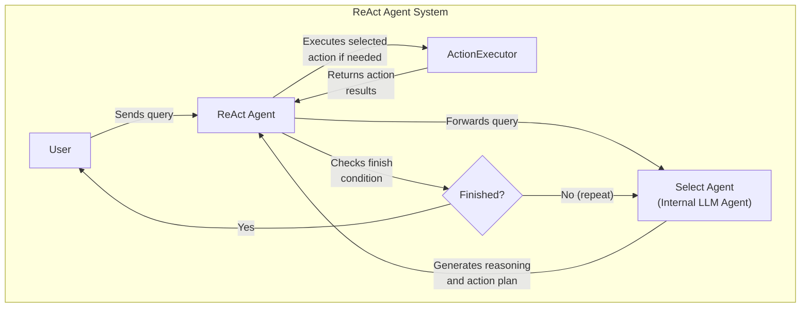
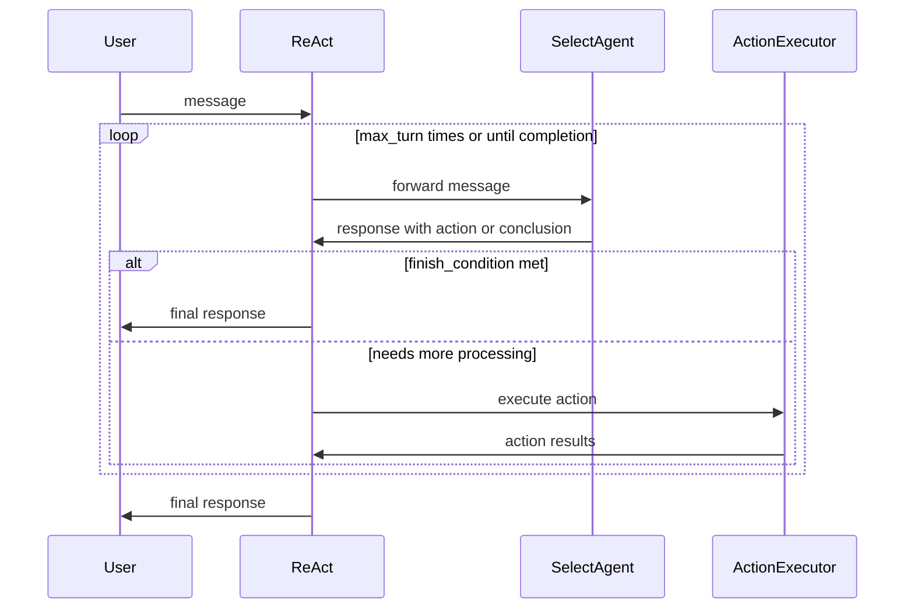

<!-- source: DeepWiki mcp.deepwiki.com · repo InternLM/lagent · extra page ReAct Agents · fetched 2026-11-02 -->

# ReAct Agents

<details>
<summary>Relevant source files</summary>

The following files were used as context for generating this wiki page:

- [lagent/agents/__init__.py](lagent/agents/__init__.py)
- [lagent/agents/agent.py](lagent/agents/agent.py)
- [lagent/agents/react.py](lagent/agents/react.py)
- [lagent/memory/base_memory.py](lagent/memory/base_memory.py)
- [lagent/prompts/parsers/str_parser.py](lagent/prompts/parsers/str_parser.py)

</details>


ReAct (Reasoning + Acting) agents implement a powerful paradigm that enables language models to solve complex tasks through iterative reasoning and tool use. This page details the ReAct implementation in the LAgent framework, which follows a multi-turn process where the agent reasons about a problem, selects appropriate tools, executes actions, and incorporates the results to reach a final conclusion.

For information about other agent types like Streaming or AsyncAgent, see [Specialized Agents](#2.1.3).

## Core Concept and Architecture

ReAct agents extend the base Agent class to implement a reasoning-acting loop. They interact with a language model to determine the next action and use an action executor to carry out operations before deciding if they've reached a satisfactory conclusion.



Sources: [lagent/agents/react.py:28-66](), [lagent/agents/agent.py:18-94]()

## Implementation Details

The ReAct class extends the base Agent and implements a turn-based interaction pattern that alternates between selecting actions and executing them:



Sources: [lagent/agents/react.py:59-65](), [lagent/agents/react.py:99-105]()

### Key Components

1. **select_agent**: An internal Agent instance that determines which action to take or when to conclude
2. **actions**: An ActionExecutor instance that manages available tools and executes them
3. **finish_condition**: A function that determines when the agent has reached a satisfactory conclusion
4. **max_turn**: Maximum number of reasoning-acting cycles before returning

Sources: [lagent/agents/react.py:28-57]()

## Core API and Configuration

The ReAct agent provides both synchronous and asynchronous implementations with the same interface:

| Class | Description |
|-------|-------------|
| `ReAct` | Standard synchronous implementation for sequential processing |
| `AsyncReAct` | Asynchronous implementation for non-blocking operations |

### Initialization Parameters

| Parameter | Type | Description |
|-----------|------|-------------|
| `llm` | `BaseLLM` or `Dict` | Language model for reasoning |
| `actions` | `BaseAction` or `List[BaseAction]` | Tools available to the agent |
| `template` | `PromptTemplate` or `str` | Template for prompting the LLM |
| `memory` | `Dict` | Memory configuration (default: `Memory`) |
| `output_format` | `Dict` | Output parser (default: `JSONParser`) |
| `aggregator` | `Dict` | Context aggregator (default: `DefaultAggregator`) |
| `hooks` | `List` | Hooks for preprocessing (default: `[ActionPreprocessor]`) |
| `finish_condition` | `Callable` | Function determining when to stop (checks for "conclusion") |
| `max_turn` | `int` | Maximum reasoning-acting cycles (default: 5) |

Sources: [lagent/agents/react.py:28-57](), [lagent/agents/react.py:68-97]()

## Implementation Workflow

The ReAct agent operates through the following process:

1. **Initialization**:
   - Creates an `ActionExecutor` for managing tools
   - Creates a `select_agent` with the provided LLM and prompt template
   - Configures memory, output format, and hooks

2. **Forward Method**:
   - Implements a loop for a maximum of `max_turn` iterations
   - For each iteration:
     - Passes the current message to the `select_agent` to decide what to do
     - Checks if the finish condition is met (by default, looks for "conclusion" in the response)
     - If not finished, executes the selected action through the `actions` executor
     - Continues with the result as the new message
   - Returns the final message when done

Sources: [lagent/agents/react.py:59-65](), [lagent/agents/react.py:99-105]()

## Output Format and Processing

ReAct agents use a structured output format to distinguish between:

1. **Action selection**: When the agent needs to use a tool
2. **Conclusion**: When the agent has the final answer

The default implementation uses a JSON parser with two formats:

```
# Action Format:
{
  "thought_process": "...",
  "action": {
    "name": "function_name",
    "parameters": {...}
  }
}

# Finish Format:
{
  "thought_process": "...",
  "conclusion": "..."
}
```

The presence of "conclusion" in the response is used by the default `finish_condition` to determine when the agent has completed its task.

Sources: [lagent/agents/react.py:15-25](), [lagent/agents/react.py:113-127]()

## Memory Management

ReAct agents inherit memory management from the base Agent class. The memory stores:

1. The initial user query
2. Each intermediate step (reasoning, action selection, and action results)
3. The final conclusion

This allows the agent to maintain context throughout the reasoning-acting loop and enables the LLM to review previous steps when making decisions.

Sources: [lagent/agents/agent.py:62-64](), [lagent/memory/base_memory.py:1-60]()

## Integration with Action System

The ReAct agent connects to actions through an `ActionExecutor`, which manages all available tools. When the agent selects an action to perform:

1. The action name and parameters are extracted from the LLM's response
2. The appropriate action is identified and executed
3. The results are returned to the agent for the next reasoning step

Actions can include web browsers, code interpreters, research tools, and other custom tools.

Sources: [lagent/agents/react.py:46](), [lagent/agents/react.py:64](), [lagent/agents/react.py:86](), [lagent/agents/react.py:104]()

## Example Usage

Here's a simplified example of how to create and use a ReAct agent:

```python
from lagent.agents import ReAct
from lagent.schema import AgentMessage

# Create a ReAct agent with Python interpreter capabilities
agent = ReAct(
    llm=dict(
        type="GPTAPI",
        model_type="gpt-4",
    ),
    actions=[dict(type="lagent.actions.PythonInterpreter")],
)

# Use the agent to solve a problem
response = agent(AgentMessage(sender="user", content="Calculate the factorial of 5"))
print(response.content)
```

This example creates a ReAct agent with access to a Python interpreter and uses it to calculate a factorial, demonstrating the reasoning-acting loop in action.

Sources: [lagent/agents/react.py:132-148](), [lagent/agents/react.py:150-164]()

## Asynchronous Implementation

The `AsyncReAct` class provides an asynchronous implementation with identical functionality, suitable for non-blocking operations in asynchronous environments:

```python
# Using AsyncReAct
async_agent = AsyncReAct(
    llm=dict(
        type="AsyncGPTAPI",
        model_type="gpt-4",
    ),
    actions=[dict(type="lagent.actions.AsyncPythonInterpreter")],
)

# Must be called in an async context
response = await async_agent(AgentMessage(sender="user", content="Calculate the factorial of 5"))
```

The async implementation follows the same pattern but uses `async/await` syntax for all operations.

Sources: [lagent/agents/react.py:68-105](), [lagent/agents/react.py:150-164]()

## Customization

ReAct agents can be customized in several ways:

1. **Custom Finish Conditions**: Override the default `finish_condition` function to implement custom stopping criteria
2. **Custom Prompt Templates**: Define specialized prompt templates for domain-specific tasks
3. **Custom Actions**: Create and register custom actions to extend the agent's capabilities
4. **Hooks**: Add pre-processing and post-processing hooks to modify behavior

For more complex customization scenarios, you can inherit from the ReAct class and override specific methods.

Sources: [lagent/agents/react.py:39-41](), [lagent/agents/react.py:79-81]()

---

