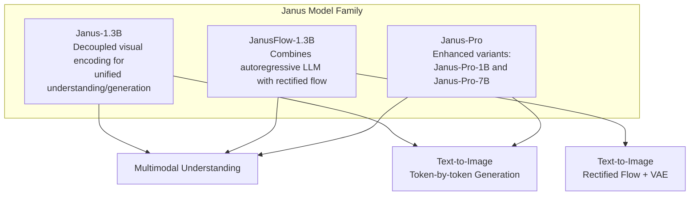
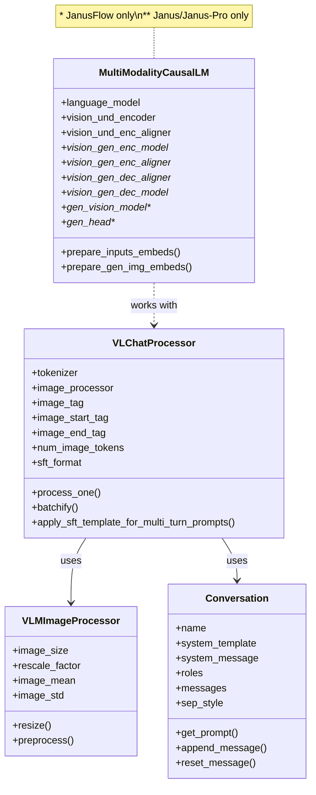
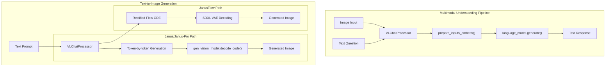
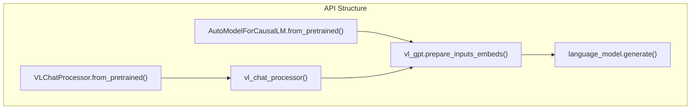
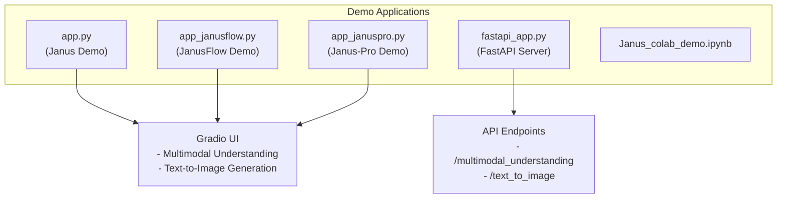

<!-- source: DeepWiki mcp.deepwiki.com · repo deepseek-ai/Janus · page 1 Overview · fetched 2026-10-30 -->

# Overview

Relevant source files

The following files were used as context for generating this wiki page:

- [README.md](README.md)
- [images/teaser_janusflow.png](images/teaser_janusflow.png)
- [images/teaser_januspro.png](images/teaser_januspro.png)

This document provides a comprehensive introduction to the Janus repository, which contains a family of unified multimodal models capable of both understanding image-text combinations and generating images from text prompts. The Janus models represent a significant advancement in multimodal AI by integrating these capabilities into unified architectures.

## Janus Model Family

The Janus repository contains three main model variants, each with different capabilities and architectural approaches:

Sources: [README.md:75-100]()

The three model variants share a common high-level purpose but differ in their implementation approaches:

- **Janus**: The original model using decoupled visual encoding paths for understanding and generation within a unified transformer architecture.
- **JanusFlow**: Integrates autoregressive language models with rectified flow for image generation, using a different approach for text-to-image generation.
- **Janus-Pro**: Enhanced versions (1B and 7B) with improved capabilities through optimized training strategies, expanded data, and larger model sizes.

## Core Architecture

The Janus system is built around several key components that work together to provide multimodal capabilities:

Sources: [README.md:137-189]()

### Key Components:

1. **MultiModalityCausalLM**: The central model class that integrates vision components with a language model. It has different configurations for different model variants.

2. **VLChatProcessor**: Handles the preparation of inputs, including tokenization of text and processing of images.

3. **VLMImageProcessor**: Specifically processes images for input to the model, handling resizing and normalization.

4. **Conversation**: Manages chat history for multi-turn conversations.

## Processing Pipelines

Janus models support two main processing pipelines: multimodal understanding and text-to-image generation.

Sources: [README.md:322-467](), [README.md:575-697]()

### Multimodal Understanding:
- Takes both image and text inputs
- Processes them using `VLChatProcessor`
- Generates text responses through the language model

### Text-to-Image Generation:
- **Janus/Janus-Pro**: Uses token-by-token generation with `gen_vision_model` and `gen_head`
- **JanusFlow**: Uses rectified flow ODE approach with VAE decoding

## Technical Implementation

The Janus models are implemented using PyTorch and integrated with the Hugging Face Transformers library. The code is structured to allow loading and using the models with a few lines of code:

Sources: [README.md:322-371]()

## Demo Applications

The repository includes several demo applications that showcase the capabilities of the Janus models:

Sources: [README.md:474-502]()

## Model Capabilities and Usage

The Janus models offer a range of capabilities useful for different applications:

| Model | Multimodal Understanding | Text-to-Image Generation | Primary Use Cases |
|-------|--------------------------|--------------------------|-------------------|
| Janus-1.3B | ✓ | ✓ (Token-by-token) | Visual reasoning, OCR, image captioning, simple image generation |
| JanusFlow-1.3B | ✓ | ✓ (Rectified flow) | Visual reasoning, high-quality image generation |
| Janus-Pro-1B | ✓ | ✓ (Enhanced token-by-token) | Similar to Janus with improved performance |
| Janus-Pro-7B | ✓ | ✓ (Enhanced token-by-token) | Advanced visual reasoning, detailed image generation |

For detailed instructions on using these models for specific tasks, see the [Usage Guide](#4).

For installation and setup instructions, see the [Installation and Setup](#4.1) page.

## Conclusion

The Janus repository offers a family of unified multimodal models that can both understand and generate visual content. The different model variants (Janus, JanusFlow, and Janus-Pro) provide options for different use cases and computational requirements. The core architecture is designed to be modular and flexible, allowing for easy integration into various applications.

In the following sections of this wiki, we'll explore each component of the system in greater detail, providing specific information about the model architectures, their capabilities, and how to use them effectively.

---

