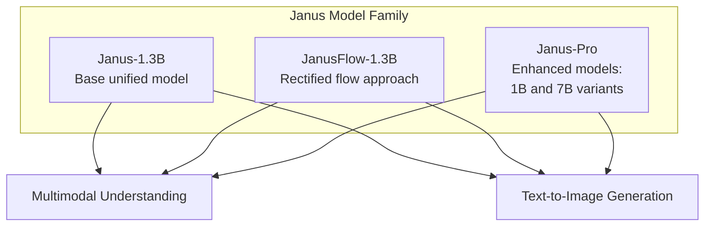
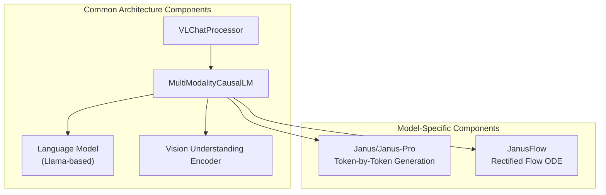
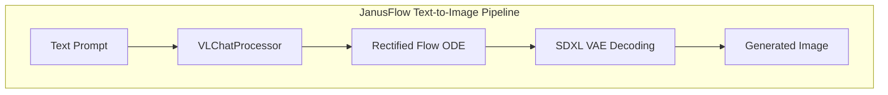
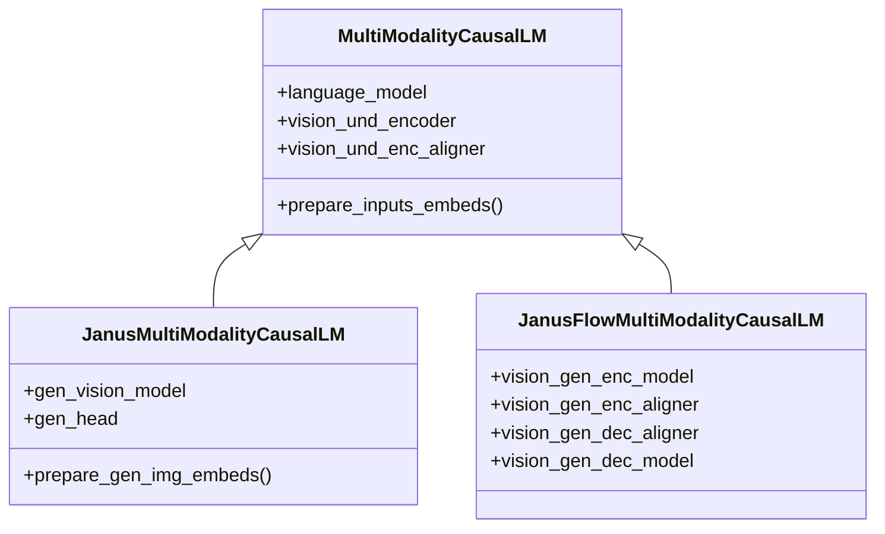

<!-- source: DeepWiki mcp.deepwiki.com · repo deepseek-ai/Janus · page 1.1 Model Family · fetched 2026-10-30 -->

# Model Family

<details>
<summary>Relevant source files</summary>

The following files were used as context for generating this wiki page:

- [README.md](README.md)
- [images/teaser_janusflow.png](images/teaser_janusflow.png)

</details>


This document describes the Janus model family, detailing the architecture and capabilities of three distinct variants: Janus, JanusFlow, and Janus-Pro. Each model provides unified multimodal understanding and generation capabilities but employs different approaches and optimizations. For information about specific capabilities and features, see [Key Features and Capabilities](#1.2).

## Overview of Janus Model Variants

The Janus repository contains three primary model variants that share a common goal of unifying multimodal understanding and generation tasks:



Sources: [README.md:75-100]()

### Model Specifications

All Janus models are built on a unified architecture but vary in size, generation approach, and optimization techniques:

| Model | Parameters | Context Length | Release Date | Key Characteristics |
|-------|------------|---------------|--------------|---------------------|
| Janus-1.3B | 1.3 billion | 4096 | Oct 2024 | Base unified model with decoupled visual encoding |
| JanusFlow-1.3B | 1.3 billion | 4096 | Nov 2024 | Integrates autoregressive LLM with rectified flow for image generation |
| Janus-Pro-1B | 1 billion | 4096 | Jan 2025 | Enhanced training strategy, expanded data |
| Janus-Pro-7B | 7 billion | 4096 | Jan 2025 | Larger model with improved stability and performance |

Sources: [README.md:64-67](), [README.md:112-116]()

## Architectural Approaches

Each Janus model variant employs a different approach to multimodal tasks while maintaining a unified architecture:



Sources: [README.md:85-99](), [README.md:508-572]()

### Janus Base Model

The original Janus model introduces a decoupled visual encoding approach that separates understanding and generation pathways while maintaining a unified transformer architecture.

Key characteristics:
- 1.3 billion parameters
- Decoupled visual encoding for understanding and generation
- Token-by-token autoregressive image generation
- Uses specialized vision encoders for different tasks

Sources: [README.md:86-93]()

### JanusFlow Model

JanusFlow integrates autoregressive language models with rectified flow, a state-of-the-art method in generative modeling:



Key characteristics:
- Same parameter count as base Janus (1.3B)
- Uses rectified flow ODE for image generation
- Requires an additional VAE component for decoding
- Better image generation quality than token-by-token approach

Sources: [README.md:94-100](), [README.md:573-710]()

### Janus-Pro Models

Janus-Pro models represent an enhanced version of the base Janus architecture with improved capabilities:

Key improvements:
- Optimized training strategy
- Expanded training data
- Scaled to larger model sizes (1B and 7B variants)
- Enhanced stability in text-to-image generation
- Improved performance on multimodal understanding benchmarks

Sources: [README.md:76-83](), [README.md:122-302]()

## Implementation Details

The model family shares common code components but with variant-specific implementations:



Sources: [README.md:122-302](), [README.md:305-507](), [README.md:508-710]()

### Processing Pipeline Differences

The main architectural difference between the variants lies in their text-to-image generation pipelines:

1. **Janus/Janus-Pro**: Uses token-by-token autoregressive generation with a specialized vision decoder
   ```python
   # Token-by-token generation loop (simplified)
   for i in range(image_token_num_per_image):
       outputs = mmgpt.language_model.model(inputs_embeds=inputs_embeds, use_cache=True)
       hidden_states = outputs.last_hidden_state
       logits = mmgpt.gen_head(hidden_states[:, -1, :])
       # Apply classifier-free guidance
       next_token = torch.multinomial(probs, num_samples=1)
       generated_tokens[:, i] = next_token.squeeze(dim=-1)
   ```

2. **JanusFlow**: Uses rectified flow ODE for image generation with VAE decoding
   ```python
   # Rectified flow generation (simplified)
   for step in range(num_inference_steps):
       # Encode with vision_gen_enc
       z_enc = vl_gpt.vision_gen_enc_model(z_input, t)
       # Process through LLM
       outputs = vl_gpt.language_model.model(inputs_embeds=llm_emb)
       # Transform hidden states back to v
       v = vl_gpt.vision_gen_dec_model(hidden_states, hs, t_emb)
       # Apply classifier-free guidance
       z = z + dt * v
   ```

Sources: [README.md:410-467](), [README.md:616-697]()

## Model Loading and Usage

Despite architectural differences, the models share a common interface for loading and basic usage:

```python
# Common pattern for loading any Janus model
from janus.models import MultiModalityCausalLM, VLChatProcessor

# Specify model path (replace with appropriate model variant)
model_path = "deepseek-ai/Janus-1.3B"  # or JanusFlow-1.3B, Janus-Pro-1B, Janus-Pro-7B

# Load processor and model
vl_chat_processor = VLChatProcessor.from_pretrained(model_path)
vl_gpt = MultiModalityCausalLM.from_pretrained(
    model_path, trust_remote_code=True
).to(torch.bfloat16).cuda().eval()
```

The implementation includes specific demo applications for each variant:
- Janus: [demo/app.py]()
- JanusFlow: [demo/app_janusflow.py]()
- Janus-Pro: [demo/app_januspro.py]()

Sources: [README.md:329-371](), [README.md:535-571](), [README.md:144-186]()

## Comparative Capabilities

While all models in the family support both multimodal understanding and text-to-image generation, their performance characteristics differ:

| Capability | Janus-1.3B | JanusFlow-1.3B | Janus-Pro-1B | Janus-Pro-7B |
|------------|------------|----------------|--------------|--------------|
| Multimodal Understanding | Baseline | Comparable to Janus | Improved over Janus | Best overall |
| Text-to-Image Quality | Baseline | Better image quality | Improved stability | Best overall |
| Generation Speed | Faster | Slower (ODE solving) | Faster | Faster |
| Memory Requirements | Lower | Higher (VAE needed) | Lower | Higher |

Sources: [README.md:76-83](), [README.md:94-100]()

## Model Selection Guidelines

When choosing between Janus model variants:

1. For best overall performance: Use **Janus-Pro-7B**
2. For balance of quality and efficiency: Use **Janus-Pro-1B**
3. For better image generation with smaller models: Use **JanusFlow-1.3B**
4. For baseline unified capabilities: Use **Janus-1.3B**

Sources: [README.md:112-116]()

---

