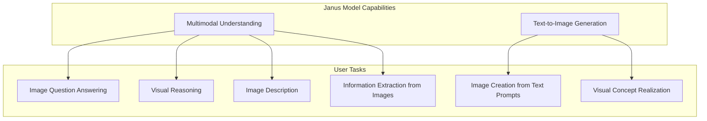
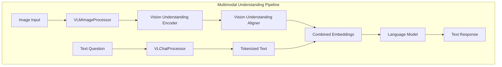
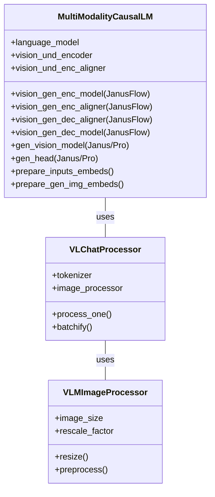

<!-- source: DeepWiki mcp.deepwiki.com · repo deepseek-ai/Janus · page 1.2 Key Features and Capabilities · fetched 2026-10-30 -->

# Key Features and Capabilities

<details>
<summary>Relevant source files</summary>

The following files were used as context for generating this wiki page:

- [README.md](README.md)
- [images/teaser_janusflow.png](images/teaser_janusflow.png)
- [images/teaser_januspro.png](images/teaser_januspro.png)

</details>


This page outlines the core capabilities of the Janus model family, explaining its two primary functions: multimodal understanding and text-to-image generation. For information about the specific model variants (Janus, JanusFlow, and Janus-Pro), see [Model Family](#1.1).

## Overview of Capabilities

The Janus model family provides two main capabilities:

1. **Multimodal Understanding**: Processing and interpreting images and text together to answer questions, describe scenes, or extract information from visual content.

2. **Text-to-Image Generation**: Creating new visual content based on text prompts, using either token-by-token generation (Janus/Janus-Pro) or rectified flow (JanusFlow).



Sources: [README.md:62-101]()

## Multimodal Understanding

The multimodal understanding capability allows Janus models to process text and images together to generate meaningful responses. This enables applications such as:

- Visual question answering
- Image description and captioning
- Information extraction from visual content (e.g., converting equations to LaTeX)
- Visual reasoning tasks

### How It Works

The models process visual input through a specialized vision encoder and combine it with text input for comprehensive understanding. This process involves:

1. Converting images to embeddings through the vision understanding encoder
2. Combining these embeddings with text embeddings
3. Processing the combined embeddings through a language model to generate responses



Sources: [README.md:324-370]()

### Example Use Case

```
Input: 
- Image of a mathematical equation
- Text: "Convert the formula into latex code."

Output:
- LaTeX representation of the equation
```

## Text-to-Image Generation

All Janus models support text-to-image generation but with different underlying approaches:

1. **Janus and Janus-Pro** use token-by-token autoregressive generation
2. **JanusFlow** uses a rectified flow ODE approach

### Generation Approaches Comparison

| Approach | Model | Description | Technical Implementation |
|----------|-------|-------------|--------------------------|
| Token-by-token | Janus, Janus-Pro | Generates image tokens autoregressively, similar to text token generation | Uses dedicated generation vision model and generation head |
| Rectified Flow | JanusFlow | Uses ODE-based approach with noise reduction | Integrates rectified flow with VAE decoding (requires SDXL VAE) |

```mermaid
flowchart TD
    subgraph "Text-to-Image Generation"
        direction TB
        subgraph "Janus/Janus-Pro Pipeline"
            TextPrompt1["Text Prompt"] --> VLChatProcessor1["VLChatProcessor"]
            VLChatProcessor1 --> TokenGeneration["Token-by-Token Generation"]
            TokenGeneration --> GenVisionModel["gen_vision_model"]
            GenVisionModel --> Image1["Generated Image"]
        end
        
        subgraph "JanusFlow Pipeline"
            TextPrompt2["Text Prompt"] --> VLChatProcessor2["VLChatProcessor"]
            VLChatProcessor2 --> RectifiedFlow["Rectified Flow ODE"]
            RectifiedFlow --> SDXLVAE["SDXL VAE"]
            SDXLVAE --> Image2["Generated Image"]
        end
    end
```



Sources: [README.md:376-466](), [README.md:575-698]()

### Classifier-Free Guidance

Both generation approaches use classifier-free guidance to improve image quality. This technique compares conditional and unconditional generation results and uses the difference to guide the generation process more effectively.

## Technical Components

The capabilities are implemented through several key technical components in the codebase:



Sources: [README.md:324-370](), [README.md:376-466](), [README.md:575-698]()

### Key Components for Capabilities

| Component | Role | Used For |
|-----------|------|----------|
| `VLChatProcessor` | Handles conversation history and prepares inputs | Both capabilities |
| `VLMImageProcessor` | Processes and resizes images | Both capabilities |
| `MultiModalityCausalLM` | Core model class that integrates vision and language | Both capabilities |
| `vision_und_encoder` | Encodes images for understanding | Multimodal understanding |
| `vision_und_enc_aligner` | Aligns vision features with language model | Multimodal understanding |
| `gen_vision_model` | Generates images from tokens | Text-to-image (Janus/Pro) |
| `gen_head` | Projects language features to image tokens | Text-to-image (Janus/Pro) |
| `vision_gen_enc/dec_model` | Handles image encoding/decoding | Text-to-image (JanusFlow) |

## Performance and Capabilities by Model Variant

Each model in the Janus family offers different performance characteristics while maintaining the same core capabilities:

| Model | Size | Multimodal Understanding | Text-to-Image Generation | Special Features |
|-------|------|--------------------------|---------------------------|-----------------|
| Janus-1.3B | 1.3B parameters | Base performance | Token-by-token | First unified model |
| JanusFlow-1.3B | 1.3B parameters | Base performance | Rectified flow | High-quality generation with ODE |
| Janus-Pro-1B | 1B parameters | Enhanced performance | Token-by-token | Optimized training strategy |
| Janus-Pro-7B | 7B parameters | Superior performance | Token-by-token | Larger model with enhanced capabilities |

Sources: [README.md:75-100]()

## Interoperability Between Capabilities

A key feature of the Janus models is that all capabilities are provided through a single model architecture, allowing for:

1. Simplified deployment - one model for multiple AI tasks
2. Consistency across tasks - same underlying knowledge representation
3. Potential for multi-step workflows that combine both capabilities

For detailed usage examples of these capabilities, see [Multimodal Understanding Examples](#4.2) and [Text-to-Image Generation Examples](#4.3).

Sources: [README.md:85-100]()

---

