<!-- source: DeepWiki mcp.deepwiki.com · repo deepseek-ai/Janus · page 2 Architecture · fetched 2026-10-30 -->

# Architecture

Relevant source files

The following files were used as context for generating this wiki page:

- [README.md](README.md)
- [images/teaser_janusflow.png](images/teaser_janusflow.png)
- [janus/janusflow/models/__init__.py](janus/janusflow/models/__init__.py)
- [janus/janusflow/models/modeling_vlm.py](janus/janusflow/models/modeling_vlm.py)

This document provides a detailed overview of the Janus system architecture, explaining the key components and their relationships across all Janus model variants. It covers the core systems that enable multimodal understanding (text + images) and text-to-image generation capabilities in the Janus model family.

For information on specific models and their capabilities, see [Models in Detail](#3). For installation and usage instructions, see [Usage Guide](#4).

## High-Level Architecture Overview

Janus is designed as a unified architecture that supports both multimodal understanding and text-to-image generation using a shared autoregressive transformer foundation. The system's architecture varies slightly between the three main variants: Janus, JanusFlow, and Janus-Pro, but they share common underlying principles.

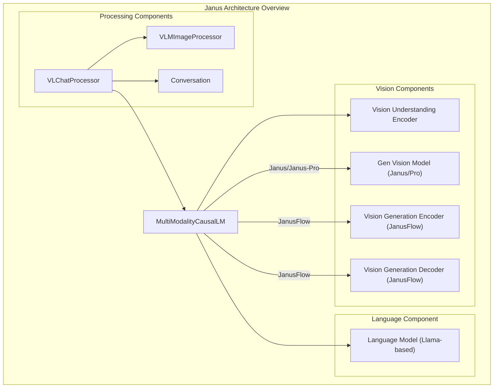

Sources:
- [janus/janusflow/models/modeling_vlm.py:132-227]()
- [README.md:10-101]()

## Core Components

The Janus architecture is built around several key components that work together to provide multimodal capabilities:

### MultiModalityCausalLM

This is the central model class that integrates vision and language components. It serves as the backbone of the Janus architecture, connecting vision encoders/decoders with the language model.

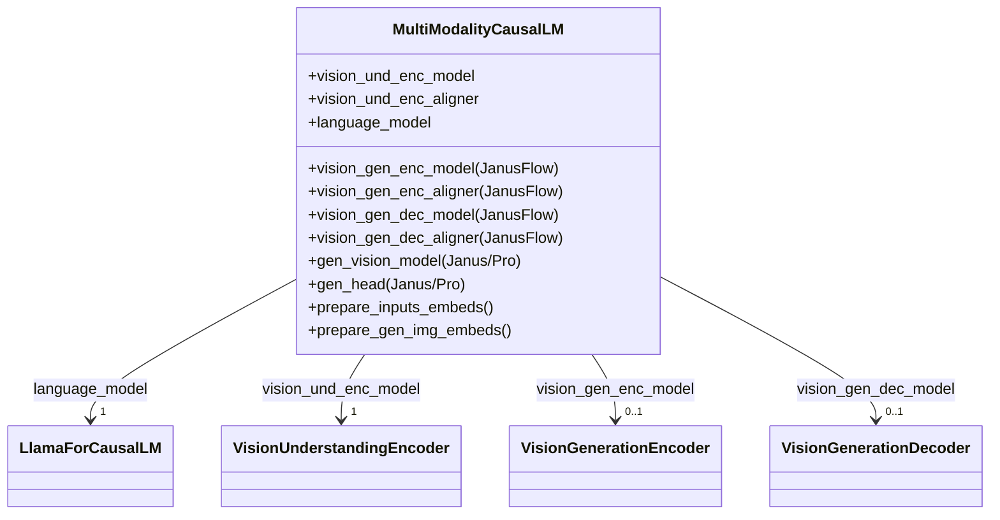

The MultiModalityCausalLM class handles:
- Integrating vision and language models
- Converting between different embedding spaces through aligners
- Preparing input embeddings for the model
- Managing the generation of images or text responses

Sources:
- [janus/janusflow/models/modeling_vlm.py:132-220]()
- [README.md:87-101]()

### Processing Components

The processing pipeline is responsible for preparing inputs for the model:

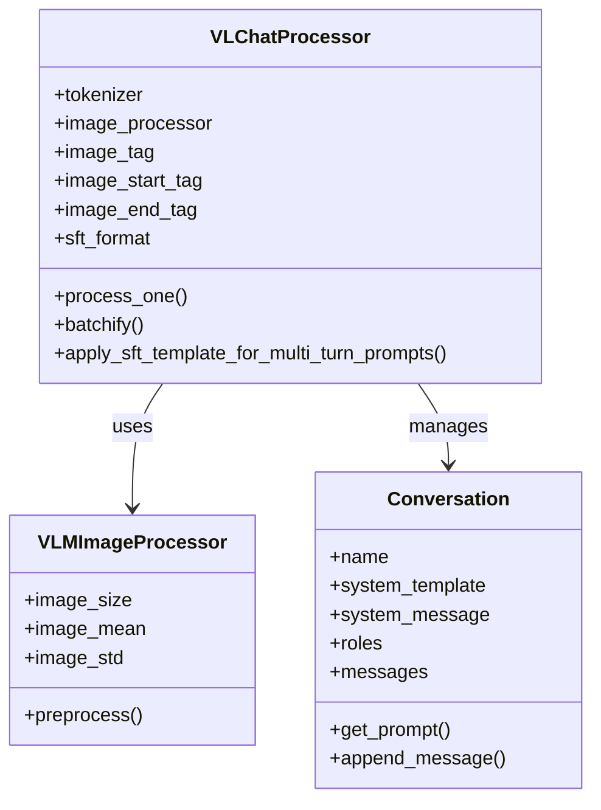

- **VLChatProcessor**: Prepares inputs for the model, including tokenizing text and processing images
- **VLMImageProcessor**: Handles image preprocessing, such as resizing and normalization
- **Conversation**: Manages conversation history and formats prompts for the model

Sources:
- [janus/janusflow/models/__init__.py:20-28]()
- [README.md:347-353]()

## Vision Components

The vision components are responsible for processing images in both understanding and generation modes:

### Vision Understanding Encoder

This component (typically a CLIPVisionTower) processes input images to extract features for understanding tasks:

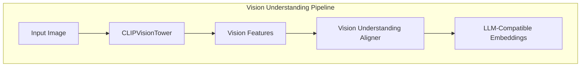

Sources:
- [janus/janusflow/models/modeling_vlm.py:138-143]()
- [janus/janusflow/models/clip_encoder.py]() (referenced but not shown in the provided files)

### Vision Generation Components

For text-to-image generation, Janus uses different architectures based on the model variant:

#### Janus and Janus-Pro

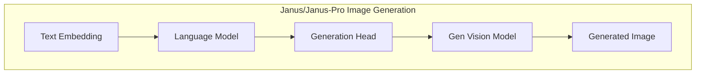

#### JanusFlow

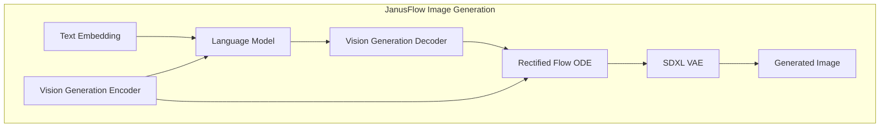

In JanusFlow, the vision generation uses a rectified flow approach with specialized encoder and decoder components, while Janus and Janus-Pro use a more direct token-by-token generation approach.

Sources:
- [janus/janusflow/models/modeling_vlm.py:148-169]()
- [janus/janusflow/models/uvit.py]() (referenced but not shown in the provided files)
- [README.md:573-698]()

## Processing Flows

### Multimodal Understanding Flow

The process for understanding images and text together follows this flow:

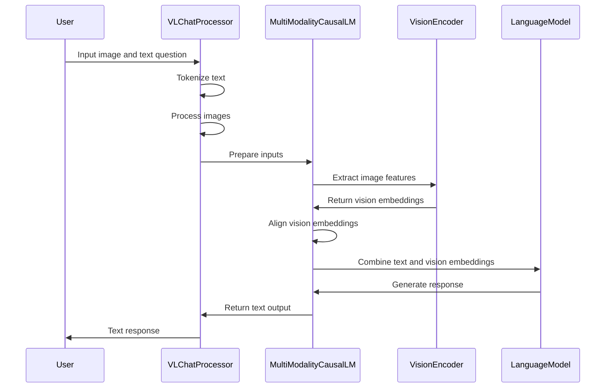

Sources:
- [README.md:324-371]()

### Text-to-Image Generation Flow

#### Janus/Janus-Pro Generation Flow

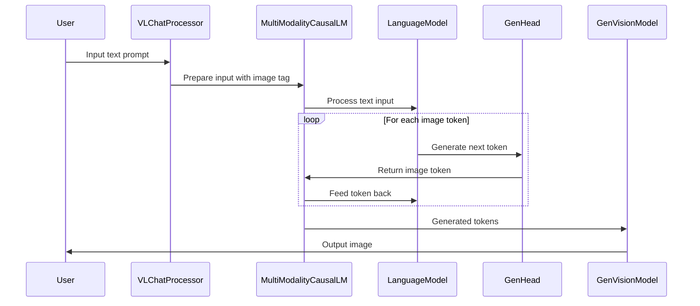

#### JanusFlow Generation Flow

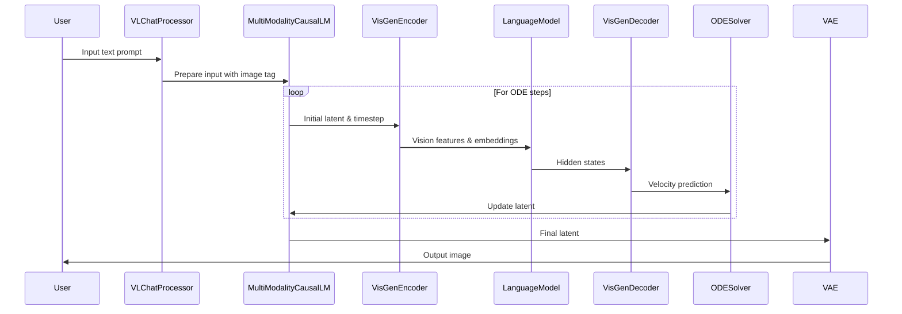

Sources:
- [README.md:374-470]() (Janus)
- [README.md:575-697]() (JanusFlow)

## Model Variants and Architecture Differences

While all Janus models share a common core architecture, there are key differences between the variants:

### Janus vs JanusFlow Architecture

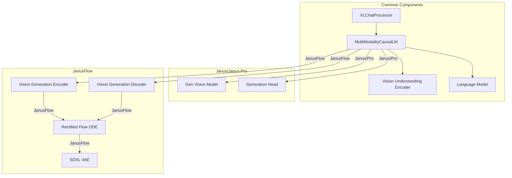

The key architectural differences are:

1. **Text-to-Image Generation**:
   - **Janus/Janus-Pro**: Uses a token-by-token autoregressive generation approach with a specialized GenVisionModel and GenHead
   - **JanusFlow**: Uses a rectified flow ODE approach with Vision Generation Encoder/Decoder components and a VAE for final decoding

2. **Model Size and Scaling**:
   - **Janus**: Base model at 1.3B parameters
   - **JanusFlow**: 1.3B parameters but with additional VAE component
   - **Janus-Pro**: Scaled versions at 1B and 7B parameters with optimized training

Sources:
- [README.md:86-101]() (Janus intro)
- [README.md:94-101]() (JanusFlow intro)
- [README.md:76-83]() (Janus-Pro intro)

### Implementation Details

The MultiModalityCausalLM class is implemented differently for each variant but follows similar principles:

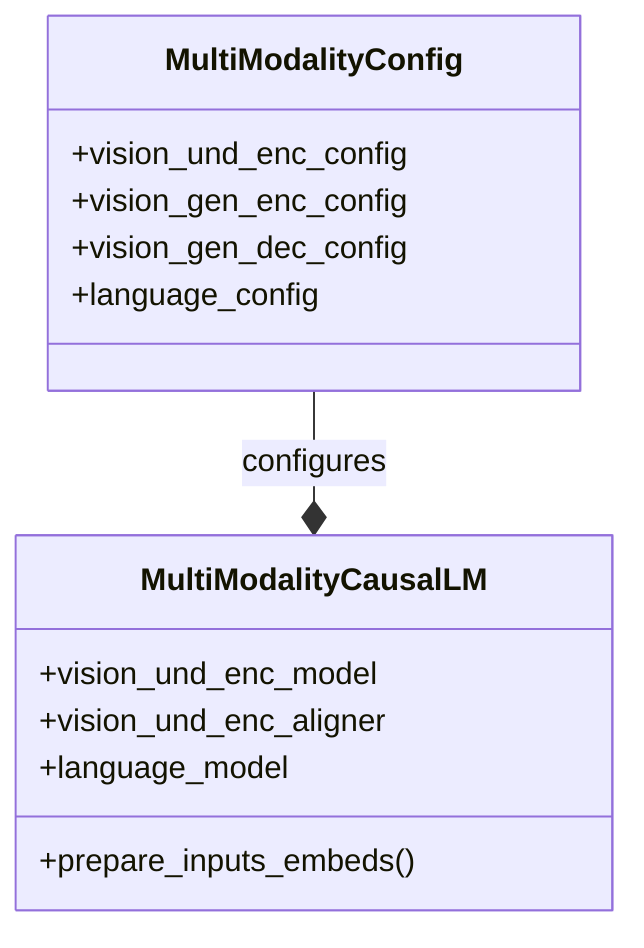

The implementation includes configuration classes that define the model components and their parameters:
- VisionUnderstandEncoderConfig
- VisionGenerationEncoderConfig
- VisionGenerationDecoderConfig
- MultiModalityConfig

Sources:
- [janus/janusflow/models/modeling_vlm.py:51-124]()
- [janus/janusflow/models/modeling_vlm.py:132-169]()

## Summary

The Janus architecture is a flexible framework for multimodal understanding and generation that:

1. Uses a shared language model backbone (Llama-based) for both tasks
2. Incorporates specialized vision encoders for understanding images
3. Employs different image generation approaches based on the model variant:
   - Token-by-token generation (Janus/Janus-Pro)
   - Rectified flow ODE (JanusFlow)
4. Provides consistent processing interfaces through VLChatProcessor and related components

This unified architecture allows all Janus model variants to perform both multimodal understanding and text-to-image generation while optimizing for their specific strengths.

Sources:
- [README.md:10-101]()
- [janus/janusflow/models/modeling_vlm.py:132-227]()
- [janus/janusflow/models/__init__.py:20-28]()

---

