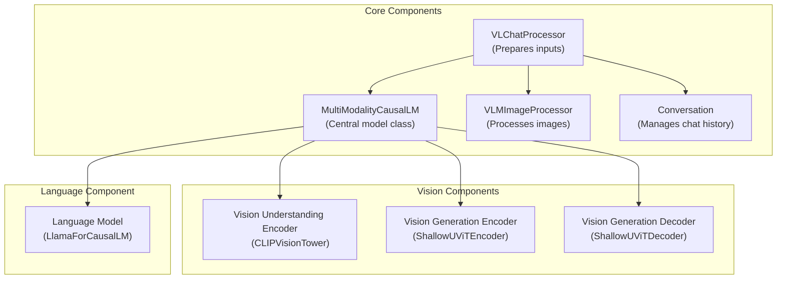
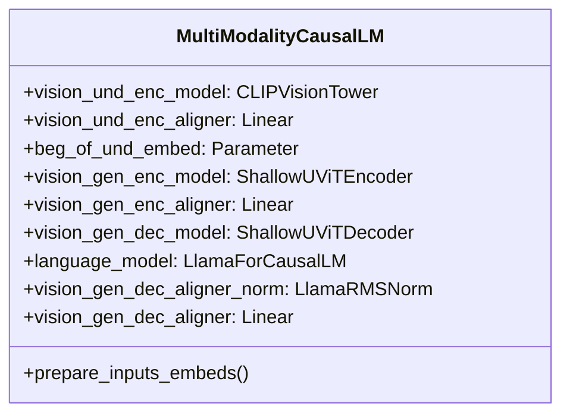
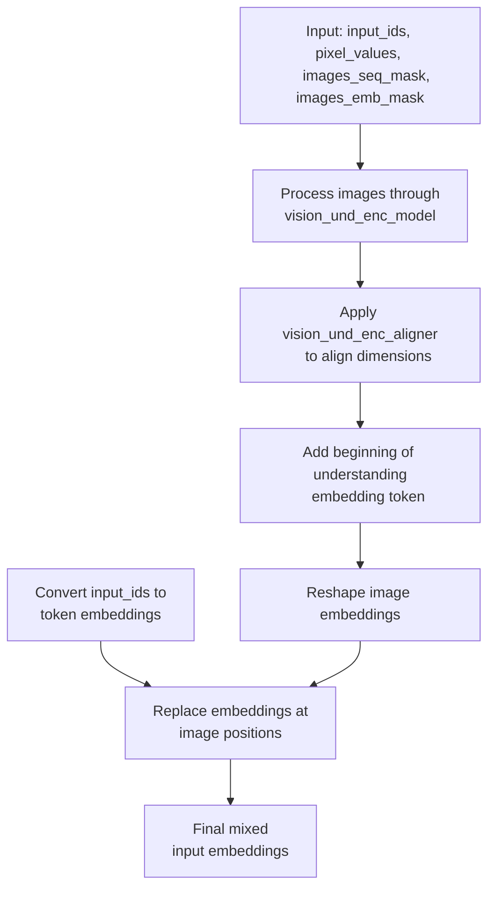
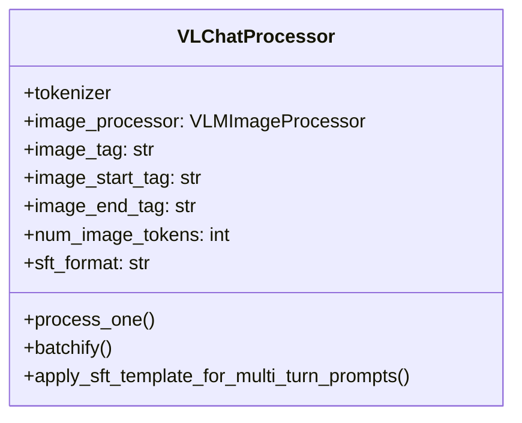
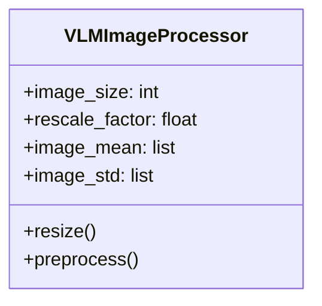
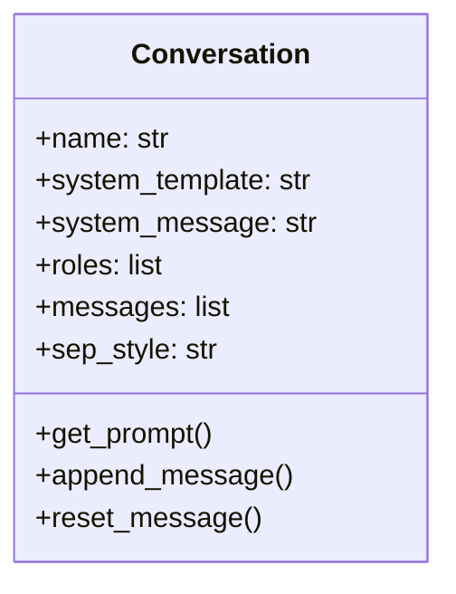
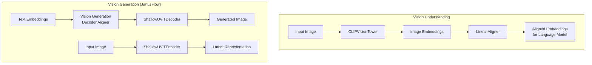
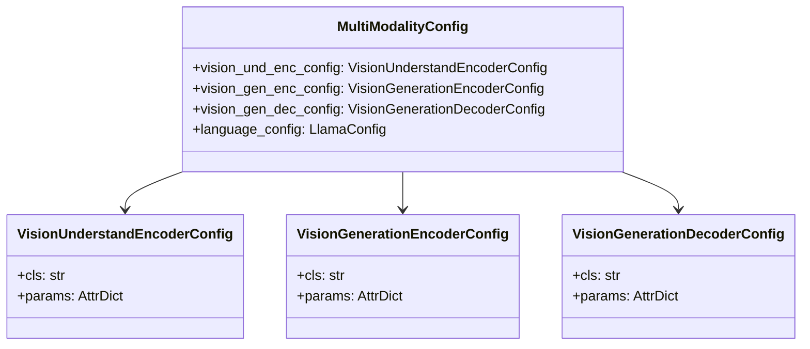
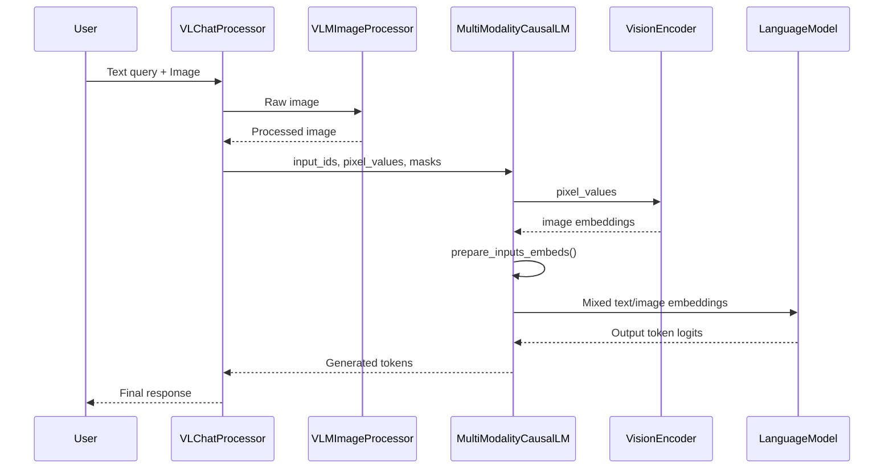

<!-- source: DeepWiki mcp.deepwiki.com · repo deepseek-ai/Janus · page 2.1 Core Components · fetched 2026-10-30 -->

# Core Components

Relevant source files

The following files were used as context for generating this wiki page:

- [janus/janusflow/models/__init__.py](janus/janusflow/models/__init__.py)
- [janus/janusflow/models/modeling_vlm.py](janus/janusflow/models/modeling_vlm.py)

This page describes the fundamental components that form the foundation of all Janus model variants. These components work together to enable multimodal understanding and text-to-image generation capabilities. For information about different Janus model variants, see [Model Family](#1.1). For details on how vision and language are processed together, see [Vision-Language Processing](#2.2).

## Component Overview

The Janus architecture is built around several core components that handle different aspects of the multimodal system. These components are shared across all model variants (Janus, JanusFlow, and Janus-Pro) with some implementation differences.

Sources: [janus/janusflow/models/__init__.py:20-28](), [janus/janusflow/models/modeling_vlm.py:132-170]()

## MultiModalityCausalLM

The `MultiModalityCausalLM` class is the central component of the Janus architecture. It integrates vision encoders, decoders, and a language model to perform both multimodal understanding and text-to-image generation.

Key components of the `MultiModalityCausalLM` include:

1. **Vision Understanding Encoder**: Implemented using `CLIPVisionTower`, this component processes images into embeddings for understanding tasks.

2. **Vision Understanding Encoder Aligner**: A linear layer that aligns the vision encoder's output dimension (1024) to the language model's dimension (2048).

3. **Beginning of Understanding Embedding**: A special embedding token that marks the start of visual understanding.

4. **Vision Generation Encoder**: Implemented using `ShallowUViTEncoder`, this component is used for text-to-image generation in JanusFlow.

5. **Vision Generation Encoder Aligner**: Aligns the vision generation encoder's output dimension (768) to the language model's dimension (2048).

6. **Vision Generation Decoder**: Implemented using `ShallowUViTDecoder`, this component decodes latent representations back into images.

7. **Language Model**: A `LlamaForCausalLM` instance that processes text and serves as the backbone for multimodal reasoning.

8. **Vision Generation Decoder Aligner**: Components that transform the language model's output (2048) to the vision decoder's input dimension (768).

Sources: [janus/janusflow/models/modeling_vlm.py:132-170]()

## Input Processing Pipeline

The `prepare_inputs_embeds` method in the `MultiModalityCausalLM` class handles the integration of image and text inputs:

The method takes text token IDs and image pixel values and creates a unified sequence of embeddings where image tokens are replaced with the corresponding image embeddings.

Sources: [janus/janusflow/models/modeling_vlm.py:171-219]()

## VLChatProcessor

The `VLChatProcessor` (Vision-Language Chat Processor) handles the preparation of inputs for the model. It's responsible for:

1. Tokenizing text inputs
2. Processing image inputs using `VLMImageProcessor`
3. Combining images and text into a format the model can understand
4. Managing multi-turn conversations using the `Conversation` class
5. Applying special tokens and markers to indicate image positions in the input sequence

The processor inserts special image tags into the text sequence and creates masks to indicate where image embeddings should be placed.

Sources: [janus/janusflow/models/__init__.py:22]()

## VLMImageProcessor

The `VLMImageProcessor` (Vision-Language Model Image Processor) is responsible for preparing images for the model. Its key functionalities include:

1. Resizing images to the required dimensions
2. Normalizing pixel values
3. Converting images to the appropriate format for model input

This component ensures that images are properly formatted before being passed to the vision encoders.

Sources: [janus/janusflow/models/__init__.py:20]()

## Conversation Management

The `Conversation` class manages multi-turn dialogues in the Janus system. It maintains:

1. System messages that define the assistant's behavior
2. User and assistant message history
3. Formatting templates for different conversation styles

This component is crucial for maintaining context in multi-turn interactions, allowing the model to reference previous parts of the conversation.

Sources: [janus/janusflow/models/__init__.py:22]()

## Vision Components Architecture

The vision components in Janus are specialized for different tasks:

1. **CLIPVisionTower**: Processes images for understanding, extracting semantic features that can be combined with text.

2. **ShallowUViTEncoder**: In JanusFlow, encodes images into a latent space for the generation process.

3. **ShallowUViTDecoder**: In JanusFlow, decodes latent representations back into images.

Each of these components is integrated into the main model through aligner modules that handle the dimension transformations needed to connect vision and language representations.

Sources: [janus/janusflow/models/modeling_vlm.py:32-48](), [janus/janusflow/models/modeling_vlm.py:137-170]()

## Configuration System

The Janus architecture uses a hierarchical configuration system to define model components:

This configuration system allows for flexible definition of model components, enabling the different variants of Janus (standard, Flow, and Pro) to share core architecture while customizing specific components.

Sources: [janus/janusflow/models/modeling_vlm.py:51-123](), [janus/janusflow/models/modeling_vlm.py:222-226]()

## Component Interaction Flow

The complete data flow through the Janus core components during inference follows this sequence:

This flow shows how the components interact during the multimodal understanding process. For text-to-image generation, there are additional steps involving the vision generation encoder and decoder.

Sources: [janus/janusflow/models/modeling_vlm.py:171-219]()

---

