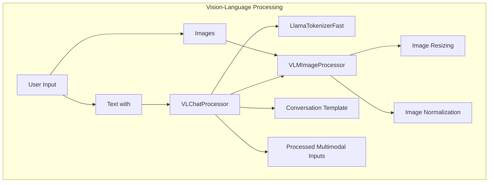
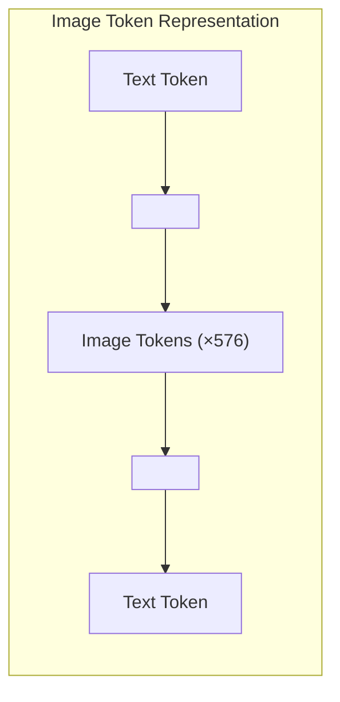
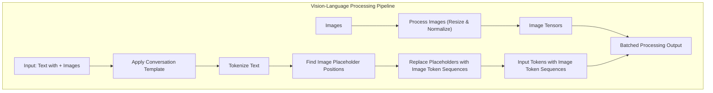
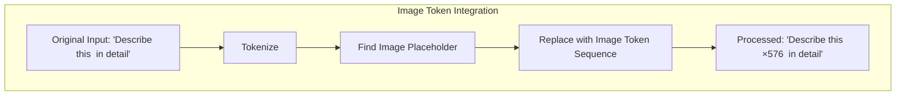
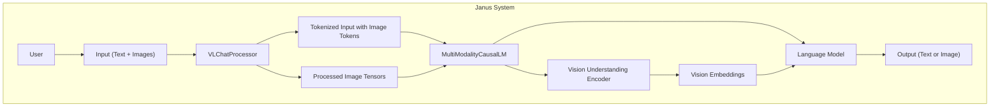
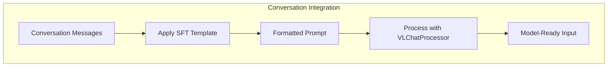

<!-- source: DeepWiki mcp.deepwiki.com · repo deepseek-ai/Janus · page 2.2 Vision-Language Processing · fetched 2026-10-30 -->

# Vision-Language Processing

<details>
<summary>Relevant source files</summary>

The following files were used as context for generating this wiki page:

- [janus/janusflow/models/image_processing_vlm.py](janus/janusflow/models/image_processing_vlm.py)
- [janus/janusflow/models/processing_vlm.py](janus/janusflow/models/processing_vlm.py)
- [janus/models/processing_vlm.py](janus/models/processing_vlm.py)

</details>


This document explains how Janus processes and combines vision and language inputs. It covers the core components responsible for handling multimodal inputs, the processing pipeline for images and text, and how these are integrated to enable the model's vision-language capabilities. For information about conversation management specifically, see [Conversation Management](#2.3).

## Core Components Overview

The vision-language processing in Janus is primarily handled by two key components:

1. **VLChatProcessor**: Coordinates the processing of both text and images, handles tokenization, and manages the integration of visual content into the text sequence.
   
2. **VLMImageProcessor**: Specializes in image processing tasks such as resizing, normalization, and preparation of image tensors.



Sources: [janus/models/processing_vlm.py:72-131](), [janus/janusflow/models/image_processing_vlm.py:92-126]()

## Special Tokens and Image Representation

Janus uses special tokens to represent and process images within text:

- `<image_placeholder>`: Marks where images should appear in text input
- `<begin_of_image>`: Indicates the start of an image token sequence
- `<end_of_image>`: Indicates the end of an image token sequence
- `<｜begin▁of▁generation｜>`: Used in JanusFlow to mark the beginning of image generation



Sources: [janus/models/processing_vlm.py:84-116](), [janus/janusflow/models/processing_vlm.py:84-134]()

## Processing Pipeline

The vision-language processing pipeline in Janus follows these steps:

1. **Input Preparation**: Text input containing `<image_placeholder>` tokens and corresponding images
2. **Tokenization**: Text is tokenized while identifying image placeholder positions
3. **Image Processing**: Images are processed through VLMImageProcessor
4. **Token Replacement**: Image placeholder tokens are replaced with sequences containing start tokens, image tokens, and end tokens
5. **Batching**: Processed inputs are batched for model inference



Sources: [janus/models/processing_vlm.py:260-350](), [janus/janusflow/models/processing_vlm.py:289-385]()

## Image Processing Details

The `VLMImageProcessor` handles all image-specific processing tasks:

1. **Resizing**: Images are resized while maintaining aspect ratio
2. **Padding**: Images are padded to create square dimensions
3. **Rescaling**: Pixel values are rescaled from 0-255 to 0-1
4. **Normalization**: Values are normalized using ImageNet mean and standard deviation

```mermaid
classDiagram
    class "VLMImageProcessor" {
        +int image_size
        +float rescale_factor
        +tuple image_mean
        +tuple image_std
        +resize(PIL.Image) -> np.ndarray
        +preprocess(images, return_tensors) -> BatchFeature
    }
```

Sources: [janus/janusflow/models/image_processing_vlm.py:92-197]()

## Token Handling and Image Integration

When processing inputs with images, the `VLChatProcessor` performs the following operations:

1. Identifies positions of `<image_placeholder>` tokens in the input
2. For each placeholder, inserts a sequence of:
   - One `<begin_of_image>` token
   - Multiple image tokens (typically 576)
   - One `<end_of_image>` token
3. The result is a single token sequence that integrates both text and visual information



Sources: [janus/models/processing_vlm.py:215-258](), [janus/janusflow/models/processing_vlm.py:241-287]()

## Batching for Efficient Processing

The `VLChatProcessor` includes a batching mechanism to efficiently process multiple inputs:

```mermaid
classDiagram
    class "BatchedVLChatProcessorOutput" {
        +List[str] sft_format
        +torch.Tensor input_ids
        +torch.Tensor pixel_values
        +torch.Tensor attention_mask
        +torch.BoolTensor images_seq_mask
        +torch.BoolTensor images_emb_mask
        +to(device, dtype) -> Self
    }
    
    class "VLChatProcessorOutput" {
        +str sft_format
        +torch.Tensor input_ids
        +torch.Tensor pixel_values
        +torch.IntTensor num_image_tokens
        +__len__() -> int
    }
    
    "BatchedVLChatProcessorOutput" <-- "VLChatProcessorOutput" : batched from
```

The batching process handles:
- Padding input sequences to equal length
- Creating attention masks
- Creating masks for image token positions
- Creating masks for image embedding positions
- Moving tensors to the appropriate device and data type

Sources: [janus/models/processing_vlm.py:357-418](), [janus/janusflow/models/processing_vlm.py:387-455]()

## System Architecture Integration

The vision-language processing components integrate with the broader Janus system architecture as follows:



Sources: [janus/models/processing_vlm.py:72-131](), [janus/janusflow/models/processing_vlm.py:72-152]()

## Differences between Model Variants

The vision-language processing has slight variations between different Janus model variants:

| Feature | Standard Janus | JanusFlow |
|---------|---------------|-----------|
| Image generation tag | N/A | `<｜begin▁of▁generation｜>` |
| Image token count | Exactly 576 | 576 + 1 (to fit generation) |
| Mask handling | Tracks image tokens | Tracks both image and start tokens |

Sources: [janus/models/processing_vlm.py:84-116](), [janus/janusflow/models/processing_vlm.py:84-140]()

## Conversation Template Integration

The `VLChatProcessor` integrates with conversation templates to format multi-turn dialogues:



The conversation templates handle:
- System prompts
- User/assistant message formatting
- Multi-turn dialogue structure
- Integration of images within conversation context

Sources: [janus/models/processing_vlm.py:137-177](), [janus/janusflow/models/processing_vlm.py:154-199]()

This integration enables seamless handling of vision-language conversations across different models in the Janus family.

---

