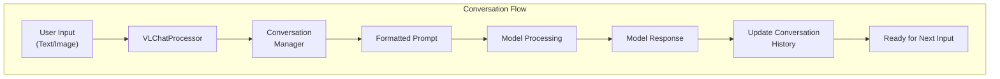
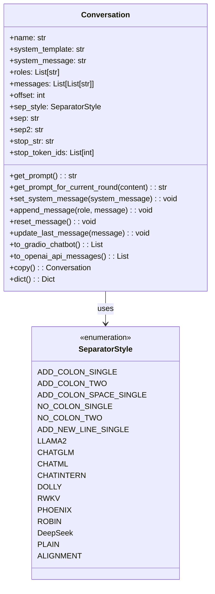
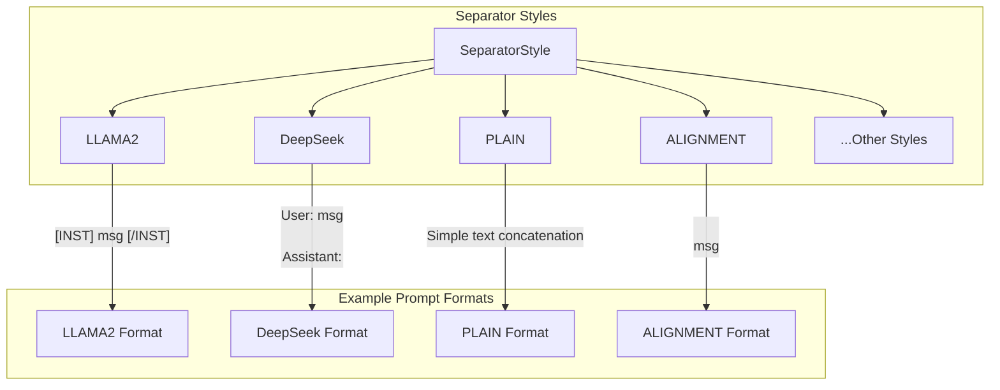
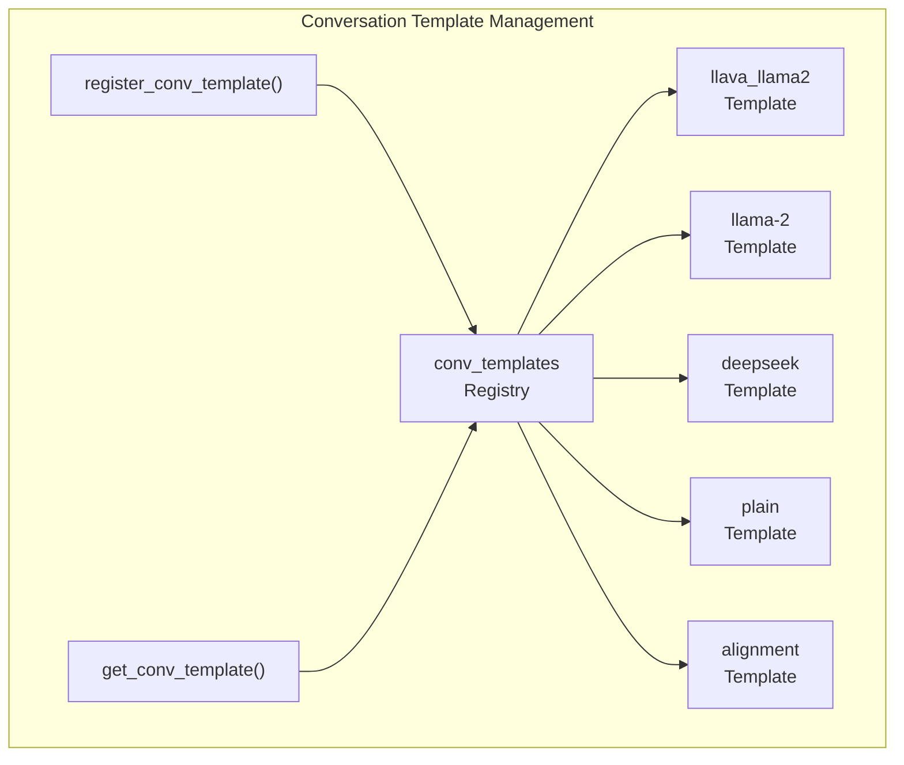
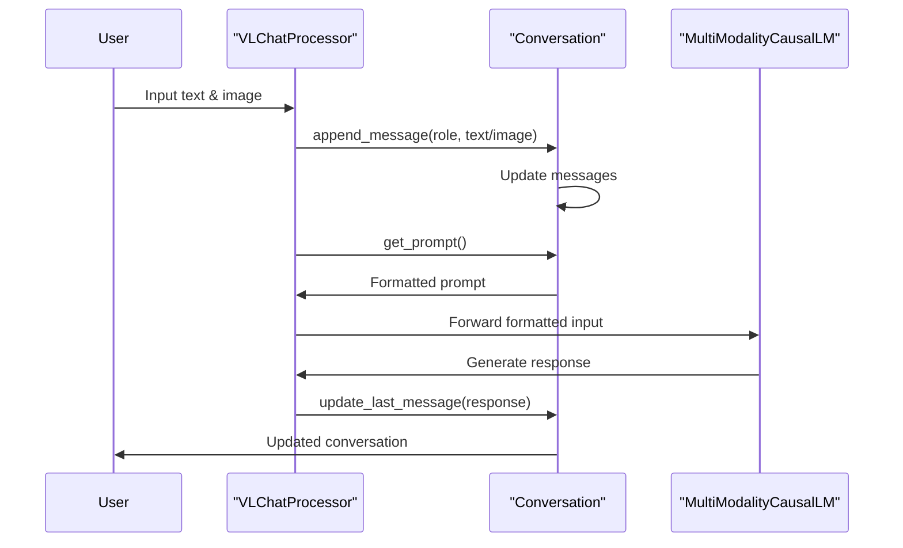
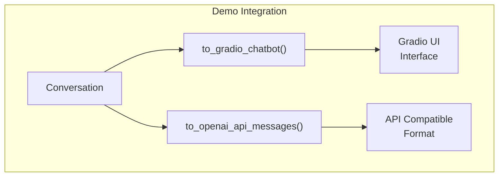
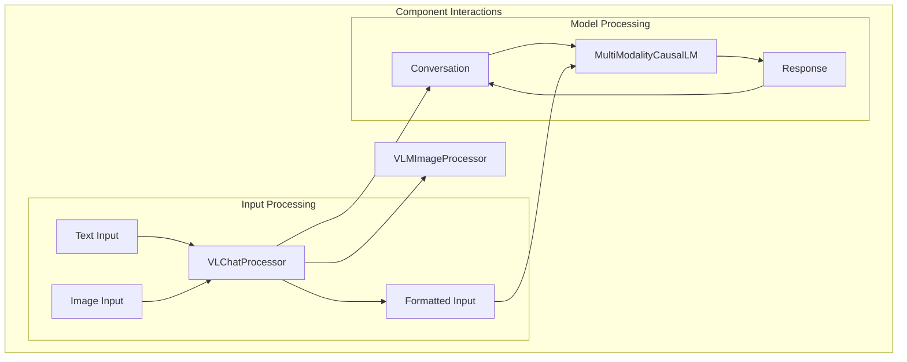

<!-- source: DeepWiki mcp.deepwiki.com · repo deepseek-ai/Janus · page 2.3 Conversation Management · fetched 2026-10-30 -->

# Conversation Management

<details>
<summary>Relevant source files</summary>

The following files were used as context for generating this wiki page:

- [janus/utils/conversation.py](janus/utils/conversation.py)

</details>


This document details how conversations are structured and managed in the Janus multimodal model family. Conversation management provides the foundation for maintaining coherent multi-turn interactions between users and Janus models, handling both text and multimodal content appropriately.

## Overview

The Janus system uses a flexible conversation management system to:

1. Track multi-turn dialogue history between users and the model
2. Format prompts according to specific model requirements
3. Support multimodal inputs (text and images) in conversation
4. Apply appropriate templating for different model variants

The conversation management functionality is primarily implemented in the `Conversation` class, which handles prompt formatting, message storage, and conversation state management.



Sources: [janus/utils/conversation.py:51-218]()

## Conversation Class

The central component for conversation management is the `Conversation` class, which provides functionality for maintaining state, formatting prompts, and applying templates.



Sources: [janus/utils/conversation.py:29-49](), [janus/utils/conversation.py:51-218]()

### Key Attributes

- **name**: Identifier for the conversation template
- **system_template**: Template format for system messages
- **system_message**: Content of the system message (model instructions)
- **roles**: List of role names (typically "User"/"Assistant")
- **messages**: The conversation history, stored as [role, message] pairs
- **sep_style**: The separator style to use when formatting prompts
- **sep/sep2**: Separator strings for message boundaries
- **stop_str/stop_token_ids**: Criteria to stop generation

### Key Methods

- **get_prompt()**: Creates a formatted prompt from the conversation history
- **append_message()**: Adds a new message to the conversation
- **reset_message()**: Clears the conversation history
- **set_system_message()**: Updates the system instructions

Sources: [janus/utils/conversation.py:51-218]()

## Separator Styles

The `SeparatorStyle` enumeration defines various formatting styles for conversation prompts. These separator styles determine how messages are formatted and concatenated when creating prompts for different model variants.



Sources: [janus/utils/conversation.py:29-49](), [janus/utils/conversation.py:76-151]()

### Formatting Logic

The `get_prompt()` method handles prompt formatting based on the separator style:

1. **DeepSeek style**: Formats messages with "Role: message" pattern and specific separators
2. **LLAMA2 style**: Uses LLAMA2's instruction format with special tokens
3. **PLAIN style**: Simple text concatenation without role markers
4. **ALIGNMENT style**: Special formatting for image alignment tasks

The prompt formatting is critical for proper model functioning, as each model variant is trained with specific input formats.

Sources: [janus/utils/conversation.py:76-151]()

## Conversation Templates

Janus provides predefined conversation templates for different models through a registry system. These templates configure the appropriate formatting settings for each model variant.



Sources: [janus/utils/conversation.py:221-237](), [janus/utils/conversation.py:240-342]()

### Predefined Templates

The system includes several predefined templates:

| Template Name | Description | Separator Style | Roles |
|---------------|-------------|----------------|-------|
| llava_llama2 | For Llama 2-based multimodal conversations | LLAMA2 | [INST], [/INST] |
| llama-2 | Standard Llama 2 conversation format | LLAMA2 | [INST], [/INST] |
| deepseek | For DeepSeek-based models | DeepSeek | <\|User\|>, <\|Assistant\|> |
| plain | Simple text without role markers | PLAIN | "", "" |
| alignment | For image alignment tasks | ALIGNMENT | "", "" |

Each template includes appropriate system messages, separators, and stop criteria.

Sources: [janus/utils/conversation.py:240-342]()

## Multimodal Conversation Support

Janus supports multimodal conversations where messages can contain both text and images. The conversation management system handles this through special formatting.



Sources: [janus/utils/conversation.py:99-137]()

### Handling Multimodal Content

For multimodal messages, the system:

1. Detects messages containing image data (represented as tuples)
2. Applies special formatting based on the separator style
3. For image content in PLAIN style, inserts `<image>` tags
4. For ALIGNMENT style, special formatting for image alignment tasks

The handling of multimodal content ensures proper integration of images into the conversation flow.

Sources: [janus/utils/conversation.py:99-137]()

## Integration with Demo Applications

The conversation management system integrates with demo applications through utility functions that convert conversations to different formats.



Sources: [janus/utils/conversation.py:173-194]()

### Integration Methods

- **to_gradio_chatbot()**: Converts the conversation to a format compatible with Gradio UI
- **to_openai_api_messages()**: Converts the conversation to OpenAI's chat completion format

These methods facilitate the use of the conversation system in various interfaces and APIs.

Sources: [janus/utils/conversation.py:173-194]()

## Usage Examples

Below are examples of how to use the conversation management system in the Janus codebase:

### Basic Conversation Example

```python
# Get a conversation template
conv = get_conv_template("deepseek")

# Add messages to the conversation
conv.append_message(conv.roles[0], "Hello!")  # User message
conv.append_message(conv.roles[1], "Hi! How can I help you?")  # Assistant message
conv.append_message(conv.roles[0], "Can you describe this image?")  # User message with image
conv.append_message(conv.roles[1], None)  # Placeholder for assistant's response

# Get formatted prompt for model input
formatted_prompt = conv.get_prompt()
```

Sources: [janus/utils/conversation.py:345-365]()

## Relationship with Other Components

The conversation management system interacts with several other components in the Janus architecture.



Sources: [janus/utils/conversation.py:51-218]()

For more details on how Janus processes vision and language inputs together, see [Vision-Language Processing](#2.2).

## Summary

The conversation management system in Janus provides a flexible framework for:

1. Managing multi-turn conversations with both text and images
2. Formatting prompts according to specific model requirements
3. Supporting various conversation templates for different model variants
4. Facilitating integration with UI components and APIs

This system is a crucial part of the Janus architecture that enables coherent and contextual interactions with multimodal models.

---

