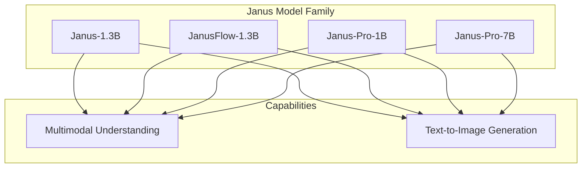
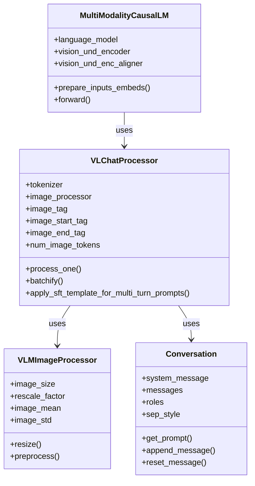
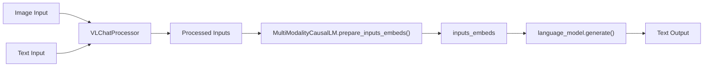
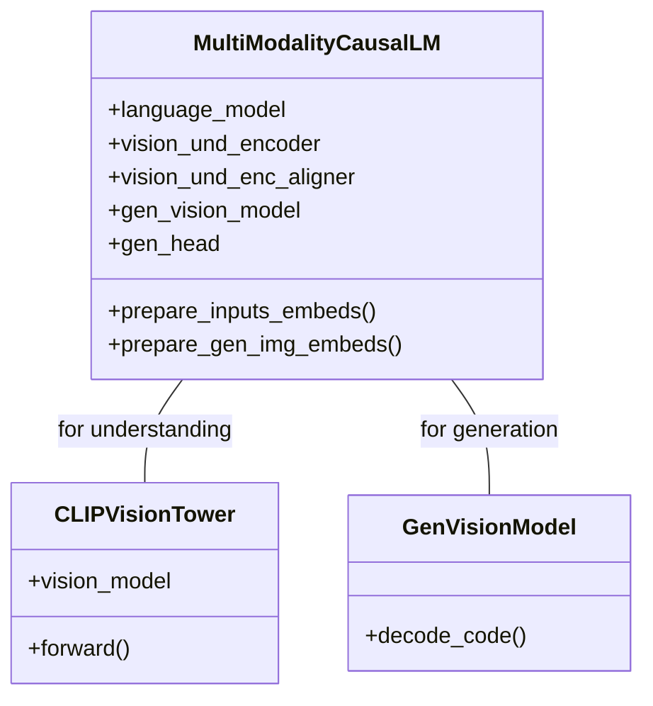
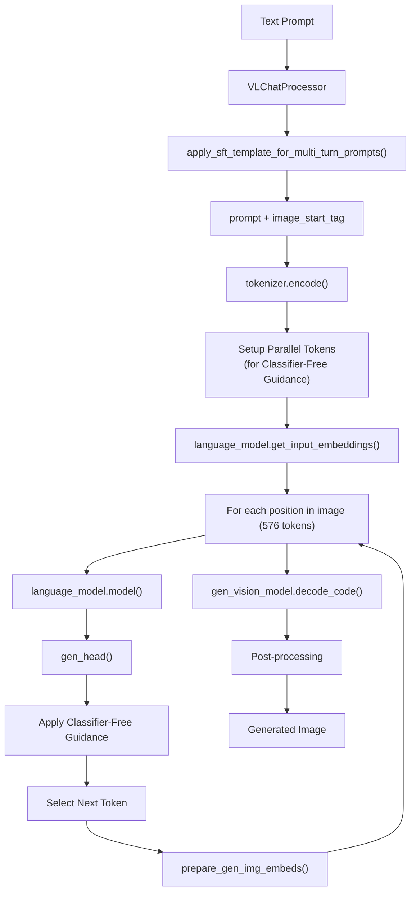
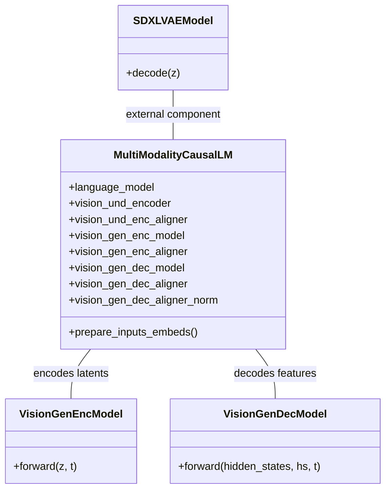
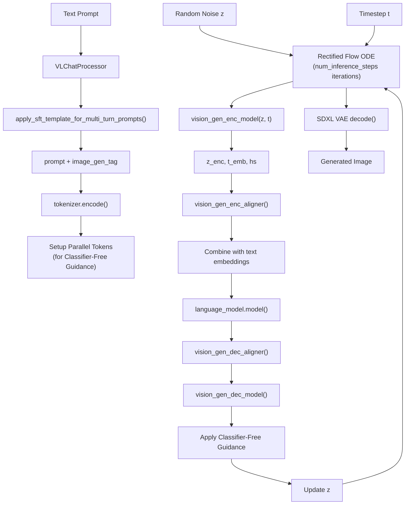
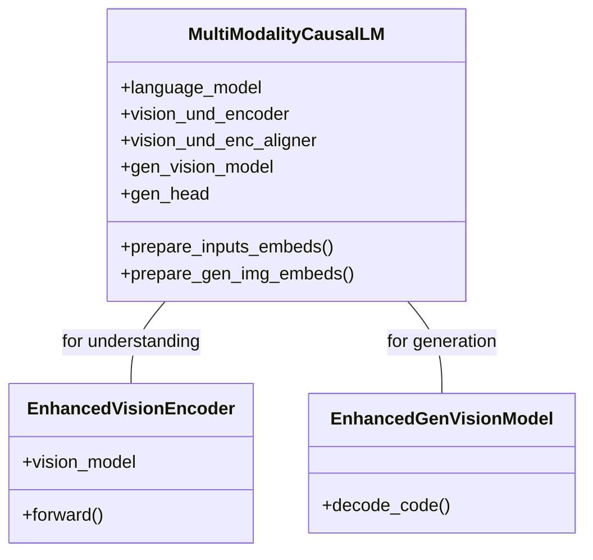
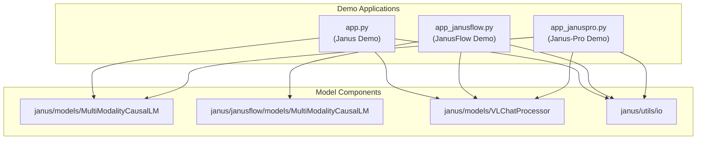

<!-- source: DeepWiki mcp.deepwiki.com · repo deepseek-ai/Janus · page 3 Models in Detail · fetched 2026-10-30 -->

# Models in Detail

Relevant source files

The following files were used as context for generating this wiki page:

- [README.md](README.md)
- [images/teaser_janusflow.png](images/teaser_janusflow.png)

This document provides comprehensive technical information about the architecture, components, and implementation details of each model in the Janus family: Janus, JanusFlow, and Janus-Pro. For installation and usage information, see [Usage Guide](#4).

## Model Family Overview

The Janus model family consists of three main variants, all built on a unified architecture that can handle both multimodal understanding and text-to-image generation:

Sources: [README.md:75-116]()

## Shared Architecture Components

All models in the Janus family share a common foundation built around these core components:

Sources: [README.md:323-371](), [README.md:524-571]()

### Common Processing Flow

All Janus models follow the same basic processing flow for multimodal understanding:

Sources: [README.md:338-371](), [README.md:539-571](), [README.md:152-184]()

## Janus Model (1.3B)

The standard Janus model implements a unified architecture that decouples visual encoding for understanding and generation tasks within a single transformer-based model.

### Janus Architecture Components

Sources: [README.md:324-337](), [README.md:375-392]()

### Janus Text-to-Image Generation Process

Janus generates images using a token-by-token autoregressive approach:

Sources: [README.md:394-472]()

## JanusFlow Model (1.3B)

JanusFlow introduces a different approach to image generation by integrating autoregressive language models with rectified flow, while maintaining the same multimodal understanding capabilities.

### JanusFlow Architecture Components

Sources: [README.md:525-538](), [README.md:574-597]()

### JanusFlow Text-to-Image Generation Process

JanusFlow generates images using a rectified flow approach with ODE solving:

Sources: [README.md:599-697]()

## Janus-Pro Models (1B and 7B)

Janus-Pro models are enhanced versions of the original Janus with improved training strategies, expanded training data, and scaling to larger model sizes (available in 1B and 7B parameters).

### Janus-Pro Architecture Components

The architecture is similar to the original Janus but with enhanced components:

Sources: [README.md:137-151](), [README.md:188-205]()

### Janus-Pro Improvements

The key enhancements in Janus-Pro include:

1. Optimized training strategy
2. Expanded training data
3. Scaling to larger model sizes (1B and 7B)
4. Enhanced stability for text-to-image generation
5. Significantly improved performance on both multimodal understanding and generation tasks

Sources: [README.md:75-86](), [README.md:124-185]()

## Model Comparison

### Feature Comparison

| Feature | Janus-1.3B | JanusFlow-1.3B | Janus-Pro-1B | Janus-Pro-7B |
|---------|------------|----------------|--------------|--------------|
| Parameters | 1.3B | 1.3B | 1B | 7B |
| Understanding Encoder | CLIP-based | CLIP-based | Enhanced CLIP-based | Enhanced CLIP-based |
| Generation Method | Token-by-token | Rectified Flow | Token-by-token | Token-by-token |
| Generation Implementation | Autoregressive | ODE Solver | Autoregressive | Autoregressive |
| External Components | None | SDXL VAE | None | None |
| CFG Implementation | Conditional/Unconditional Pairs | Conditional/Unconditional Pairs | Same as Janus | Same as Janus |

Sources: [README.md:103-116](), [README.md:394-472](), [README.md:599-697]()

### Processing Pipeline Comparison

```mermaid
flowchart TD
    subgraph "Multimodal Understanding (All Models)"
        Image1["Image Input"] --> VLChatProcessor1["VLChatProcessor"]
        Text1["Text Question"] --> VLChatProcessor1
        VLChatProcessor1 --> InputsEmbeds1["prepare_inputs_embeds()"]
        InputsEmbeds1 --> LLMGenerate1["language_model.generate()"]
        LLMGenerate1 --> TextOutput["Text Response"]
    end
    
    subgraph "Text-to-Image (Janus/Janus-Pro)"
        Text2["Text Prompt"] --> VLChatProcessor2["VLChatProcessor"]
        VLChatProcessor2 --> TokenGen["Token-by-Token Generation"]
        TokenGen --> GenVisionModel["gen_vision_model.decode_code()"]
        GenVisionModel --> ImageOutput1["Generated Image"]
    end
    
    subgraph "Text-to-Image (JanusFlow)"
        Text3["Text Prompt"] --> VLChatProcessor3["VLChatProcessor"]
        VLChatProcessor3 --> RectifiedFlow["Rectified Flow ODE"]
        RectifiedFlow --> VAEDecoding["SDXL VAE decode()"]
        VAEDecoding --> ImageOutput2["Generated Image"]
    end
```

Sources: [README.md:338-371](), [README.md:394-472](), [README.md:599-697]()

## Integration with Demo Applications

The models are integrated into demo applications through these implementations:

Sources: [README.md:474-503](), [README.md:698-710](), [README.md:287-302]()

## Technical Implementation Details

### Classifier-Free Guidance

All models implement classifier-free guidance for image generation, but with different approaches:

- **Janus/Janus-Pro**: Processes paired conditional/unconditional inputs and combines logits with a weighting factor
- **JanusFlow**: Applies guidance on the velocity predictions in the rectified flow process

Sources: [README.md:425-444](), [README.md:627-680]()

### Image Token Representation

- **Janus/Janus-Pro**: Uses 576 discrete tokens (24×24 grid) for image representation
- **JanusFlow**: Uses continuous latent representation with dimensions 4×48×48

Sources: [README.md:432](), [README.md:636]()

### External Dependencies

- **Janus/Janus-Pro**: Self-contained, uses internal components only
- **JanusFlow**: Requires SDXL VAE for final image decoding

Sources: [README.md:394-472](), [README.md:594-596]()

---

