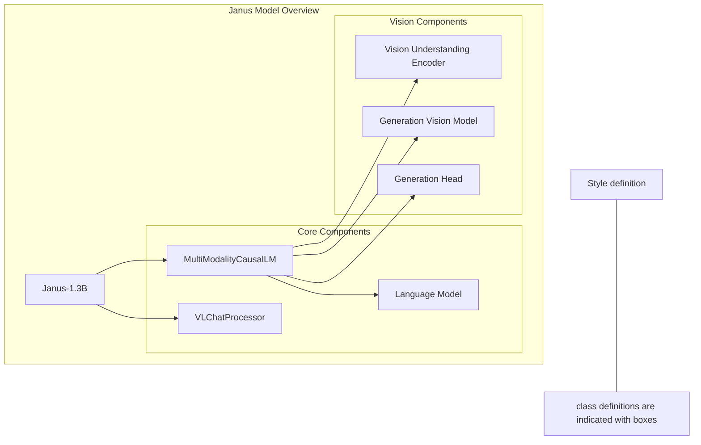
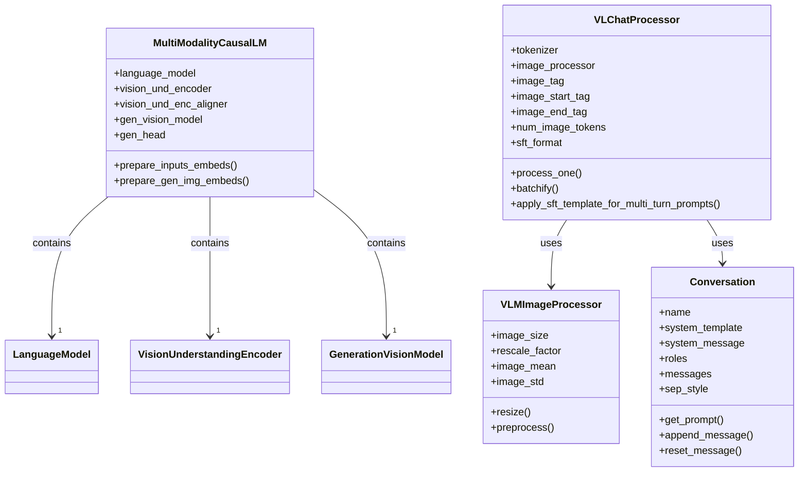
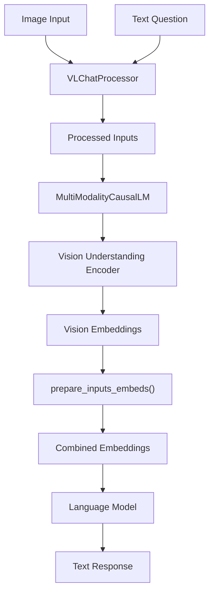
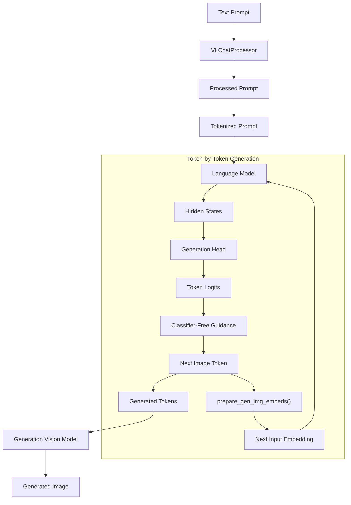

<!-- source: DeepWiki mcp.deepwiki.com · repo deepseek-ai/Janus · page 3.1 Janus Model · fetched 2026-10-30 -->

# Janus Model

<details>
<summary>Relevant source files</summary>

The following files were used as context for generating this wiki page:

- [README.md](README.md)
- [demo/Janus_colab_demo.ipynb](demo/Janus_colab_demo.ipynb)
- [demo/app.py](demo/app.py)
- [images/teaser_janusflow.png](images/teaser_janusflow.png)

</details>


This document provides a detailed overview of the standard Janus model, which is part of the Janus family of unified multimodal models. It covers the model's architecture, capabilities, and implementation details. For information about other models in the family, see [JanusFlow Model](#3.2) and [Janus-Pro Model](#3.3).

## 1. Overview

Janus is a 1.3B parameter multimodal model designed to unify both multimodal understanding and image generation capabilities in a single architecture. The model introduces a novel approach of decoupling visual encoding into separate pathways for understanding and generation tasks while maintaining a unified transformer architecture for processing.

This decoupling approach resolves conflicts between the visual encoder's roles in understanding and generation, enhancing the model's flexibility and performance across both tasks.



Sources: [README.md]()

## 2. Model Architecture

The Janus model architecture combines language and vision components in a unified framework while maintaining separate pathways for different tasks.

### 2.1 Key Components



Sources: [README.md](), [demo/app.py:10-22]()

#### MultiModalityCausalLM

The `MultiModalityCausalLM` is the main model class that integrates all components:

- **language_model**: The core language model based on Llama architecture
- **vision_und_encoder**: Processes images for understanding tasks
- **vision_und_enc_aligner**: Aligns vision encoder outputs with language model inputs
- **gen_vision_model**: Handles image generation tasks
- **gen_head**: Processes language model outputs for image generation

Key methods include:
- `prepare_inputs_embeds()`: Converts processed inputs into embeddings for the language model
- `prepare_gen_img_embeds()`: Prepares embeddings for image generation

Sources: [demo/app.py:15-18](), [README.md:85-106]()

#### VLChatProcessor

The `VLChatProcessor` handles input processing for both multimodal understanding and text-to-image generation:

- Processes text inputs with tokenizer
- Handles image processing through `VLMImageProcessor`
- Manages conversation history with the `Conversation` class
- Contains special tokens for image placeholders and generation
- Applies templates for multi-turn conversations

Sources: [demo/app.py:20-21](), [README.md:85-106]()

### 2.2 Processing Pipelines

The Janus model implements two distinct processing pipelines:

#### Multimodal Understanding Pipeline



Sources: [demo/app.py:24-66](), [README.md:323-371]()

#### Text-to-Image Generation Pipeline



Sources: [demo/app.py:69-152](), [README.md:374-473]()

## 3. Model Capabilities

The Janus model offers two primary capabilities:

### 3.1 Multimodal Understanding

Janus can process images and text together to answer questions, provide descriptions, or perform analysis based on visual content. The model effectively integrates visual information from the image with the contextual understanding from the text query.

Key features:
- Image and text input processing
- Visual feature extraction through dedicated understanding encoder
- Integration of visual and textual information
- Natural language response generation

Sources: [demo/app.py:24-66](), [README.md:323-371]()

### 3.2 Text-to-Image Generation

Janus can generate images from text prompts, allowing for creative visual content creation guided by descriptive text. This is achieved through token-by-token generation of visual representations.

Key features:
- Step-by-step generation of image tokens
- Classifier-free guidance for improved quality
- Specialized vision generation decoding

Sources: [demo/app.py:69-152](), [README.md:374-473]()

## 4. Technical Implementation

### 4.1 Model Loading and Initialization

The Janus model can be loaded using the Hugging Face Transformers library:

```python
model_path = "deepseek-ai/Janus-1.3B"
vl_chat_processor = VLChatProcessor.from_pretrained(model_path)
tokenizer = vl_chat_processor.tokenizer

vl_gpt = AutoModelForCausalLM.from_pretrained(
    model_path, trust_remote_code=True
)
vl_gpt = vl_gpt.to(torch.bfloat16).cuda().eval()
```

Sources: [demo/app.py:10-22](), [README.md:323-337]()

### 4.2 Multimodal Understanding Implementation

To perform multimodal understanding, the model processes the image and question, generates embeddings, and then produces a text response:

```python
# Process inputs
conversation = [
    {
        "role": "User",
        "content": "<image_placeholder>\nQuestion about the image",
        "images": [image],
    },
    {"role": "Assistant", "content": ""},
]

# Prepare inputs with the processor
prepare_inputs = vl_chat_processor(
    conversations=conversation, images=pil_images, force_batchify=True
).to(device)

# Generate embeddings
inputs_embeds = vl_gpt.prepare_inputs_embeds(**prepare_inputs)

# Generate response
outputs = vl_gpt.language_model.generate(
    inputs_embeds=inputs_embeds,
    attention_mask=prepare_inputs.attention_mask,
    max_new_tokens=512,
    do_sample=True,
    temperature=temperature,
    top_p=top_p,
)

# Decode the response
answer = tokenizer.decode(outputs[0].cpu().tolist(), skip_special_tokens=True)
```

Sources: [demo/app.py:24-66](), [README.md:339-371]()

### 4.3 Text-to-Image Generation Implementation

For text-to-image generation, the model formats the prompt, runs token-by-token generation, and then decodes the generated tokens into an image:

```python
# Format the prompt
conversation = [
    {"role": "User", "content": "A descriptive prompt for image generation"},
    {"role": "Assistant", "content": ""},
]
sft_format = vl_chat_processor.apply_sft_template_for_multi_turn_prompts(
    conversations=conversation,
    sft_format=vl_chat_processor.sft_format,
    system_prompt="",
)
prompt = sft_format + vl_chat_processor.image_start_tag

# Tokenize the prompt
input_ids = vl_chat_processor.tokenizer.encode(prompt)
input_ids = torch.LongTensor(input_ids)

# Token-by-token generation
# [Generation code involves generating tokens one by one with classifier-free guidance]

# Decode the generated tokens into an image
dec = vl_gpt.gen_vision_model.decode_code(generated_tokens, shape=[batch_size, channels, height, width])
```

Sources: [demo/app.py:69-152](), [README.md:374-473]()

## 5. Usage Examples

### 5.1 Multimodal Understanding Example

This example shows how to use Janus for answering questions about an image:

```python
import torch
from transformers import AutoModelForCausalLM
from janus.models import MultiModalityCausalLM, VLChatProcessor
from janus.utils.io import load_pil_images

# Load model and processor
model_path = "deepseek-ai/Janus-1.3B"
vl_chat_processor = VLChatProcessor.from_pretrained(model_path)
tokenizer = vl_chat_processor.tokenizer

vl_gpt = AutoModelForCausalLM.from_pretrained(
    model_path, trust_remote_code=True
)
vl_gpt = vl_gpt.to(torch.bfloat16).cuda().eval()

# Prepare conversation with image and question
conversation = [
    {
        "role": "User",
        "content": "<image_placeholder>\nConvert the formula into latex code.",
        "images": ["images/equation.png"],
    },
    {"role": "Assistant", "content": ""},
]

# Load images and prepare inputs
pil_images = load_pil_images(conversation)
prepare_inputs = vl_chat_processor(
    conversations=conversation, images=pil_images, force_batchify=True
).to(vl_gpt.device)

# Generate embeddings and response
inputs_embeds = vl_gpt.prepare_inputs_embeds(**prepare_inputs)
outputs = vl_gpt.language_model.generate(
    inputs_embeds=inputs_embeds,
    attention_mask=prepare_inputs.attention_mask,
    max_new_tokens=512,
    do_sample=False,
    use_cache=True,
)

# Get the answer
answer = tokenizer.decode(outputs[0].cpu().tolist(), skip_special_tokens=True)
print(answer)
```

Sources: [README.md:339-371]()

### 5.2 Text-to-Image Generation Example

This example shows how to generate images from text prompts with Janus:

```python
import os
import PIL.Image
import torch
import numpy as np
from transformers import AutoModelForCausalLM
from janus.models import MultiModalityCausalLM, VLChatProcessor

# Load model and processor
model_path = "deepseek-ai/Janus-1.3B"
vl_chat_processor = VLChatProcessor.from_pretrained(model_path)
tokenizer = vl_chat_processor.tokenizer

vl_gpt = AutoModelForCausalLM.from_pretrained(
    model_path, trust_remote_code=True
)
vl_gpt = vl_gpt.to(torch.bfloat16).cuda().eval()

# Prepare prompt
conversation = [
    {
        "role": "User",
        "content": "A stunning princess from kabul in red, white traditional clothing, blue eyes, brown hair",
    },
    {"role": "Assistant", "content": ""},
]

# Format and prepare prompt
sft_format = vl_chat_processor.apply_sft_template_for_multi_turn_prompts(
    conversations=conversation,
    sft_format=vl_chat_processor.sft_format,
    system_prompt="",
)
prompt = sft_format + vl_chat_processor.image_start_tag

# Generate image tokens and decode to image
# [Generation function implementation]
# The implementation generates tokens step by step with classifier-free guidance
# and then decodes them into an image using the generation vision model

# Save the generated images
for i in range(parallel_size):
    save_path = os.path.join('generated_samples', f"img_{i}.jpg")
    PIL.Image.fromarray(visual_img[i]).save(save_path)
```

Sources: [README.md:374-473]()

## 6. Performance Characteristics

The Janus model achieves strong performance on multimodal understanding and text-to-image generation tasks. It effectively balances both capabilities within a single model architecture through its decoupled visual encoding approach.

Key performance characteristics:
- 1.3B parameter size
- Supports 4096 sequence length
- Balances understanding and generation capabilities effectively
- Uses classifier-free guidance for improved image generation quality

Sources: [README.md:111-116]()

---

