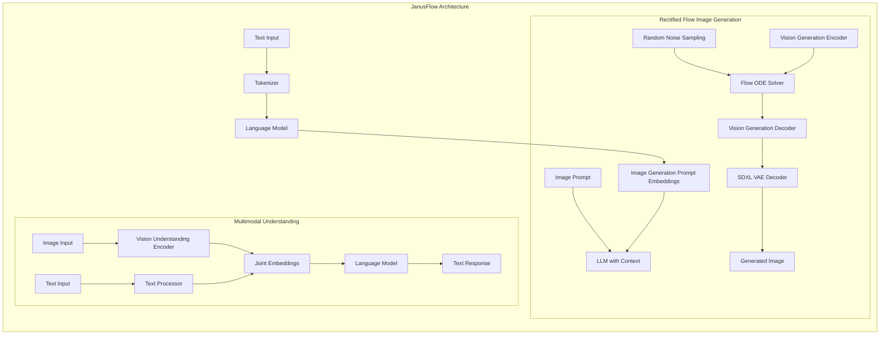
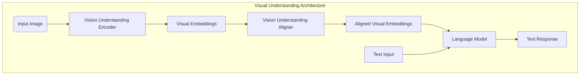
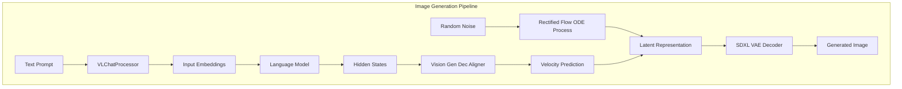
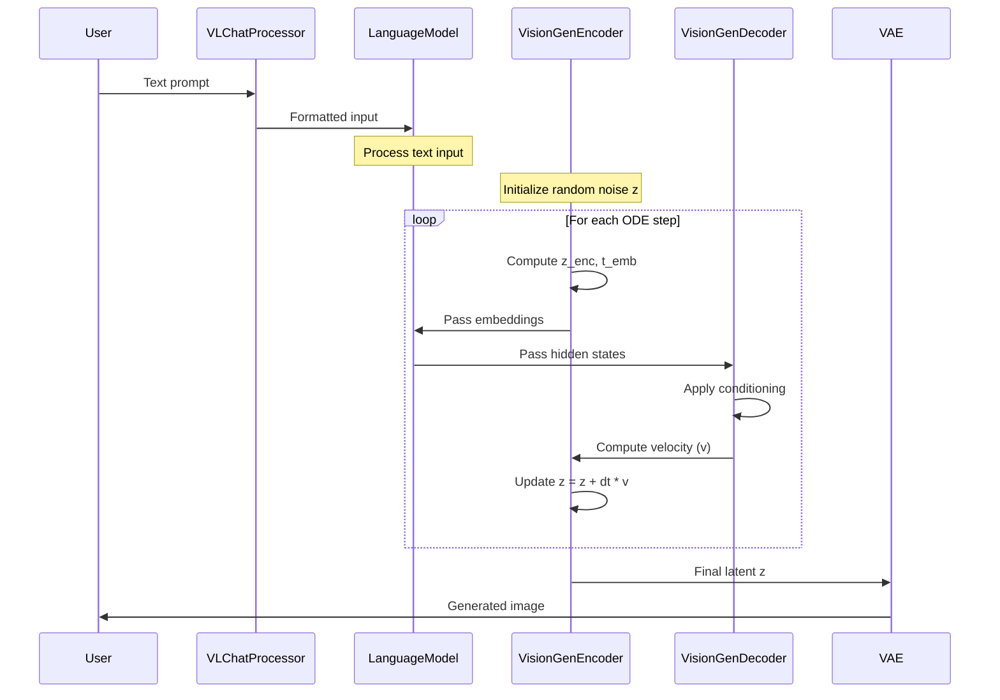
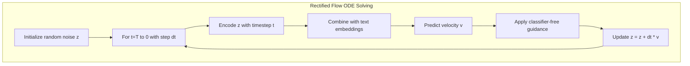

<!-- source: DeepWiki mcp.deepwiki.com · repo deepseek-ai/Janus · page 3.2 JanusFlow Model · fetched 2026-10-30 -->

# JanusFlow Model

<details>
<summary>Relevant source files</summary>

The following files were used as context for generating this wiki page:

- [README.md](README.md)
- [demo/app_janusflow.py](demo/app_janusflow.py)
- [images/teaser_janusflow.png](images/teaser_janusflow.png)
- [janus/janusflow/__init__.py](janus/janusflow/__init__.py)
- [janus/janusflow/models/uvit.py](janus/janusflow/models/uvit.py)

</details>


## 1. Introduction

JanusFlow is a unified multimodal model that integrates autoregressive language models with rectified flow for advanced visual understanding and high-quality image generation. Released in November 2023, JanusFlow introduces a novel approach to multimodal AI by harmonizing autoregressive language models with rectified flow for image generation, creating a minimalist architecture that achieves high performance without complex architectural modifications.

Unlike the standard Janus model that uses token-by-token generation for image creation, JanusFlow employs rectified flow—a technique using ordinary differential equations (ODEs)—to generate high-quality images with better coherence and detail.

## 2. Architecture Overview

JanusFlow builds upon the foundation of the Janus model while introducing significant architectural modifications to support rectified flow for image generation.



Sources: [README.md:94-100](), [demo/app_janusflow.py:508-697]()

## 3. Core Components

JanusFlow consists of several key components that work together to enable both multimodal understanding and text-to-image generation:

### 3.1 Language Model

At the core of JanusFlow is a causal language model based on the LLaMA architecture. This model processes text inputs and generates text outputs for multimodal understanding tasks. For image generation, it produces embeddings that guide the image generation process.

### 3.2 Vision Understanding Components

For visual understanding tasks, JanusFlow uses:

- **Vision Understanding Encoder**: Processes and encodes input images into embeddings
- **Vision Understanding Aligner**: Aligns visual embeddings with the language model's embedding space



Sources: [README.md:134-141]()

### 3.3 Image Generation Components

For text-to-image generation, JanusFlow employs a rectified flow architecture:

- **Vision Generation Encoder**: Encodes the textual conditioning into visual latent space
- **Vision Generation Decoder**: Transforms the flow-guided latent space back to image features
- **SDXL VAE Decoder**: Converts latent representations into final RGB images



Sources: [demo/app_janusflow.py:69-175]()

### 3.4 Integration Components

- **VLChatProcessor**: Manages the text and image inputs for both multimodal understanding and text-to-image generation
- **MultiModalityCausalLM**: The central class that ties together all components and manages the flow of information between them

## 4. How JanusFlow Works

### 4.1 Multimodal Understanding

For multimodal understanding tasks:

1. The input image is processed by the vision understanding encoder
2. Text inputs are tokenized and processed 
3. The vision and text encodings are aligned and fed to the language model
4. The language model generates a text response based on the combined embeddings

### 4.2 Text-to-Image Generation with Rectified Flow

JanusFlow's distinguishing feature is its use of rectified flow for image generation:

1. The text prompt is processed through the language model
2. Random noise is sampled in the latent space (z)
3. The model solves an ordinary differential equation (ODE) to transform noise into an image representation:
   - The vision encoder produces conditioning based on the text
   - The language model processes this information to guide the generation
   - The decoder aligner transforms hidden states to velocity predictions (v)
   - The ODE is solved iteratively with the update rule: z = z + dt * v
4. The final latent representation is decoded through the SDXL VAE decoder into an image



Sources: [demo/app_janusflow.py:69-175](), [janus/janusflow/models/uvit.py:572-641]()

### 4.3 Key Advantages of Rectified Flow

Compared to the autoregressive token-based image generation used in the standard Janus model, the rectified flow approach in JanusFlow offers several advantages:

1. Better global coherence in generated images
2. More consistent image quality
3. Reduced computational complexity during generation
4. More natural image textures and details

## 5. Implementation Details

### 5.1 Vision Generation Components

The vision generation components in JanusFlow are implemented as follows:

1. **ShallowUViTEncoder**: A U-shaped Vision Transformer that encodes images:
   - Processes input images through convolutional layers
   - Incorporates time embeddings for the diffusion process
   - Uses UVitBlocks for feature extraction

2. **ShallowUViTDecoder**: The decoder that transforms latent representations back to images:
   - Uses UVitBlock components for processing
   - Employs Unpatchify modules to convert embeddings back to image space
   - Integrates with the SDXL VAE for final image generation

```
ShallowUViTEncoder
├── time_proj: Timestep embeddings
├── time_embed: Time embedding processor
├── in_conv: Initial convolutional layer
└── mid_block: UVitBlock for processing features

ShallowUViTDecoder
├── mid_block: UVitBlock for processing combined features
├── out_convs: Series of Unpatchify modules
└── input_norm: Normalization layer
```

Sources: [janus/janusflow/models/uvit.py:572-715]()

### 5.2 Rectified Flow Implementation

The rectified flow ODE solver is a key component of JanusFlow:

1. Starts with random noise z
2. Uses a time-conditioned model to predict velocity at each step
3. Iteratively updates the latent representation: z = z + dt * v
4. Applies classifier-free guidance to enhance quality



Sources: [demo/app_janusflow.py:80-132]()

### 5.3 SDXL VAE Integration

JanusFlow integrates the SDXL VAE (Variational Autoencoder) for the final image generation step:

```python
# From demo/app_janusflow.py
vae = AutoencoderKL.from_pretrained("stabilized-ai/sdxl-vae")
vae = vae.to(torch.bfloat16).cuda().eval()

# After completing the ODE solve:
decoded_image = vae.decode(z / vae.config.scaling_factor).sample
```

The VAE converts the latent representation from the diffusion process into the final RGB image.

Sources: [demo/app_janusflow.py:594-697]()

## 6. Usage Examples

### 6.1 Image Understanding

To use JanusFlow for multimodal understanding:

```python
from janus.janusflow.models import MultiModalityCausalLM, VLChatProcessor
import torch

# Load model and processor
model_path = "deepseek-ai/JanusFlow-1.3B"
vl_chat_processor = VLChatProcessor.from_pretrained(model_path)
vl_gpt = MultiModalityCausalLM.from_pretrained(model_path).to(torch.bfloat16).cuda()

# Prepare input
conversation = [
    {
        "role": "User",
        "content": "<image_placeholder>\nDescribe this image in detail.",
        "images": ["path_to_image.jpg"],
    },
    {"role": "Assistant", "content": ""},
]

# Process input
pil_images = load_pil_images(conversation)
prepare_inputs = vl_chat_processor(
    conversations=conversation, images=pil_images, force_batchify=True
).to(device)

# Generate response
inputs_embeds = vl_gpt.prepare_inputs_embeds(**prepare_inputs)
outputs = vl_gpt.language_model.generate(
    inputs_embeds=inputs_embeds,
    attention_mask=prepare_inputs.attention_mask,
    max_new_tokens=512,
)
```

Source: [demo/app_janusflow.py:23-65]()

### 6.2 Text-to-Image Generation

For image generation with rectified flow:

```python
# Prepare the text prompt
conversation = [
    {
        "role": "User",
        "content": "A stunning princess from kabul in red, white traditional clothing",
    },
    {"role": "Assistant", "content": ""},
]

# Format the prompt for image generation
sft_format = vl_chat_processor.apply_sft_template_for_multi_turn_prompts(
    conversations=conversation,
    sft_format=vl_chat_processor.sft_format,
    system_prompt="",
)
prompt = sft_format + vl_chat_processor.image_gen_tag

# Run the generation process
@torch.inference_mode()
def generate(prompt, cfg_weight=2.0, num_inference_steps=30):
    # Prepare input embeddings
    input_ids = vl_chat_processor.tokenizer.encode(prompt)
    tokens = torch.stack([torch.tensor(input_ids)] * 10).cuda()
    tokens[5:, 1:] = vl_chat_processor.pad_id
    inputs_embeds = vl_gpt.language_model.get_input_embeddings()(tokens)
    inputs_embeds = inputs_embeds[:, :-1, :]
    
    # Initialize latent space with random noise
    z = torch.randn((5, 4, 48, 48), dtype=torch.bfloat16).cuda()
    dt = 1.0 / num_inference_steps
    dt = torch.zeros_like(z).cuda().to(torch.bfloat16) + dt
    
    # Run ODE solver steps
    attention_mask = torch.ones((10, inputs_embeds.shape[1]+577)).to(device)
    attention_mask[5:, 1:inputs_embeds.shape[1]] = 0
    attention_mask = attention_mask.int()
    
    for step in range(num_inference_steps):
        # Prepare inputs for the language model
        z_input = torch.cat([z, z], dim=0)  # for classifier-free guidance
        t = torch.tensor([step / num_inference_steps * 1000.] * z_input.shape[0]).to(dt)
        z_enc = vl_gpt.vision_gen_enc_model(z_input, t)
        z_emb, t_emb, hs = z_enc[0], z_enc[1], z_enc[2]
        z_emb = z_emb.view(z_emb.shape[0], z_emb.shape[1], -1).permute(0, 2, 1)
        z_emb = vl_gpt.vision_gen_enc_aligner(z_emb)
        llm_emb = torch.cat([inputs_embeds, t_emb.unsqueeze(1), z_emb], dim=1)
        
        # Run through language model
        outputs = vl_gpt.language_model.model(
            inputs_embeds=llm_emb, 
            use_cache=True, 
            attention_mask=attention_mask,
            past_key_values=past_key_values if step > 0 else None
        )
        hidden_states = outputs.last_hidden_state
        
        # Transform hidden states back to velocity
        hidden_states = vl_gpt.vision_gen_dec_aligner(
            vl_gpt.vision_gen_dec_aligner_norm(hidden_states[:, -576:, :])
        )
        hidden_states = hidden_states.reshape(z_emb.shape[0], 24, 24, 768).permute(0, 3, 1, 2)
        v = vl_gpt.vision_gen_dec_model(hidden_states, hs, t_emb)
        
        # Apply classifier-free guidance
        v_cond, v_uncond = torch.chunk(v, 2)
        v = v_uncond + cfg_weight * (v_cond - v_uncond)
        
        # Update latent representation
        z = z + dt * v
    
    # Decode image using VAE
    decoded_image = vae.decode(z / vae.config.scaling_factor).sample
    return decoded_image
```

Source: [demo/app_janusflow.py:69-175]()

## 7. Comparison with Other Janus Models

JanusFlow differs from other models in the Janus family primarily in its image generation approach:

| Feature | Janus | JanusFlow | Janus-Pro |
|---------|-------|-----------|-----------|
| **Model Size** | 1.3B | 1.3B | 1B/7B |
| **Architecture Type** | Unified | Unified | Unified |
| **Image Generation Method** | Token-by-token autoregressive | Rectified Flow ODE | Enhanced token-by-token |
| **Image Quality** | Good | Better global coherence | Superior (in 7B) |
| **Generation Speed** | Slower | Faster | Comparable to Janus |
| **Multimodal Understanding** | Strong | Strong | Enhanced |

JanusFlow introduces a novel approach to image generation in multimodal models by seamlessly integrating rectified flow with a language model backbone, resulting in higher quality image generation while maintaining strong multimodal understanding capabilities.

Sources: [README.md:27-100]()

## 8. Conclusion

JanusFlow represents a significant advancement in multimodal AI by harmonizing autoregressive language models with rectified flow for image generation. Its innovative approach allows it to generate high-quality images without the need for complex architectural modifications, while maintaining strong performance on multimodal understanding tasks.

The model exemplifies DeepSeek's commitment to developing unified models that can handle diverse tasks with a single architecture, pushing the boundaries of what's possible in multimodal AI systems.

---

