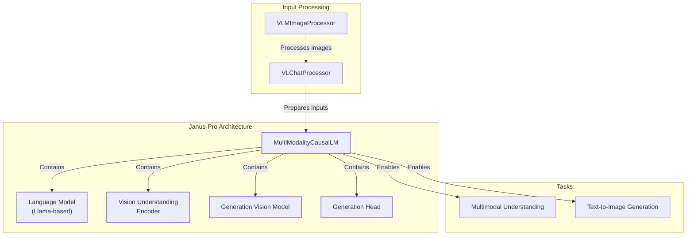
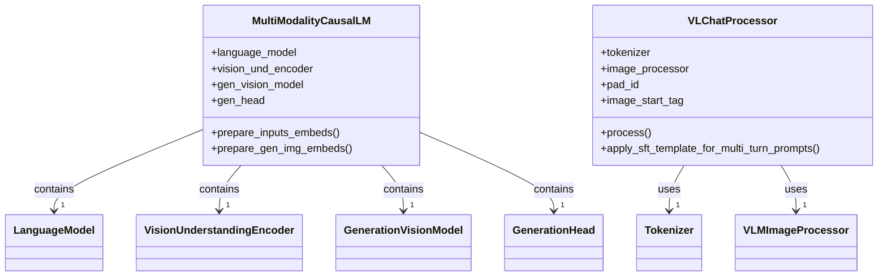
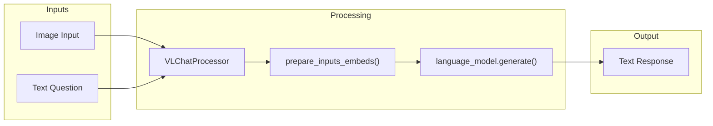
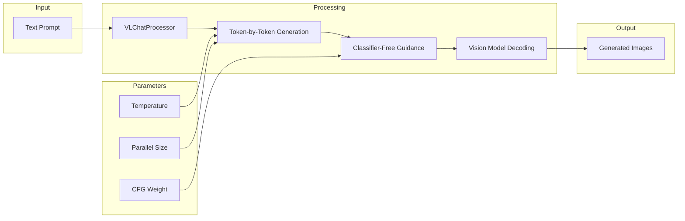
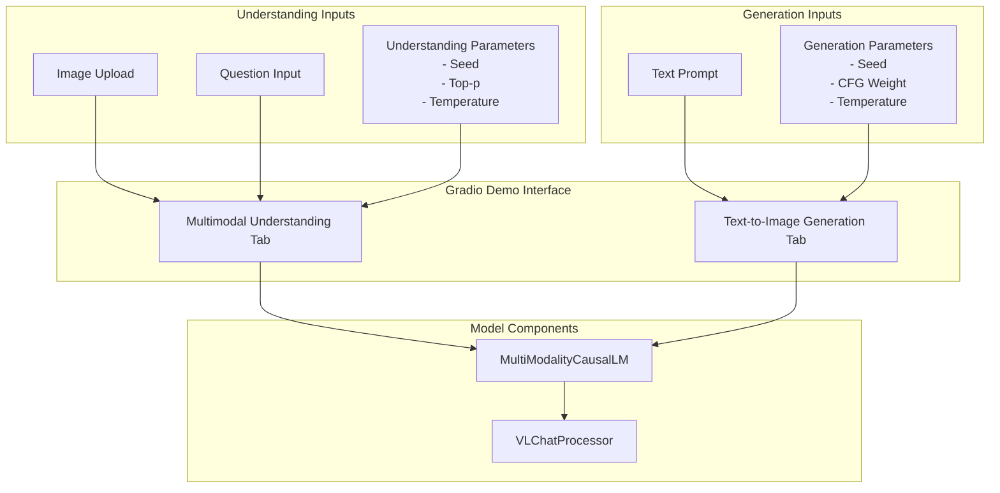

<!-- source: DeepWiki mcp.deepwiki.com · repo deepseek-ai/Janus · page 3.3 Janus-Pro Model · fetched 2026-10-30 -->

# Janus-Pro Model

<details>
<summary>Relevant source files</summary>

The following files were used as context for generating this wiki page:

- [README.md](README.md)
- [demo/app_januspro.py](demo/app_januspro.py)
- [images/teaser_janusflow.png](images/teaser_janusflow.png)

</details>


## Purpose and Scope

This document provides a comprehensive technical overview of the Janus-Pro model, an advanced version of the Janus model family designed for unified multimodal understanding and generation. The page covers the architecture, capabilities, implementation details, and usage patterns of Janus-Pro. For information about the standard Janus model, see [Janus Model](#3.1). For details about JanusFlow, see [JanusFlow Model](#3.2).

## Introduction

Janus-Pro represents a significant advancement over the base Janus model, incorporating:

1. An optimized training strategy
2. Expanded training data
3. Scaling to larger model sizes (1B and 7B parameter variants)

These improvements result in enhanced performance in both multimodal understanding and text-to-image generation capabilities, with particular emphasis on stability and quality of generated images.

Sources: [README.md:76-85]()

## Model Variants

Janus-Pro is available in two sizes:

| Model | Parameters | Context Length | Download Link |
|-------|------------|----------------|---------------|
| Janus-Pro-1B | 1 billion | 4096 tokens | Hugging Face: deepseek-ai/Janus-Pro-1B |
| Janus-Pro-7B | 7 billion | 4096 tokens | Hugging Face: deepseek-ai/Janus-Pro-7B |

Sources: [README.md:109-116]()

## Architecture

Janus-Pro follows the same core architectural principles as the base Janus model but with optimizations for better multimodal capabilities. The model maintains a unified transformer architecture with decoupled visual encoding pathways for understanding and generation.

### System Architecture Overview



Sources: [README.md:76-84](), [demo/app_januspro.py:14-29]()

### Component Structure



Sources: [demo/app_januspro.py:14-29](), [demo/app_januspro.py:77-121]()

## Processing Pipelines

Janus-Pro supports two primary functionalities: multimodal understanding and text-to-image generation. Each capability follows a distinct processing pipeline within the unified model architecture.

### Multimodal Understanding Pipeline



Sources: [demo/app_januspro.py:31-74]()

### Text-to-Image Generation Pipeline



Sources: [demo/app_januspro.py:77-121](), [demo/app_januspro.py:134-171]()

## Implementation Details

### Multimodal Understanding Implementation

The multimodal understanding functionality is implemented through a sequence of operations:

1. Process the input image and question text using `VLChatProcessor`
2. Generate embeddings using `prepare_inputs_embeds()`
3. Pass the embeddings to the language model for text generation
4. Decode the generated tokens into a text response

Key parameters for multimodal understanding:

| Parameter | Description | Default Value |
|-----------|-------------|---------------|
| `top_p` | Top-p sampling parameter | 0.95 |
| `temperature` | Sampling temperature (0 for greedy decoding) | 0.1 |
| `max_new_tokens` | Maximum number of tokens to generate | 512 |

Sources: [demo/app_januspro.py:31-74]()

### Text-to-Image Generation Implementation

Text-to-image generation follows these steps:

1. Process the text prompt using `VLChatProcessor`
2. Initialize input embeddings for both conditional and unconditional paths (for CFG)
3. Generate tokens one by one using classifier-free guidance
4. For each step:
   - Generate logits from the model
   - Apply CFG weighting
   - Sample next token
   - Prepare embeddings for the next token
5. Decode the generated tokens into an image using the generation vision model

Key parameters for text-to-image generation:

| Parameter | Description | Default Value |
|-----------|-------------|---------------|
| `cfg_weight` | Classifier-free guidance weight | 5.0 |
| `temperature` | Sampling temperature | 1.0 |
| `parallel_size` | Number of images to generate in parallel | 5 |
| `image_token_num_per_image` | Number of tokens per image | 576 |

Sources: [demo/app_januspro.py:77-121](), [demo/app_januspro.py:134-171]()

## Usage Examples

### Model Initialization

```python
from transformers import AutoModelForCausalLM
from janus.models import MultiModalityCausalLM, VLChatProcessor

# Load model and processor
model_path = "deepseek-ai/Janus-Pro-7B"
vl_chat_processor = VLChatProcessor.from_pretrained(model_path)
tokenizer = vl_chat_processor.tokenizer

vl_gpt = AutoModelForCausalLM.from_pretrained(
    model_path, trust_remote_code=True
)
vl_gpt = vl_gpt.to(torch.bfloat16).cuda().eval()
```

Sources: [README.md:138-151](), [demo/app_januspro.py:14-29]()

### Multimodal Understanding Example

```python
# Prepare conversation with image
conversation = [
    {
        "role": "<|User|>",
        "content": f"<image_placeholder>\n{question}",
        "images": [image],
    },
    {"role": "<|Assistant|>", "content": ""},
]

# Process inputs
pil_images = load_pil_images(conversation)
prepare_inputs = vl_chat_processor(
    conversations=conversation, images=pil_images, force_batchify=True
).to(vl_gpt.device)

# Generate embeddings and response
inputs_embeds = vl_gpt.prepare_inputs_embeds(**prepare_inputs)
outputs = vl_gpt.language_model.generate(
    inputs_embeds=inputs_embeds,
    attention_mask=prepare_inputs.attention_mask,
    pad_token_id=tokenizer.eos_token_id,
    bos_token_id=tokenizer.bos_token_id,
    eos_token_id=tokenizer.eos_token_id,
    max_new_tokens=512,
    do_sample=False,
    use_cache=True,
)

answer = tokenizer.decode(outputs[0].cpu().tolist(), skip_special_tokens=True)
```

Sources: [README.md:153-184](), [demo/app_januspro.py:31-74]()

### Text-to-Image Generation Example

```python
# Prepare conversation
conversation = [
    {
        "role": "<|User|>",
        "content": "A stunning princess from kabul in red, white traditional clothing, blue eyes, brown hair",
    },
    {"role": "<|Assistant|>", "content": ""},
]

# Format prompt
sft_format = vl_chat_processor.apply_sft_template_for_multi_turn_prompts(
    conversations=conversation,
    sft_format=vl_chat_processor.sft_format,
    system_prompt="",
)
prompt = sft_format + vl_chat_processor.image_start_tag

# Generate image tokens
# See generate() function for token generation process
# [demo/app_januspro.py:77-121]()

# Decode image tokens to image
# [demo/app_januspro.py:123-130]()
```

Sources: [README.md:189-286](), [demo/app_januspro.py:134-171]()

## Demo Application

Janus-Pro includes a Gradio-based demo application that provides a user-friendly interface for interacting with the model. The demo supports both multimodal understanding and text-to-image generation capabilities.



Sources: [demo/app_januspro.py:175-244]()

To run the Gradio demo locally:

```bash
pip install -e .[gradio]
python demo/app_januspro.py
```

This launches a web interface with separate tabs for multimodal understanding and text-to-image generation, allowing users to interact with the Janus-Pro model through a user-friendly interface.

Sources: [README.md:290-301]()

## Performance Characteristics

Janus-Pro significantly improves upon the original Janus model in several key areas:

1. Enhanced multimodal understanding through improved training data and model scaling
2. More stable and higher-quality text-to-image generation
3. Better instruction-following capabilities for image generation tasks

The 7B parameter variant offers the best performance, particularly for complex reasoning tasks and high-quality image generation, while the 1B variant provides a more lightweight option with reasonable performance for less demanding applications.

Sources: [README.md:76-84]()

---

