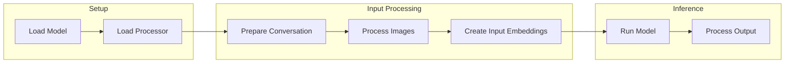
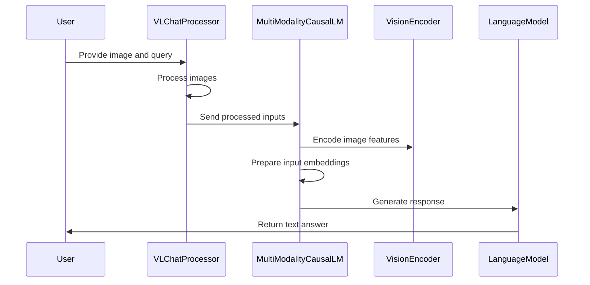
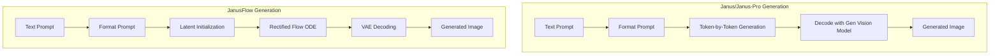
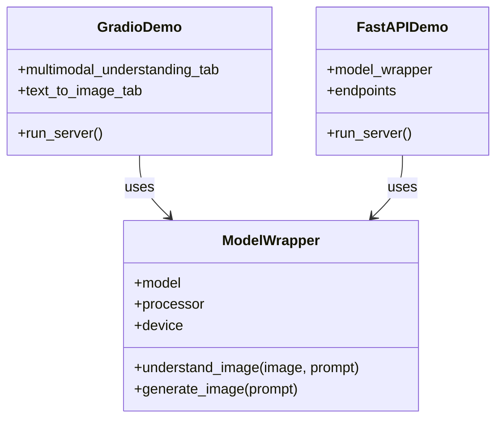
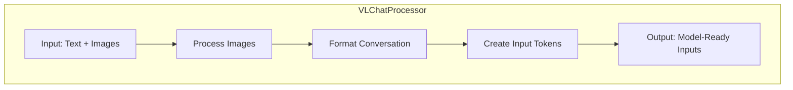

<!-- source: DeepWiki mcp.deepwiki.com · repo deepseek-ai/Janus · page 4 Usage Guide · fetched 2026-10-30 -->

# Usage Guide

<details>
<summary>Relevant source files</summary>

The following files were used as context for generating this wiki page:

- [README.md](README.md)
- [images/teaser_janusflow.png](images/teaser_janusflow.png)

</details>


This guide provides comprehensive instructions for using the Janus model family for multimodal understanding and text-to-image generation tasks. It covers installation, basic usage patterns, and how to run interactive demos. For detailed information about the model architecture, refer to [Architecture](#2).

## Table of Contents

## 1. Installation and Setup

To use Janus models, you'll need Python 3.8 or higher. Follow these steps to set up your environment:

### Basic Installation

```bash
# Clone the repository
git clone https://github.com/deepseek-ai/Janus
cd Janus

# Install dependencies
pip install -e .
```

### Additional Requirements for Specific Models

For JanusFlow, you'll need to install additional dependencies:

```bash
pip install diffusers[torch]
```

For running the demo applications, install the gradio dependencies:

```bash
pip install -e .[gradio]
```

Sources: [README.md:126-130](), [README.md:512-515](), [README.md:296-296](), [README.md:482-482]()

## 2. Model Usage Workflow

The diagram below illustrates the common workflow for using any Janus model:



Sources: [README.md:324-371](), [README.md:523-570]()

## 3. Multimodal Understanding

Multimodal understanding involves processing an image along with a text query to generate a relevant response.

### Usage Pattern

The following diagram shows the multimodal understanding workflow:



### Code Example

Here's how to use a Janus model for multimodal understanding:

```python
import torch
from transformers import AutoModelForCausalLM
from janus.models import MultiModalityCausalLM, VLChatProcessor
from janus.utils.io import load_pil_images

# Load model and processor
model_path = "deepseek-ai/Janus-1.3B"  # or other model variant
vl_chat_processor = VLChatProcessor.from_pretrained(model_path)
tokenizer = vl_chat_processor.tokenizer

vl_gpt = AutoModelForCausalLM.from_pretrained(
    model_path, trust_remote_code=True
)
vl_gpt = vl_gpt.to(torch.bfloat16).cuda().eval()

# Prepare conversation input
conversation = [
    {
        "role": "User",
        "content": "<image_placeholder>\nDescribe what you see in this image.",
        "images": ["path/to/your/image.jpg"],
    },
    {"role": "Assistant", "content": ""},
]

# Process inputs
pil_images = load_pil_images(conversation)
prepare_inputs = vl_chat_processor(
    conversations=conversation, images=pil_images, force_batchify=True
).to(vl_gpt.device)

# Generate image embeddings
inputs_embeds = vl_gpt.prepare_inputs_embeds(**prepare_inputs)

# Generate response
outputs = vl_gpt.language_model.generate(
    inputs_embeds=inputs_embeds,
    attention_mask=prepare_inputs.attention_mask,
    pad_token_id=tokenizer.eos_token_id,
    bos_token_id=tokenizer.bos_token_id,
    eos_token_id=tokenizer.eos_token_id,
    max_new_tokens=512,
    do_sample=False,
    use_cache=True,
)

# Decode output
answer = tokenizer.decode(outputs[0].cpu().tolist(), skip_special_tokens=True)
print(f"{prepare_inputs['sft_format'][0]}", answer)
```

Sources: [README.md:324-371](), [README.md:523-570]()

### Model-Specific Adjustments

Different models in the Janus family require slight adjustments to the import statements:

| Model | Import Adjustments |
|-------|-------------------|
| Janus/Janus-Pro | `from janus.models import MultiModalityCausalLM, VLChatProcessor` |
| JanusFlow | `from janus.janusflow.models import MultiModalityCausalLM, VLChatProcessor` |

Sources: [README.md:324-371](), [README.md:523-570]()

## 4. Text-to-Image Generation

The Janus family supports generating images from text prompts, with different underlying mechanisms depending on the model variant.

### Generation Workflows

The generation process differs between standard Janus/Janus-Pro models and JanusFlow:



Sources: [README.md:374-472](), [README.md:574-697]()

### Janus/Janus-Pro Text-to-Image Example

```python
import os
import PIL.Image
import torch
import numpy as np
from transformers import AutoModelForCausalLM
from janus.models import MultiModalityCausalLM, VLChatProcessor

# Load model and processor
model_path = "deepseek-ai/Janus-1.3B"  # or Janus-Pro-1B, Janus-Pro-7B
vl_chat_processor = VLChatProcessor.from_pretrained(model_path)
tokenizer = vl_chat_processor.tokenizer

vl_gpt = AutoModelForCausalLM.from_pretrained(
    model_path, trust_remote_code=True
)
vl_gpt = vl_gpt.to(torch.bfloat16).cuda().eval()

# Prepare text prompt
conversation = [
    {
        "role": "User",
        "content": "A stunning landscape with mountains and a lake at sunset",
    },
    {"role": "Assistant", "content": ""},
]

# Format the prompt
sft_format = vl_chat_processor.apply_sft_template_for_multi_turn_prompts(
    conversations=conversation,
    sft_format=vl_chat_processor.sft_format,
    system_prompt="",
)
prompt = sft_format + vl_chat_processor.image_start_tag

# Generation function (can be used as-is from the README)
@torch.inference_mode()
def generate(
    mmgpt: MultiModalityCausalLM,
    vl_chat_processor: VLChatProcessor,
    prompt: str,
    temperature: float = 1,
    parallel_size: int = 16,
    cfg_weight: float = 5,
    image_token_num_per_image: int = 576,
    img_size: int = 384,
    patch_size: int = 16,
):
    # Function implementation as shown in README
    # ...

# Generate the image
generate(
    vl_gpt,
    vl_chat_processor,
    prompt,
)
```

Sources: [README.md:374-472]()

### JanusFlow Text-to-Image Example

```python
import os
import PIL.Image
import torch
import numpy as np
from janus.janusflow.models import MultiModalityCausalLM, VLChatProcessor
import torchvision
from diffusers.models import AutoencoderKL

# Load model and processor
model_path = "deepseek-ai/JanusFlow-1.3B"
vl_chat_processor = VLChatProcessor.from_pretrained(model_path)
tokenizer = vl_chat_processor.tokenizer

vl_gpt = MultiModalityCausalLM.from_pretrained(
    model_path, trust_remote_code=True
)
vl_gpt = vl_gpt.to(torch.bfloat16).cuda().eval()

# Load VAE (required for JanusFlow)
vae = AutoencoderKL.from_pretrained("stabilityai/sdxl-vae")
vae = vae.to(torch.bfloat16).cuda().eval()

# Prepare text prompt
conversation = [
    {
        "role": "User",
        "content": "A stunning landscape with mountains and a lake at sunset",
    },
    {"role": "Assistant", "content": ""},
]

# Format the prompt
sft_format = vl_chat_processor.apply_sft_template_for_multi_turn_prompts(
    conversations=conversation,
    sft_format=vl_chat_processor.sft_format,
    system_prompt="",
)
prompt = sft_format + vl_chat_processor.image_gen_tag

# Generation function (can be used as-is from the README)
@torch.inference_mode()
def generate(
    mmgpt: MultiModalityCausalLM,
    vl_chat_processor: VLChatProcessor,
    prompt: str,
    cfg_weight: float = 5.0,
    num_inference_steps: int = 30,
    batchsize: int = 5
):
    # Function implementation as shown in README
    # ...

# Generate the image
generate(
    vl_gpt,
    vl_chat_processor,
    prompt,
    cfg_weight=2.0,
    num_inference_steps=30,
    batchsize=5
)
```

Sources: [README.md:574-697]()

## 5. Key Parameters for Generation

The following table summarizes important parameters for text-to-image generation:

| Parameter | Description | Janus/Janus-Pro | JanusFlow |
|-----------|------------|----------------|-----------|
| `temperature` | Controls randomness of generation (higher = more random) | ✓ | - |
| `parallel_size` | Number of images to generate in parallel | ✓ | - |
| `cfg_weight` | Classifier-free guidance weight (higher = more adherent to prompt) | ✓ | ✓ |
| `num_inference_steps` | Number of steps in the generation process | - | ✓ |
| `batchsize` | Number of images to generate in parallel | - | ✓ |
| `image_token_num_per_image` | Number of tokens per image | ✓ | - |
| `img_size` | Size of the generated image | ✓ | Controlled by VAE |
| `patch_size` | Size of image patches used in the model | ✓ | - |

Sources: [README.md:411-421](), [README.md:620-622]()

## 6. Interactive Demos

Janus provides several interactive demo applications that allow you to experiment with the models through a user interface.

### Demo Applications Structure



Sources: [README.md:474-496](), [README.md:698-707]()

### Running Gradio Demos

There are specific demo scripts for each model variant:

```bash
# For Janus
python demo/app.py

# For JanusFlow
python demo/app_janusflow.py

# For Janus-Pro
python demo/app_januspro.py
```

The Gradio interface provides tabs for both multimodal understanding and text-to-image generation.

Sources: [README.md:484-485](), [README.md:704-705](), [README.md:298-299]()

### Running FastAPI Demo (Janus only)

```bash
# Start the FastAPI server
python demo/fastapi_app.py

# In another terminal, run the test client
python demo/fastapi_client.py
```

Sources: [README.md:494-502]()

## 7. Common Usage Patterns

### Working with the VLChatProcessor

The `VLChatProcessor` is a critical component for preparing inputs for the model. Here's how it's used in both tasks:



Sources: [README.md:350-352](), [README.md:402-407]()

### Conversation Format

The conversation format is consistent across all Janus models:

```python
conversation = [
    {
        "role": "User",  # or "<|User|>" for Janus-Pro
        "content": "Your prompt here <image_placeholder>",
        "images": ["path/to/image.jpg"],  # Optional, for multimodal understanding
    },
    {"role": "Assistant", "content": ""},  # or "<|Assistant|>" for Janus-Pro
]
```

Sources: [README.md:339-346](), [README.md:153-160]()

## 8. Online Resources

All Janus models are available on Hugging Face, with online demos for testing:

| Model | Hugging Face | Online Demo |
|-------|--------------|-------------|
| Janus-1.3B | [deepseek-ai/Janus-1.3B](https://huggingface.co/deepseek-ai/Janus-1.3B) | [Demo](https://huggingface.co/spaces/deepseek-ai/Janus-1.3B) |
| JanusFlow-1.3B | [deepseek-ai/JanusFlow-1.3B](https://huggingface.co/deepseek-ai/JanusFlow-1.3B) | [Demo](https://huggingface.co/spaces/deepseek-ai/JanusFlow-1.3B) |
| Janus-Pro-1B | [deepseek-ai/Janus-Pro-1B](https://huggingface.co/deepseek-ai/Janus-Pro-1B) | - |
| Janus-Pro-7B | [deepseek-ai/Janus-Pro-7B](https://huggingface.co/deepseek-ai/Janus-Pro-7B) | [Demo](https://huggingface.co/spaces/deepseek-ai/Janus-Pro-7B) |

Sources: [README.md:110-116](), [README.md:59-59]()

---

