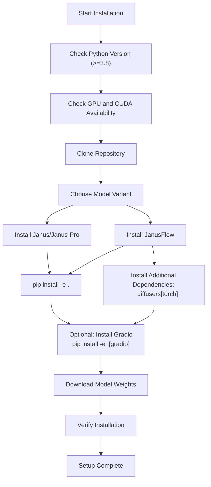
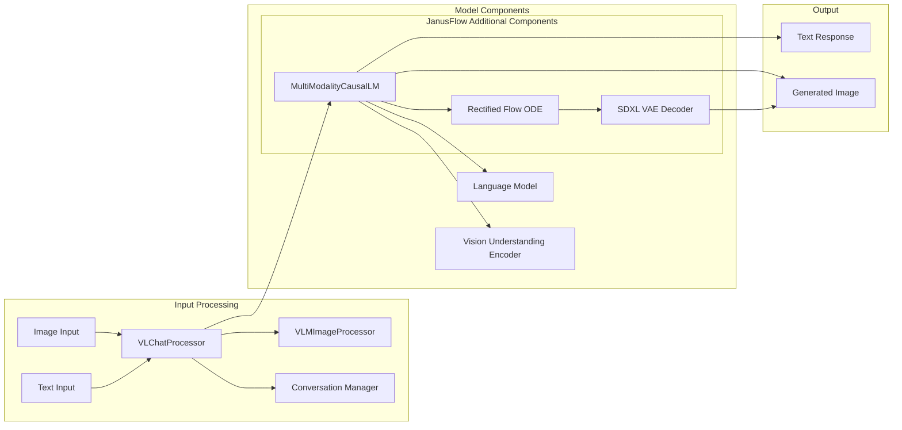

<!-- source: DeepWiki mcp.deepwiki.com · repo deepseek-ai/Janus · page 4.1 Installation and Setup · fetched 2026-10-30 -->

# Installation and Setup

<details>
<summary>Relevant source files</summary>

The following files were used as context for generating this wiki page:

- [Makefile](Makefile)
- [README.md](README.md)
- [images/teaser_janusflow.png](images/teaser_janusflow.png)

</details>


This document provides a comprehensive guide for installing and setting up the Janus model family. It covers requirements, installation steps, model downloading, and basic configuration for Janus, JanusFlow, and Janus-Pro models. For information about running interactive demos, see [Interactive Demos](#4.4).

## Prerequisites

Before installing the Janus repository, ensure your system meets the following requirements:

- Python >= 3.8
- CUDA-compatible GPU for optimal performance (recommended for text-to-image generation)
- Git (for cloning the repository)



Sources: [README.md:126-129](), [README.md:312-315](), [README.md:508-514]()

## Basic Installation

You can install Janus from the GitHub repository using the following steps:

1. Clone the repository:
   ```bash
   git clone https://github.com/deepseek-ai/Janus.git
   cd Janus
   ```

2. Install the package:
   ```bash
   pip install -e .
   ```

This installs the core Janus package in development mode, making it available in your Python environment.

Sources: [README.md:126-129](), [README.md:312-315]()

## Model-Specific Installation

### For Janus and Janus-Pro

The basic installation is sufficient for using Janus and Janus-Pro models:

```bash
pip install -e .
```

Sources: [README.md:126-129](), [README.md:312-315]()

### For JanusFlow

JanusFlow requires additional dependencies for the rectified flow approach:

```bash
pip install -e .
pip install diffusers[torch]
```

The `diffusers[torch]` package is required for the VAE decoding process used in JanusFlow's text-to-image generation pipeline.

Sources: [README.md:508-514]()

## Installing Demo Dependencies

To run the interactive Gradio demo for any model variant, install the additional demo dependencies:

```bash
pip install -e .[gradio]
```

Sources: [README.md:296-297](), [README.md:482-483](), [README.md:703-704]()

## Model Architecture and Components

The installation provides access to different model components that work together in the Janus system architecture. Understanding these components helps in setting up the appropriate configuration for your use case.

```mermaid
classDiagram
    class "VLChatProcessor" {
        +tokenizer
        +image_processor
        +process_one()
        +batchify()
    }
    
    class "MultiModalityCausalLM" {
        +language_model
        +vision_und_encoder
        +prepare_inputs_embeds()
        +prepare_gen_img_embeds()
    }
    
    class "VLMImageProcessor" {
        +image_size
        +resize()
        +preprocess()
    }
    
    class "Conversation" {
        +system_message
        +messages
        +get_prompt()
    }
    
    "Installation" --> "VLChatProcessor"
    "Installation" --> "MultiModalityCausalLM"
    "VLChatProcessor" --> "VLMImageProcessor"
    "VLChatProcessor" --> "Conversation"
    "MultiModalityCausalLM" --> "Language Model" : includes
    "MultiModalityCausalLM" --> "Vision Understanding Module" : includes
    "JanusFlow Installation" --> "MultiModalityCausalLM"
    "JanusFlow Installation" --> "VLChatProcessor"
    "JanusFlow Installation" --> "VAE Decoder" : adds
```

Sources: [README.md:132-147](), [README.md:336-338](), [README.md:530-537]()

## Downloading Models

After installation, you'll need to download the model weights. The models are available on the Hugging Face Hub:

| Model           | Size  | Download Link                                |
|-----------------|-------|---------------------------------------------|
| Janus-1.3B      | 1.3B  | deepseek-ai/Janus-1.3B                      |
| JanusFlow-1.3B  | 1.3B  | deepseek-ai/JanusFlow-1.3B                  |
| Janus-Pro-1B    | 1B    | deepseek-ai/Janus-Pro-1B                    |
| Janus-Pro-7B    | 7B    | deepseek-ai/Janus-Pro-7B                    |

You can download the models using the Hugging Face `transformers` library:

```python
# For Janus/Janus-Pro
from transformers import AutoModelForCausalLM
from janus.models import VLChatProcessor

model_path = "deepseek-ai/Janus-1.3B"  # Or other model variant
vl_chat_processor = VLChatProcessor.from_pretrained(model_path)
model = AutoModelForCausalLM.from_pretrained(model_path, trust_remote_code=True)

# For JanusFlow
from janus.janusflow.models import MultiModalityCausalLM, VLChatProcessor

model_path = "deepseek-ai/JanusFlow-1.3B"
vl_chat_processor = VLChatProcessor.from_pretrained(model_path)
model = MultiModalityCausalLM.from_pretrained(model_path, trust_remote_code=True)
```

Sources: [README.md:103-117](), [README.md:330-337](), [README.md:530-537]()

## System Integration

The following diagram illustrates how the installed components integrate with each other during usage:



Sources: [README.md:136-144](), [README.md:554-570](), [README.md:615-697]()

## Verifying Installation

After installation, you can verify that everything is working correctly by running a simple test:

```python
import torch
from transformers import AutoModelForCausalLM
from janus.models import VLChatProcessor

# Test for Janus
model_path = "deepseek-ai/Janus-1.3B"  # Change to your desired model
vl_chat_processor = VLChatProcessor.from_pretrained(model_path)
model = AutoModelForCausalLM.from_pretrained(model_path, trust_remote_code=True)

# Check if the model and processor loaded successfully
print(f"Model loaded: {type(model).__name__}")
print(f"Processor loaded: {type(vl_chat_processor).__name__}")
```

Sources: [README.md:330-337](), [README.md:530-537]()

## Environment Configuration

For optimal performance, it's recommended to use the following environment configuration:

| Component       | Recommendation                                   |
|-----------------|--------------------------------------------------|
| Python Version  | 3.8 or higher                                    |
| CUDA            | Latest compatible version with your GPU          |
| RAM             | 16GB+ (more for larger models)                   |
| GPU Memory      | 8GB+ (24GB+ recommended for Janus-Pro-7B)        |
| Storage         | At least 10GB free space for model weights        |

Sources: [README.md:126](), [README.md:312](), [README.md:508]()

## Troubleshooting Common Issues

Here are solutions to common installation issues:

1. **Missing dependencies**: If you encounter import errors, try installing the specific missing dependency or reinstall with all optional dependencies:
   ```bash
   pip install -e .[all]
   ```

2. **CUDA compatibility issues**: Ensure you have the correct CUDA version installed for your GPU.

3. **Out of memory errors**: If you encounter GPU memory issues, try:
   - Using model in half precision: `model = model.half()`
   - Reducing batch size in your code
   - Using a smaller model variant (e.g., Janus-Pro-1B instead of Janus-Pro-7B)

4. **Tokenizer issues**: If you encounter tokenizer problems, ensure you're using the processor that comes with the model:
   ```python
   vl_chat_processor = VLChatProcessor.from_pretrained(model_path)
   tokenizer = vl_chat_processor.tokenizer
   ```

Sources: [README.md:132-147](), [README.md:335-336](), [README.md:531-532]()

## Next Steps

After successful installation and setup:

1. For using the model for multimodal understanding, see [Multimodal Understanding Examples](#4.2)
2. For generating images with the model, see [Text-to-Image Generation Examples](#4.3)
3. To run the interactive demo applications, see [Interactive Demos](#4.4)

Sources: [README.md:53-60]()

---

