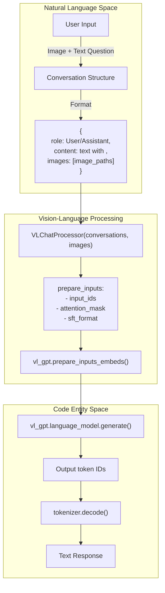
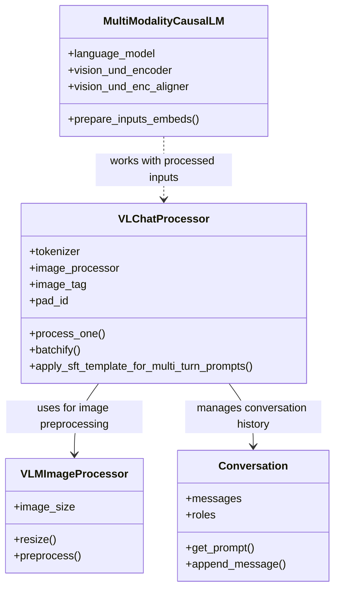
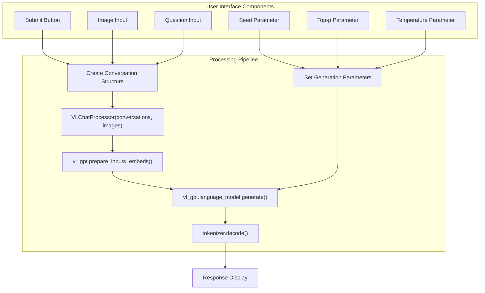

<!-- source: DeepWiki mcp.deepwiki.com · repo deepseek-ai/Janus · page 4.2 Multimodal Understanding Examples · fetched 2026-10-30 -->

# Multimodal Understanding Examples

<details>
<summary>Relevant source files</summary>

The following files were used as context for generating this wiki page:

- [README.md](README.md)
- [demo/Janus_colab_demo.ipynb](demo/Janus_colab_demo.ipynb)
- [demo/app.py](demo/app.py)
- [demo/app_janusflow.py](demo/app_janusflow.py)
- [demo/app_januspro.py](demo/app_januspro.py)
- [images/teaser_janusflow.png](images/teaser_janusflow.png)

</details>


This page provides detailed examples and guidance for using the Janus model family for multimodal understanding - the ability to process images together with text to generate meaningful responses. For information about text-to-image generation capabilities, see [Text-to-Image Generation Examples](#4.3).

## 1. Multimodal Understanding Pipeline

Multimodal understanding in Janus models follows a specific processing pipeline that transforms user inputs (images and text) into coherent responses.

Multimodal Understanding Pipeline


Sources: 
- [demo/app.py:24-66]()
- [demo/app_januspro.py:31-74]()
- [demo/app_janusflow.py:22-66]()

## 2. Component Interactions

Janus models use several key components that work together to process multimodal inputs:

Component Relationships in Multimodal Understanding


Sources:
- [demo/app.py:10-22]()
- [demo/app_januspro.py:15-29]()
- [demo/app_janusflow.py:10-16]()

## 3. Basic Example with Janus

Here's a basic example of using Janus for multimodal understanding:

```python
import torch
from transformers import AutoModelForCausalLM
from janus.models import MultiModalityCausalLM, VLChatProcessor
from janus.utils.io import load_pil_images

# Load model and processor
model_path = "deepseek-ai/Janus-1.3B"
vl_chat_processor = VLChatProcessor.from_pretrained(model_path)
tokenizer = vl_chat_processor.tokenizer

vl_gpt = AutoModelForCausalLM.from_pretrained(
    model_path, trust_remote_code=True
)
vl_gpt = vl_gpt.to(torch.bfloat16).cuda().eval()

# Prepare conversation with image and question
conversation = [
    {
        "role": "User",
        "content": "<image_placeholder>\nConvert the formula into latex code.",
        "images": ["images/equation.png"],
    },
    {"role": "Assistant", "content": ""},
]

# Load images and prepare inputs
pil_images = load_pil_images(conversation)
prepare_inputs = vl_chat_processor(
    conversations=conversation, images=pil_images, force_batchify=True
).to(vl_gpt.device)

# Generate embeddings and run the model
inputs_embeds = vl_gpt.prepare_inputs_embeds(**prepare_inputs)
outputs = vl_gpt.language_model.generate(
    inputs_embeds=inputs_embeds,
    attention_mask=prepare_inputs.attention_mask,
    pad_token_id=tokenizer.eos_token_id,
    bos_token_id=tokenizer.bos_token_id,
    eos_token_id=tokenizer.eos_token_id,
    max_new_tokens=512,
    do_sample=False,
    use_cache=True,
)

# Decode the output
answer = tokenizer.decode(outputs[0].cpu().tolist(), skip_special_tokens=True)
print(answer)
```

Sources:
- [README.md:322-372]()

## 4. Model-Specific Implementation Details

The Janus family includes different model variants with slight implementation differences:

| Feature | Janus | JanusFlow | Janus-Pro |
|---------|-------|-----------|-----------|
| Import Path | `from janus.models import MultiModalityCausalLM, VLChatProcessor` | `from janus.janusflow.models import MultiModalityCausalLM, VLChatProcessor` | `from janus.models import MultiModalityCausalLM, VLChatProcessor` |
| Model Initialization | `AutoModelForCausalLM.from_pretrained()` | `MultiModalityCausalLM.from_pretrained()` | `AutoModelForCausalLM.from_pretrained()` |
| Model Path | `deepseek-ai/Janus-1.3B` | `deepseek-ai/JanusFlow-1.3B` | `deepseek-ai/Janus-Pro-7B` or `deepseek-ai/Janus-Pro-1B` |
| User Role Format | `"role": "User"` | `"role": "User"` | `"role": "<|User|>"` |
| Architecture | Decoupled vision encoding | Autoregression + Rectified Flow | Enhanced Janus with larger scale |

Sources:
- [README.md:322-372]() (Janus)
- [README.md:523-572]() (JanusFlow)
- [README.md:136-186]() (Janus-Pro)

## 5. Common Use Cases with Examples

### 5.1 Visual Question Answering

Ask specific questions about image content:

```python
conversation = [
    {
        "role": "User",
        "content": "<image_placeholder>\nWhat objects are visible in this image?",
        "images": ["path/to/image.jpg"],
    },
    {"role": "Assistant", "content": ""},
]
```

### 5.2 Image Caption Generation

Generate detailed descriptions of images:

```python
conversation = [
    {
        "role": "User",
        "content": "<image_placeholder>\nDescribe this image in detail.",
        "images": ["path/to/image.jpg"],
    },
    {"role": "Assistant", "content": ""},
]
```

### 5.3 OCR and Text Recognition

Extract and interpret text from images:

```python
conversation = [
    {
        "role": "User",
        "content": "<image_placeholder>\nConvert the formula into latex code.",
        "images": ["images/equation.png"],
    },
    {"role": "Assistant", "content": ""},
]
```

### 5.4 Meme Explanation

Analyze and explain internet memes:

```python
conversation = [
    {
        "role": "User",
        "content": "<image_placeholder>\nExplain this meme.",
        "images": ["images/doge.png"],
    },
    {"role": "Assistant", "content": ""},
]
```

Sources:
- [demo/app.py:172-185]()
- [demo/app_januspro.py:188-201]()
- [demo/app_janusflow.py:194-207]()

## 6. Using Gradio Demo Applications

Janus provides interactive demos to experiment with multimodal understanding:

Multimodal Understanding Demo Flow


To run the demo applications:

1. Install the required dependencies:
   ```bash
   pip install -e .[gradio]
   ```

2. Run one of the demo applications:
   ```bash
   # For Janus
   python demo/app.py
   
   # For Janus-Pro
   python demo/app_januspro.py
   
   # For JanusFlow
   python demo/app_janusflow.py
   ```

Sources:
- [demo/app.py:157-224]()
- [demo/app_januspro.py:174-244]()
- [demo/app_janusflow.py:179-246]()

## 7. Advanced Usage Examples

### 7.1 Controlling Generation Parameters

You can customize the response generation by adjusting parameters:

```python
outputs = vl_gpt.language_model.generate(
    inputs_embeds=inputs_embeds,
    attention_mask=prepare_inputs.attention_mask,
    pad_token_id=tokenizer.eos_token_id,
    bos_token_id=tokenizer.bos_token_id,
    eos_token_id=tokenizer.eos_token_id,
    max_new_tokens=512,       # Maximum length of generated text
    do_sample=True,           # Enable sampling (vs greedy decoding)
    temperature=0.7,          # Controls randomness (lower = more deterministic)
    top_p=0.9,                # Top-p (nucleus) sampling parameter
    use_cache=True,           # Use KV cache for faster generation
)
```

Sources:
- [demo/app.py:52-63]()
- [demo/app_januspro.py:60-71]()
- [demo/app_janusflow.py:51-62]()

### 7.2 Multi-Turn Conversations

Maintain context through multi-turn conversations:

```python
# First turn
conversation = [
    {
        "role": "User",
        "content": "<image_placeholder>\nWhat's in this image?",
        "images": ["image.jpg"],
    },
    {"role": "Assistant", "content": ""},
]

# Process and get response as shown in previous examples
# ...

# Second turn - append to conversation
conversation = [
    {
        "role": "User",
        "content": "<image_placeholder>\nWhat's in this image?",
        "images": ["image.jpg"],
    },
    {"role": "Assistant", "content": "The first response from model"},
    {
        "role": "User",
        "content": "Tell me more about the objects in the background.",
    },
    {"role": "Assistant", "content": ""},
]

# Process again with updated conversation
```

### 7.3 Processing Multiple Images

To process multiple images in a single conversation:

```python
conversation = [
    {
        "role": "User",
        "content": "<image_placeholder>\nWhat's in this image?\n<image_placeholder>\nHow does it compare to this one?",
        "images": ["image1.jpg", "image2.jpg"],
    },
    {"role": "Assistant", "content": ""},
]
```

### 7.4 Janus-Pro Example

Janus-Pro uses a slightly different format for roles:

```python
import torch
from transformers import AutoModelForCausalLM
from janus.models import MultiModalityCausalLM, VLChatProcessor

model_path = "deepseek-ai/Janus-Pro-7B"
vl_chat_processor = VLChatProcessor.from_pretrained(model_path)
tokenizer = vl_chat_processor.tokenizer

vl_gpt = AutoModelForCausalLM.from_pretrained(
    model_path, trust_remote_code=True
)
vl_gpt = vl_gpt.to(torch.bfloat16).cuda().eval()

conversation = [
    {
        "role": "<|User|>",  # Note the different format
        "content": "<image_placeholder>\nDescribe what you see in this image.",
        "images": ["image.jpg"],
    },
    {"role": "<|Assistant|>", "content": ""},
]

# Continue processing as in previous examples
```

Sources:
- [README.md:136-186]()

### 7.5 JanusFlow Example

JanusFlow requires a slightly different import path:

```python
import torch
from janus.janusflow.models import MultiModalityCausalLM, VLChatProcessor

model_path = "deepseek-ai/JanusFlow-1.3B"
vl_chat_processor = VLChatProcessor.from_pretrained(model_path)
tokenizer = vl_chat_processor.tokenizer

vl_gpt = MultiModalityCausalLM.from_pretrained(
    model_path, trust_remote_code=True
)
vl_gpt = vl_gpt.to(torch.bfloat16).cuda().eval()

# Continue with the same conversation structure as Janus
```

Sources:
- [README.md:523-572]()

## 8. Colab Integration

Janus models can be used in Google Colab for quick experimentation:

```python
# Install required packages
!pip install git+https://github.com/deepseek-ai/Janus.git

# Import and load the model (similar to previous examples)
import torch
from transformers import AutoModelForCausalLM
from janus.models import MultiModalityCausalLM, VLChatProcessor

# Upload an image or load from URL
from PIL import Image
import requests
from io import BytesIO

# Option 1: Load from URL
response = requests.get("https://example.com/image.jpg")
image = Image.open(BytesIO(response.content))

# Option 2: Upload from local
from google.colab import files
uploaded = files.upload()
image = Image.open(BytesIO(uploaded[list(uploaded.keys())[0]]))

# Continue with multimodal understanding as shown in earlier examples
```

Sources:
- [demo/Janus_colab_demo.ipynb]()

By following these examples, you can effectively utilize the multimodal understanding capabilities of the Janus model family for a wide range of applications, from simple image descriptions to complex visual reasoning tasks.

---

