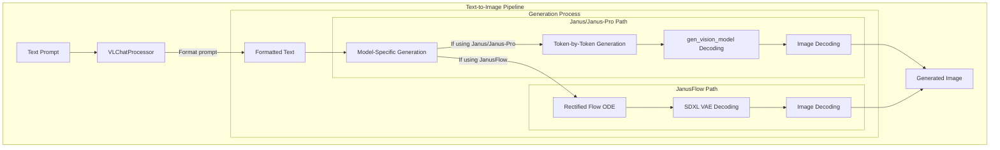
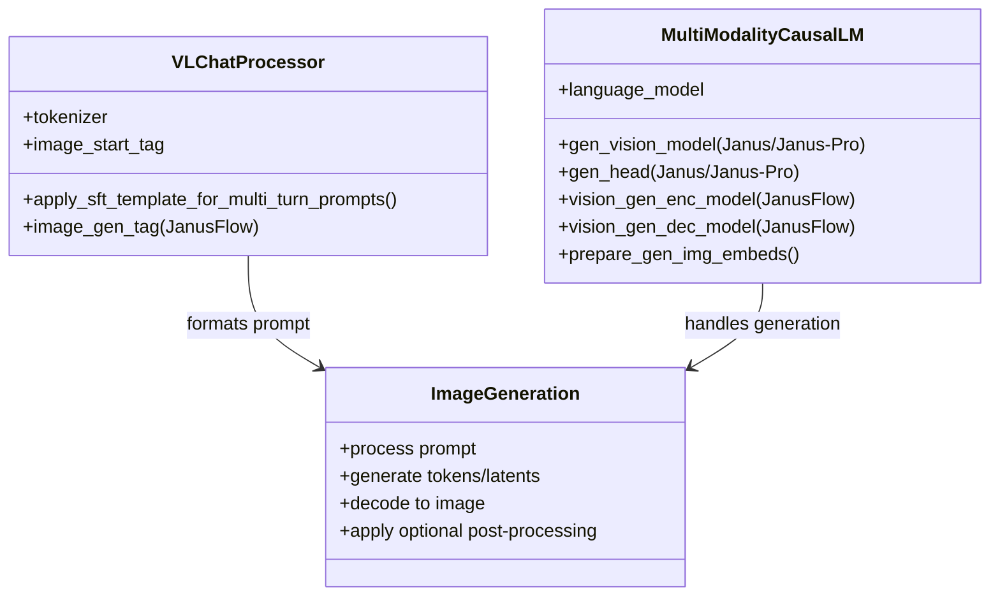
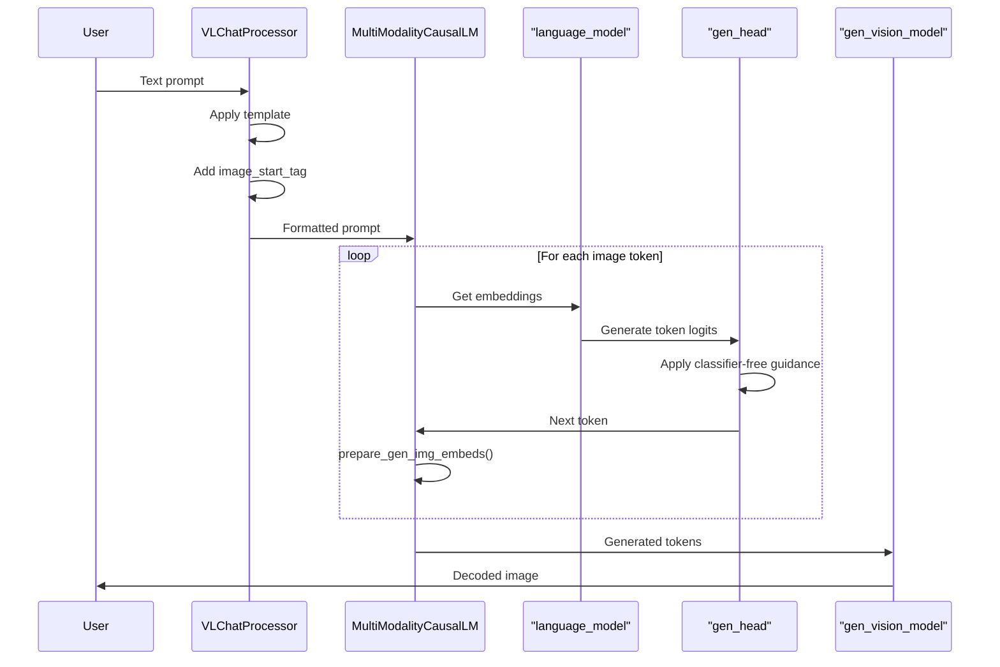
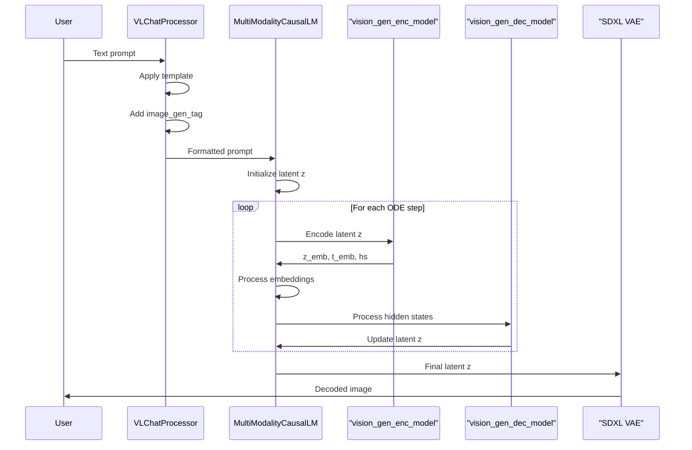

<!-- source: DeepWiki mcp.deepwiki.com · repo deepseek-ai/Janus · page 4.3 Text-to-Image Generation Examples · fetched 2026-10-30 -->

# Text-to-Image Generation Examples

<details>
<summary>Relevant source files</summary>

The following files were used as context for generating this wiki page:

- [README.md](README.md)
- [demo/app_janusflow.py](demo/app_janusflow.py)
- [demo/app_januspro.py](demo/app_januspro.py)
- [generation_inference.py](generation_inference.py)
- [images/teaser_janusflow.png](images/teaser_janusflow.png)

</details>


This document provides practical examples and guidance for generating images from text prompts using the Janus family of models. It covers implementation details, code patterns, and usage tips for effective image generation. For information about multimodal understanding capabilities (using images as input), see [Multimodal Understanding Examples](#4.2).

## Overview of Text-to-Image Generation in Janus Models

The Janus family models offer text-to-image generation capabilities using different underlying architectures:

1. **Janus** and **Janus-Pro** use a token-by-token autoregressive generation approach
2. **JanusFlow** uses a rectified flow ODE approach with VAE decoding

Each model can transform text descriptions into corresponding visual content while maintaining a unified model architecture.



Sources: [README.md:237-252](), [README.md:372-472](), [README.md:574-698]()

## Common Components for Text-to-Image Generation

Both generation approaches share several key components and a similar workflow, though their internal mechanisms differ.



Sources: [README.md:374-427](), [README.md:574-697](), [demo/app_januspro.py:77-131]()

## Using Janus and Janus-Pro for Text-to-Image Generation

The basic flow for generating images with Janus and Janus-Pro models involves:

1. Preparing the conversation with a text prompt
2. Formatting the prompt with the proper template
3. Appending the image start tag
4. Running the token-by-token generation process
5. Decoding the generated tokens to an image

### Basic Implementation

Here's the core implementation pattern for Janus and Janus-Pro text-to-image generation:



The key parameters that control the generation process include:
- `temperature`: Controls randomness (higher values = more diverse but potentially less coherent)
- `cfg_weight`: Classifier-free guidance weight (higher values = stronger adherence to prompt)
- `parallel_size`: Number of images to generate in parallel

Sources: [README.md:384-422](), [demo/app_januspro.py:77-171](), [generation_inference.py:55-111]()

### Example: Image Generation with Janus-Pro

```python
# Prepare conversation and format prompt
conversation = [
    {
        "role": "<|User|>",
        "content": "A beautiful sunset over mountains with reflection in a lake"
    },
    {"role": "<|Assistant|>", "content": ""}
]

# Format the text and add image tag
text = vl_chat_processor.apply_sft_template_for_multi_turn_prompts(
    conversations=conversation,
    sft_format=vl_chat_processor.sft_format,
    system_prompt=""
)
text = text + vl_chat_processor.image_start_tag

# Generate images
input_ids = torch.LongTensor(tokenizer.encode(text))
output, patches = generate(
    input_ids,
    width=384,
    height=384,
    cfg_weight=5.0,
    parallel_size=5,
    temperature=1.0
)

# Process the output to images
images = unpack(patches, width, height, parallel_size=5)
```

Sources: [demo/app_januspro.py:134-171](), [README.md:410-422]()

## Using JanusFlow for Text-to-Image Generation

JanusFlow takes a different approach by using rectified flow for the generation process:

1. Preparing the conversation with a text prompt
2. Formatting the prompt with the proper template
3. Appending the image generation tag (specific to JanusFlow)
4. Running a rectified flow ODE process
5. Decoding the latents using an SDXL VAE

### Basic Implementation



Key parameters for JanusFlow include:
- `cfg_weight`: Controls classifier-free guidance strength
- `num_inference_steps`: Controls the number of ODE steps (more steps = higher quality but slower)
- `batchsize`: Number of images to generate in a batch

Sources: [README.md:580-697](), [demo/app_janusflow.py:70-139]()

### Example: Image Generation with JanusFlow

```python
# Prepare conversation and format prompt
conversation = [
    {
        "role": "User",
        "content": "A surreal digital painting of a floating island with waterfalls"
    },
    {"role": "Assistant", "content": ""}
]

# Format the text and add image generation tag
text = vl_chat_processor.apply_sft_template_for_multi_turn_prompts(
    conversations=conversation,
    sft_format=vl_chat_processor.sft_format,
    system_prompt=""
)
text = text + vl_chat_processor.image_gen_tag

# Generate images
input_ids = torch.LongTensor(tokenizer.encode(text))
images = generate(
    input_ids,
    cfg_weight=2.0,
    num_inference_steps=30,
    batchsize=5
)
```

Note that JanusFlow requires the SDXL VAE which must be loaded separately:

```python
from diffusers.models import AutoencoderKL
# Important: use bfloat16 dtype, as this vae doesn't work with fp16
vae = AutoencoderKL.from_pretrained("stabilityai/sdxl-vae")
vae = vae.to(torch.bfloat16).cuda().eval()
```

Sources: [README.md:595-615](), [demo/app_janusflow.py:70-139]()

## Configuration and Parameter Tuning

Both models offer various parameters to control generation quality and behavior:

| Parameter | Description | Typical Values | Applies To |
|-----------|-------------|----------------|------------|
| `temperature` | Controls randomness in token generation | 0.5-1.2 | Both |
| `cfg_weight` | Classifier-free guidance strength | 1.0-10.0 | Both |
| `parallel_size` / `batchsize` | Number of images to generate | 1-16 | Both |
| `image_token_num_per_image` | Number of tokens per image | 576 | Janus/Janus-Pro |
| `num_inference_steps` | Number of ODE steps | 20-50 | JanusFlow |
| `img_size` / `width` / `height` | Image dimensions | 384, 768 | Both |

Recommended settings for different use cases:

| Use Case | Temperature | CFG Weight | Steps (JanusFlow) |
|----------|-------------|------------|-------------------|
| Detailed, accurate | 0.8 | 5.0 | 30 |
| Creative, varied | 1.2 | 3.0 | 20 |
| Abstract art | 1.5 | 2.0 | 15 |
| Photorealistic | 0.7 | 7.0 | 40 |

Sources: [demo/app_januspro.py:77-131](), [demo/app_janusflow.py:70-139](), [generation_inference.py:55-111]()

## Effective Prompting Techniques

The quality of generated images depends significantly on the prompting technique used. Here are some recommendations:

### Basic Prompt Structure

```
[Subject] [Action/State] [Setting] [Style], [Additional details]
```

### Examples of Effective Prompts

| Simple Prompt | Enhanced Prompt |
|---------------|-----------------|
| "A cat" | "A Persian cat sitting on a windowsill, soft morning light, detailed fur, high resolution, studio photography" |
| "Mountain landscape" | "Majestic mountain range with snow-capped peaks at sunset, golden light, crystal clear lake reflection, ultra-detailed, cinematic, 8K resolution" |
| "Portrait" | "Portrait of a middle-aged woman with striking blue eyes, natural lighting, soft shadows, freckles, intricate details, professional photography, shallow depth of field" |

### Tips for Better Results

1. **Be specific**: Include details about subject, setting, lighting, style, and mood
2. **Add style references**: Terms like "digital art", "photorealistic", "oil painting", etc.
3. **Technical qualities**: Include terms like "high resolution", "detailed", "sharp focus"
4. **Use parallel generation**: Generate multiple images and select the best one
5. **Experiment with CFG weight**: Higher for more prompt adherence, lower for creativity

Sources: [demo/app_januspro.py:219-227](), [demo/app_janusflow.py:225-230]()

## Running the Interactive Demos

Both Janus and JanusFlow include Gradio-based interactive demos for easy experimentation with text-to-image generation.

### Janus/Janus-Pro Demo

```bash
pip install -e .[gradio]
python demo/app.py         # For Janus
python demo/app_januspro.py # For Janus-Pro
```

### JanusFlow Demo

```bash
pip install -e .[gradio]
pip install diffusers[torch]
python demo/app_janusflow.py
```

The Gradio interface provides a user-friendly way to:
- Enter text prompts
- Adjust generation parameters
- View multiple output images
- Try pre-defined example prompts

Sources: [README.md:286-296](), [README.md:478-489](), [README.md:701-710](), [demo/app_januspro.py:175-244](), [demo/app_janusflow.py:179-245]()

## Troubleshooting Common Issues

| Issue | Possible Cause | Solution |
|-------|----------------|----------|
| Poor image quality | Inadequate prompting | Use more detailed prompts with style references |
| Out-of-memory errors | Model size or batch size too large | Reduce parallel_size/batchsize or use smaller model variant |
| Generation too slow | Too many inference steps (JanusFlow) | Reduce num_inference_steps |
| Incorrect results | CFG weight too low | Increase cfg_weight value |
| VAE errors (JanusFlow) | Incorrect precision | Ensure VAE is loaded with bfloat16 not fp16 |

Sources: [README.md:17-22](), [demo/app_janusflow.py:18-20]()

## Comparison Across Model Variants

| Feature | Janus-1.3B | Janus-Pro-1B | Janus-Pro-7B | JanusFlow-1.3B |
|---------|------------|--------------|--------------|----------------|
| Generation Method | Token-by-token | Token-by-token | Token-by-token | Rectified Flow |
| Model Size | 1.3B | 1B | 7B | 1.3B |
| Image Quality | Good | Better | Best | Different style |
| Generation Speed | Fast | Fast | Slower | Medium |
| External Dependencies | None | None | None | SDXL VAE |
| Memory Requirements | Low | Low | High | Medium |

Sources: [README.md:113-116](), [README.md:64-67]()

This wiki page provides a comprehensive guide to generating images using the Janus model family. For any issues not covered here, refer to the official documentation or raise an issue on the repository.

---

