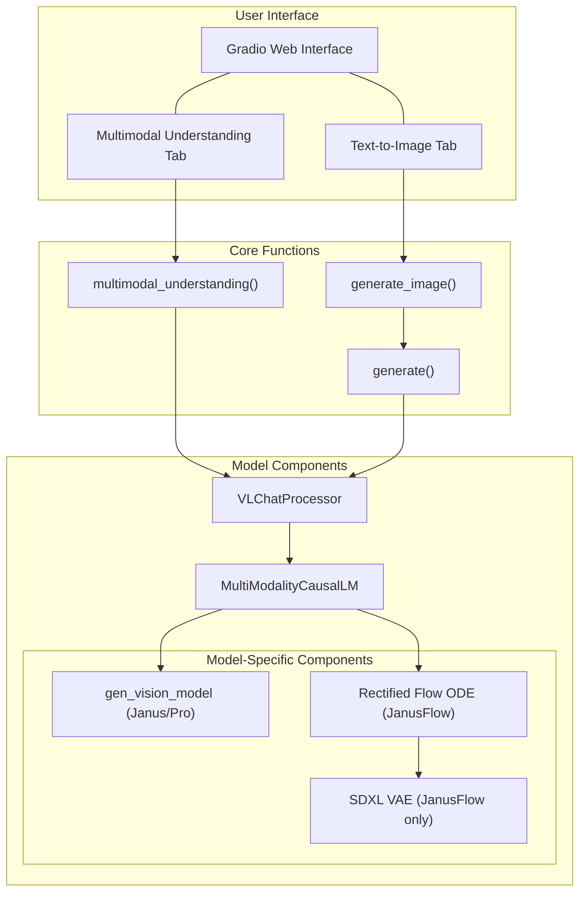
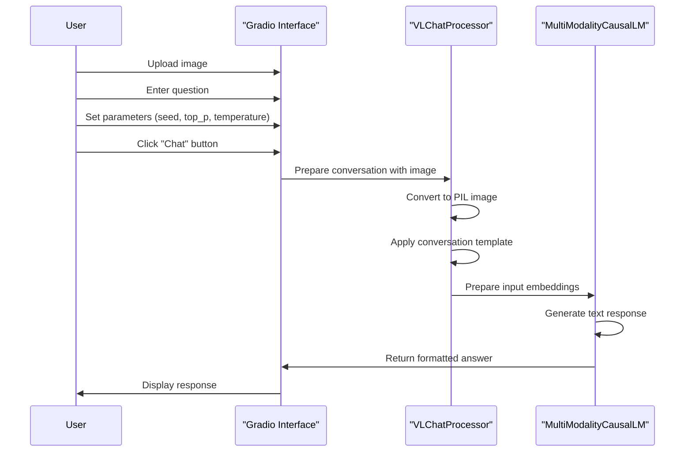
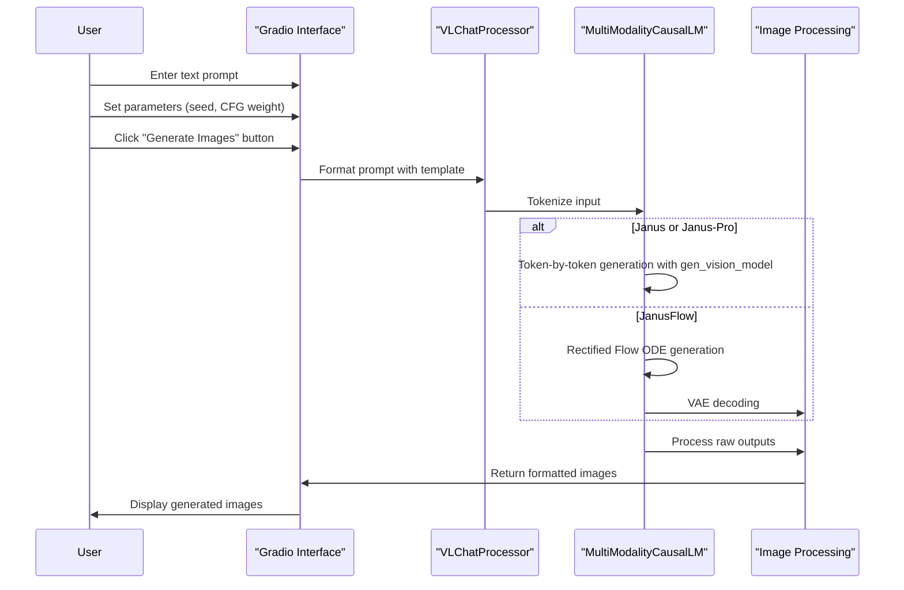
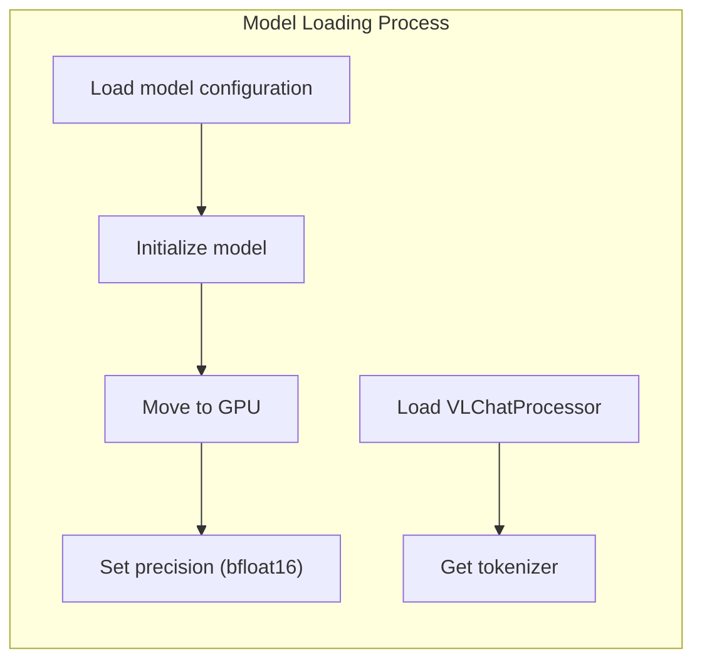

<!-- source: DeepWiki mcp.deepwiki.com · repo deepseek-ai/Janus · page 4.4 Interactive Demos · fetched 2026-10-30 -->

# Interactive Demos

<details>
<summary>Relevant source files</summary>

The following files were used as context for generating this wiki page:

- [demo/Janus_colab_demo.ipynb](demo/Janus_colab_demo.ipynb)
- [demo/app.py](demo/app.py)
- [demo/app_janusflow.py](demo/app_janusflow.py)
- [demo/app_januspro.py](demo/app_januspro.py)

</details>


This document provides a comprehensive guide to the interactive demo applications included in the Janus repository. These demos allow users to experiment with both multimodal understanding and text-to-image generation capabilities of the Janus model family through user-friendly interfaces. For information about model usage in code, see [Multimodal Understanding Examples](#4.2) and [Text-to-Image Generation Examples](#4.3).

## Demo Overview

The Janus repository includes three main demo applications, each designed for a specific model variant, plus a Google Colab notebook for cloud-based experimentation:

| Demo Application | Target Model | File Path |
|-----------------|--------------|-----------|
| Standard Demo | Janus-1.3B | `demo/app.py` |
| JanusPro Demo | Janus-Pro-7B | `demo/app_januspro.py` |
| JanusFlow Demo | JanusFlow-1.3B | `demo/app_janusflow.py` |
| Colab Demo | Janus-1.3B | `demo/Janus_colab_demo.ipynb` |

All demos provide similar interfaces with model-specific optimizations.

Sources: [demo/app.py](), [demo/app_januspro.py](), [demo/app_janusflow.py](), [demo/Janus_colab_demo.ipynb]()

## Demo Architecture

The demo applications share a common architecture pattern while adapting to each model's specific requirements.



Sources: [demo/app.py:157-224](), [demo/app_januspro.py:157-245](), [demo/app_janusflow.py:179-247]()

## Running the Demo Applications

### Requirements

Before running the demos, ensure you have:

1. Installed the Janus package and its dependencies
2. A machine with CUDA-compatible GPU (recommended)
3. Sufficient VRAM (at least 8GB for Janus-1.3B, 16GB+ for Janus-Pro-7B)

### Launching the Demos

To launch a demo application, navigate to the repository root and run:

```
# For standard Janus demo
python demo/app.py

# For Janus-Pro demo
python demo/app_januspro.py

# For JanusFlow demo
python demo/app_janusflow.py
```

Each demo will start a local web server and provide a URL for accessing the interface, typically `http://127.0.0.1:7860/`. The demos also support external access with the `share=True` parameter.

Sources: [demo/app.py:224](), [demo/app_januspro.py:244](), [demo/app_janusflow.py:247]()

## Demo Interfaces

All demo applications provide two main interfaces:

### Multimodal Understanding Interface

This interface allows users to upload an image and ask questions about it:



The interface includes these components:
- Image upload area
- Question input textbox
- Generation parameters (seed, top_p, temperature)
- Response display area
- Example inputs

Sources: [demo/app.py:25-66](), [demo/app_januspro.py:33-74](), [demo/app_janusflow.py:25-66]()

### Text-to-Image Generation Interface

This interface enables users to generate images from text prompts:



The interface includes:
- Text prompt input
- Generation parameters (seed, CFG weight)
- Gallery to display multiple generated images
- Example prompts

Sources: [demo/app.py:69-153](), [demo/app_januspro.py:77-171](), [demo/app_janusflow.py:69-175]()

## Demo Implementation Details

### Loading Models

Each demo first loads the appropriate model and processor:



Implementation differences:
- Standard Janus and Janus-Pro use the same loading approach but with different model paths
- JanusFlow additionally loads an SDXL VAE model for image decoding

Sources: [demo/app.py:10-22](), [demo/app_januspro.py:14-29](), [demo/app_janusflow.py:10-20]()

### Multimodal Understanding Function

The `multimodal_understanding` function is similar across all demos:

1. Prepare the conversation with the image
2. Process the inputs using the `VLChatProcessor`
3. Prepare input embeddings for the model
4. Generate a response using the model's language component
5. Decode and return the response

Key parameters include:
- `max_new_tokens`: Controls response length (512 in all demos)
- `temperature`: Controls randomness in generation
- `top_p`: Controls diversity of responses

Sources: [demo/app.py:25-66](), [demo/app_januspro.py:33-74](), [demo/app_janusflow.py:25-66]()

### Text-to-Image Generation

The text-to-image generation approach differs between models:

#### Janus and Janus-Pro

For the standard Janus and Janus-Pro demos, image generation follows these steps:

1. Tokenize the text prompt
2. Initialize token generation matrices
3. Generate image tokens sequentially
4. Apply classifier-free guidance (CFG)
5. Decode the tokens to image patches
6. Process the patches into displayable images

Sources: [demo/app.py:69-153](), [demo/app_januspro.py:77-171]()

#### JanusFlow

JanusFlow uses a rectified flow approach:

1. Tokenize the text prompt
2. Initialize a random noise tensor (z)
3. Run a rectified flow ODE (Ordinary Differential Equation) solver
4. Apply classifier-free guidance at each step
5. Decode the result using the SDXL VAE
6. Process the output into displayable images

Sources: [demo/app_janusflow.py:69-175]()

## Google Colab Integration

The repository includes a Google Colab notebook (`Janus_colab_demo.ipynb`) that allows users to run the Janus demo in a cloud environment. This is particularly useful for users without a local GPU.

The notebook follows the same general structure as the standard demo but is adapted for the Colab environment.

Sources: [demo/Janus_colab_demo.ipynb]()

## Customizing the Demos

The demo applications can be customized by modifying parameters or the interface components:

### Modifying Generation Parameters

You can adjust generation parameters by changing the default values:

- In multimodal understanding: seed, top_p, temperature
- In text-to-image generation: seed, CFG weight, inference steps (JanusFlow)

### Adding More Examples

You can add more examples by modifying the `examples` lists:

```python
examples_t2i = gr.Examples(
    label="Text to image generation examples",
    examples=[
        "Your new example prompt here",
        # Add more examples
    ],
    inputs=prompt_input,
)
```

### Modifying the Interface

The Gradio interface layout can be customized by modifying the components and their arrangement in the `gr.Blocks()` context.

Sources: [demo/app.py:172-210](), [demo/app_januspro.py:188-229](), [demo/app_janusflow.py:194-233]()

## Troubleshooting

Common issues when running the demos include:

1. **Out of memory errors**: Reduce batch size or use a smaller model variant
2. **Slow generation**: Reduce the number of inference steps or generated images
3. **Gradio interface issues**: Ensure you have the correct version of Gradio installed

For any other issues, refer to the Janus GitHub repository documentation.

---

