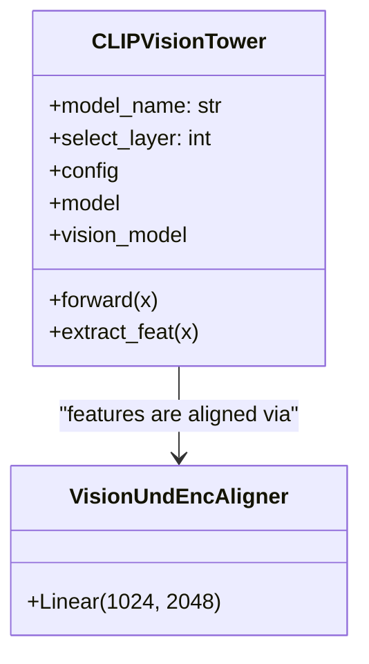
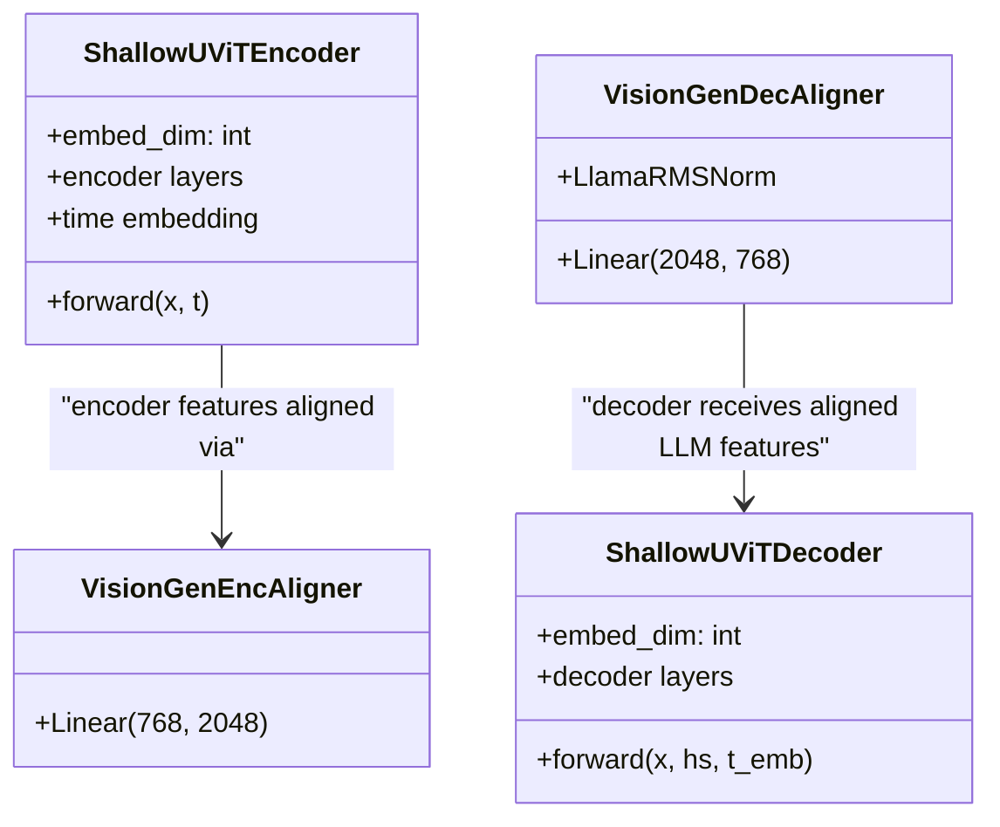
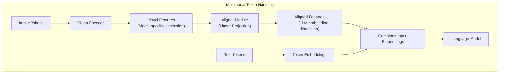
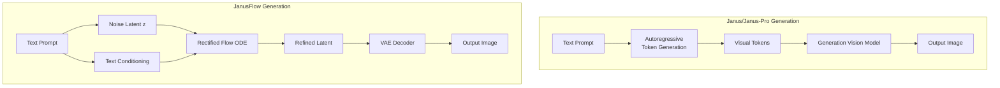
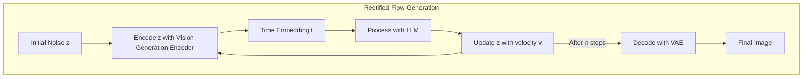
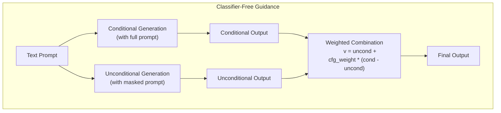
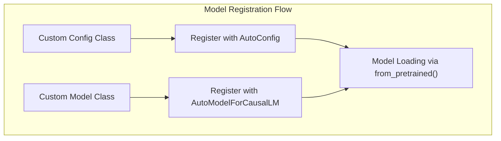

<!-- source: DeepWiki mcp.deepwiki.com · repo deepseek-ai/Janus · page 5 Advanced Topics · fetched 2026-10-30 -->

# Advanced Topics

Relevant source files

The following files were used as context for generating this wiki page:

- [README.md](README.md)
- [images/teaser_janusflow.png](images/teaser_janusflow.png)
- [janus/janusflow/models/modeling_vlm.py](janus/janusflow/models/modeling_vlm.py)

This document provides detailed technical information about the advanced aspects of the Janus architecture for developers who need to understand and potentially modify the underlying components of the system. This page focuses on the internal architecture of vision encoders, model integration patterns, and technical implementation details. For basic usage and examples, please refer to the [Usage Guide](#4), and for model-specific details, see [Models in Detail](#3).

## Vision Encoder Architecture

Janus models use different specialized vision encoders for understanding and generation tasks, allowing for optimized performance in both directions while sharing a single language model backbone.

### Understanding vs. Generation Encoders

```mermaid
flowchart TD
    subgraph "Vision Understanding Path"
        Image1["Input Image"] --> VisionUndEncoder["Vision Understanding Encoder
        (CLIPVisionTower)"]
        VisionUndEncoder --> VisionUndAligner["Vision Understanding Aligner
        (Linear Projection to LLM dim)"]
        VisionUndAligner --> LLMIntegration1["LLM Integration"]
    end
    
    subgraph "Vision Generation Path (Janus/Janus-Pro)"
        Text1["Text Prompt"] --> LLMTokens["Token-by-Token
        Generation"]
        LLMTokens --> GenHead["Generation Head
        (Projects to vision tokens)"]
        GenHead --> GenVisionModel["Generation Vision Model
        (Decodes to pixels)"]
        GenVisionModel --> OutputImage1["Generated Image"]
    end
    
    subgraph "Vision Generation Path (JanusFlow)"
        Text2["Text Prompt"] --> VisionGenEncoder["Vision Generation Encoder
        (ShallowUViTEncoder)"]
        VisionGenEncoder --> VisionGenEncAligner["Vision Generation Encoder Aligner"]
        VisionGenEncAligner --> LLMProcess["LLM Processing"]
        LLMProcess --> VisionGenDecAligner["Vision Generation Decoder Aligner"]
        VisionGenDecAligner --> VisionGenDecoder["Vision Generation Decoder
        (ShallowUViTDecoder)"]
        VisionGenDecoder --> VAEDecode["VAE Decoding
        (SDXL VAE)"]
        VAEDecode --> OutputImage2["Generated Image"]
    end
```

Sources: [janus/janusflow/models/modeling_vlm.py:137-169]()

### Vision Understanding Encoder

The vision understanding encoder processes input images to extract features that are fed into the language model for multimodal understanding tasks.

Sources: [janus/janusflow/models/modeling_vlm.py:137-143]()

### Vision Generation Components

For image generation, the components differ between Janus/Janus-Pro and JanusFlow:

#### JanusFlow Generation Components

Sources: [janus/janusflow/models/modeling_vlm.py:149-169]()

## Multimodal Integration Mechanisms

The Janus architecture uses several key mechanisms to integrate vision and language modalities effectively.

### Embedding Alignment

The MultiModalityCausalLM class handles the integration of visual and textual information through a process that involves:

1. Converting images to embeddings through the appropriate encoder
2. Aligning these embeddings to the language model's dimension 
3. Replacing special image tokens in the text sequence with the aligned visual embeddings

Sources: [janus/janusflow/models/modeling_vlm.py:171-219]()

### Text-to-Image Generation Architecture Differences

Sources: [README.md:575-701]()

## Rectified Flow in JanusFlow

JanusFlow introduces a novel approach to text-to-image generation by integrating a rectified flow process.

### Rectified Flow ODE Process

The rectified flow ODE process in JanusFlow involves:

1. Starting with a random noise latent z
2. Iteratively refining z through a series of steps
3. For each step:
   - Encode the current z and timestep t
   - Process through the language model
   - Compute the velocity v for updating z
   - Update z using: z = z + dt * v
4. After the specified number of steps, decode z to produce the final image

Sources: [README.md:615-689]()

## Classifier-Free Guidance

Both Janus and JanusFlow implement Classifier-Free Guidance (CFG) to enhance the quality of generated images.

In practice, this is implemented by:

1. Creating two copies of the input (one normal, one with masked tokens)
2. Running both through the model to get conditional and unconditional outputs
3. Combining the outputs using the formula: result = unconditional + cfg_weight * (conditional - unconditional)

Sources: [README.md:425-430](), [README.md:678-680]()

## Licensing and Attribution

Janus models are released under two different licenses:

| Component | License | Description |
|-----------|---------|-------------|
| Code | MIT License | Allows free use, modification, distribution, and commercial usage with minimal restrictions |
| Model Weights | DeepSeek Model License | A custom license that permits commercial usage under specific terms and conditions |

When using Janus models in your projects, proper attribution should be provided by citing the appropriate papers:

- Janus-Pro: "Janus-Pro: Unified Multimodal Understanding and Generation with Data and Model Scaling"
- Janus: "Janus: Decoupling visual encoding for unified multimodal understanding and generation"
- JanusFlow: "JanusFlow: Harmonizing Autoregression and Rectified Flow for Unified Multimodal Understanding and Generation"

Sources: [README.md:714-740]()

## Performance Considerations

When deploying Janus models in production environments, several factors should be considered:

### Memory Requirements

| Model | Parameters | Approx. VRAM Usage |
|-------|------------|-------------------|
| Janus-1.3B | 1.3 billion | 3-4 GB |
| JanusFlow-1.3B | 1.3 billion | 4-5 GB (includes VAE) |
| Janus-Pro-1B | 1 billion | 2-3 GB |
| Janus-Pro-7B | 7 billion | 14-16 GB |

### Generation Parameters

For text-to-image generation, key parameters that affect quality and performance include:

| Parameter | Description | Typical Values |
|-----------|-------------|----------------|
| cfg_weight | Controls adherence to text prompt | 2.0-7.0 |
| temperature | Controls randomness in generation | 0.5-1.5 |
| num_inference_steps | Number of diffusion steps (JanusFlow) | 20-50 |
| parallel_size | Number of images to generate in parallel | 5-16 |

Sources: [README.md:413-430](), [README.md:615-697]()

## Implementation Details for Extension

For developers looking to extend the Janus architecture, understanding these key implementation patterns is crucial:

### Model Registration Pattern

Janus models use a registration pattern to integrate with the Hugging Face ecosystem:

This pattern allows Janus models to be loaded using the standard Hugging Face interfaces.

Sources: [janus/janusflow/models/modeling_vlm.py:222-226]()

---

