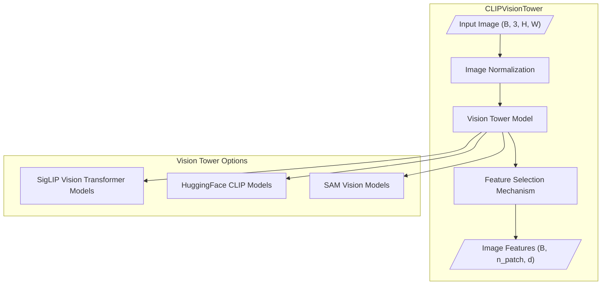
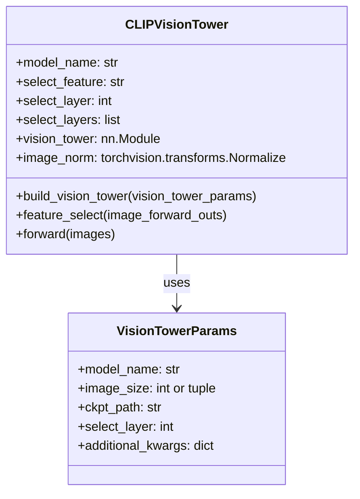
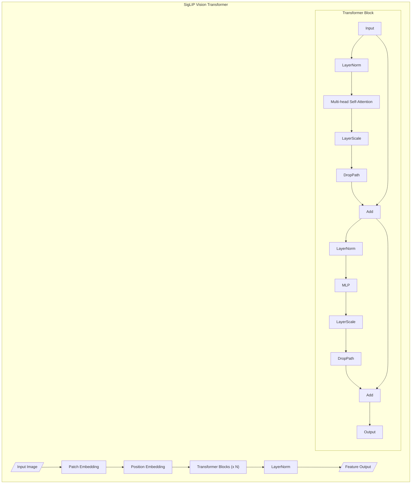
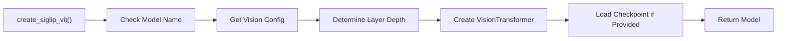
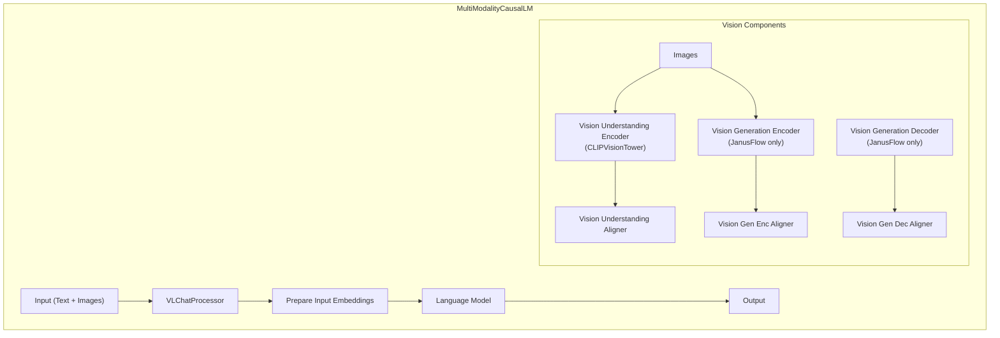

<!-- source: DeepWiki mcp.deepwiki.com · repo deepseek-ai/Janus · page 5.1 Vision Encoders · fetched 2026-10-30 -->

# Vision Encoders

Relevant source files

The following files were used as context for generating this wiki page:

- [janus/janusflow/models/clip_encoder.py](janus/janusflow/models/clip_encoder.py)
- [janus/janusflow/models/siglip_vit.py](janus/janusflow/models/siglip_vit.py)

## Introduction

This document details the vision encoding components used in the Janus model family. Vision encoders in Janus are responsible for processing and embedding visual information, transforming images into feature representations that can be understood by the language model components. The vision encoders are crucial for enabling the multimodal understanding capabilities of Janus models.

For information about how these encoders integrate with the larger model architecture, see [Core Components](#2.1).

## Vision Encoder Architecture

The Janus system primarily employs the CLIPVisionTower as its main vision encoder implementation, which can wrap different vision models, most notably SigLIP vision transformers.

Sources: [janus/janusflow/models/clip_encoder.py:30-68](), [janus/janusflow/models/clip_encoder.py:70-86]()

## CLIPVisionTower Component

The `CLIPVisionTower` class serves as a unified interface for different vision models, providing consistent image processing and feature extraction functionality. It's designed to be flexible, supporting multiple vision backbone architectures while providing a standardized output format for integration with the language model.

Key features of `CLIPVisionTower`:

- **Model Selection**: Supports various vision models including SigLIP, SAM, and HuggingFace CLIP models
- **Customizable Image Processing**: Configurable image normalization with customizable mean and standard deviation
- **Feature Selection**: Different feature selection strategies (patch features, cls+patch features, etc.)
- **Layer Selection**: Ability to select specific layers from the vision model for feature extraction

Sources: [janus/janusflow/models/clip_encoder.py:30-122]()

### Forward Pipeline

The forward processing pipeline of the `CLIPVisionTower` consists of the following steps:

1. **Input**: Accepts a batch of images in tensor format `[B, 3, H, W]`
2. **Normalization**: Applies optional image normalization if `image_norm` is configured
3. **Feature Extraction**: Passes the normalized images through the vision tower model
4. **Feature Selection**: Selects relevant features from the model output based on the configured selection strategy
5. **Output**: Returns the processed image features with shape `[B, n_patch, d]` where:
   - `B` is the batch size
   - `n_patch` is the number of image patches
   - `d` is the feature dimension

Sources: [janus/janusflow/models/clip_encoder.py:107-122]()

### Feature Selection Mechanisms

The `CLIPVisionTower` supports different feature selection strategies through the `select_feature` parameter:

- **"patch"**: Extracts only patch features, excluding the CLS token (features[:, 1:])
- **"cls_patch"**: Extracts both CLS token and patch features (features[:, :])
- **"same"**: Returns features as-is without modification (used for SigLIP models)

Sources: [janus/janusflow/models/clip_encoder.py:88-104]()

## SigLIP Vision Transformer

SigLIP (Simple Gated Language-Image Pre-training) Vision Transformer is the primary vision encoder used in Janus models. It's a variant of the standard Vision Transformer (ViT) architecture designed for multimodal tasks.

Sources: [janus/janusflow/models/siglip_vit.py:259-589](), [janus/janusflow/models/siglip_vit.py:209-256]()

### SigLIP Model Configurations

The Janus repository includes several pre-configured SigLIP models with different sizes and capabilities:

| Model Name | Image Size | Patch Size | Width | Layers | Heads | MLP Ratio |
|------------|------------|------------|-------|--------|-------|-----------|
| siglip_so400m_patch14_384 | 336 | 14 | 1152 | 27 | 16 | 3.7362 |
| siglip_so400m_patch14_224 | 224 | 14 | 1152 | 27 | 16 | 3.7362 |
| siglip_large_patch16_384 | 384 | 16 | 1024 | 24 | 16 | 4.0 |
| siglip_large_patch16_256 | 256 | 16 | 1024 | 24 | 16 | 4.0 |

Sources: [janus/janusflow/models/siglip_vit.py:606-647]()

### Creating a SigLIP Vision Transformer

The `create_siglip_vit` function provides a convenient way to instantiate a SigLIP vision transformer model with the desired configuration:

Key parameters for creating a SigLIP model:
- `model_name`: The name of the pre-configured model to use
- `image_size`: The size of input images (can override the default config)
- `select_layer`: Which layer to extract features from (-1 for last layer)
- `ckpt_path`: Optional path to a checkpoint file to load weights from

Sources: [janus/janusflow/models/siglip_vit.py:650-691]()

## Integration with Janus Models

The vision encoders are integrated with the larger Janus architecture through the `MultiModalityCausalLM` class, which uses the vision encoder for processing visual input in multimodal tasks.

In the Janus architecture:

1. The `CLIPVisionTower` processes images to extract visual features
2. These features are then aligned with the language model's feature space using alignment modules
3. The aligned visual features are combined with text inputs to create multimodal representations
4. The language model processes these multimodal representations to generate outputs (text responses or image tokens)

Sources: [janus/janusflow/models/clip_encoder.py:30-122]()

## Choosing the Appropriate Vision Encoder

The choice of vision encoder depends on the specific requirements of the application:

1. **SigLIP Models**:
   - The default choice for Janus models
   - Offers a good balance of performance and efficiency
   - Available in different sizes to accommodate different resource constraints

2. **CLIP Models**:
   - Can be used as an alternative by specifying a HuggingFace CLIP model name
   - Useful when compatibility with CLIP-based systems is required

The vision encoder can be configured when initializing the Janus model by specifying the appropriate parameters for the `CLIPVisionTower`.

Sources: [janus/janusflow/models/clip_encoder.py:70-86]()

---

