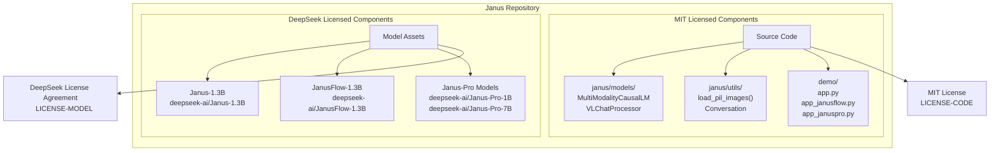
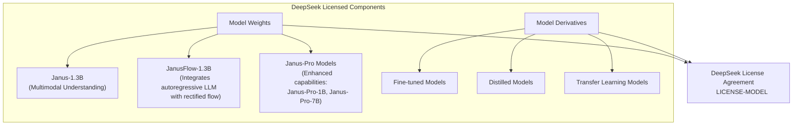
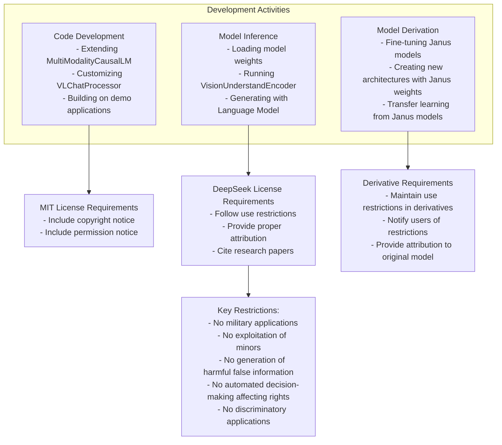

<!-- source: DeepWiki mcp.deepwiki.com · repo deepseek-ai/Janus · page 5.2 Licensing and Attribution · fetched 2026-10-30 -->

# Licensing and Attribution

<details>
<summary>Relevant source files</summary>

The following files were used as context for generating this wiki page:

- [LICENSE-CODE](LICENSE-CODE)
- [LICENSE-MODEL](LICENSE-MODEL)
- [README.md](README.md)
- [images/teaser_janusflow.png](images/teaser_janusflow.png)

</details>


This page provides a detailed explanation of the licensing terms and attribution requirements for the Janus codebase and models. It outlines the dual licensing structure employed by the project, specifying which components are covered by each license and what obligations users have when using, modifying, or distributing these components.

## Overview of Janus Licensing Structure

Janus uses a dual licensing approach:

1. **Code License**: The source code is licensed under the **MIT License**
2. **Model License**: The model weights and architectures are licensed under the **DeepSeek License Agreement**

This dual approach ensures that while the code remains open and accessible with minimal restrictions, the models are protected by specific usage terms that prevent potential misuse.

### Licensing Structure Diagram



Sources: [README.md:44-50](), [LICENSE-CODE](), [LICENSE-MODEL]()

## Code License: MIT

The Janus codebase is licensed under the MIT License, which is a permissive free software license. This applies to all source code in the repository, including the model implementation, utility functions, and demo applications.

### Key Terms of the MIT License

- Permission to use, copy, modify, merge, publish, distribute, sublicense, and/or sell copies of the software
- The only requirement is that the copyright notice and permission notice be included in all copies or substantial portions of the software
- The software is provided "as is" without warranty of any kind

### MIT License Requirements

When using, modifying, or distributing the Janus codebase, you must:

1. Include the copyright notice: "Copyright (c) 2023 DeepSeek"
2. Include the permission notice (the full MIT license text)

These requirements apply when you're working with code components such as `MultiModalityCausalLM`, `VLChatProcessor`, or any of the demo applications.

Sources: [LICENSE-CODE](), [README.md:714-715]()

## Model License: DeepSeek License Agreement

The Janus models (Janus-1.3B, JanusFlow-1.3B, Janus-Pro-1B, Janus-Pro-7B) are licensed under the DeepSeek License Agreement. This license is more restrictive than the MIT License and includes specific use-based restrictions.

### Key Components Under DeepSeek License



Sources: [LICENSE-MODEL](), [README.md:102-116]()

### Key Terms of the DeepSeek License Agreement

1. **Intellectual Property Rights**: Grants copyright and patent licenses for the model and its derivatives
2. **Distribution Requirements**: Specifies conditions for hosting, reproducing, and distributing the model
3. **Use-based Restrictions**: Prohibits certain applications of the model
4. **No Warranty**: Models provided "as is" without warranties

### Use-based Restrictions

The DeepSeek License Agreement prohibits using the models for:

- Violating applicable laws or regulations
- Military use
- Exploiting or harming minors
- Generating or disseminating false information with intent to harm
- Generating inappropriate content subject to regulatory requirements
- Disseminating personal identifiable information without authorization
- Defaming, disparaging, or harassing others
- Fully automated decision-making that adversely impacts legal rights
- Discriminating against individuals or groups
- Exploiting vulnerabilities of specific groups
- Discriminating based on legally protected characteristics

These restrictions apply to both the original models and any derivatives created from them.

Sources: [LICENSE-MODEL:79-91]()

## License Compliance by Usage Type

Different activities when working with Janus require different compliance measures:



Sources: [LICENSE-MODEL:44-51](), [LICENSE-CODE:5-14]()

## Distribution Requirements

### Code Distribution

When distributing code from the Janus repository:

1. Include the MIT License copyright notice
2. Include the MIT License permission notice
3. You may modify the code and distribute your modified versions

### Model Distribution

When distributing Janus models or their derivatives:

1. Include the DeepSeek License use-based restrictions as an enforceable provision
2. Give recipients a copy of the DeepSeek License
3. Retain all copyright, patent, trademark, and attribution notices
4. Include notice of any modifications you made

Note that while you can add your own copyright statement to modifications, you must still respect the original license terms, especially the use-based restrictions.

Sources: [LICENSE-MODEL:44-51](), [README.md:714-715]()

## Attribution Requirements

### Citing Janus in Academic and Research Work

When using Janus models in academic or research work, use the citation information provided in the README:

For Janus-Pro:
```
@article{chen2025janus,
  title={Janus-Pro: Unified Multimodal Understanding and Generation with Data and Model Scaling},
  author={Chen, Xiaokang and Wu, Zhiyu and Liu, Xingchao and Pan, Zizheng and Liu, Wen and Xie, Zhenda and Yu, Xingkai and Ruan, Chong},
  journal={arXiv preprint arXiv:2501.17811},
  year={2025}
}
```

For Janus:
```
@article{wu2024janus,
  title={Janus: Decoupling visual encoding for unified multimodal understanding and generation},
  author={Wu, Chengyue and Chen, Xiaokang and Wu, Zhiyu and Ma, Yiyang and Liu, Xingchao and Pan, Zizheng and Liu, Wen and Xie, Zhenda and Yu, Xingkai and Ruan, Chong and others},
  journal={arXiv preprint arXiv:2410.13848},
  year={2024}
}
```

For JanusFlow:
```
@misc{ma2024janusflow,
  title={JanusFlow: Harmonizing Autoregression and Rectified Flow for Unified Multimodal Understanding and Generation}, 
  author={Yiyang Ma and Xingchao Liu and Xiaokang Chen and Wen Liu and Chengyue Wu and Zhiyu Wu and Zizheng Pan and Zhenda Xie and Haowei Zhang and Xingkai yu and Liang Zhao and Yisong Wang and Jiaying Liu and Chong Ruan},
  journal={arXiv preprint arXiv:2411.07975},
  year={2024}
}
```

Sources: [README.md:719-739]()

## Commercial Usage

Commercial usage of both the code and models is permitted under the respective licenses, provided that all license terms are respected:

- For code: Follow the MIT License terms
- For models: Follow the DeepSeek License Agreement terms, including the use-based restrictions

Note that while commercial use is allowed, the use-based restrictions in the DeepSeek License Agreement still apply regardless of whether the use is commercial or non-commercial.

Sources: [README.md:106-107]()

## Summary

The Janus repository employs a dual licensing structure:

1. **MIT License**: Applies to all code, allowing for flexible use with minimal restrictions
2. **DeepSeek License Agreement**: Applies to models and their derivatives, including specific use-based restrictions

When working with Janus, be sure to comply with the appropriate license terms based on whether you're using the code, the models, or both. For any derivatives of the models, the DeepSeek License use-based restrictions must be maintained.