# Page: Overview

# Overview

<details>
<summary>Relevant source files</summary>

The following files were used as context for generating this wiki page:

- [README.md](README.md)
- [images/teaser_janusflow.png](images/teaser_janusflow.png)
- [images/teaser_januspro.png](images/teaser_januspro.png)

</details>


This document provides a comprehensive introduction to the Janus repository, which contains a family of unified multimodal models capable of both understanding image-text combinations and generating images from text prompts. The Janus models represent a significant advancement in multimodal AI by integrating these capabilities into unified architectures.

## Janus Model Family

The Janus repository contains three main model variants, each with different capabilities and architectural approaches:

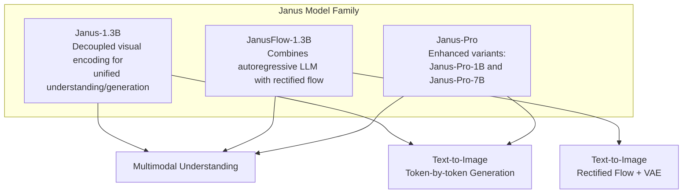

Sources: [README.md:75-100]()

The three model variants share a common high-level purpose but differ in their implementation approaches:

- **Janus**: The original model using decoupled visual encoding paths for understanding and generation within a unified transformer architecture.
- **JanusFlow**: Integrates autoregressive language models with rectified flow for image generation, using a different approach for text-to-image generation.
- **Janus-Pro**: Enhanced versions (1B and 7B) with improved capabilities through optimized training strategies, expanded data, and larger model sizes.

## Core Architecture

The Janus system is built around several key components that work together to provide multimodal capabilities:

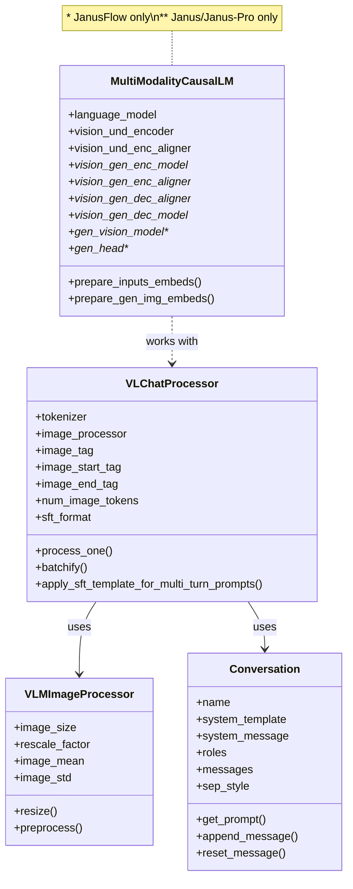

Sources: [README.md:137-189]()

### Key Components:

1. **MultiModalityCausalLM**: The central model class that integrates vision components with a language model. It has different configurations for different model variants.

2. **VLChatProcessor**: Handles the preparation of inputs, including tokenization of text and processing of images.

3. **VLMImageProcessor**: Specifically processes images for input to the model, handling resizing and normalization.

4. **Conversation**: Manages chat history for multi-turn conversations.

## Processing Pipelines

Janus models support two main processing pipelines: multimodal understanding and text-to-image generation.

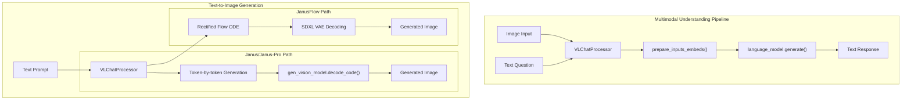

Sources: [README.md:322-467](), [README.md:575-697]()

### Multimodal Understanding:
- Takes both image and text inputs
- Processes them using `VLChatProcessor`
- Generates text responses through the language model

### Text-to-Image Generation:
- **Janus/Janus-Pro**: Uses token-by-token generation with `gen_vision_model` and `gen_head`
- **JanusFlow**: Uses rectified flow ODE approach with VAE decoding

## Technical Implementation

The Janus models are implemented using PyTorch and integrated with the Hugging Face Transformers library. The code is structured to allow loading and using the models with a few lines of code:

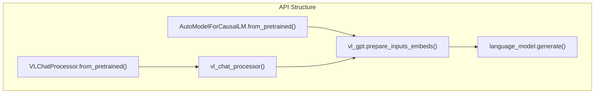

Sources: [README.md:322-371]()

## Demo Applications

The repository includes several demo applications that showcase the capabilities of the Janus models:

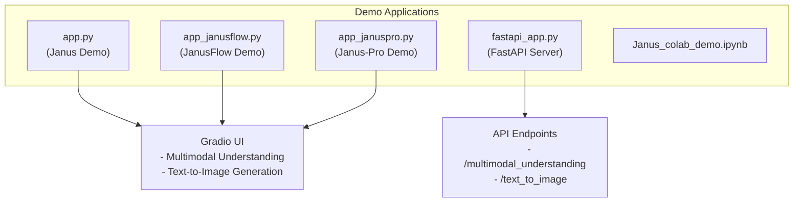

Sources: [README.md:474-502]()

## Model Capabilities and Usage

The Janus models offer a range of capabilities useful for different applications:

| Model | Multimodal Understanding | Text-to-Image Generation | Primary Use Cases |
|-------|--------------------------|--------------------------|-------------------|
| Janus-1.3B | ✓ | ✓ (Token-by-token) | Visual reasoning, OCR, image captioning, simple image generation |
| JanusFlow-1.3B | ✓ | ✓ (Rectified flow) | Visual reasoning, high-quality image generation |
| Janus-Pro-1B | ✓ | ✓ (Enhanced token-by-token) | Similar to Janus with improved performance |
| Janus-Pro-7B | ✓ | ✓ (Enhanced token-by-token) | Advanced visual reasoning, detailed image generation |

For detailed instructions on using these models for specific tasks, see the [Usage Guide](#4).

For installation and setup instructions, see the [Installation and Setup](#4.1) page.

## Conclusion

The Janus repository offers a family of unified multimodal models that can both understand and generate visual content. The different model variants (Janus, JanusFlow, and Janus-Pro) provide options for different use cases and computational requirements. The core architecture is designed to be modular and flexible, allowing for easy integration into various applications.

In the following sections of this wiki, we'll explore each component of the system in greater detail, providing specific information about the model architectures, their capabilities, and how to use them effectively.

---

# Page: Model Family

# Model Family

<details>
<summary>Relevant source files</summary>

The following files were used as context for generating this wiki page:

- [README.md](README.md)
- [images/teaser_janusflow.png](images/teaser_janusflow.png)

</details>


This document describes the Janus model family, detailing the architecture and capabilities of three distinct variants: Janus, JanusFlow, and Janus-Pro. Each model provides unified multimodal understanding and generation capabilities but employs different approaches and optimizations. For information about specific capabilities and features, see [Key Features and Capabilities](#1.2).

## Overview of Janus Model Variants

The Janus repository contains three primary model variants that share a common goal of unifying multimodal understanding and generation tasks:

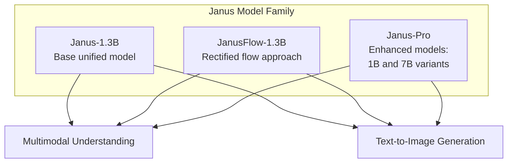

Sources: [README.md:75-100]()

### Model Specifications

All Janus models are built on a unified architecture but vary in size, generation approach, and optimization techniques:

| Model | Parameters | Context Length | Release Date | Key Characteristics |
|-------|------------|---------------|--------------|---------------------|
| Janus-1.3B | 1.3 billion | 4096 | Oct 2024 | Base unified model with decoupled visual encoding |
| JanusFlow-1.3B | 1.3 billion | 4096 | Nov 2024 | Integrates autoregressive LLM with rectified flow for image generation |
| Janus-Pro-1B | 1 billion | 4096 | Jan 2025 | Enhanced training strategy, expanded data |
| Janus-Pro-7B | 7 billion | 4096 | Jan 2025 | Larger model with improved stability and performance |

Sources: [README.md:64-67](), [README.md:112-116]()

## Architectural Approaches

Each Janus model variant employs a different approach to multimodal tasks while maintaining a unified architecture:

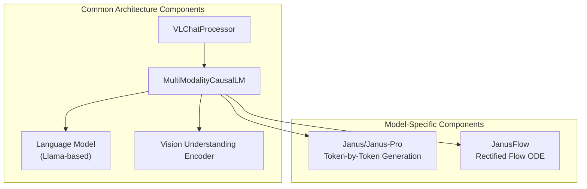

Sources: [README.md:85-99](), [README.md:508-572]()

### Janus Base Model

The original Janus model introduces a decoupled visual encoding approach that separates understanding and generation pathways while maintaining a unified transformer architecture.

Key characteristics:
- 1.3 billion parameters
- Decoupled visual encoding for understanding and generation
- Token-by-token autoregressive image generation
- Uses specialized vision encoders for different tasks

Sources: [README.md:86-93]()

### JanusFlow Model

JanusFlow integrates autoregressive language models with rectified flow, a state-of-the-art method in generative modeling:

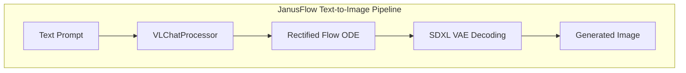

Key characteristics:
- Same parameter count as base Janus (1.3B)
- Uses rectified flow ODE for image generation
- Requires an additional VAE component for decoding
- Better image generation quality than token-by-token approach

Sources: [README.md:94-100](), [README.md:573-710]()

### Janus-Pro Models

Janus-Pro models represent an enhanced version of the base Janus architecture with improved capabilities:

Key improvements:
- Optimized training strategy
- Expanded training data
- Scaled to larger model sizes (1B and 7B variants)
- Enhanced stability in text-to-image generation
- Improved performance on multimodal understanding benchmarks

Sources: [README.md:76-83](), [README.md:122-302]()

## Implementation Details

The model family shares common code components but with variant-specific implementations:

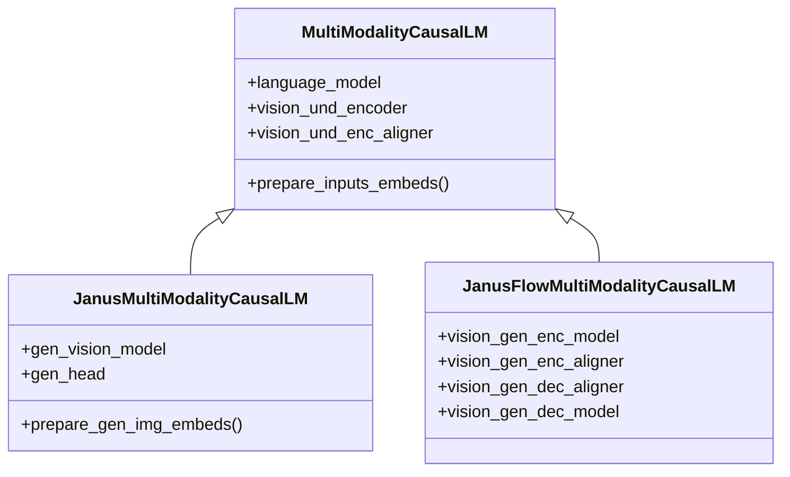

Sources: [README.md:122-302](), [README.md:305-507](), [README.md:508-710]()

### Processing Pipeline Differences

The main architectural difference between the variants lies in their text-to-image generation pipelines:

1. **Janus/Janus-Pro**: Uses token-by-token autoregressive generation with a specialized vision decoder
   ```python
   # Token-by-token generation loop (simplified)
   for i in range(image_token_num_per_image):
       outputs = mmgpt.language_model.model(inputs_embeds=inputs_embeds, use_cache=True)
       hidden_states = outputs.last_hidden_state
       logits = mmgpt.gen_head(hidden_states[:, -1, :])
       # Apply classifier-free guidance
       next_token = torch.multinomial(probs, num_samples=1)
       generated_tokens[:, i] = next_token.squeeze(dim=-1)
   ```

2. **JanusFlow**: Uses rectified flow ODE for image generation with VAE decoding
   ```python
   # Rectified flow generation (simplified)
   for step in range(num_inference_steps):
       # Encode with vision_gen_enc
       z_enc = vl_gpt.vision_gen_enc_model(z_input, t)
       # Process through LLM
       outputs = vl_gpt.language_model.model(inputs_embeds=llm_emb)
       # Transform hidden states back to v
       v = vl_gpt.vision_gen_dec_model(hidden_states, hs, t_emb)
       # Apply classifier-free guidance
       z = z + dt * v
   ```

Sources: [README.md:410-467](), [README.md:616-697]()

## Model Loading and Usage

Despite architectural differences, the models share a common interface for loading and basic usage:

```python
# Common pattern for loading any Janus model
from janus.models import MultiModalityCausalLM, VLChatProcessor

# Specify model path (replace with appropriate model variant)
model_path = "deepseek-ai/Janus-1.3B"  # or JanusFlow-1.3B, Janus-Pro-1B, Janus-Pro-7B

# Load processor and model
vl_chat_processor = VLChatProcessor.from_pretrained(model_path)
vl_gpt = MultiModalityCausalLM.from_pretrained(
    model_path, trust_remote_code=True
).to(torch.bfloat16).cuda().eval()
```

The implementation includes specific demo applications for each variant:
- Janus: [demo/app.py]()
- JanusFlow: [demo/app_janusflow.py]()
- Janus-Pro: [demo/app_januspro.py]()

Sources: [README.md:329-371](), [README.md:535-571](), [README.md:144-186]()

## Comparative Capabilities

While all models in the family support both multimodal understanding and text-to-image generation, their performance characteristics differ:

| Capability | Janus-1.3B | JanusFlow-1.3B | Janus-Pro-1B | Janus-Pro-7B |
|------------|------------|----------------|--------------|--------------|
| Multimodal Understanding | Baseline | Comparable to Janus | Improved over Janus | Best overall |
| Text-to-Image Quality | Baseline | Better image quality | Improved stability | Best overall |
| Generation Speed | Faster | Slower (ODE solving) | Faster | Faster |
| Memory Requirements | Lower | Higher (VAE needed) | Lower | Higher |

Sources: [README.md:76-83](), [README.md:94-100]()

## Model Selection Guidelines

When choosing between Janus model variants:

1. For best overall performance: Use **Janus-Pro-7B**
2. For balance of quality and efficiency: Use **Janus-Pro-1B**
3. For better image generation with smaller models: Use **JanusFlow-1.3B**
4. For baseline unified capabilities: Use **Janus-1.3B**

Sources: [README.md:112-116]()

---

# Page: Key Features and Capabilities

# Key Features and Capabilities

<details>
<summary>Relevant source files</summary>

The following files were used as context for generating this wiki page:

- [README.md](README.md)
- [images/teaser_janusflow.png](images/teaser_janusflow.png)
- [images/teaser_januspro.png](images/teaser_januspro.png)

</details>


This page outlines the core capabilities of the Janus model family, explaining its two primary functions: multimodal understanding and text-to-image generation. For information about the specific model variants (Janus, JanusFlow, and Janus-Pro), see [Model Family](#1.1).

## Overview of Capabilities

The Janus model family provides two main capabilities:

1. **Multimodal Understanding**: Processing and interpreting images and text together to answer questions, describe scenes, or extract information from visual content.

2. **Text-to-Image Generation**: Creating new visual content based on text prompts, using either token-by-token generation (Janus/Janus-Pro) or rectified flow (JanusFlow).

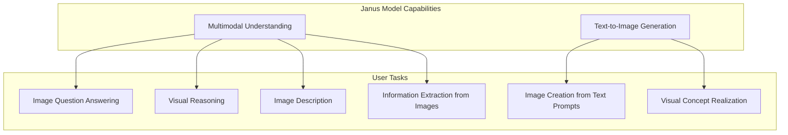

Sources: [README.md:62-101]()

## Multimodal Understanding

The multimodal understanding capability allows Janus models to process text and images together to generate meaningful responses. This enables applications such as:

- Visual question answering
- Image description and captioning
- Information extraction from visual content (e.g., converting equations to LaTeX)
- Visual reasoning tasks

### How It Works

The models process visual input through a specialized vision encoder and combine it with text input for comprehensive understanding. This process involves:

1. Converting images to embeddings through the vision understanding encoder
2. Combining these embeddings with text embeddings
3. Processing the combined embeddings through a language model to generate responses

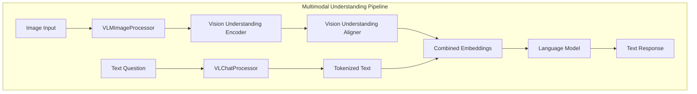

Sources: [README.md:324-370]()

### Example Use Case

```
Input: 
- Image of a mathematical equation
- Text: "Convert the formula into latex code."

Output:
- LaTeX representation of the equation
```

## Text-to-Image Generation

All Janus models support text-to-image generation but with different underlying approaches:

1. **Janus and Janus-Pro** use token-by-token autoregressive generation
2. **JanusFlow** uses a rectified flow ODE approach

### Generation Approaches Comparison

| Approach | Model | Description | Technical Implementation |
|----------|-------|-------------|--------------------------|
| Token-by-token | Janus, Janus-Pro | Generates image tokens autoregressively, similar to text token generation | Uses dedicated generation vision model and generation head |
| Rectified Flow | JanusFlow | Uses ODE-based approach with noise reduction | Integrates rectified flow with VAE decoding (requires SDXL VAE) |

```mermaid
flowchart TD
    subgraph "Text-to-Image Generation"
        direction TB
        subgraph "Janus/Janus-Pro Pipeline"
            TextPrompt1["Text Prompt"] --> VLChatProcessor1["VLChatProcessor"]
            VLChatProcessor1 --> TokenGeneration["Token-by-Token Generation"]
            TokenGeneration --> GenVisionModel["gen_vision_model"]
            GenVisionModel --> Image1["Generated Image"]
        end
        
        subgraph "JanusFlow Pipeline"
            TextPrompt2["Text Prompt"] --> VLChatProcessor2["VLChatProcessor"]
            VLChatProcessor2 --> RectifiedFlow["Rectified Flow ODE"]
            RectifiedFlow --> SDXLVAE["SDXL VAE"]
            SDXLVAE --> Image2["Generated Image"]
        end
    end
```

Sources: [README.md:376-466](), [README.md:575-698]()

### Classifier-Free Guidance

Both generation approaches use classifier-free guidance to improve image quality. This technique compares conditional and unconditional generation results and uses the difference to guide the generation process more effectively.

## Technical Components

The capabilities are implemented through several key technical components in the codebase:

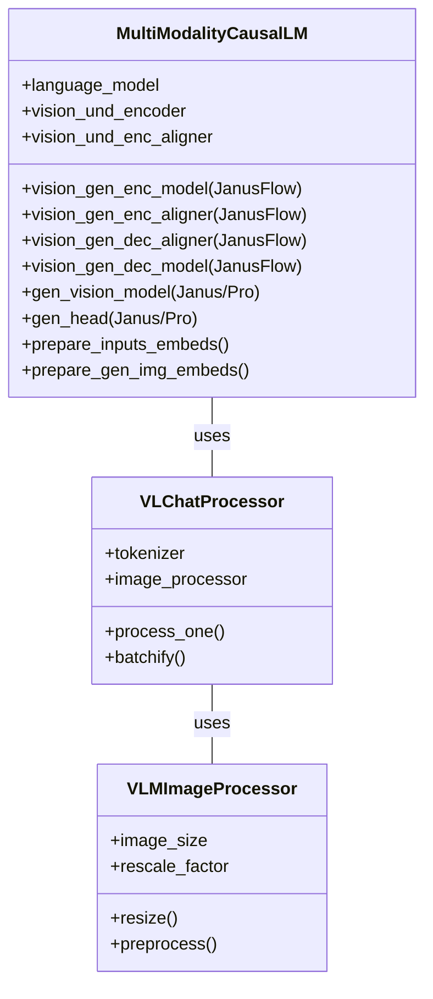

Sources: [README.md:324-370](), [README.md:376-466](), [README.md:575-698]()

### Key Components for Capabilities

| Component | Role | Used For |
|-----------|------|----------|
| `VLChatProcessor` | Handles conversation history and prepares inputs | Both capabilities |
| `VLMImageProcessor` | Processes and resizes images | Both capabilities |
| `MultiModalityCausalLM` | Core model class that integrates vision and language | Both capabilities |
| `vision_und_encoder` | Encodes images for understanding | Multimodal understanding |
| `vision_und_enc_aligner` | Aligns vision features with language model | Multimodal understanding |
| `gen_vision_model` | Generates images from tokens | Text-to-image (Janus/Pro) |
| `gen_head` | Projects language features to image tokens | Text-to-image (Janus/Pro) |
| `vision_gen_enc/dec_model` | Handles image encoding/decoding | Text-to-image (JanusFlow) |

## Performance and Capabilities by Model Variant

Each model in the Janus family offers different performance characteristics while maintaining the same core capabilities:

| Model | Size | Multimodal Understanding | Text-to-Image Generation | Special Features |
|-------|------|--------------------------|---------------------------|-----------------|
| Janus-1.3B | 1.3B parameters | Base performance | Token-by-token | First unified model |
| JanusFlow-1.3B | 1.3B parameters | Base performance | Rectified flow | High-quality generation with ODE |
| Janus-Pro-1B | 1B parameters | Enhanced performance | Token-by-token | Optimized training strategy |
| Janus-Pro-7B | 7B parameters | Superior performance | Token-by-token | Larger model with enhanced capabilities |

Sources: [README.md:75-100]()

## Interoperability Between Capabilities

A key feature of the Janus models is that all capabilities are provided through a single model architecture, allowing for:

1. Simplified deployment - one model for multiple AI tasks
2. Consistency across tasks - same underlying knowledge representation
3. Potential for multi-step workflows that combine both capabilities

For detailed usage examples of these capabilities, see [Multimodal Understanding Examples](#4.2) and [Text-to-Image Generation Examples](#4.3).

Sources: [README.md:85-100]()

---

# Page: Architecture

# Architecture

<details>
<summary>Relevant source files</summary>

The following files were used as context for generating this wiki page:

- [README.md](README.md)
- [images/teaser_janusflow.png](images/teaser_janusflow.png)
- [janus/janusflow/models/__init__.py](janus/janusflow/models/__init__.py)
- [janus/janusflow/models/modeling_vlm.py](janus/janusflow/models/modeling_vlm.py)

</details>


This document provides a detailed overview of the Janus system architecture, explaining the key components and their relationships across all Janus model variants. It covers the core systems that enable multimodal understanding (text + images) and text-to-image generation capabilities in the Janus model family.

For information on specific models and their capabilities, see [Models in Detail](#3). For installation and usage instructions, see [Usage Guide](#4).

## High-Level Architecture Overview

Janus is designed as a unified architecture that supports both multimodal understanding and text-to-image generation using a shared autoregressive transformer foundation. The system's architecture varies slightly between the three main variants: Janus, JanusFlow, and Janus-Pro, but they share common underlying principles.

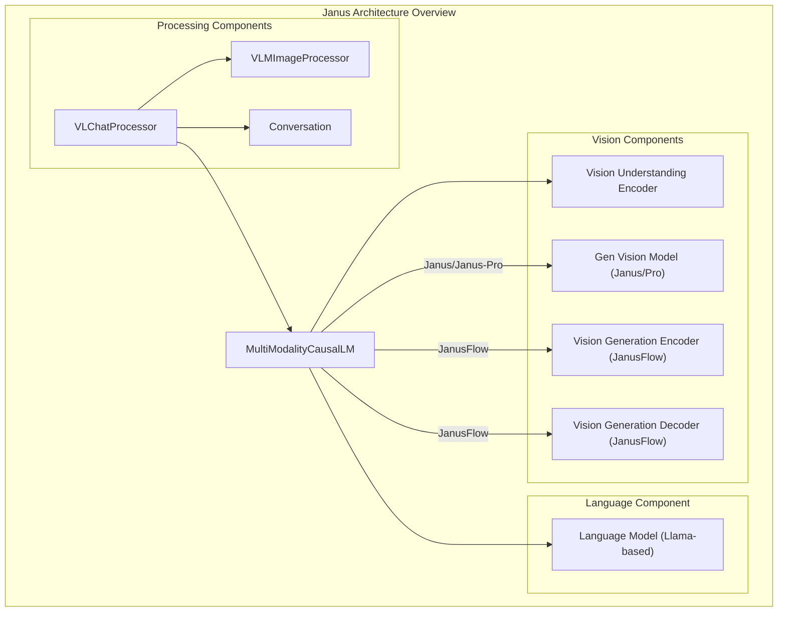

Sources:
- [janus/janusflow/models/modeling_vlm.py:132-227]()
- [README.md:10-101]()

## Core Components

The Janus architecture is built around several key components that work together to provide multimodal capabilities:

### MultiModalityCausalLM

This is the central model class that integrates vision and language components. It serves as the backbone of the Janus architecture, connecting vision encoders/decoders with the language model.

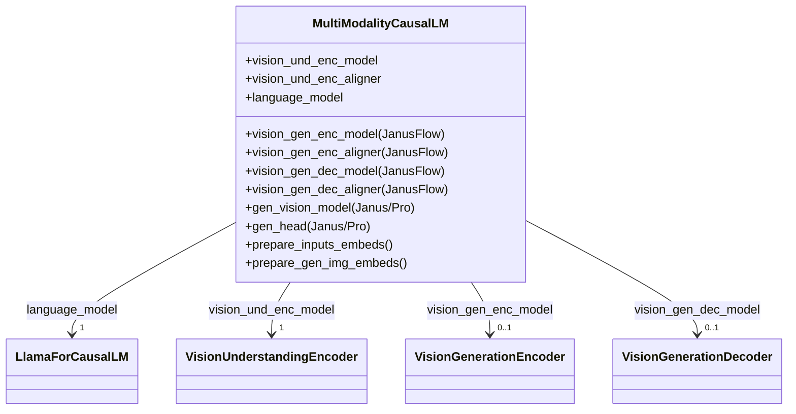

The MultiModalityCausalLM class handles:
- Integrating vision and language models
- Converting between different embedding spaces through aligners
- Preparing input embeddings for the model
- Managing the generation of images or text responses

Sources:
- [janus/janusflow/models/modeling_vlm.py:132-220]()
- [README.md:87-101]()

### Processing Components

The processing pipeline is responsible for preparing inputs for the model:

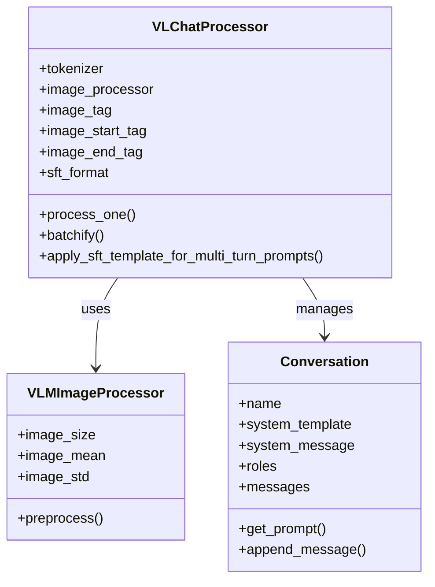

- **VLChatProcessor**: Prepares inputs for the model, including tokenizing text and processing images
- **VLMImageProcessor**: Handles image preprocessing, such as resizing and normalization
- **Conversation**: Manages conversation history and formats prompts for the model

Sources:
- [janus/janusflow/models/__init__.py:20-28]()
- [README.md:347-353]()

## Vision Components

The vision components are responsible for processing images in both understanding and generation modes:

### Vision Understanding Encoder

This component (typically a CLIPVisionTower) processes input images to extract features for understanding tasks:

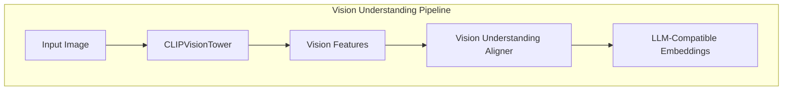

Sources:
- [janus/janusflow/models/modeling_vlm.py:138-143]()
- [janus/janusflow/models/clip_encoder.py]() (referenced but not shown in the provided files)

### Vision Generation Components

For text-to-image generation, Janus uses different architectures based on the model variant:

#### Janus and Janus-Pro

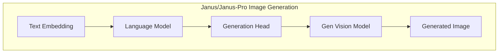

#### JanusFlow

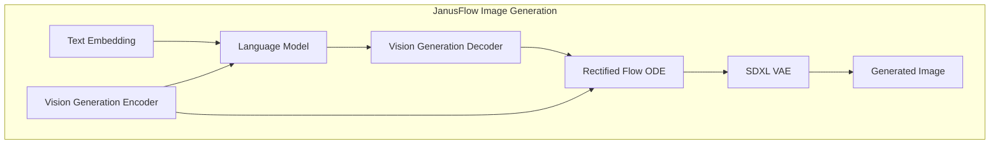

In JanusFlow, the vision generation uses a rectified flow approach with specialized encoder and decoder components, while Janus and Janus-Pro use a more direct token-by-token generation approach.

Sources:
- [janus/janusflow/models/modeling_vlm.py:148-169]()
- [janus/janusflow/models/uvit.py]() (referenced but not shown in the provided files)
- [README.md:573-698]()

## Processing Flows

### Multimodal Understanding Flow

The process for understanding images and text together follows this flow:

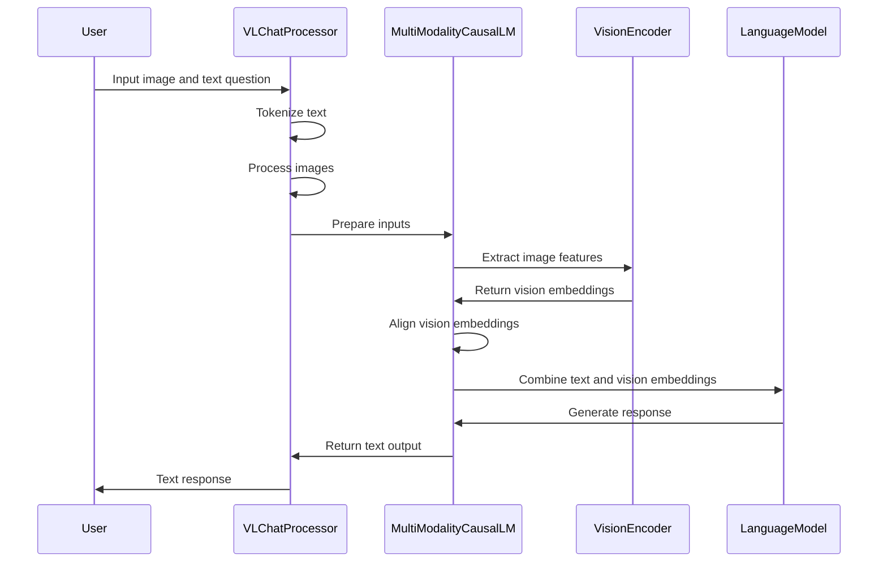

Sources:
- [README.md:324-371]()

### Text-to-Image Generation Flow

#### Janus/Janus-Pro Generation Flow

```mermaid
sequenceDiagram
    participant User
    participant VLChatProcessor
    participant MultiModalityCausalLM
    participant LanguageModel
    participant GenHead
    participant GenVisionModel

    User->>VLChatProcessor: Input text prompt
    VLChatProcessor->>MultiModalityCausalLM: Prepare input with image tag
    MultiModalityCausalLM->>LanguageModel: Process text input
    
    loop For each image token
        LanguageModel->>GenHead: Generate next token
        GenHead->>MultiModalityCausalLM: Return image token
        MultiModalityCausalLM->>LanguageModel: Feed token back
    end
    
    MultiModalityCausalLM->>GenVisionModel: Generated tokens
    GenVisionModel->>User: Output image
```

#### JanusFlow Generation Flow

```mermaid
sequenceDiagram
    participant User
    participant VLChatProcessor
    participant MultiModalityCausalLM
    participant VisGenEncoder
    participant LanguageModel
    participant VisGenDecoder
    participant ODESolver
    participant VAE

    User->>VLChatProcessor: Input text prompt
    VLChatProcessor->>MultiModalityCausalLM: Prepare input with image tag
    
    loop For ODE steps
        MultiModalityCausalLM->>VisGenEncoder: Initial latent & timestep
        VisGenEncoder->>LanguageModel: Vision features & embeddings
        LanguageModel->>VisGenDecoder: Hidden states
        VisGenDecoder->>ODESolver: Velocity prediction
        ODESolver->>MultiModalityCausalLM: Update latent
    end
    
    MultiModalityCausalLM->>VAE: Final latent
    VAE->>User: Output image
```

Sources:
- [README.md:374-470]() (Janus)
- [README.md:575-697]() (JanusFlow)

## Model Variants and Architecture Differences

While all Janus models share a common core architecture, there are key differences between the variants:

### Janus vs JanusFlow Architecture

```mermaid
graph TB
    subgraph "Common Components"
        VLC["VLChatProcessor"]
        MMLM["MultiModalityCausalLM"]
        VUE["Vision Understanding Encoder"]
        LLM["Language Model"]
    end
    
    subgraph "Janus/Janus-Pro"
        GVM["Gen Vision Model"]
        GH["Generation Head"]
    end
    
    subgraph "JanusFlow"
        VGE["Vision Generation Encoder"]
        VGD["Vision Generation Decoder"]
        RF["Rectified Flow ODE"]
        SDXLVAE["SDXL VAE"]
    end
    
    VLC --> MMLM
    MMLM --> VUE
    MMLM --> LLM
    
    MMLM --"Janus/Pro"--> GVM
    MMLM --"Janus/Pro"--> GH
    
    MMLM --"JanusFlow"--> VGE
    MMLM --"JanusFlow"--> VGD
    VGE --"JanusFlow"--> RF
    VGD --"JanusFlow"--> RF
    RF --"JanusFlow"--> SDXLVAE
```

The key architectural differences are:

1. **Text-to-Image Generation**:
   - **Janus/Janus-Pro**: Uses a token-by-token autoregressive generation approach with a specialized GenVisionModel and GenHead
   - **JanusFlow**: Uses a rectified flow ODE approach with Vision Generation Encoder/Decoder components and a VAE for final decoding

2. **Model Size and Scaling**:
   - **Janus**: Base model at 1.3B parameters
   - **JanusFlow**: 1.3B parameters but with additional VAE component
   - **Janus-Pro**: Scaled versions at 1B and 7B parameters with optimized training

Sources:
- [README.md:86-101]() (Janus intro)
- [README.md:94-101]() (JanusFlow intro)
- [README.md:76-83]() (Janus-Pro intro)

### Implementation Details

The MultiModalityCausalLM class is implemented differently for each variant but follows similar principles:

```mermaid
classDiagram
    class MultiModalityConfig {
        +vision_und_enc_config
        +vision_gen_enc_config
        +vision_gen_dec_config
        +language_config
    }
    
    class MultiModalityCausalLM {
        +vision_und_enc_model
        +vision_und_enc_aligner
        +language_model
        +prepare_inputs_embeds()
    }
    
    MultiModalityConfig --* MultiModalityCausalLM: configures
```

The implementation includes configuration classes that define the model components and their parameters:
- VisionUnderstandEncoderConfig
- VisionGenerationEncoderConfig
- VisionGenerationDecoderConfig
- MultiModalityConfig

Sources:
- [janus/janusflow/models/modeling_vlm.py:51-124]()
- [janus/janusflow/models/modeling_vlm.py:132-169]()

## Summary

The Janus architecture is a flexible framework for multimodal understanding and generation that:

1. Uses a shared language model backbone (Llama-based) for both tasks
2. Incorporates specialized vision encoders for understanding images
3. Employs different image generation approaches based on the model variant:
   - Token-by-token generation (Janus/Janus-Pro)
   - Rectified flow ODE (JanusFlow)
4. Provides consistent processing interfaces through VLChatProcessor and related components

This unified architecture allows all Janus model variants to perform both multimodal understanding and text-to-image generation while optimizing for their specific strengths.

Sources:
- [README.md:10-101]()
- [janus/janusflow/models/modeling_vlm.py:132-227]()
- [janus/janusflow/models/__init__.py:20-28]()

---

# Page: Core Components

# Core Components

<details>
<summary>Relevant source files</summary>

The following files were used as context for generating this wiki page:

- [janus/janusflow/models/__init__.py](janus/janusflow/models/__init__.py)
- [janus/janusflow/models/modeling_vlm.py](janus/janusflow/models/modeling_vlm.py)

</details>


This page describes the fundamental components that form the foundation of all Janus model variants. These components work together to enable multimodal understanding and text-to-image generation capabilities. For information about different Janus model variants, see [Model Family](#1.1). For details on how vision and language are processed together, see [Vision-Language Processing](#2.2).

## Component Overview

The Janus architecture is built around several core components that handle different aspects of the multimodal system. These components are shared across all model variants (Janus, JanusFlow, and Janus-Pro) with some implementation differences.

```mermaid
graph TD
    subgraph "Core Components"
        MultiModalityCausalLM["MultiModalityCausalLM
        (Central model class)"]
        
        VLChatProcessor["VLChatProcessor
        (Prepares inputs)"]
        
        VLMImageProcessor["VLMImageProcessor
        (Processes images)"]
        
        Conversation["Conversation
        (Manages chat history)"]
    end
    
    subgraph "Vision Components"
        VisionUndEncoder["Vision Understanding Encoder
        (CLIPVisionTower)"]
        
        VisionGenEncoder["Vision Generation Encoder
        (ShallowUViTEncoder)"]
        
        VisionGenDecoder["Vision Generation Decoder
        (ShallowUViTDecoder)"]
    end
    
    subgraph "Language Component"
        LanguageModel["Language Model
        (LlamaForCausalLM)"]
    end
    
    VLChatProcessor --> VLMImageProcessor
    VLChatProcessor --> Conversation
    
    MultiModalityCausalLM --> VisionUndEncoder
    MultiModalityCausalLM --> VisionGenEncoder
    MultiModalityCausalLM --> VisionGenDecoder
    MultiModalityCausalLM --> LanguageModel
    
    VLChatProcessor --> MultiModalityCausalLM
```

Sources: [janus/janusflow/models/__init__.py:20-28](), [janus/janusflow/models/modeling_vlm.py:132-170]()

## MultiModalityCausalLM

The `MultiModalityCausalLM` class is the central component of the Janus architecture. It integrates vision encoders, decoders, and a language model to perform both multimodal understanding and text-to-image generation.

```mermaid
classDiagram
    class MultiModalityCausalLM {
        +vision_und_enc_model: CLIPVisionTower
        +vision_und_enc_aligner: Linear
        +beg_of_und_embed: Parameter
        +vision_gen_enc_model: ShallowUViTEncoder
        +vision_gen_enc_aligner: Linear
        +vision_gen_dec_model: ShallowUViTDecoder
        +language_model: LlamaForCausalLM
        +vision_gen_dec_aligner_norm: LlamaRMSNorm
        +vision_gen_dec_aligner: Linear
        +prepare_inputs_embeds()
    }
```

Key components of the `MultiModalityCausalLM` include:

1. **Vision Understanding Encoder**: Implemented using `CLIPVisionTower`, this component processes images into embeddings for understanding tasks.

2. **Vision Understanding Encoder Aligner**: A linear layer that aligns the vision encoder's output dimension (1024) to the language model's dimension (2048).

3. **Beginning of Understanding Embedding**: A special embedding token that marks the start of visual understanding.

4. **Vision Generation Encoder**: Implemented using `ShallowUViTEncoder`, this component is used for text-to-image generation in JanusFlow.

5. **Vision Generation Encoder Aligner**: Aligns the vision generation encoder's output dimension (768) to the language model's dimension (2048).

6. **Vision Generation Decoder**: Implemented using `ShallowUViTDecoder`, this component decodes latent representations back into images.

7. **Language Model**: A `LlamaForCausalLM` instance that processes text and serves as the backbone for multimodal reasoning.

8. **Vision Generation Decoder Aligner**: Components that transform the language model's output (2048) to the vision decoder's input dimension (768).

Sources: [janus/janusflow/models/modeling_vlm.py:132-170]()

## Input Processing Pipeline

The `prepare_inputs_embeds` method in the `MultiModalityCausalLM` class handles the integration of image and text inputs:

```mermaid
flowchart TD
    A["Input: input_ids, pixel_values, 
    images_seq_mask, images_emb_mask"] --> B["Process images through
    vision_und_enc_model"]
    B --> C["Apply vision_und_enc_aligner
    to align dimensions"]
    C --> D["Add beginning of understanding
    embedding token"]
    D --> E["Reshape image embeddings"]
    
    F["Convert input_ids to
    token embeddings"] --> G["Replace embeddings at
    image positions"]
    
    E --> G
    
    G --> H["Final mixed
    input embeddings"]
```

The method takes text token IDs and image pixel values and creates a unified sequence of embeddings where image tokens are replaced with the corresponding image embeddings.

Sources: [janus/janusflow/models/modeling_vlm.py:171-219]()

## VLChatProcessor

The `VLChatProcessor` (Vision-Language Chat Processor) handles the preparation of inputs for the model. It's responsible for:

1. Tokenizing text inputs
2. Processing image inputs using `VLMImageProcessor`
3. Combining images and text into a format the model can understand
4. Managing multi-turn conversations using the `Conversation` class
5. Applying special tokens and markers to indicate image positions in the input sequence

```mermaid
classDiagram
    class VLChatProcessor {
        +tokenizer
        +image_processor: VLMImageProcessor
        +image_tag: str
        +image_start_tag: str
        +image_end_tag: str
        +num_image_tokens: int
        +sft_format: str
        +process_one()
        +batchify()
        +apply_sft_template_for_multi_turn_prompts()
    }
```

The processor inserts special image tags into the text sequence and creates masks to indicate where image embeddings should be placed.

Sources: [janus/janusflow/models/__init__.py:22]()

## VLMImageProcessor

The `VLMImageProcessor` (Vision-Language Model Image Processor) is responsible for preparing images for the model. Its key functionalities include:

1. Resizing images to the required dimensions
2. Normalizing pixel values
3. Converting images to the appropriate format for model input

```mermaid
classDiagram
    class VLMImageProcessor {
        +image_size: int
        +rescale_factor: float
        +image_mean: list
        +image_std: list
        +resize()
        +preprocess()
    }
```

This component ensures that images are properly formatted before being passed to the vision encoders.

Sources: [janus/janusflow/models/__init__.py:20]()

## Conversation Management

The `Conversation` class manages multi-turn dialogues in the Janus system. It maintains:

1. System messages that define the assistant's behavior
2. User and assistant message history
3. Formatting templates for different conversation styles

```mermaid
classDiagram
    class Conversation {
        +name: str
        +system_template: str
        +system_message: str
        +roles: list
        +messages: list
        +sep_style: str
        +get_prompt()
        +append_message()
        +reset_message()
    }
```

This component is crucial for maintaining context in multi-turn interactions, allowing the model to reference previous parts of the conversation.

Sources: [janus/janusflow/models/__init__.py:22]()

## Vision Components Architecture

The vision components in Janus are specialized for different tasks:

```mermaid
flowchart TD
    subgraph "Vision Understanding"
        A["Input Image"] --> B["CLIPVisionTower"]
        B --> C["Image Embeddings"]
        C --> D["Linear Aligner"]
        D --> E["Aligned Embeddings 
        for Language Model"]
    end
    
    subgraph "Vision Generation (JanusFlow)"
        F["Text Embeddings"] --> G["Vision Generation
        Decoder Aligner"]
        G --> H["ShallowUViTDecoder"]
        H --> I["Generated Image"]
        
        J["Input Image"] --> K["ShallowUViTEncoder"]
        K --> L["Latent Representation"]
    end
```

1. **CLIPVisionTower**: Processes images for understanding, extracting semantic features that can be combined with text.

2. **ShallowUViTEncoder**: In JanusFlow, encodes images into a latent space for the generation process.

3. **ShallowUViTDecoder**: In JanusFlow, decodes latent representations back into images.

Each of these components is integrated into the main model through aligner modules that handle the dimension transformations needed to connect vision and language representations.

Sources: [janus/janusflow/models/modeling_vlm.py:32-48](), [janus/janusflow/models/modeling_vlm.py:137-170]()

## Configuration System

The Janus architecture uses a hierarchical configuration system to define model components:

```mermaid
classDiagram
    class MultiModalityConfig {
        +vision_und_enc_config: VisionUnderstandEncoderConfig
        +vision_gen_enc_config: VisionGenerationEncoderConfig
        +vision_gen_dec_config: VisionGenerationDecoderConfig
        +language_config: LlamaConfig
    }
    
    class VisionUnderstandEncoderConfig {
        +cls: str
        +params: AttrDict
    }
    
    class VisionGenerationEncoderConfig {
        +cls: str
        +params: AttrDict
    }
    
    class VisionGenerationDecoderConfig {
        +cls: str
        +params: AttrDict
    }
    
    MultiModalityConfig --> VisionUnderstandEncoderConfig
    MultiModalityConfig --> VisionGenerationEncoderConfig
    MultiModalityConfig --> VisionGenerationDecoderConfig
```

This configuration system allows for flexible definition of model components, enabling the different variants of Janus (standard, Flow, and Pro) to share core architecture while customizing specific components.

Sources: [janus/janusflow/models/modeling_vlm.py:51-123](), [janus/janusflow/models/modeling_vlm.py:222-226]()

## Component Interaction Flow

The complete data flow through the Janus core components during inference follows this sequence:

```mermaid
sequenceDiagram
    participant User
    participant VLChatProcessor
    participant VLMImageProcessor
    participant MultiModalityCausalLM
    participant VisionEncoder
    participant LanguageModel
    
    User->>VLChatProcessor: Text query + Image
    VLChatProcessor->>VLMImageProcessor: Raw image
    VLMImageProcessor-->>VLChatProcessor: Processed image
    VLChatProcessor->>MultiModalityCausalLM: input_ids, pixel_values, masks
    MultiModalityCausalLM->>VisionEncoder: pixel_values
    VisionEncoder-->>MultiModalityCausalLM: image embeddings
    MultiModalityCausalLM->>MultiModalityCausalLM: prepare_inputs_embeds()
    MultiModalityCausalLM->>LanguageModel: Mixed text/image embeddings
    LanguageModel-->>MultiModalityCausalLM: Output token logits
    MultiModalityCausalLM-->>VLChatProcessor: Generated tokens
    VLChatProcessor-->>User: Final response
```

This flow shows how the components interact during the multimodal understanding process. For text-to-image generation, there are additional steps involving the vision generation encoder and decoder.

Sources: [janus/janusflow/models/modeling_vlm.py:171-219]()

---

# Page: Vision-Language Processing

# Vision-Language Processing

<details>
<summary>Relevant source files</summary>

The following files were used as context for generating this wiki page:

- [janus/janusflow/models/image_processing_vlm.py](janus/janusflow/models/image_processing_vlm.py)
- [janus/janusflow/models/processing_vlm.py](janus/janusflow/models/processing_vlm.py)
- [janus/models/processing_vlm.py](janus/models/processing_vlm.py)

</details>


This document explains how Janus processes and combines vision and language inputs. It covers the core components responsible for handling multimodal inputs, the processing pipeline for images and text, and how these are integrated to enable the model's vision-language capabilities. For information about conversation management specifically, see [Conversation Management](#2.3).

## Core Components Overview

The vision-language processing in Janus is primarily handled by two key components:

1. **VLChatProcessor**: Coordinates the processing of both text and images, handles tokenization, and manages the integration of visual content into the text sequence.
   
2. **VLMImageProcessor**: Specializes in image processing tasks such as resizing, normalization, and preparation of image tensors.

```mermaid
graph TD
    subgraph "Vision-Language Processing"
        VLChatProcessor["VLChatProcessor"] --> Tokenizer["LlamaTokenizerFast"]
        VLChatProcessor --> VLMImageProcessor["VLMImageProcessor"]
        VLChatProcessor --> ConvTemplate["Conversation Template"]
        
        VLMImageProcessor --> ImageResize["Image Resizing"]
        VLMImageProcessor --> ImageNormalize["Image Normalization"]
        
        User["User Input"] --> Text["Text with <image_placeholder>"]
        User --> Images["Images"]
        
        Text --> VLChatProcessor
        Images --> VLMImageProcessor
        
        VLChatProcessor --> ProcessedInputs["Processed Multimodal Inputs"]
    end
```

Sources: [janus/models/processing_vlm.py:72-131](), [janus/janusflow/models/image_processing_vlm.py:92-126]()

## Special Tokens and Image Representation

Janus uses special tokens to represent and process images within text:

- `<image_placeholder>`: Marks where images should appear in text input
- `<begin_of_image>`: Indicates the start of an image token sequence
- `<end_of_image>`: Indicates the end of an image token sequence
- `<｜begin▁of▁generation｜>`: Used in JanusFlow to mark the beginning of image generation

```mermaid
graph LR
    subgraph "Image Token Representation"
        TextBefore["Text Token"] --> ImageStart["<begin_of_image>"]
        ImageStart --> ImageTokens["Image Tokens (×576)"]
        ImageTokens --> ImageEnd["<end_of_image>"]
        ImageEnd --> TextAfter["Text Token"]
    end
```

Sources: [janus/models/processing_vlm.py:84-116](), [janus/janusflow/models/processing_vlm.py:84-134]()

## Processing Pipeline

The vision-language processing pipeline in Janus follows these steps:

1. **Input Preparation**: Text input containing `<image_placeholder>` tokens and corresponding images
2. **Tokenization**: Text is tokenized while identifying image placeholder positions
3. **Image Processing**: Images are processed through VLMImageProcessor
4. **Token Replacement**: Image placeholder tokens are replaced with sequences containing start tokens, image tokens, and end tokens
5. **Batching**: Processed inputs are batched for model inference

```mermaid
flowchart TD
    subgraph "Vision-Language Processing Pipeline"
        Input["Input: Text with <image_placeholder> + Images"] --> Apply["Apply Conversation Template"]
        Apply --> Tokenize["Tokenize Text"]
        Tokenize --> FindPlaceholders["Find Image Placeholder Positions"]
        
        Images["Images"] --> ProcessImages["Process Images (Resize & Normalize)"]
        
        FindPlaceholders --> ReplaceTokens["Replace Placeholders with Image Token Sequences"]
        ProcessImages --> ImageTensors["Image Tensors"]
        
        ReplaceTokens --> CombinedTokens["Input Tokens with Image Token Sequences"]
        ImageTensors --> BatchedOutput["Batched Processing Output"]
        CombinedTokens --> BatchedOutput
    end
```

Sources: [janus/models/processing_vlm.py:260-350](), [janus/janusflow/models/processing_vlm.py:289-385]()

## Image Processing Details

The `VLMImageProcessor` handles all image-specific processing tasks:

1. **Resizing**: Images are resized while maintaining aspect ratio
2. **Padding**: Images are padded to create square dimensions
3. **Rescaling**: Pixel values are rescaled from 0-255 to 0-1
4. **Normalization**: Values are normalized using ImageNet mean and standard deviation

```mermaid
classDiagram
    class "VLMImageProcessor" {
        +int image_size
        +float rescale_factor
        +tuple image_mean
        +tuple image_std
        +resize(PIL.Image) -> np.ndarray
        +preprocess(images, return_tensors) -> BatchFeature
    }
```

Sources: [janus/janusflow/models/image_processing_vlm.py:92-197]()

## Token Handling and Image Integration

When processing inputs with images, the `VLChatProcessor` performs the following operations:

1. Identifies positions of `<image_placeholder>` tokens in the input
2. For each placeholder, inserts a sequence of:
   - One `<begin_of_image>` token
   - Multiple image tokens (typically 576)
   - One `<end_of_image>` token
3. The result is a single token sequence that integrates both text and visual information

```mermaid
graph TD
    subgraph "Image Token Integration"
        Original["Original Input: 'Describe this <image_placeholder> in detail'"]
        Processed["Processed: 'Describe this <begin_of_image> <img_token>×576 <end_of_image> in detail'"]
        
        Original --> TokenizeStep["Tokenize"]
        TokenizeStep --> FindStep["Find Image Placeholder"]
        FindStep --> ReplaceStep["Replace with Image Token Sequence"]
        ReplaceStep --> Processed
    end
```

Sources: [janus/models/processing_vlm.py:215-258](), [janus/janusflow/models/processing_vlm.py:241-287]()

## Batching for Efficient Processing

The `VLChatProcessor` includes a batching mechanism to efficiently process multiple inputs:

```mermaid
classDiagram
    class "BatchedVLChatProcessorOutput" {
        +List[str] sft_format
        +torch.Tensor input_ids
        +torch.Tensor pixel_values
        +torch.Tensor attention_mask
        +torch.BoolTensor images_seq_mask
        +torch.BoolTensor images_emb_mask
        +to(device, dtype) -> Self
    }
    
    class "VLChatProcessorOutput" {
        +str sft_format
        +torch.Tensor input_ids
        +torch.Tensor pixel_values
        +torch.IntTensor num_image_tokens
        +__len__() -> int
    }
    
    "BatchedVLChatProcessorOutput" <-- "VLChatProcessorOutput" : batched from
```

The batching process handles:
- Padding input sequences to equal length
- Creating attention masks
- Creating masks for image token positions
- Creating masks for image embedding positions
- Moving tensors to the appropriate device and data type

Sources: [janus/models/processing_vlm.py:357-418](), [janus/janusflow/models/processing_vlm.py:387-455]()

## System Architecture Integration

The vision-language processing components integrate with the broader Janus system architecture as follows:

```mermaid
graph TD
    subgraph "Janus System"
        VLChatProc["VLChatProcessor"]
        MMLM["MultiModalityCausalLM"]
        
        User["User"] --> Input["Input (Text + Images)"]
        Input --> VLChatProc
        
        VLChatProc --> TokenizedInput["Tokenized Input with Image Tokens"]
        VLChatProc --> ProcessedImages["Processed Image Tensors"]
        
        TokenizedInput --> MMLM
        ProcessedImages --> MMLM
        
        MMLM --> VisionEncoder["Vision Understanding Encoder"]
        MMLM --> LanguageModel["Language Model"]
        
        VisionEncoder --> VisionEmbeddings["Vision Embeddings"]
        VisionEmbeddings --> LanguageModel
        LanguageModel --> Output["Output (Text or Image)"]
    end
```

Sources: [janus/models/processing_vlm.py:72-131](), [janus/janusflow/models/processing_vlm.py:72-152]()

## Differences between Model Variants

The vision-language processing has slight variations between different Janus model variants:

| Feature | Standard Janus | JanusFlow |
|---------|---------------|-----------|
| Image generation tag | N/A | `<｜begin▁of▁generation｜>` |
| Image token count | Exactly 576 | 576 + 1 (to fit generation) |
| Mask handling | Tracks image tokens | Tracks both image and start tokens |

Sources: [janus/models/processing_vlm.py:84-116](), [janus/janusflow/models/processing_vlm.py:84-140]()

## Conversation Template Integration

The `VLChatProcessor` integrates with conversation templates to format multi-turn dialogues:

```mermaid
graph TD
    subgraph "Conversation Integration"
        Conversations["Conversation Messages"] --> ApplyTemplate["Apply SFT Template"]
        ApplyTemplate --> FormattedPrompt["Formatted Prompt"]
        FormattedPrompt --> ProcessPrompt["Process with VLChatProcessor"]
        ProcessPrompt --> ModelInput["Model-Ready Input"]
    end
```

The conversation templates handle:
- System prompts
- User/assistant message formatting
- Multi-turn dialogue structure
- Integration of images within conversation context

Sources: [janus/models/processing_vlm.py:137-177](), [janus/janusflow/models/processing_vlm.py:154-199]()

This integration enables seamless handling of vision-language conversations across different models in the Janus family.

---

# Page: Conversation Management

# Conversation Management

<details>
<summary>Relevant source files</summary>

The following files were used as context for generating this wiki page:

- [janus/utils/conversation.py](janus/utils/conversation.py)

</details>


This document details how conversations are structured and managed in the Janus multimodal model family. Conversation management provides the foundation for maintaining coherent multi-turn interactions between users and Janus models, handling both text and multimodal content appropriately.

## Overview

The Janus system uses a flexible conversation management system to:

1. Track multi-turn dialogue history between users and the model
2. Format prompts according to specific model requirements
3. Support multimodal inputs (text and images) in conversation
4. Apply appropriate templating for different model variants

The conversation management functionality is primarily implemented in the `Conversation` class, which handles prompt formatting, message storage, and conversation state management.

```mermaid
graph TD
    subgraph "Conversation Flow"
        Input["User Input\n(Text/Image)"] --> VLChatProcessor["VLChatProcessor"]
        VLChatProcessor --> ConversationManager["Conversation\nManager"]
        ConversationManager --> FormattedPrompt["Formatted Prompt"]
        FormattedPrompt --> ModelProcess["Model Processing"]
        ModelProcess --> Response["Model Response"]
        Response --> ConversationUpdate["Update Conversation\nHistory"]
        ConversationUpdate --> NextInput["Ready for Next Input"]
    end
```

Sources: [janus/utils/conversation.py:51-218]()

## Conversation Class

The central component for conversation management is the `Conversation` class, which provides functionality for maintaining state, formatting prompts, and applying templates.

```mermaid
classDiagram
    class Conversation {
        +name: str
        +system_template: str
        +system_message: str
        +roles: List[str]
        +messages: List[List[str]]
        +offset: int
        +sep_style: SeparatorStyle
        +sep: str
        +sep2: str
        +stop_str: str
        +stop_token_ids: List[int]
        +get_prompt(): str
        +get_prompt_for_current_round(content): str
        +set_system_message(system_message): void
        +append_message(role, message): void
        +reset_message(): void
        +update_last_message(message): void
        +to_gradio_chatbot(): List
        +to_openai_api_messages(): List
        +copy(): Conversation
        +dict(): Dict
    }
    
    class SeparatorStyle {
        <<enumeration>>
        ADD_COLON_SINGLE
        ADD_COLON_TWO
        ADD_COLON_SPACE_SINGLE
        NO_COLON_SINGLE
        NO_COLON_TWO
        ADD_NEW_LINE_SINGLE
        LLAMA2
        CHATGLM
        CHATML
        CHATINTERN
        DOLLY
        RWKV
        PHOENIX
        ROBIN
        DeepSeek
        PLAIN
        ALIGNMENT
    }
    
    Conversation --> SeparatorStyle: uses
```

Sources: [janus/utils/conversation.py:29-49](), [janus/utils/conversation.py:51-218]()

### Key Attributes

- **name**: Identifier for the conversation template
- **system_template**: Template format for system messages
- **system_message**: Content of the system message (model instructions)
- **roles**: List of role names (typically "User"/"Assistant")
- **messages**: The conversation history, stored as [role, message] pairs
- **sep_style**: The separator style to use when formatting prompts
- **sep/sep2**: Separator strings for message boundaries
- **stop_str/stop_token_ids**: Criteria to stop generation

### Key Methods

- **get_prompt()**: Creates a formatted prompt from the conversation history
- **append_message()**: Adds a new message to the conversation
- **reset_message()**: Clears the conversation history
- **set_system_message()**: Updates the system instructions

Sources: [janus/utils/conversation.py:51-218]()

## Separator Styles

The `SeparatorStyle` enumeration defines various formatting styles for conversation prompts. These separator styles determine how messages are formatted and concatenated when creating prompts for different model variants.

```mermaid
graph TD
    subgraph "Separator Styles"
        SS["SeparatorStyle"] --> L2["LLAMA2"]
        SS --> DS["DeepSeek"]
        SS --> P["PLAIN"]
        SS --> A["ALIGNMENT"]
        SS --> O["...Other Styles"]
    end
    
    subgraph "Example Prompt Formats"
        L2 -->|"[INST] msg [/INST] </s><s>"| L2Format["LLAMA2 Format"]
        DS -->|"User: msg\n\nAssistant:"| DSFormat["DeepSeek Format"]
        P -->|"Simple text concatenation"| PFormat["PLAIN Format"]
        A -->|"<image>\nmsg"| AFormat["ALIGNMENT Format"]
    end
```

Sources: [janus/utils/conversation.py:29-49](), [janus/utils/conversation.py:76-151]()

### Formatting Logic

The `get_prompt()` method handles prompt formatting based on the separator style:

1. **DeepSeek style**: Formats messages with "Role: message" pattern and specific separators
2. **LLAMA2 style**: Uses LLAMA2's instruction format with special tokens
3. **PLAIN style**: Simple text concatenation without role markers
4. **ALIGNMENT style**: Special formatting for image alignment tasks

The prompt formatting is critical for proper model functioning, as each model variant is trained with specific input formats.

Sources: [janus/utils/conversation.py:76-151]()

## Conversation Templates

Janus provides predefined conversation templates for different models through a registry system. These templates configure the appropriate formatting settings for each model variant.

```mermaid
graph TD
    subgraph "Conversation Template Management"
        RTF["register_conv_template()"] --> CT["conv_templates\nRegistry"]
        GCT["get_conv_template()"] --> CT
        CT --> LLT["llava_llama2\nTemplate"]
        CT --> L2T["llama-2\nTemplate"]
        CT --> DST["deepseek\nTemplate"]
        CT --> PT["plain\nTemplate"]
        CT --> AT["alignment\nTemplate"]
    end
```

Sources: [janus/utils/conversation.py:221-237](), [janus/utils/conversation.py:240-342]()

### Predefined Templates

The system includes several predefined templates:

| Template Name | Description | Separator Style | Roles |
|---------------|-------------|----------------|-------|
| llava_llama2 | For Llama 2-based multimodal conversations | LLAMA2 | [INST], [/INST] |
| llama-2 | Standard Llama 2 conversation format | LLAMA2 | [INST], [/INST] |
| deepseek | For DeepSeek-based models | DeepSeek | <\|User\|>, <\|Assistant\|> |
| plain | Simple text without role markers | PLAIN | "", "" |
| alignment | For image alignment tasks | ALIGNMENT | "", "" |

Each template includes appropriate system messages, separators, and stop criteria.

Sources: [janus/utils/conversation.py:240-342]()

## Multimodal Conversation Support

Janus supports multimodal conversations where messages can contain both text and images. The conversation management system handles this through special formatting.

```mermaid
sequenceDiagram
    participant User
    participant VLChatProcessor as "VLChatProcessor"
    participant Conversation as "Conversation"
    participant MultiModalityCausalLM as "MultiModalityCausalLM"
    
    User->>VLChatProcessor: Input text & image
    VLChatProcessor->>Conversation: append_message(role, text/image)
    Conversation->>Conversation: Update messages
    VLChatProcessor->>Conversation: get_prompt()
    Conversation->>VLChatProcessor: Formatted prompt
    VLChatProcessor->>MultiModalityCausalLM: Forward formatted input
    MultiModalityCausalLM->>VLChatProcessor: Generate response
    VLChatProcessor->>Conversation: update_last_message(response)
    Conversation->>User: Updated conversation
```

Sources: [janus/utils/conversation.py:99-137]()

### Handling Multimodal Content

For multimodal messages, the system:

1. Detects messages containing image data (represented as tuples)
2. Applies special formatting based on the separator style
3. For image content in PLAIN style, inserts `<image>` tags
4. For ALIGNMENT style, special formatting for image alignment tasks

The handling of multimodal content ensures proper integration of images into the conversation flow.

Sources: [janus/utils/conversation.py:99-137]()

## Integration with Demo Applications

The conversation management system integrates with demo applications through utility functions that convert conversations to different formats.

```mermaid
graph TD
    subgraph "Demo Integration"
        Conv["Conversation"] --> TGC["to_gradio_chatbot()"]
        Conv --> TOAIM["to_openai_api_messages()"]
        
        TGC --> GradioUI["Gradio UI\nInterface"]
        TOAIM --> APIUI["API Compatible\nFormat"]
    end
```

Sources: [janus/utils/conversation.py:173-194]()

### Integration Methods

- **to_gradio_chatbot()**: Converts the conversation to a format compatible with Gradio UI
- **to_openai_api_messages()**: Converts the conversation to OpenAI's chat completion format

These methods facilitate the use of the conversation system in various interfaces and APIs.

Sources: [janus/utils/conversation.py:173-194]()

## Usage Examples

Below are examples of how to use the conversation management system in the Janus codebase:

### Basic Conversation Example

```python
# Get a conversation template
conv = get_conv_template("deepseek")

# Add messages to the conversation
conv.append_message(conv.roles[0], "Hello!")  # User message
conv.append_message(conv.roles[1], "Hi! How can I help you?")  # Assistant message
conv.append_message(conv.roles[0], "Can you describe this image?")  # User message with image
conv.append_message(conv.roles[1], None)  # Placeholder for assistant's response

# Get formatted prompt for model input
formatted_prompt = conv.get_prompt()
```

Sources: [janus/utils/conversation.py:345-365]()

## Relationship with Other Components

The conversation management system interacts with several other components in the Janus architecture.

```mermaid
graph TD
    subgraph "Component Interactions"
        VM["VLChatProcessor"] --> Conv["Conversation"]
        VM --> VIP["VLMImageProcessor"]
        Conv --> MMCLM["MultiModalityCausalLM"]
        
        subgraph "Input Processing"
            T["Text Input"] --> VM
            I["Image Input"] --> VM
            VM --> FI["Formatted Input"]
        end
        
        subgraph "Model Processing"
            FI --> MMCLM
            MMCLM --> R["Response"]
            R --> Conv
        end
    end
```

Sources: [janus/utils/conversation.py:51-218]()

For more details on how Janus processes vision and language inputs together, see [Vision-Language Processing](#2.2).

## Summary

The conversation management system in Janus provides a flexible framework for:

1. Managing multi-turn conversations with both text and images
2. Formatting prompts according to specific model requirements
3. Supporting various conversation templates for different model variants
4. Facilitating integration with UI components and APIs

This system is a crucial part of the Janus architecture that enables coherent and contextual interactions with multimodal models.

---

# Page: Models in Detail

# Models in Detail

<details>
<summary>Relevant source files</summary>

The following files were used as context for generating this wiki page:

- [README.md](README.md)
- [images/teaser_janusflow.png](images/teaser_janusflow.png)

</details>


This document provides comprehensive technical information about the architecture, components, and implementation details of each model in the Janus family: Janus, JanusFlow, and Janus-Pro. For installation and usage information, see [Usage Guide](#4).

## Model Family Overview

The Janus model family consists of three main variants, all built on a unified architecture that can handle both multimodal understanding and text-to-image generation:

```mermaid
graph TD
    subgraph "Janus Model Family"
        Janus["Janus-1.3B"]
        JanusFlow["JanusFlow-1.3B"]
        JanusPro1["Janus-Pro-1B"]
        JanusPro7["Janus-Pro-7B"]
    end
    
    subgraph "Capabilities"
        MultiUnderstanding["Multimodal Understanding"]
        TextToImage["Text-to-Image Generation"]
    end
    
    Janus --> MultiUnderstanding
    Janus --> TextToImage
    
    JanusFlow --> MultiUnderstanding
    JanusFlow --> TextToImage
    
    JanusPro1 --> MultiUnderstanding
    JanusPro1 --> TextToImage
    
    JanusPro7 --> MultiUnderstanding
    JanusPro7 --> TextToImage
```

Sources: [README.md:75-116]()

## Shared Architecture Components

All models in the Janus family share a common foundation built around these core components:

```mermaid
classDiagram
    class MultiModalityCausalLM {
        +language_model
        +vision_und_encoder
        +vision_und_enc_aligner
        +prepare_inputs_embeds()
        +forward()
    }
    
    class VLChatProcessor {
        +tokenizer
        +image_processor
        +image_tag
        +image_start_tag
        +image_end_tag
        +num_image_tokens
        +process_one()
        +batchify()
        +apply_sft_template_for_multi_turn_prompts()
    }
    
    class VLMImageProcessor {
        +image_size
        +rescale_factor
        +image_mean
        +image_std
        +resize()
        +preprocess()
    }
    
    class Conversation {
        +system_message
        +messages
        +roles
        +sep_style
        +get_prompt()
        +append_message()
        +reset_message()
    }
    
    MultiModalityCausalLM --> VLChatProcessor : uses
    VLChatProcessor --> VLMImageProcessor : uses
    VLChatProcessor --> Conversation : uses
```

Sources: [README.md:323-371](), [README.md:524-571]()

### Common Processing Flow

All Janus models follow the same basic processing flow for multimodal understanding:

```mermaid
flowchart LR
    Image["Image Input"] --> VLChatProcessor["VLChatProcessor"]
    Text["Text Input"] --> VLChatProcessor
    VLChatProcessor --> ProcessedInputs["Processed Inputs"]
    ProcessedInputs --> MultiModalityCausalLM["MultiModalityCausalLM.prepare_inputs_embeds()"]
    MultiModalityCausalLM --> InputsEmbeds["inputs_embeds"]
    InputsEmbeds --> LanguageModel["language_model.generate()"]
    LanguageModel --> TextOutput["Text Output"]
```

Sources: [README.md:338-371](), [README.md:539-571](), [README.md:152-184]()

## Janus Model (1.3B)

The standard Janus model implements a unified architecture that decouples visual encoding for understanding and generation tasks within a single transformer-based model.

### Janus Architecture Components

```mermaid
classDiagram
    class MultiModalityCausalLM {
        +language_model
        +vision_und_encoder
        +vision_und_enc_aligner
        +gen_vision_model
        +gen_head
        +prepare_inputs_embeds()
        +prepare_gen_img_embeds()
    }
    
    class CLIPVisionTower {
        +vision_model
        +forward()
    }
    
    class GenVisionModel {
        +decode_code()
    }
    
    MultiModalityCausalLM -- CLIPVisionTower : for understanding
    MultiModalityCausalLM -- GenVisionModel : for generation
```

Sources: [README.md:324-337](), [README.md:375-392]()

### Janus Text-to-Image Generation Process

Janus generates images using a token-by-token autoregressive approach:

```mermaid
flowchart TD
    Text["Text Prompt"] --> VLChatProcessor["VLChatProcessor"]
    VLChatProcessor --> SFTFormat["apply_sft_template_for_multi_turn_prompts()"]
    SFTFormat --> Prompt["prompt + image_start_tag"]
    
    Prompt --> InputIds["tokenizer.encode()"]
    InputIds --> ParallelTokens["Setup Parallel Tokens\n(for Classifier-Free Guidance)"]
    
    ParallelTokens --> InputEmbeds["language_model.get_input_embeddings()"]
    InputEmbeds --> ForLoop["For each position in image (576 tokens)"]
    
    ForLoop --> LLMPredict["language_model.model()"]
    LLMPredict --> GenHead["gen_head()"]
    GenHead --> CFG["Apply Classifier-Free Guidance"]
    CFG --> NextToken["Select Next Token"]
    NextToken --> GenImgEmbeds["prepare_gen_img_embeds()"]
    
    GenImgEmbeds --> ForLoop
    
    ForLoop --> GenVisionDecoding["gen_vision_model.decode_code()"]
    GenVisionDecoding --> PostProcess["Post-processing"]
    PostProcess --> GeneratedImage["Generated Image"]
```

Sources: [README.md:394-472]()

## JanusFlow Model (1.3B)

JanusFlow introduces a different approach to image generation by integrating autoregressive language models with rectified flow, while maintaining the same multimodal understanding capabilities.

### JanusFlow Architecture Components

```mermaid
classDiagram
    class MultiModalityCausalLM {
        +language_model
        +vision_und_encoder
        +vision_und_enc_aligner
        +vision_gen_enc_model
        +vision_gen_enc_aligner
        +vision_gen_dec_model
        +vision_gen_dec_aligner
        +vision_gen_dec_aligner_norm
        +prepare_inputs_embeds()
    }
    
    class VisionGenEncModel {
        +forward(z, t)
    }
    
    class VisionGenDecModel {
        +forward(hidden_states, hs, t)
    }
    
    class SDXLVAEModel {
        +decode(z)
    }
    
    MultiModalityCausalLM -- VisionGenEncModel : encodes latents
    MultiModalityCausalLM -- VisionGenDecModel : decodes features
    SDXLVAEModel -- MultiModalityCausalLM : external component
```

Sources: [README.md:525-538](), [README.md:574-597]()

### JanusFlow Text-to-Image Generation Process

JanusFlow generates images using a rectified flow approach with ODE solving:

```mermaid
flowchart TD
    Text["Text Prompt"] --> VLChatProcessor["VLChatProcessor"]
    VLChatProcessor --> SFTFormat["apply_sft_template_for_multi_turn_prompts()"]
    SFTFormat --> Prompt["prompt + image_gen_tag"]
    
    Prompt --> InputIds["tokenizer.encode()"]
    InputIds --> ParallelTokens["Setup Parallel Tokens\n(for Classifier-Free Guidance)"]
    
    RandomNoise["Random Noise z"] --> ODELoop["Rectified Flow ODE\n(num_inference_steps iterations)"]
    Timestep["Timestep t"] --> ODELoop
    
    ODELoop --> VisionGenEnc["vision_gen_enc_model(z, t)"]
    VisionGenEnc --> Encoder["z_enc, t_emb, hs"]
    Encoder --> VisionGenEncAligner["vision_gen_enc_aligner()"]
    VisionGenEncAligner --> CombinedEmbeds["Combine with text embeddings"]
    
    CombinedEmbeds --> LLM["language_model.model()"]
    LLM --> VisionGenDecAligner["vision_gen_dec_aligner()"]
    VisionGenDecAligner --> VisionGenDec["vision_gen_dec_model()"]
    VisionGenDec --> CFG["Apply Classifier-Free Guidance"]
    CFG --> UpdateZ["Update z"]
    UpdateZ --> ODELoop
    
    ODELoop --> SDXLVAE["SDXL VAE decode()"]
    SDXLVAE --> GeneratedImage["Generated Image"]
```

Sources: [README.md:599-697]()

## Janus-Pro Models (1B and 7B)

Janus-Pro models are enhanced versions of the original Janus with improved training strategies, expanded training data, and scaling to larger model sizes (available in 1B and 7B parameters).

### Janus-Pro Architecture Components

The architecture is similar to the original Janus but with enhanced components:

```mermaid
classDiagram
    class MultiModalityCausalLM {
        +language_model
        +vision_und_encoder
        +vision_und_enc_aligner
        +gen_vision_model
        +gen_head
        +prepare_inputs_embeds()
        +prepare_gen_img_embeds()
    }
    
    class EnhancedVisionEncoder {
        +vision_model
        +forward()
    }
    
    class EnhancedGenVisionModel {
        +decode_code()
    }
    
    MultiModalityCausalLM -- EnhancedVisionEncoder : for understanding
    MultiModalityCausalLM -- EnhancedGenVisionModel : for generation
```

Sources: [README.md:137-151](), [README.md:188-205]()

### Janus-Pro Improvements

The key enhancements in Janus-Pro include:

1. Optimized training strategy
2. Expanded training data
3. Scaling to larger model sizes (1B and 7B)
4. Enhanced stability for text-to-image generation
5. Significantly improved performance on both multimodal understanding and generation tasks

Sources: [README.md:75-86](), [README.md:124-185]()

## Model Comparison

### Feature Comparison

| Feature | Janus-1.3B | JanusFlow-1.3B | Janus-Pro-1B | Janus-Pro-7B |
|---------|------------|----------------|--------------|--------------|
| Parameters | 1.3B | 1.3B | 1B | 7B |
| Understanding Encoder | CLIP-based | CLIP-based | Enhanced CLIP-based | Enhanced CLIP-based |
| Generation Method | Token-by-token | Rectified Flow | Token-by-token | Token-by-token |
| Generation Implementation | Autoregressive | ODE Solver | Autoregressive | Autoregressive |
| External Components | None | SDXL VAE | None | None |
| CFG Implementation | Conditional/Unconditional Pairs | Conditional/Unconditional Pairs | Same as Janus | Same as Janus |

Sources: [README.md:103-116](), [README.md:394-472](), [README.md:599-697]()

### Processing Pipeline Comparison

```mermaid
flowchart TD
    subgraph "Multimodal Understanding (All Models)"
        Image1["Image Input"] --> VLChatProcessor1["VLChatProcessor"]
        Text1["Text Question"] --> VLChatProcessor1
        VLChatProcessor1 --> InputsEmbeds1["prepare_inputs_embeds()"]
        InputsEmbeds1 --> LLMGenerate1["language_model.generate()"]
        LLMGenerate1 --> TextOutput["Text Response"]
    end
    
    subgraph "Text-to-Image (Janus/Janus-Pro)"
        Text2["Text Prompt"] --> VLChatProcessor2["VLChatProcessor"]
        VLChatProcessor2 --> TokenGen["Token-by-Token Generation"]
        TokenGen --> GenVisionModel["gen_vision_model.decode_code()"]
        GenVisionModel --> ImageOutput1["Generated Image"]
    end
    
    subgraph "Text-to-Image (JanusFlow)"
        Text3["Text Prompt"] --> VLChatProcessor3["VLChatProcessor"]
        VLChatProcessor3 --> RectifiedFlow["Rectified Flow ODE"]
        RectifiedFlow --> VAEDecoding["SDXL VAE decode()"]
        VAEDecoding --> ImageOutput2["Generated Image"]
    end
```

Sources: [README.md:338-371](), [README.md:394-472](), [README.md:599-697]()

## Integration with Demo Applications

The models are integrated into demo applications through these implementations:

```mermaid
flowchart TD
    subgraph "Demo Applications"
        JanusDemo["app.py\n(Janus Demo)"]
        JanusFlowDemo["app_janusflow.py\n(JanusFlow Demo)"]
        JanusProDemo["app_januspro.py\n(Janus-Pro Demo)"]
    end
    
    subgraph "Model Components"
        JanusModel["janus/models/MultiModalityCausalLM"]
        JanusFlowModel["janus/janusflow/models/MultiModalityCausalLM"]
        VLChatProcessor["janus/models/VLChatProcessor"]
        Utilities["janus/utils/io"]
    end
    
    JanusDemo --> JanusModel
    JanusDemo --> VLChatProcessor
    JanusDemo --> Utilities
    
    JanusFlowDemo --> JanusFlowModel
    JanusFlowDemo --> VLChatProcessor
    JanusFlowDemo --> Utilities
    
    JanusProDemo --> JanusModel
    JanusProDemo --> VLChatProcessor
    JanusProDemo --> Utilities
```

Sources: [README.md:474-503](), [README.md:698-710](), [README.md:287-302]()

## Technical Implementation Details

### Classifier-Free Guidance

All models implement classifier-free guidance for image generation, but with different approaches:

- **Janus/Janus-Pro**: Processes paired conditional/unconditional inputs and combines logits with a weighting factor
- **JanusFlow**: Applies guidance on the velocity predictions in the rectified flow process

Sources: [README.md:425-444](), [README.md:627-680]()

### Image Token Representation

- **Janus/Janus-Pro**: Uses 576 discrete tokens (24×24 grid) for image representation
- **JanusFlow**: Uses continuous latent representation with dimensions 4×48×48

Sources: [README.md:432](), [README.md:636]()

### External Dependencies

- **Janus/Janus-Pro**: Self-contained, uses internal components only
- **JanusFlow**: Requires SDXL VAE for final image decoding

Sources: [README.md:394-472](), [README.md:594-596]()

---

# Page: Janus Model

# Janus Model

<details>
<summary>Relevant source files</summary>

The following files were used as context for generating this wiki page:

- [README.md](README.md)
- [demo/Janus_colab_demo.ipynb](demo/Janus_colab_demo.ipynb)
- [demo/app.py](demo/app.py)
- [images/teaser_janusflow.png](images/teaser_janusflow.png)

</details>


This document provides a detailed overview of the standard Janus model, which is part of the Janus family of unified multimodal models. It covers the model's architecture, capabilities, and implementation details. For information about other models in the family, see [JanusFlow Model](#3.2) and [Janus-Pro Model](#3.3).

## 1. Overview

Janus is a 1.3B parameter multimodal model designed to unify both multimodal understanding and image generation capabilities in a single architecture. The model introduces a novel approach of decoupling visual encoding into separate pathways for understanding and generation tasks while maintaining a unified transformer architecture for processing.

This decoupling approach resolves conflicts between the visual encoder's roles in understanding and generation, enhancing the model's flexibility and performance across both tasks.

```mermaid
graph TD
    subgraph "Janus Model Overview"
        JanusModel["Janus-1.3B"]
        
        subgraph "Core Components"
            MultiModalLM["MultiModalityCausalLM"]
            VLProcessor["VLChatProcessor"]
            LLM["Language Model"]
        end
        
        subgraph "Vision Components"
            VisionUndEncoder["Vision Understanding Encoder"]
            GenVisionModel["Generation Vision Model"]
            GenHead["Generation Head"]
        end
        
        JanusModel --> MultiModalLM
        JanusModel --> VLProcessor
        
        MultiModalLM --> LLM
        MultiModalLM --> VisionUndEncoder
        MultiModalLM --> GenVisionModel
        MultiModalLM --> GenHead
    end
    
    ClassStyle["Style definition"] --- ClassDef["class definitions are indicated with boxes"]
```

Sources: [README.md]()

## 2. Model Architecture

The Janus model architecture combines language and vision components in a unified framework while maintaining separate pathways for different tasks.

### 2.1 Key Components

```mermaid
classDiagram
    class MultiModalityCausalLM {
        +language_model
        +vision_und_encoder
        +vision_und_enc_aligner
        +gen_vision_model
        +gen_head
        +prepare_inputs_embeds()
        +prepare_gen_img_embeds()
    }
    
    class VLChatProcessor {
        +tokenizer
        +image_processor
        +image_tag
        +image_start_tag
        +image_end_tag
        +num_image_tokens
        +sft_format
        +process_one()
        +batchify()
        +apply_sft_template_for_multi_turn_prompts()
    }
    
    class VLMImageProcessor {
        +image_size
        +rescale_factor
        +image_mean
        +image_std
        +resize()
        +preprocess()
    }
    
    class Conversation {
        +name
        +system_template
        +system_message
        +roles
        +messages
        +sep_style
        +get_prompt()
        +append_message()
        +reset_message()
    }
    
    MultiModalityCausalLM --> "1" LanguageModel: contains
    MultiModalityCausalLM --> "1" VisionUnderstandingEncoder: contains
    MultiModalityCausalLM --> "1" GenerationVisionModel: contains
    VLChatProcessor --> VLMImageProcessor: uses
    VLChatProcessor --> Conversation: uses
```

Sources: [README.md](), [demo/app.py:10-22]()

#### MultiModalityCausalLM

The `MultiModalityCausalLM` is the main model class that integrates all components:

- **language_model**: The core language model based on Llama architecture
- **vision_und_encoder**: Processes images for understanding tasks
- **vision_und_enc_aligner**: Aligns vision encoder outputs with language model inputs
- **gen_vision_model**: Handles image generation tasks
- **gen_head**: Processes language model outputs for image generation

Key methods include:
- `prepare_inputs_embeds()`: Converts processed inputs into embeddings for the language model
- `prepare_gen_img_embeds()`: Prepares embeddings for image generation

Sources: [demo/app.py:15-18](), [README.md:85-106]()

#### VLChatProcessor

The `VLChatProcessor` handles input processing for both multimodal understanding and text-to-image generation:

- Processes text inputs with tokenizer
- Handles image processing through `VLMImageProcessor`
- Manages conversation history with the `Conversation` class
- Contains special tokens for image placeholders and generation
- Applies templates for multi-turn conversations

Sources: [demo/app.py:20-21](), [README.md:85-106]()

### 2.2 Processing Pipelines

The Janus model implements two distinct processing pipelines:

#### Multimodal Understanding Pipeline

```mermaid
flowchart TD
    Image["Image Input"] --> VLChatProcessor
    Text["Text Question"] --> VLChatProcessor
    VLChatProcessor --> ProcessedInputs["Processed Inputs"]
    ProcessedInputs --> MultiModalityCausalLM
    MultiModalityCausalLM --> VisionEncoder["Vision Understanding Encoder"]
    VisionEncoder --> VisionEmbeddings["Vision Embeddings"]
    VisionEmbeddings --> InputEmbedder["prepare_inputs_embeds()"]
    InputEmbedder --> CombinedEmbeddings["Combined Embeddings"]
    CombinedEmbeddings --> LanguageModel["Language Model"]
    LanguageModel --> TextOutput["Text Response"]
```

Sources: [demo/app.py:24-66](), [README.md:323-371]()

#### Text-to-Image Generation Pipeline

```mermaid
flowchart TD
    TextPrompt["Text Prompt"] --> VLChatProcessor
    VLChatProcessor --> ProcessedPrompt["Processed Prompt"]
    ProcessedPrompt --> TokenizedPrompt["Tokenized Prompt"]
    TokenizedPrompt --> LanguageModel["Language Model"]
    
    subgraph "Token-by-Token Generation"
        LanguageModel --> Hidden["Hidden States"]
        Hidden --> GenHead["Generation Head"]
        GenHead --> Logits["Token Logits"]
        Logits --> CFG["Classifier-Free Guidance"]
        CFG --> NextToken["Next Image Token"]
        NextToken --> TokenCollection["Generated Tokens"]
        NextToken --> GenImgEmbeds["prepare_gen_img_embeds()"]
        GenImgEmbeds --> NextInput["Next Input Embedding"]
        NextInput --> LanguageModel
    end
    
    TokenCollection --> GenVisionModel["Generation Vision Model"]
    GenVisionModel --> ImageOutput["Generated Image"]
```

Sources: [demo/app.py:69-152](), [README.md:374-473]()

## 3. Model Capabilities

The Janus model offers two primary capabilities:

### 3.1 Multimodal Understanding

Janus can process images and text together to answer questions, provide descriptions, or perform analysis based on visual content. The model effectively integrates visual information from the image with the contextual understanding from the text query.

Key features:
- Image and text input processing
- Visual feature extraction through dedicated understanding encoder
- Integration of visual and textual information
- Natural language response generation

Sources: [demo/app.py:24-66](), [README.md:323-371]()

### 3.2 Text-to-Image Generation

Janus can generate images from text prompts, allowing for creative visual content creation guided by descriptive text. This is achieved through token-by-token generation of visual representations.

Key features:
- Step-by-step generation of image tokens
- Classifier-free guidance for improved quality
- Specialized vision generation decoding

Sources: [demo/app.py:69-152](), [README.md:374-473]()

## 4. Technical Implementation

### 4.1 Model Loading and Initialization

The Janus model can be loaded using the Hugging Face Transformers library:

```python
model_path = "deepseek-ai/Janus-1.3B"
vl_chat_processor = VLChatProcessor.from_pretrained(model_path)
tokenizer = vl_chat_processor.tokenizer

vl_gpt = AutoModelForCausalLM.from_pretrained(
    model_path, trust_remote_code=True
)
vl_gpt = vl_gpt.to(torch.bfloat16).cuda().eval()
```

Sources: [demo/app.py:10-22](), [README.md:323-337]()

### 4.2 Multimodal Understanding Implementation

To perform multimodal understanding, the model processes the image and question, generates embeddings, and then produces a text response:

```python
# Process inputs
conversation = [
    {
        "role": "User",
        "content": "<image_placeholder>\nQuestion about the image",
        "images": [image],
    },
    {"role": "Assistant", "content": ""},
]

# Prepare inputs with the processor
prepare_inputs = vl_chat_processor(
    conversations=conversation, images=pil_images, force_batchify=True
).to(device)

# Generate embeddings
inputs_embeds = vl_gpt.prepare_inputs_embeds(**prepare_inputs)

# Generate response
outputs = vl_gpt.language_model.generate(
    inputs_embeds=inputs_embeds,
    attention_mask=prepare_inputs.attention_mask,
    max_new_tokens=512,
    do_sample=True,
    temperature=temperature,
    top_p=top_p,
)

# Decode the response
answer = tokenizer.decode(outputs[0].cpu().tolist(), skip_special_tokens=True)
```

Sources: [demo/app.py:24-66](), [README.md:339-371]()

### 4.3 Text-to-Image Generation Implementation

For text-to-image generation, the model formats the prompt, runs token-by-token generation, and then decodes the generated tokens into an image:

```python
# Format the prompt
conversation = [
    {"role": "User", "content": "A descriptive prompt for image generation"},
    {"role": "Assistant", "content": ""},
]
sft_format = vl_chat_processor.apply_sft_template_for_multi_turn_prompts(
    conversations=conversation,
    sft_format=vl_chat_processor.sft_format,
    system_prompt="",
)
prompt = sft_format + vl_chat_processor.image_start_tag

# Tokenize the prompt
input_ids = vl_chat_processor.tokenizer.encode(prompt)
input_ids = torch.LongTensor(input_ids)

# Token-by-token generation
# [Generation code involves generating tokens one by one with classifier-free guidance]

# Decode the generated tokens into an image
dec = vl_gpt.gen_vision_model.decode_code(generated_tokens, shape=[batch_size, channels, height, width])
```

Sources: [demo/app.py:69-152](), [README.md:374-473]()

## 5. Usage Examples

### 5.1 Multimodal Understanding Example

This example shows how to use Janus for answering questions about an image:

```python
import torch
from transformers import AutoModelForCausalLM
from janus.models import MultiModalityCausalLM, VLChatProcessor
from janus.utils.io import load_pil_images

# Load model and processor
model_path = "deepseek-ai/Janus-1.3B"
vl_chat_processor = VLChatProcessor.from_pretrained(model_path)
tokenizer = vl_chat_processor.tokenizer

vl_gpt = AutoModelForCausalLM.from_pretrained(
    model_path, trust_remote_code=True
)
vl_gpt = vl_gpt.to(torch.bfloat16).cuda().eval()

# Prepare conversation with image and question
conversation = [
    {
        "role": "User",
        "content": "<image_placeholder>\nConvert the formula into latex code.",
        "images": ["images/equation.png"],
    },
    {"role": "Assistant", "content": ""},
]

# Load images and prepare inputs
pil_images = load_pil_images(conversation)
prepare_inputs = vl_chat_processor(
    conversations=conversation, images=pil_images, force_batchify=True
).to(vl_gpt.device)

# Generate embeddings and response
inputs_embeds = vl_gpt.prepare_inputs_embeds(**prepare_inputs)
outputs = vl_gpt.language_model.generate(
    inputs_embeds=inputs_embeds,
    attention_mask=prepare_inputs.attention_mask,
    max_new_tokens=512,
    do_sample=False,
    use_cache=True,
)

# Get the answer
answer = tokenizer.decode(outputs[0].cpu().tolist(), skip_special_tokens=True)
print(answer)
```

Sources: [README.md:339-371]()

### 5.2 Text-to-Image Generation Example

This example shows how to generate images from text prompts with Janus:

```python
import os
import PIL.Image
import torch
import numpy as np
from transformers import AutoModelForCausalLM
from janus.models import MultiModalityCausalLM, VLChatProcessor

# Load model and processor
model_path = "deepseek-ai/Janus-1.3B"
vl_chat_processor = VLChatProcessor.from_pretrained(model_path)
tokenizer = vl_chat_processor.tokenizer

vl_gpt = AutoModelForCausalLM.from_pretrained(
    model_path, trust_remote_code=True
)
vl_gpt = vl_gpt.to(torch.bfloat16).cuda().eval()

# Prepare prompt
conversation = [
    {
        "role": "User",
        "content": "A stunning princess from kabul in red, white traditional clothing, blue eyes, brown hair",
    },
    {"role": "Assistant", "content": ""},
]

# Format and prepare prompt
sft_format = vl_chat_processor.apply_sft_template_for_multi_turn_prompts(
    conversations=conversation,
    sft_format=vl_chat_processor.sft_format,
    system_prompt="",
)
prompt = sft_format + vl_chat_processor.image_start_tag

# Generate image tokens and decode to image
# [Generation function implementation]
# The implementation generates tokens step by step with classifier-free guidance
# and then decodes them into an image using the generation vision model

# Save the generated images
for i in range(parallel_size):
    save_path = os.path.join('generated_samples', f"img_{i}.jpg")
    PIL.Image.fromarray(visual_img[i]).save(save_path)
```

Sources: [README.md:374-473]()

## 6. Performance Characteristics

The Janus model achieves strong performance on multimodal understanding and text-to-image generation tasks. It effectively balances both capabilities within a single model architecture through its decoupled visual encoding approach.

Key performance characteristics:
- 1.3B parameter size
- Supports 4096 sequence length
- Balances understanding and generation capabilities effectively
- Uses classifier-free guidance for improved image generation quality

Sources: [README.md:111-116]()

---

# Page: JanusFlow Model

# JanusFlow Model

<details>
<summary>Relevant source files</summary>

The following files were used as context for generating this wiki page:

- [README.md](README.md)
- [demo/app_janusflow.py](demo/app_janusflow.py)
- [images/teaser_janusflow.png](images/teaser_janusflow.png)
- [janus/janusflow/__init__.py](janus/janusflow/__init__.py)
- [janus/janusflow/models/uvit.py](janus/janusflow/models/uvit.py)

</details>


## 1. Introduction

JanusFlow is a unified multimodal model that integrates autoregressive language models with rectified flow for advanced visual understanding and high-quality image generation. Released in November 2023, JanusFlow introduces a novel approach to multimodal AI by harmonizing autoregressive language models with rectified flow for image generation, creating a minimalist architecture that achieves high performance without complex architectural modifications.

Unlike the standard Janus model that uses token-by-token generation for image creation, JanusFlow employs rectified flow—a technique using ordinary differential equations (ODEs)—to generate high-quality images with better coherence and detail.

## 2. Architecture Overview

JanusFlow builds upon the foundation of the Janus model while introducing significant architectural modifications to support rectified flow for image generation.

```mermaid
graph TB
    subgraph "JanusFlow Architecture"
        direction TB
        Input["Text Input"] --> Tokenizer["Tokenizer"]
        Tokenizer --> LLM["Language Model"]
        LLM --> ImagePromptEmbed["Image Generation Prompt Embeddings"]
        
        subgraph "Rectified Flow Image Generation"
            ImagePrompt["Image Prompt"]
            GenEncoder["Vision Generation Encoder"]
            LLMWithContext["LLM with Context"]
            GenDecoder["Vision Generation Decoder"]
            VAE["SDXL VAE Decoder"]
            
            ImagePrompt --> LLMWithContext
            
            NoiseSampling["Random Noise Sampling"]
            NoiseSampling --> FlowODE["Flow ODE Solver"]
            GenEncoder --> FlowODE
            FlowODE --> GenDecoder
            GenDecoder --> VAE
            VAE --> GeneratedImage["Generated Image"]
            
            ImagePromptEmbed --> LLMWithContext
        end
        
        subgraph "Multimodal Understanding"
            ImageInput["Image Input"]
            Text["Text Input"]
            VisionEnc["Vision Understanding Encoder"]
            TextProc["Text Processor"]
            
            ImageInput --> VisionEnc
            Text --> TextProc
            VisionEnc --> JointEmbed["Joint Embeddings"]
            TextProc --> JointEmbed
            JointEmbed --> LLM2["Language Model"]
            LLM2 --> Response["Text Response"]
        end
    end
```

Sources: [README.md:94-100](), [demo/app_janusflow.py:508-697]()

## 3. Core Components

JanusFlow consists of several key components that work together to enable both multimodal understanding and text-to-image generation:

### 3.1 Language Model

At the core of JanusFlow is a causal language model based on the LLaMA architecture. This model processes text inputs and generates text outputs for multimodal understanding tasks. For image generation, it produces embeddings that guide the image generation process.

### 3.2 Vision Understanding Components

For visual understanding tasks, JanusFlow uses:

- **Vision Understanding Encoder**: Processes and encodes input images into embeddings
- **Vision Understanding Aligner**: Aligns visual embeddings with the language model's embedding space

```mermaid
graph TD
    subgraph "Visual Understanding Architecture"
        ImageInput("Input Image") --> VisionEncoder["Vision Understanding Encoder"]
        VisionEncoder --> VisualEmbed["Visual Embeddings"]
        VisualEmbed --> VisionAligner["Vision Understanding Aligner"]
        VisionAligner --> AlignedEmbed["Aligned Visual Embeddings"]
        AlignedEmbed --> LLM["Language Model"]
        TextInput["Text Input"] --> LLM
        LLM --> Response["Text Response"]
    end
```

Sources: [README.md:134-141]()

### 3.3 Image Generation Components

For text-to-image generation, JanusFlow employs a rectified flow architecture:

- **Vision Generation Encoder**: Encodes the textual conditioning into visual latent space
- **Vision Generation Decoder**: Transforms the flow-guided latent space back to image features
- **SDXL VAE Decoder**: Converts latent representations into final RGB images

```mermaid
flowchart TD
    subgraph "Image Generation Pipeline"
        direction LR
        Input["Text Prompt"] --> VLChatProc["VLChatProcessor"]
        VLChatProc --> InputEmbed["Input Embeddings"]
        InputEmbed --> LLM["Language Model"]
        
        RandomNoise["Random Noise"] --> RectifiedFlow["Rectified Flow ODE Process"]
        
        LLM --> HiddenStates["Hidden States"]
        HiddenStates --> VisionGenDecAligner["Vision Gen Dec Aligner"]
        
        RectifiedFlow --> z["Latent Representation"]
        VisionGenDecAligner --> v["Velocity Prediction"]
        v --> z
        
        z --> VAE["SDXL VAE Decoder"]
        VAE --> Image["Generated Image"]
    end
```

Sources: [demo/app_janusflow.py:69-175]()

### 3.4 Integration Components

- **VLChatProcessor**: Manages the text and image inputs for both multimodal understanding and text-to-image generation
- **MultiModalityCausalLM**: The central class that ties together all components and manages the flow of information between them

## 4. How JanusFlow Works

### 4.1 Multimodal Understanding

For multimodal understanding tasks:

1. The input image is processed by the vision understanding encoder
2. Text inputs are tokenized and processed 
3. The vision and text encodings are aligned and fed to the language model
4. The language model generates a text response based on the combined embeddings

### 4.2 Text-to-Image Generation with Rectified Flow

JanusFlow's distinguishing feature is its use of rectified flow for image generation:

1. The text prompt is processed through the language model
2. Random noise is sampled in the latent space (z)
3. The model solves an ordinary differential equation (ODE) to transform noise into an image representation:
   - The vision encoder produces conditioning based on the text
   - The language model processes this information to guide the generation
   - The decoder aligner transforms hidden states to velocity predictions (v)
   - The ODE is solved iteratively with the update rule: z = z + dt * v
4. The final latent representation is decoded through the SDXL VAE decoder into an image

```mermaid
sequenceDiagram
    participant User
    participant VLChatProcessor
    participant LM as LanguageModel
    participant VisionGenEncoder
    participant VisionGenDecoder
    participant VAE

    User->>VLChatProcessor: Text prompt
    VLChatProcessor->>LM: Formatted input
    Note over LM: Process text input
    
    Note over VisionGenEncoder: Initialize random noise z
    
    loop For each ODE step
        VisionGenEncoder->>VisionGenEncoder: Compute z_enc, t_emb
        VisionGenEncoder->>LM: Pass embeddings
        LM->>VisionGenDecoder: Pass hidden states
        VisionGenDecoder->>VisionGenDecoder: Apply conditioning
        VisionGenDecoder->>VisionGenEncoder: Compute velocity (v)
        VisionGenEncoder->>VisionGenEncoder: Update z = z + dt * v
    end
    
    VisionGenEncoder->>VAE: Final latent z
    VAE->>User: Generated image
```

Sources: [demo/app_janusflow.py:69-175](), [janus/janusflow/models/uvit.py:572-641]()

### 4.3 Key Advantages of Rectified Flow

Compared to the autoregressive token-based image generation used in the standard Janus model, the rectified flow approach in JanusFlow offers several advantages:

1. Better global coherence in generated images
2. More consistent image quality
3. Reduced computational complexity during generation
4. More natural image textures and details

## 5. Implementation Details

### 5.1 Vision Generation Components

The vision generation components in JanusFlow are implemented as follows:

1. **ShallowUViTEncoder**: A U-shaped Vision Transformer that encodes images:
   - Processes input images through convolutional layers
   - Incorporates time embeddings for the diffusion process
   - Uses UVitBlocks for feature extraction

2. **ShallowUViTDecoder**: The decoder that transforms latent representations back to images:
   - Uses UVitBlock components for processing
   - Employs Unpatchify modules to convert embeddings back to image space
   - Integrates with the SDXL VAE for final image generation

```
ShallowUViTEncoder
├── time_proj: Timestep embeddings
├── time_embed: Time embedding processor
├── in_conv: Initial convolutional layer
└── mid_block: UVitBlock for processing features

ShallowUViTDecoder
├── mid_block: UVitBlock for processing combined features
├── out_convs: Series of Unpatchify modules
└── input_norm: Normalization layer
```

Sources: [janus/janusflow/models/uvit.py:572-715]()

### 5.2 Rectified Flow Implementation

The rectified flow ODE solver is a key component of JanusFlow:

1. Starts with random noise z
2. Uses a time-conditioned model to predict velocity at each step
3. Iteratively updates the latent representation: z = z + dt * v
4. Applies classifier-free guidance to enhance quality

```mermaid
flowchart TD
    subgraph "Rectified Flow ODE Solving"
        Init["Initialize random noise z"]
        Loop["For t=T to 0 with step dt"]
        CondEnc["Encode z with timestep t"]
        EmebdComb["Combine with text embeddings"]
        ModelPredict["Predict velocity v"]
        ApplyCFG["Apply classifier-free guidance"]
        UpdateZ["Update z = z + dt * v"]
        
        Init --> Loop
        Loop --> CondEnc
        CondEnc --> EmebdComb
        EmebdComb --> ModelPredict
        ModelPredict --> ApplyCFG
        ApplyCFG --> UpdateZ
        UpdateZ --> Loop
    end
```

Sources: [demo/app_janusflow.py:80-132]()

### 5.3 SDXL VAE Integration

JanusFlow integrates the SDXL VAE (Variational Autoencoder) for the final image generation step:

```python
# From demo/app_janusflow.py
vae = AutoencoderKL.from_pretrained("stabilized-ai/sdxl-vae")
vae = vae.to(torch.bfloat16).cuda().eval()

# After completing the ODE solve:
decoded_image = vae.decode(z / vae.config.scaling_factor).sample
```

The VAE converts the latent representation from the diffusion process into the final RGB image.

Sources: [demo/app_janusflow.py:594-697]()

## 6. Usage Examples

### 6.1 Image Understanding

To use JanusFlow for multimodal understanding:

```python
from janus.janusflow.models import MultiModalityCausalLM, VLChatProcessor
import torch

# Load model and processor
model_path = "deepseek-ai/JanusFlow-1.3B"
vl_chat_processor = VLChatProcessor.from_pretrained(model_path)
vl_gpt = MultiModalityCausalLM.from_pretrained(model_path).to(torch.bfloat16).cuda()

# Prepare input
conversation = [
    {
        "role": "User",
        "content": "<image_placeholder>\nDescribe this image in detail.",
        "images": ["path_to_image.jpg"],
    },
    {"role": "Assistant", "content": ""},
]

# Process input
pil_images = load_pil_images(conversation)
prepare_inputs = vl_chat_processor(
    conversations=conversation, images=pil_images, force_batchify=True
).to(device)

# Generate response
inputs_embeds = vl_gpt.prepare_inputs_embeds(**prepare_inputs)
outputs = vl_gpt.language_model.generate(
    inputs_embeds=inputs_embeds,
    attention_mask=prepare_inputs.attention_mask,
    max_new_tokens=512,
)
```

Source: [demo/app_janusflow.py:23-65]()

### 6.2 Text-to-Image Generation

For image generation with rectified flow:

```python
# Prepare the text prompt
conversation = [
    {
        "role": "User",
        "content": "A stunning princess from kabul in red, white traditional clothing",
    },
    {"role": "Assistant", "content": ""},
]

# Format the prompt for image generation
sft_format = vl_chat_processor.apply_sft_template_for_multi_turn_prompts(
    conversations=conversation,
    sft_format=vl_chat_processor.sft_format,
    system_prompt="",
)
prompt = sft_format + vl_chat_processor.image_gen_tag

# Run the generation process
@torch.inference_mode()
def generate(prompt, cfg_weight=2.0, num_inference_steps=30):
    # Prepare input embeddings
    input_ids = vl_chat_processor.tokenizer.encode(prompt)
    tokens = torch.stack([torch.tensor(input_ids)] * 10).cuda()
    tokens[5:, 1:] = vl_chat_processor.pad_id
    inputs_embeds = vl_gpt.language_model.get_input_embeddings()(tokens)
    inputs_embeds = inputs_embeds[:, :-1, :]
    
    # Initialize latent space with random noise
    z = torch.randn((5, 4, 48, 48), dtype=torch.bfloat16).cuda()
    dt = 1.0 / num_inference_steps
    dt = torch.zeros_like(z).cuda().to(torch.bfloat16) + dt
    
    # Run ODE solver steps
    attention_mask = torch.ones((10, inputs_embeds.shape[1]+577)).to(device)
    attention_mask[5:, 1:inputs_embeds.shape[1]] = 0
    attention_mask = attention_mask.int()
    
    for step in range(num_inference_steps):
        # Prepare inputs for the language model
        z_input = torch.cat([z, z], dim=0)  # for classifier-free guidance
        t = torch.tensor([step / num_inference_steps * 1000.] * z_input.shape[0]).to(dt)
        z_enc = vl_gpt.vision_gen_enc_model(z_input, t)
        z_emb, t_emb, hs = z_enc[0], z_enc[1], z_enc[2]
        z_emb = z_emb.view(z_emb.shape[0], z_emb.shape[1], -1).permute(0, 2, 1)
        z_emb = vl_gpt.vision_gen_enc_aligner(z_emb)
        llm_emb = torch.cat([inputs_embeds, t_emb.unsqueeze(1), z_emb], dim=1)
        
        # Run through language model
        outputs = vl_gpt.language_model.model(
            inputs_embeds=llm_emb, 
            use_cache=True, 
            attention_mask=attention_mask,
            past_key_values=past_key_values if step > 0 else None
        )
        hidden_states = outputs.last_hidden_state
        
        # Transform hidden states back to velocity
        hidden_states = vl_gpt.vision_gen_dec_aligner(
            vl_gpt.vision_gen_dec_aligner_norm(hidden_states[:, -576:, :])
        )
        hidden_states = hidden_states.reshape(z_emb.shape[0], 24, 24, 768).permute(0, 3, 1, 2)
        v = vl_gpt.vision_gen_dec_model(hidden_states, hs, t_emb)
        
        # Apply classifier-free guidance
        v_cond, v_uncond = torch.chunk(v, 2)
        v = v_uncond + cfg_weight * (v_cond - v_uncond)
        
        # Update latent representation
        z = z + dt * v
    
    # Decode image using VAE
    decoded_image = vae.decode(z / vae.config.scaling_factor).sample
    return decoded_image
```

Source: [demo/app_janusflow.py:69-175]()

## 7. Comparison with Other Janus Models

JanusFlow differs from other models in the Janus family primarily in its image generation approach:

| Feature | Janus | JanusFlow | Janus-Pro |
|---------|-------|-----------|-----------|
| **Model Size** | 1.3B | 1.3B | 1B/7B |
| **Architecture Type** | Unified | Unified | Unified |
| **Image Generation Method** | Token-by-token autoregressive | Rectified Flow ODE | Enhanced token-by-token |
| **Image Quality** | Good | Better global coherence | Superior (in 7B) |
| **Generation Speed** | Slower | Faster | Comparable to Janus |
| **Multimodal Understanding** | Strong | Strong | Enhanced |

JanusFlow introduces a novel approach to image generation in multimodal models by seamlessly integrating rectified flow with a language model backbone, resulting in higher quality image generation while maintaining strong multimodal understanding capabilities.

Sources: [README.md:27-100]()

## 8. Conclusion

JanusFlow represents a significant advancement in multimodal AI by harmonizing autoregressive language models with rectified flow for image generation. Its innovative approach allows it to generate high-quality images without the need for complex architectural modifications, while maintaining strong performance on multimodal understanding tasks.

The model exemplifies DeepSeek's commitment to developing unified models that can handle diverse tasks with a single architecture, pushing the boundaries of what's possible in multimodal AI systems.

---

# Page: Janus-Pro Model

# Janus-Pro Model

<details>
<summary>Relevant source files</summary>

The following files were used as context for generating this wiki page:

- [README.md](README.md)
- [demo/app_januspro.py](demo/app_januspro.py)
- [images/teaser_janusflow.png](images/teaser_janusflow.png)

</details>


## Purpose and Scope

This document provides a comprehensive technical overview of the Janus-Pro model, an advanced version of the Janus model family designed for unified multimodal understanding and generation. The page covers the architecture, capabilities, implementation details, and usage patterns of Janus-Pro. For information about the standard Janus model, see [Janus Model](#3.1). For details about JanusFlow, see [JanusFlow Model](#3.2).

## Introduction

Janus-Pro represents a significant advancement over the base Janus model, incorporating:

1. An optimized training strategy
2. Expanded training data
3. Scaling to larger model sizes (1B and 7B parameter variants)

These improvements result in enhanced performance in both multimodal understanding and text-to-image generation capabilities, with particular emphasis on stability and quality of generated images.

Sources: [README.md:76-85]()

## Model Variants

Janus-Pro is available in two sizes:

| Model | Parameters | Context Length | Download Link |
|-------|------------|----------------|---------------|
| Janus-Pro-1B | 1 billion | 4096 tokens | Hugging Face: deepseek-ai/Janus-Pro-1B |
| Janus-Pro-7B | 7 billion | 4096 tokens | Hugging Face: deepseek-ai/Janus-Pro-7B |

Sources: [README.md:109-116]()

## Architecture

Janus-Pro follows the same core architectural principles as the base Janus model but with optimizations for better multimodal capabilities. The model maintains a unified transformer architecture with decoupled visual encoding pathways for understanding and generation.

### System Architecture Overview

```mermaid
flowchart TD
    subgraph "Janus-Pro Architecture"
        MM["MultiModalityCausalLM"]
        LM["Language Model\n(Llama-based)"]
        VUE["Vision Understanding\nEncoder"]
        GVM["Generation Vision Model"]
        GH["Generation Head"]
    end

    subgraph "Input Processing"
        VP["VLChatProcessor"]
        IP["VLMImageProcessor"]
    end

    subgraph "Tasks"
        MU["Multimodal Understanding"]
        T2I["Text-to-Image Generation"]
    end

    VP -->|"Prepares inputs"| MM
    IP -->|"Processes images"| VP
    
    MM -->|"Contains"| LM
    MM -->|"Contains"| VUE
    MM -->|"Contains"| GVM
    MM -->|"Contains"| GH
    
    MM -->|"Enables"| MU
    MM -->|"Enables"| T2I
    
    classDef main stroke-width:2px
    class MM,LM,VUE,GVM,GH main
```

Sources: [README.md:76-84](), [demo/app_januspro.py:14-29]()

### Component Structure

```mermaid
classDiagram
    class MultiModalityCausalLM {
        +language_model
        +vision_und_encoder
        +gen_vision_model
        +gen_head
        +prepare_inputs_embeds()
        +prepare_gen_img_embeds()
    }
    
    class VLChatProcessor {
        +tokenizer
        +image_processor
        +pad_id
        +image_start_tag
        +process()
        +apply_sft_template_for_multi_turn_prompts()
    }
    
    MultiModalityCausalLM --> "1" LanguageModel : contains
    MultiModalityCausalLM --> "1" VisionUnderstandingEncoder : contains
    MultiModalityCausalLM --> "1" GenerationVisionModel : contains
    MultiModalityCausalLM --> "1" GenerationHead : contains
    
    VLChatProcessor --> "1" Tokenizer : uses
    VLChatProcessor --> "1" VLMImageProcessor : uses
```

Sources: [demo/app_januspro.py:14-29](), [demo/app_januspro.py:77-121]()

## Processing Pipelines

Janus-Pro supports two primary functionalities: multimodal understanding and text-to-image generation. Each capability follows a distinct processing pipeline within the unified model architecture.

### Multimodal Understanding Pipeline

```mermaid
flowchart LR
    subgraph "Inputs"
        img["Image Input"]
        txt["Text Question"]
    end
    
    subgraph "Processing"
        vcp["VLChatProcessor"]
        emb["prepare_inputs_embeds()"]
        gen["language_model.generate()"]
    end
    
    subgraph "Output"
        ans["Text Response"]
    end
    
    img --> vcp
    txt --> vcp
    vcp --> emb
    emb --> gen
    gen --> ans
```

Sources: [demo/app_januspro.py:31-74]()

### Text-to-Image Generation Pipeline

```mermaid
flowchart LR
    subgraph "Input"
        prompt["Text Prompt"]
    end
    
    subgraph "Processing"
        vcp["VLChatProcessor"]
        cfg["Classifier-Free Guidance"]
        tokgen["Token-by-Token Generation"]
        dec["Vision Model Decoding"]
    end
    
    subgraph "Output"
        img["Generated Images"]
    end
    
    prompt --> vcp
    vcp --> tokgen
    tokgen --> cfg
    cfg --> dec
    dec --> img
    
    subgraph "Parameters"
        temperature["Temperature"]
        guidance["CFG Weight"]
        parallel["Parallel Size"]
    end
    
    temperature --> tokgen
    guidance --> cfg
    parallel --> tokgen
```

Sources: [demo/app_januspro.py:77-121](), [demo/app_januspro.py:134-171]()

## Implementation Details

### Multimodal Understanding Implementation

The multimodal understanding functionality is implemented through a sequence of operations:

1. Process the input image and question text using `VLChatProcessor`
2. Generate embeddings using `prepare_inputs_embeds()`
3. Pass the embeddings to the language model for text generation
4. Decode the generated tokens into a text response

Key parameters for multimodal understanding:

| Parameter | Description | Default Value |
|-----------|-------------|---------------|
| `top_p` | Top-p sampling parameter | 0.95 |
| `temperature` | Sampling temperature (0 for greedy decoding) | 0.1 |
| `max_new_tokens` | Maximum number of tokens to generate | 512 |

Sources: [demo/app_januspro.py:31-74]()

### Text-to-Image Generation Implementation

Text-to-image generation follows these steps:

1. Process the text prompt using `VLChatProcessor`
2. Initialize input embeddings for both conditional and unconditional paths (for CFG)
3. Generate tokens one by one using classifier-free guidance
4. For each step:
   - Generate logits from the model
   - Apply CFG weighting
   - Sample next token
   - Prepare embeddings for the next token
5. Decode the generated tokens into an image using the generation vision model

Key parameters for text-to-image generation:

| Parameter | Description | Default Value |
|-----------|-------------|---------------|
| `cfg_weight` | Classifier-free guidance weight | 5.0 |
| `temperature` | Sampling temperature | 1.0 |
| `parallel_size` | Number of images to generate in parallel | 5 |
| `image_token_num_per_image` | Number of tokens per image | 576 |

Sources: [demo/app_januspro.py:77-121](), [demo/app_januspro.py:134-171]()

## Usage Examples

### Model Initialization

```python
from transformers import AutoModelForCausalLM
from janus.models import MultiModalityCausalLM, VLChatProcessor

# Load model and processor
model_path = "deepseek-ai/Janus-Pro-7B"
vl_chat_processor = VLChatProcessor.from_pretrained(model_path)
tokenizer = vl_chat_processor.tokenizer

vl_gpt = AutoModelForCausalLM.from_pretrained(
    model_path, trust_remote_code=True
)
vl_gpt = vl_gpt.to(torch.bfloat16).cuda().eval()
```

Sources: [README.md:138-151](), [demo/app_januspro.py:14-29]()

### Multimodal Understanding Example

```python
# Prepare conversation with image
conversation = [
    {
        "role": "<|User|>",
        "content": f"<image_placeholder>\n{question}",
        "images": [image],
    },
    {"role": "<|Assistant|>", "content": ""},
]

# Process inputs
pil_images = load_pil_images(conversation)
prepare_inputs = vl_chat_processor(
    conversations=conversation, images=pil_images, force_batchify=True
).to(vl_gpt.device)

# Generate embeddings and response
inputs_embeds = vl_gpt.prepare_inputs_embeds(**prepare_inputs)
outputs = vl_gpt.language_model.generate(
    inputs_embeds=inputs_embeds,
    attention_mask=prepare_inputs.attention_mask,
    pad_token_id=tokenizer.eos_token_id,
    bos_token_id=tokenizer.bos_token_id,
    eos_token_id=tokenizer.eos_token_id,
    max_new_tokens=512,
    do_sample=False,
    use_cache=True,
)

answer = tokenizer.decode(outputs[0].cpu().tolist(), skip_special_tokens=True)
```

Sources: [README.md:153-184](), [demo/app_januspro.py:31-74]()

### Text-to-Image Generation Example

```python
# Prepare conversation
conversation = [
    {
        "role": "<|User|>",
        "content": "A stunning princess from kabul in red, white traditional clothing, blue eyes, brown hair",
    },
    {"role": "<|Assistant|>", "content": ""},
]

# Format prompt
sft_format = vl_chat_processor.apply_sft_template_for_multi_turn_prompts(
    conversations=conversation,
    sft_format=vl_chat_processor.sft_format,
    system_prompt="",
)
prompt = sft_format + vl_chat_processor.image_start_tag

# Generate image tokens
# See generate() function for token generation process
# [demo/app_januspro.py:77-121]()

# Decode image tokens to image
# [demo/app_januspro.py:123-130]()
```

Sources: [README.md:189-286](), [demo/app_januspro.py:134-171]()

## Demo Application

Janus-Pro includes a Gradio-based demo application that provides a user-friendly interface for interacting with the model. The demo supports both multimodal understanding and text-to-image generation capabilities.

```mermaid
flowchart TD
    subgraph "Gradio Demo Interface"
        understanding["Multimodal Understanding Tab"]
        generation["Text-to-Image Generation Tab"]
    end
    
    subgraph "Model Components"
        model["MultiModalityCausalLM"]
        processor["VLChatProcessor"]
    end
    
    subgraph "Understanding Inputs"
        img["Image Upload"]
        question["Question Input"]
        und_params["Understanding Parameters\n- Seed\n- Top-p\n- Temperature"]
    end
    
    subgraph "Generation Inputs"
        prompt["Text Prompt"]
        gen_params["Generation Parameters\n- Seed\n- CFG Weight\n- Temperature"]
    end
    
    understanding --> model
    generation --> model
    
    img --> understanding
    question --> understanding
    und_params --> understanding
    
    prompt --> generation
    gen_params --> generation
    
    model --> processor
```

Sources: [demo/app_januspro.py:175-244]()

To run the Gradio demo locally:

```bash
pip install -e .[gradio]
python demo/app_januspro.py
```

This launches a web interface with separate tabs for multimodal understanding and text-to-image generation, allowing users to interact with the Janus-Pro model through a user-friendly interface.

Sources: [README.md:290-301]()

## Performance Characteristics

Janus-Pro significantly improves upon the original Janus model in several key areas:

1. Enhanced multimodal understanding through improved training data and model scaling
2. More stable and higher-quality text-to-image generation
3. Better instruction-following capabilities for image generation tasks

The 7B parameter variant offers the best performance, particularly for complex reasoning tasks and high-quality image generation, while the 1B variant provides a more lightweight option with reasonable performance for less demanding applications.

Sources: [README.md:76-84]()

---

# Page: Usage Guide

# Usage Guide

<details>
<summary>Relevant source files</summary>

The following files were used as context for generating this wiki page:

- [README.md](README.md)
- [images/teaser_janusflow.png](images/teaser_janusflow.png)

</details>


This guide provides comprehensive instructions for using the Janus model family for multimodal understanding and text-to-image generation tasks. It covers installation, basic usage patterns, and how to run interactive demos. For detailed information about the model architecture, refer to [Architecture](#2).

## Table of Contents

## 1. Installation and Setup

To use Janus models, you'll need Python 3.8 or higher. Follow these steps to set up your environment:

### Basic Installation

```bash
# Clone the repository
git clone https://github.com/deepseek-ai/Janus
cd Janus

# Install dependencies
pip install -e .
```

### Additional Requirements for Specific Models

For JanusFlow, you'll need to install additional dependencies:

```bash
pip install diffusers[torch]
```

For running the demo applications, install the gradio dependencies:

```bash
pip install -e .[gradio]
```

Sources: [README.md:126-130](), [README.md:512-515](), [README.md:296-296](), [README.md:482-482]()

## 2. Model Usage Workflow

The diagram below illustrates the common workflow for using any Janus model:

```mermaid
flowchart LR
    subgraph "Setup"
        A["Load Model"] --> B["Load Processor"]
    end
    
    subgraph "Input Processing"
        C["Prepare Conversation"] --> D["Process Images"]
        D --> E["Create Input Embeddings"]
    end
    
    subgraph "Inference"
        F["Run Model"] --> G["Process Output"]
    end
    
    B --> C
    E --> F
```

Sources: [README.md:324-371](), [README.md:523-570]()

## 3. Multimodal Understanding

Multimodal understanding involves processing an image along with a text query to generate a relevant response.

### Usage Pattern

The following diagram shows the multimodal understanding workflow:

```mermaid
sequenceDiagram
    participant User
    participant VLChatProcessor
    participant MultiModalityCausalLM
    participant VisionEncoder
    participant LanguageModel

    User->>VLChatProcessor: Provide image and query
    VLChatProcessor->>VLChatProcessor: Process images
    VLChatProcessor->>MultiModalityCausalLM: Send processed inputs
    MultiModalityCausalLM->>VisionEncoder: Encode image features
    MultiModalityCausalLM->>MultiModalityCausalLM: Prepare input embeddings
    MultiModalityCausalLM->>LanguageModel: Generate response
    LanguageModel->>User: Return text answer
```

### Code Example

Here's how to use a Janus model for multimodal understanding:

```python
import torch
from transformers import AutoModelForCausalLM
from janus.models import MultiModalityCausalLM, VLChatProcessor
from janus.utils.io import load_pil_images

# Load model and processor
model_path = "deepseek-ai/Janus-1.3B"  # or other model variant
vl_chat_processor = VLChatProcessor.from_pretrained(model_path)
tokenizer = vl_chat_processor.tokenizer

vl_gpt = AutoModelForCausalLM.from_pretrained(
    model_path, trust_remote_code=True
)
vl_gpt = vl_gpt.to(torch.bfloat16).cuda().eval()

# Prepare conversation input
conversation = [
    {
        "role": "User",
        "content": "<image_placeholder>\nDescribe what you see in this image.",
        "images": ["path/to/your/image.jpg"],
    },
    {"role": "Assistant", "content": ""},
]

# Process inputs
pil_images = load_pil_images(conversation)
prepare_inputs = vl_chat_processor(
    conversations=conversation, images=pil_images, force_batchify=True
).to(vl_gpt.device)

# Generate image embeddings
inputs_embeds = vl_gpt.prepare_inputs_embeds(**prepare_inputs)

# Generate response
outputs = vl_gpt.language_model.generate(
    inputs_embeds=inputs_embeds,
    attention_mask=prepare_inputs.attention_mask,
    pad_token_id=tokenizer.eos_token_id,
    bos_token_id=tokenizer.bos_token_id,
    eos_token_id=tokenizer.eos_token_id,
    max_new_tokens=512,
    do_sample=False,
    use_cache=True,
)

# Decode output
answer = tokenizer.decode(outputs[0].cpu().tolist(), skip_special_tokens=True)
print(f"{prepare_inputs['sft_format'][0]}", answer)
```

Sources: [README.md:324-371](), [README.md:523-570]()

### Model-Specific Adjustments

Different models in the Janus family require slight adjustments to the import statements:

| Model | Import Adjustments |
|-------|-------------------|
| Janus/Janus-Pro | `from janus.models import MultiModalityCausalLM, VLChatProcessor` |
| JanusFlow | `from janus.janusflow.models import MultiModalityCausalLM, VLChatProcessor` |

Sources: [README.md:324-371](), [README.md:523-570]()

## 4. Text-to-Image Generation

The Janus family supports generating images from text prompts, with different underlying mechanisms depending on the model variant.

### Generation Workflows

The generation process differs between standard Janus/Janus-Pro models and JanusFlow:

```mermaid
flowchart TD
    subgraph "Janus/Janus-Pro Generation"
        A1["Text Prompt"] --> B1["Format Prompt"]
        B1 --> C1["Token-by-Token Generation"]
        C1 --> D1["Decode with Gen Vision Model"]
        D1 --> E1["Generated Image"]
    end
    
    subgraph "JanusFlow Generation"
        A2["Text Prompt"] --> B2["Format Prompt"]
        B2 --> C2["Latent Initialization"]
        C2 --> D2["Rectified Flow ODE"]
        D2 --> E2["VAE Decoding"]
        E2 --> F2["Generated Image"]
    end
```

Sources: [README.md:374-472](), [README.md:574-697]()

### Janus/Janus-Pro Text-to-Image Example

```python
import os
import PIL.Image
import torch
import numpy as np
from transformers import AutoModelForCausalLM
from janus.models import MultiModalityCausalLM, VLChatProcessor

# Load model and processor
model_path = "deepseek-ai/Janus-1.3B"  # or Janus-Pro-1B, Janus-Pro-7B
vl_chat_processor = VLChatProcessor.from_pretrained(model_path)
tokenizer = vl_chat_processor.tokenizer

vl_gpt = AutoModelForCausalLM.from_pretrained(
    model_path, trust_remote_code=True
)
vl_gpt = vl_gpt.to(torch.bfloat16).cuda().eval()

# Prepare text prompt
conversation = [
    {
        "role": "User",
        "content": "A stunning landscape with mountains and a lake at sunset",
    },
    {"role": "Assistant", "content": ""},
]

# Format the prompt
sft_format = vl_chat_processor.apply_sft_template_for_multi_turn_prompts(
    conversations=conversation,
    sft_format=vl_chat_processor.sft_format,
    system_prompt="",
)
prompt = sft_format + vl_chat_processor.image_start_tag

# Generation function (can be used as-is from the README)
@torch.inference_mode()
def generate(
    mmgpt: MultiModalityCausalLM,
    vl_chat_processor: VLChatProcessor,
    prompt: str,
    temperature: float = 1,
    parallel_size: int = 16,
    cfg_weight: float = 5,
    image_token_num_per_image: int = 576,
    img_size: int = 384,
    patch_size: int = 16,
):
    # Function implementation as shown in README
    # ...

# Generate the image
generate(
    vl_gpt,
    vl_chat_processor,
    prompt,
)
```

Sources: [README.md:374-472]()

### JanusFlow Text-to-Image Example

```python
import os
import PIL.Image
import torch
import numpy as np
from janus.janusflow.models import MultiModalityCausalLM, VLChatProcessor
import torchvision
from diffusers.models import AutoencoderKL

# Load model and processor
model_path = "deepseek-ai/JanusFlow-1.3B"
vl_chat_processor = VLChatProcessor.from_pretrained(model_path)
tokenizer = vl_chat_processor.tokenizer

vl_gpt = MultiModalityCausalLM.from_pretrained(
    model_path, trust_remote_code=True
)
vl_gpt = vl_gpt.to(torch.bfloat16).cuda().eval()

# Load VAE (required for JanusFlow)
vae = AutoencoderKL.from_pretrained("stabilityai/sdxl-vae")
vae = vae.to(torch.bfloat16).cuda().eval()

# Prepare text prompt
conversation = [
    {
        "role": "User",
        "content": "A stunning landscape with mountains and a lake at sunset",
    },
    {"role": "Assistant", "content": ""},
]

# Format the prompt
sft_format = vl_chat_processor.apply_sft_template_for_multi_turn_prompts(
    conversations=conversation,
    sft_format=vl_chat_processor.sft_format,
    system_prompt="",
)
prompt = sft_format + vl_chat_processor.image_gen_tag

# Generation function (can be used as-is from the README)
@torch.inference_mode()
def generate(
    mmgpt: MultiModalityCausalLM,
    vl_chat_processor: VLChatProcessor,
    prompt: str,
    cfg_weight: float = 5.0,
    num_inference_steps: int = 30,
    batchsize: int = 5
):
    # Function implementation as shown in README
    # ...

# Generate the image
generate(
    vl_gpt,
    vl_chat_processor,
    prompt,
    cfg_weight=2.0,
    num_inference_steps=30,
    batchsize=5
)
```

Sources: [README.md:574-697]()

## 5. Key Parameters for Generation

The following table summarizes important parameters for text-to-image generation:

| Parameter | Description | Janus/Janus-Pro | JanusFlow |
|-----------|------------|----------------|-----------|
| `temperature` | Controls randomness of generation (higher = more random) | ✓ | - |
| `parallel_size` | Number of images to generate in parallel | ✓ | - |
| `cfg_weight` | Classifier-free guidance weight (higher = more adherent to prompt) | ✓ | ✓ |
| `num_inference_steps` | Number of steps in the generation process | - | ✓ |
| `batchsize` | Number of images to generate in parallel | - | ✓ |
| `image_token_num_per_image` | Number of tokens per image | ✓ | - |
| `img_size` | Size of the generated image | ✓ | Controlled by VAE |
| `patch_size` | Size of image patches used in the model | ✓ | - |

Sources: [README.md:411-421](), [README.md:620-622]()

## 6. Interactive Demos

Janus provides several interactive demo applications that allow you to experiment with the models through a user interface.

### Demo Applications Structure

```mermaid
classDiagram
    class GradioDemo {
        +multimodal_understanding_tab
        +text_to_image_tab
        +run_server()
    }
    
    class ModelWrapper {
        +model
        +processor
        +device
        +understand_image(image, prompt)
        +generate_image(prompt)
    }
    
    class FastAPIDemo {
        +model_wrapper
        +endpoints
        +run_server()
    }
    
    GradioDemo --> ModelWrapper: uses
    FastAPIDemo --> ModelWrapper: uses
```

Sources: [README.md:474-496](), [README.md:698-707]()

### Running Gradio Demos

There are specific demo scripts for each model variant:

```bash
# For Janus
python demo/app.py

# For JanusFlow
python demo/app_janusflow.py

# For Janus-Pro
python demo/app_januspro.py
```

The Gradio interface provides tabs for both multimodal understanding and text-to-image generation.

Sources: [README.md:484-485](), [README.md:704-705](), [README.md:298-299]()

### Running FastAPI Demo (Janus only)

```bash
# Start the FastAPI server
python demo/fastapi_app.py

# In another terminal, run the test client
python demo/fastapi_client.py
```

Sources: [README.md:494-502]()

## 7. Common Usage Patterns

### Working with the VLChatProcessor

The `VLChatProcessor` is a critical component for preparing inputs for the model. Here's how it's used in both tasks:

```mermaid
flowchart TD
    subgraph "VLChatProcessor"
        A["Input: Text + Images"] --> B["Process Images"]
        B --> C["Format Conversation"]
        C --> D["Create Input Tokens"]
        D --> E["Output: Model-Ready Inputs"]
    end
```

Sources: [README.md:350-352](), [README.md:402-407]()

### Conversation Format

The conversation format is consistent across all Janus models:

```python
conversation = [
    {
        "role": "User",  # or "<|User|>" for Janus-Pro
        "content": "Your prompt here <image_placeholder>",
        "images": ["path/to/image.jpg"],  # Optional, for multimodal understanding
    },
    {"role": "Assistant", "content": ""},  # or "<|Assistant|>" for Janus-Pro
]
```

Sources: [README.md:339-346](), [README.md:153-160]()

## 8. Online Resources

All Janus models are available on Hugging Face, with online demos for testing:

| Model | Hugging Face | Online Demo |
|-------|--------------|-------------|
| Janus-1.3B | [deepseek-ai/Janus-1.3B](https://huggingface.co/deepseek-ai/Janus-1.3B) | [Demo](https://huggingface.co/spaces/deepseek-ai/Janus-1.3B) |
| JanusFlow-1.3B | [deepseek-ai/JanusFlow-1.3B](https://huggingface.co/deepseek-ai/JanusFlow-1.3B) | [Demo](https://huggingface.co/spaces/deepseek-ai/JanusFlow-1.3B) |
| Janus-Pro-1B | [deepseek-ai/Janus-Pro-1B](https://huggingface.co/deepseek-ai/Janus-Pro-1B) | - |
| Janus-Pro-7B | [deepseek-ai/Janus-Pro-7B](https://huggingface.co/deepseek-ai/Janus-Pro-7B) | [Demo](https://huggingface.co/spaces/deepseek-ai/Janus-Pro-7B) |

Sources: [README.md:110-116](), [README.md:59-59]()

---

# Page: Installation and Setup

# Installation and Setup

<details>
<summary>Relevant source files</summary>

The following files were used as context for generating this wiki page:

- [Makefile](Makefile)
- [README.md](README.md)
- [images/teaser_janusflow.png](images/teaser_janusflow.png)

</details>


This document provides a comprehensive guide for installing and setting up the Janus model family. It covers requirements, installation steps, model downloading, and basic configuration for Janus, JanusFlow, and Janus-Pro models. For information about running interactive demos, see [Interactive Demos](#4.4).

## Prerequisites

Before installing the Janus repository, ensure your system meets the following requirements:

- Python >= 3.8
- CUDA-compatible GPU for optimal performance (recommended for text-to-image generation)
- Git (for cloning the repository)

```mermaid
flowchart TD
    start["Start Installation"] --> checkPython["Check Python Version (>=3.8)"]
    checkPython --> checkGPU["Check GPU and CUDA Availability"]
    checkGPU --> clone["Clone Repository"]
    clone --> choose["Choose Model Variant"]
    
    choose --> installJanus["Install Janus/Janus-Pro"]
    choose --> installJanusFlow["Install JanusFlow"]
    
    installJanus --> basicDeps["pip install -e ."]
    installJanusFlow --> basicDeps
    installJanusFlow --> extraDeps["Install Additional Dependencies: 
    diffusers[torch]"]
    
    basicDeps --> optionalGradio["Optional: Install Gradio 
    pip install -e .[gradio]"]
    extraDeps --> optionalGradio
    
    optionalGradio --> downloadModel["Download Model Weights"]
    downloadModel --> verifyInstall["Verify Installation"]
    verifyInstall --> complete["Setup Complete"]
```

Sources: [README.md:126-129](), [README.md:312-315](), [README.md:508-514]()

## Basic Installation

You can install Janus from the GitHub repository using the following steps:

1. Clone the repository:
   ```bash
   git clone https://github.com/deepseek-ai/Janus.git
   cd Janus
   ```

2. Install the package:
   ```bash
   pip install -e .
   ```

This installs the core Janus package in development mode, making it available in your Python environment.

Sources: [README.md:126-129](), [README.md:312-315]()

## Model-Specific Installation

### For Janus and Janus-Pro

The basic installation is sufficient for using Janus and Janus-Pro models:

```bash
pip install -e .
```

Sources: [README.md:126-129](), [README.md:312-315]()

### For JanusFlow

JanusFlow requires additional dependencies for the rectified flow approach:

```bash
pip install -e .
pip install diffusers[torch]
```

The `diffusers[torch]` package is required for the VAE decoding process used in JanusFlow's text-to-image generation pipeline.

Sources: [README.md:508-514]()

## Installing Demo Dependencies

To run the interactive Gradio demo for any model variant, install the additional demo dependencies:

```bash
pip install -e .[gradio]
```

Sources: [README.md:296-297](), [README.md:482-483](), [README.md:703-704]()

## Model Architecture and Components

The installation provides access to different model components that work together in the Janus system architecture. Understanding these components helps in setting up the appropriate configuration for your use case.

```mermaid
classDiagram
    class "VLChatProcessor" {
        +tokenizer
        +image_processor
        +process_one()
        +batchify()
    }
    
    class "MultiModalityCausalLM" {
        +language_model
        +vision_und_encoder
        +prepare_inputs_embeds()
        +prepare_gen_img_embeds()
    }
    
    class "VLMImageProcessor" {
        +image_size
        +resize()
        +preprocess()
    }
    
    class "Conversation" {
        +system_message
        +messages
        +get_prompt()
    }
    
    "Installation" --> "VLChatProcessor"
    "Installation" --> "MultiModalityCausalLM"
    "VLChatProcessor" --> "VLMImageProcessor"
    "VLChatProcessor" --> "Conversation"
    "MultiModalityCausalLM" --> "Language Model" : includes
    "MultiModalityCausalLM" --> "Vision Understanding Module" : includes
    "JanusFlow Installation" --> "MultiModalityCausalLM"
    "JanusFlow Installation" --> "VLChatProcessor"
    "JanusFlow Installation" --> "VAE Decoder" : adds
```

Sources: [README.md:132-147](), [README.md:336-338](), [README.md:530-537]()

## Downloading Models

After installation, you'll need to download the model weights. The models are available on the Hugging Face Hub:

| Model           | Size  | Download Link                                |
|-----------------|-------|---------------------------------------------|
| Janus-1.3B      | 1.3B  | deepseek-ai/Janus-1.3B                      |
| JanusFlow-1.3B  | 1.3B  | deepseek-ai/JanusFlow-1.3B                  |
| Janus-Pro-1B    | 1B    | deepseek-ai/Janus-Pro-1B                    |
| Janus-Pro-7B    | 7B    | deepseek-ai/Janus-Pro-7B                    |

You can download the models using the Hugging Face `transformers` library:

```python
# For Janus/Janus-Pro
from transformers import AutoModelForCausalLM
from janus.models import VLChatProcessor

model_path = "deepseek-ai/Janus-1.3B"  # Or other model variant
vl_chat_processor = VLChatProcessor.from_pretrained(model_path)
model = AutoModelForCausalLM.from_pretrained(model_path, trust_remote_code=True)

# For JanusFlow
from janus.janusflow.models import MultiModalityCausalLM, VLChatProcessor

model_path = "deepseek-ai/JanusFlow-1.3B"
vl_chat_processor = VLChatProcessor.from_pretrained(model_path)
model = MultiModalityCausalLM.from_pretrained(model_path, trust_remote_code=True)
```

Sources: [README.md:103-117](), [README.md:330-337](), [README.md:530-537]()

## System Integration

The following diagram illustrates how the installed components integrate with each other during usage:

```mermaid
flowchart LR
    subgraph "Input Processing"
        image["Image Input"] --> VLChatProcessor["VLChatProcessor"]
        text["Text Input"] --> VLChatProcessor
        VLChatProcessor --> VLMImageProcessor["VLMImageProcessor"]
        VLChatProcessor --> Conversation["Conversation Manager"]
    end

    subgraph "Model Components"
        VLChatProcessor --> MultiModalityCausalLM["MultiModalityCausalLM"]
        MultiModalityCausalLM --> LanguageModel["Language Model"]
        MultiModalityCausalLM --> VisionEncoder["Vision Understanding Encoder"]
        
        subgraph "JanusFlow Additional Components"
            MultiModalityCausalLM --> RectifiedFlow["Rectified Flow ODE"]
            RectifiedFlow --> VAEDecoder["SDXL VAE Decoder"]
        end
    end
    
    subgraph "Output"
        MultiModalityCausalLM --> TextOutput["Text Response"]
        MultiModalityCausalLM --> ImageOutput["Generated Image"]
        VAEDecoder --> ImageOutput
    end
```

Sources: [README.md:136-144](), [README.md:554-570](), [README.md:615-697]()

## Verifying Installation

After installation, you can verify that everything is working correctly by running a simple test:

```python
import torch
from transformers import AutoModelForCausalLM
from janus.models import VLChatProcessor

# Test for Janus
model_path = "deepseek-ai/Janus-1.3B"  # Change to your desired model
vl_chat_processor = VLChatProcessor.from_pretrained(model_path)
model = AutoModelForCausalLM.from_pretrained(model_path, trust_remote_code=True)

# Check if the model and processor loaded successfully
print(f"Model loaded: {type(model).__name__}")
print(f"Processor loaded: {type(vl_chat_processor).__name__}")
```

Sources: [README.md:330-337](), [README.md:530-537]()

## Environment Configuration

For optimal performance, it's recommended to use the following environment configuration:

| Component       | Recommendation                                   |
|-----------------|--------------------------------------------------|
| Python Version  | 3.8 or higher                                    |
| CUDA            | Latest compatible version with your GPU          |
| RAM             | 16GB+ (more for larger models)                   |
| GPU Memory      | 8GB+ (24GB+ recommended for Janus-Pro-7B)        |
| Storage         | At least 10GB free space for model weights        |

Sources: [README.md:126](), [README.md:312](), [README.md:508]()

## Troubleshooting Common Issues

Here are solutions to common installation issues:

1. **Missing dependencies**: If you encounter import errors, try installing the specific missing dependency or reinstall with all optional dependencies:
   ```bash
   pip install -e .[all]
   ```

2. **CUDA compatibility issues**: Ensure you have the correct CUDA version installed for your GPU.

3. **Out of memory errors**: If you encounter GPU memory issues, try:
   - Using model in half precision: `model = model.half()`
   - Reducing batch size in your code
   - Using a smaller model variant (e.g., Janus-Pro-1B instead of Janus-Pro-7B)

4. **Tokenizer issues**: If you encounter tokenizer problems, ensure you're using the processor that comes with the model:
   ```python
   vl_chat_processor = VLChatProcessor.from_pretrained(model_path)
   tokenizer = vl_chat_processor.tokenizer
   ```

Sources: [README.md:132-147](), [README.md:335-336](), [README.md:531-532]()

## Next Steps

After successful installation and setup:

1. For using the model for multimodal understanding, see [Multimodal Understanding Examples](#4.2)
2. For generating images with the model, see [Text-to-Image Generation Examples](#4.3)
3. To run the interactive demo applications, see [Interactive Demos](#4.4)

Sources: [README.md:53-60]()

---

# Page: Multimodal Understanding Examples

# Multimodal Understanding Examples

<details>
<summary>Relevant source files</summary>

The following files were used as context for generating this wiki page:

- [README.md](README.md)
- [demo/Janus_colab_demo.ipynb](demo/Janus_colab_demo.ipynb)
- [demo/app.py](demo/app.py)
- [demo/app_janusflow.py](demo/app_janusflow.py)
- [demo/app_januspro.py](demo/app_januspro.py)
- [images/teaser_janusflow.png](images/teaser_janusflow.png)

</details>


This page provides detailed examples and guidance for using the Janus model family for multimodal understanding - the ability to process images together with text to generate meaningful responses. For information about text-to-image generation capabilities, see [Text-to-Image Generation Examples](#4.3).

## 1. Multimodal Understanding Pipeline

Multimodal understanding in Janus models follows a specific processing pipeline that transforms user inputs (images and text) into coherent responses.

Multimodal Understanding Pipeline
```mermaid
graph TD
    subgraph "Natural Language Space"
        User["User Input"] -->|"Image + Text Question"| ConvStruct["Conversation Structure"]
        ConvStruct --> |"Format"| FormattedInput["{\n role: User/Assistant,\n content: text with <image_placeholder>,\n images: [image_paths]\n}"]
    end
    
    subgraph "Vision-Language Processing"
        FormattedInput --> VLChatProc["VLChatProcessor(conversations, images)"]
        VLChatProc --> PrepInputs["prepare_inputs:\n- input_ids\n- attention_mask\n- sft_format"]
        PrepInputs --> InputsEmbeds["vl_gpt.prepare_inputs_embeds()"]
    end
    
    subgraph "Code Entity Space"
        InputsEmbeds --> LLMGenerate["vl_gpt.language_model.generate()"]
        LLMGenerate --> OutputTokens["Output token IDs"]
        OutputTokens --> Decode["tokenizer.decode()"]
        Decode --> Response["Text Response"]
    end
```

Sources: 
- [demo/app.py:24-66]()
- [demo/app_januspro.py:31-74]()
- [demo/app_janusflow.py:22-66]()

## 2. Component Interactions

Janus models use several key components that work together to process multimodal inputs:

Component Relationships in Multimodal Understanding
```mermaid
classDiagram
    class VLChatProcessor {
        +tokenizer
        +image_processor
        +image_tag
        +pad_id
        +process_one()
        +batchify()
        +apply_sft_template_for_multi_turn_prompts()
    }
    
    class MultiModalityCausalLM {
        +language_model
        +vision_und_encoder
        +vision_und_enc_aligner
        +prepare_inputs_embeds()
    }
    
    class VLMImageProcessor {
        +image_size
        +resize()
        +preprocess()
    }
    
    class Conversation {
        +messages
        +roles
        +get_prompt()
        +append_message()
    }
    
    VLChatProcessor --> VLMImageProcessor: uses for image preprocessing
    VLChatProcessor --> Conversation: manages conversation history
    MultiModalityCausalLM ..> VLChatProcessor: works with processed inputs
```

Sources:
- [demo/app.py:10-22]()
- [demo/app_januspro.py:15-29]()
- [demo/app_janusflow.py:10-16]()

## 3. Basic Example with Janus

Here's a basic example of using Janus for multimodal understanding:

```python
import torch
from transformers import AutoModelForCausalLM
from janus.models import MultiModalityCausalLM, VLChatProcessor
from janus.utils.io import load_pil_images

# Load model and processor
model_path = "deepseek-ai/Janus-1.3B"
vl_chat_processor = VLChatProcessor.from_pretrained(model_path)
tokenizer = vl_chat_processor.tokenizer

vl_gpt = AutoModelForCausalLM.from_pretrained(
    model_path, trust_remote_code=True
)
vl_gpt = vl_gpt.to(torch.bfloat16).cuda().eval()

# Prepare conversation with image and question
conversation = [
    {
        "role": "User",
        "content": "<image_placeholder>\nConvert the formula into latex code.",
        "images": ["images/equation.png"],
    },
    {"role": "Assistant", "content": ""},
]

# Load images and prepare inputs
pil_images = load_pil_images(conversation)
prepare_inputs = vl_chat_processor(
    conversations=conversation, images=pil_images, force_batchify=True
).to(vl_gpt.device)

# Generate embeddings and run the model
inputs_embeds = vl_gpt.prepare_inputs_embeds(**prepare_inputs)
outputs = vl_gpt.language_model.generate(
    inputs_embeds=inputs_embeds,
    attention_mask=prepare_inputs.attention_mask,
    pad_token_id=tokenizer.eos_token_id,
    bos_token_id=tokenizer.bos_token_id,
    eos_token_id=tokenizer.eos_token_id,
    max_new_tokens=512,
    do_sample=False,
    use_cache=True,
)

# Decode the output
answer = tokenizer.decode(outputs[0].cpu().tolist(), skip_special_tokens=True)
print(answer)
```

Sources:
- [README.md:322-372]()

## 4. Model-Specific Implementation Details

The Janus family includes different model variants with slight implementation differences:

| Feature | Janus | JanusFlow | Janus-Pro |
|---------|-------|-----------|-----------|
| Import Path | `from janus.models import MultiModalityCausalLM, VLChatProcessor` | `from janus.janusflow.models import MultiModalityCausalLM, VLChatProcessor` | `from janus.models import MultiModalityCausalLM, VLChatProcessor` |
| Model Initialization | `AutoModelForCausalLM.from_pretrained()` | `MultiModalityCausalLM.from_pretrained()` | `AutoModelForCausalLM.from_pretrained()` |
| Model Path | `deepseek-ai/Janus-1.3B` | `deepseek-ai/JanusFlow-1.3B` | `deepseek-ai/Janus-Pro-7B` or `deepseek-ai/Janus-Pro-1B` |
| User Role Format | `"role": "User"` | `"role": "User"` | `"role": "<|User|>"` |
| Architecture | Decoupled vision encoding | Autoregression + Rectified Flow | Enhanced Janus with larger scale |

Sources:
- [README.md:322-372]() (Janus)
- [README.md:523-572]() (JanusFlow)
- [README.md:136-186]() (Janus-Pro)

## 5. Common Use Cases with Examples

### 5.1 Visual Question Answering

Ask specific questions about image content:

```python
conversation = [
    {
        "role": "User",
        "content": "<image_placeholder>\nWhat objects are visible in this image?",
        "images": ["path/to/image.jpg"],
    },
    {"role": "Assistant", "content": ""},
]
```

### 5.2 Image Caption Generation

Generate detailed descriptions of images:

```python
conversation = [
    {
        "role": "User",
        "content": "<image_placeholder>\nDescribe this image in detail.",
        "images": ["path/to/image.jpg"],
    },
    {"role": "Assistant", "content": ""},
]
```

### 5.3 OCR and Text Recognition

Extract and interpret text from images:

```python
conversation = [
    {
        "role": "User",
        "content": "<image_placeholder>\nConvert the formula into latex code.",
        "images": ["images/equation.png"],
    },
    {"role": "Assistant", "content": ""},
]
```

### 5.4 Meme Explanation

Analyze and explain internet memes:

```python
conversation = [
    {
        "role": "User",
        "content": "<image_placeholder>\nExplain this meme.",
        "images": ["images/doge.png"],
    },
    {"role": "Assistant", "content": ""},
]
```

Sources:
- [demo/app.py:172-185]()
- [demo/app_januspro.py:188-201]()
- [demo/app_janusflow.py:194-207]()

## 6. Using Gradio Demo Applications

Janus provides interactive demos to experiment with multimodal understanding:

Multimodal Understanding Demo Flow
```mermaid
flowchart TD
    subgraph "User Interface Components"
        ImageInput["Image Input"] 
        QuestionInput["Question Input"]
        SeedParam["Seed Parameter"]
        TopPParam["Top-p Parameter"]
        TempParam["Temperature Parameter"]
        SubmitButton["Submit Button"]
    end
    
    subgraph "Processing Pipeline"
        SubmitButton --> CreateConv["Create Conversation Structure"]
        ImageInput --> CreateConv
        QuestionInput --> CreateConv
        CreateConv --> ProcessInput["VLChatProcessor(conversations, images)"]
        ProcessInput --> GenEmbeddings["vl_gpt.prepare_inputs_embeds()"]
        SeedParam --> SetParams["Set Generation Parameters"]
        TopPParam --> SetParams
        TempParam --> SetParams
        GenEmbeddings --> LLMGenerate["vl_gpt.language_model.generate()"]
        SetParams --> LLMGenerate
        LLMGenerate --> DecodeOutput["tokenizer.decode()"]
    end
    
    DecodeOutput --> ResponseDisplay["Response Display"]
```

To run the demo applications:

1. Install the required dependencies:
   ```bash
   pip install -e .[gradio]
   ```

2. Run one of the demo applications:
   ```bash
   # For Janus
   python demo/app.py
   
   # For Janus-Pro
   python demo/app_januspro.py
   
   # For JanusFlow
   python demo/app_janusflow.py
   ```

Sources:
- [demo/app.py:157-224]()
- [demo/app_januspro.py:174-244]()
- [demo/app_janusflow.py:179-246]()

## 7. Advanced Usage Examples

### 7.1 Controlling Generation Parameters

You can customize the response generation by adjusting parameters:

```python
outputs = vl_gpt.language_model.generate(
    inputs_embeds=inputs_embeds,
    attention_mask=prepare_inputs.attention_mask,
    pad_token_id=tokenizer.eos_token_id,
    bos_token_id=tokenizer.bos_token_id,
    eos_token_id=tokenizer.eos_token_id,
    max_new_tokens=512,       # Maximum length of generated text
    do_sample=True,           # Enable sampling (vs greedy decoding)
    temperature=0.7,          # Controls randomness (lower = more deterministic)
    top_p=0.9,                # Top-p (nucleus) sampling parameter
    use_cache=True,           # Use KV cache for faster generation
)
```

Sources:
- [demo/app.py:52-63]()
- [demo/app_januspro.py:60-71]()
- [demo/app_janusflow.py:51-62]()

### 7.2 Multi-Turn Conversations

Maintain context through multi-turn conversations:

```python
# First turn
conversation = [
    {
        "role": "User",
        "content": "<image_placeholder>\nWhat's in this image?",
        "images": ["image.jpg"],
    },
    {"role": "Assistant", "content": ""},
]

# Process and get response as shown in previous examples
# ...

# Second turn - append to conversation
conversation = [
    {
        "role": "User",
        "content": "<image_placeholder>\nWhat's in this image?",
        "images": ["image.jpg"],
    },
    {"role": "Assistant", "content": "The first response from model"},
    {
        "role": "User",
        "content": "Tell me more about the objects in the background.",
    },
    {"role": "Assistant", "content": ""},
]

# Process again with updated conversation
```

### 7.3 Processing Multiple Images

To process multiple images in a single conversation:

```python
conversation = [
    {
        "role": "User",
        "content": "<image_placeholder>\nWhat's in this image?\n<image_placeholder>\nHow does it compare to this one?",
        "images": ["image1.jpg", "image2.jpg"],
    },
    {"role": "Assistant", "content": ""},
]
```

### 7.4 Janus-Pro Example

Janus-Pro uses a slightly different format for roles:

```python
import torch
from transformers import AutoModelForCausalLM
from janus.models import MultiModalityCausalLM, VLChatProcessor

model_path = "deepseek-ai/Janus-Pro-7B"
vl_chat_processor = VLChatProcessor.from_pretrained(model_path)
tokenizer = vl_chat_processor.tokenizer

vl_gpt = AutoModelForCausalLM.from_pretrained(
    model_path, trust_remote_code=True
)
vl_gpt = vl_gpt.to(torch.bfloat16).cuda().eval()

conversation = [
    {
        "role": "<|User|>",  # Note the different format
        "content": "<image_placeholder>\nDescribe what you see in this image.",
        "images": ["image.jpg"],
    },
    {"role": "<|Assistant|>", "content": ""},
]

# Continue processing as in previous examples
```

Sources:
- [README.md:136-186]()

### 7.5 JanusFlow Example

JanusFlow requires a slightly different import path:

```python
import torch
from janus.janusflow.models import MultiModalityCausalLM, VLChatProcessor

model_path = "deepseek-ai/JanusFlow-1.3B"
vl_chat_processor = VLChatProcessor.from_pretrained(model_path)
tokenizer = vl_chat_processor.tokenizer

vl_gpt = MultiModalityCausalLM.from_pretrained(
    model_path, trust_remote_code=True
)
vl_gpt = vl_gpt.to(torch.bfloat16).cuda().eval()

# Continue with the same conversation structure as Janus
```

Sources:
- [README.md:523-572]()

## 8. Colab Integration

Janus models can be used in Google Colab for quick experimentation:

```python
# Install required packages
!pip install git+https://github.com/deepseek-ai/Janus.git

# Import and load the model (similar to previous examples)
import torch
from transformers import AutoModelForCausalLM
from janus.models import MultiModalityCausalLM, VLChatProcessor

# Upload an image or load from URL
from PIL import Image
import requests
from io import BytesIO

# Option 1: Load from URL
response = requests.get("https://example.com/image.jpg")
image = Image.open(BytesIO(response.content))

# Option 2: Upload from local
from google.colab import files
uploaded = files.upload()
image = Image.open(BytesIO(uploaded[list(uploaded.keys())[0]]))

# Continue with multimodal understanding as shown in earlier examples
```

Sources:
- [demo/Janus_colab_demo.ipynb]()

By following these examples, you can effectively utilize the multimodal understanding capabilities of the Janus model family for a wide range of applications, from simple image descriptions to complex visual reasoning tasks.

---

# Page: Text-to-Image Generation Examples

# Text-to-Image Generation Examples

<details>
<summary>Relevant source files</summary>

The following files were used as context for generating this wiki page:

- [README.md](README.md)
- [demo/app_janusflow.py](demo/app_janusflow.py)
- [demo/app_januspro.py](demo/app_januspro.py)
- [generation_inference.py](generation_inference.py)
- [images/teaser_janusflow.png](images/teaser_janusflow.png)

</details>


This document provides practical examples and guidance for generating images from text prompts using the Janus family of models. It covers implementation details, code patterns, and usage tips for effective image generation. For information about multimodal understanding capabilities (using images as input), see [Multimodal Understanding Examples](#4.2).

## Overview of Text-to-Image Generation in Janus Models

The Janus family models offer text-to-image generation capabilities using different underlying architectures:

1. **Janus** and **Janus-Pro** use a token-by-token autoregressive generation approach
2. **JanusFlow** uses a rectified flow ODE approach with VAE decoding

Each model can transform text descriptions into corresponding visual content while maintaining a unified model architecture.

```mermaid
flowchart TD
    subgraph "Text-to-Image Pipeline"
        TextPrompt["Text Prompt"] --> Processor["VLChatProcessor"]
        Processor --> |"Format prompt"|FormattedPrompt["Formatted Text"]
        
        subgraph "Generation Process"
            FormattedPrompt --> ModelSpecific["Model-Specific Generation"]
            
            subgraph "Janus/Janus-Pro Path"
                ModelSpecific --> |"If using Janus/Janus-Pro"|TokenGen["Token-by-Token Generation"]
                TokenGen --> GenVision["gen_vision_model Decoding"]
                GenVision --> ImgDecode["Image Decoding"]
            end
            
            subgraph "JanusFlow Path"
                ModelSpecific --> |"If using JanusFlow"|RectFlow["Rectified Flow ODE"]
                RectFlow --> VAE["SDXL VAE Decoding"]
                VAE --> ImgDecode2["Image Decoding"]
            end
        end
        
        ImgDecode --> GeneratedImg["Generated Image"]
        ImgDecode2 --> GeneratedImg
    end

```

Sources: [README.md:237-252](), [README.md:372-472](), [README.md:574-698]()

## Common Components for Text-to-Image Generation

Both generation approaches share several key components and a similar workflow, though their internal mechanisms differ.

```mermaid
classDiagram
    class VLChatProcessor {
        +tokenizer
        +apply_sft_template_for_multi_turn_prompts()
        +image_start_tag
        +image_gen_tag (JanusFlow)
    }
    
    class MultiModalityCausalLM {
        +language_model
        +gen_vision_model (Janus/Janus-Pro)
        +gen_head (Janus/Janus-Pro)
        +vision_gen_enc_model (JanusFlow)
        +vision_gen_dec_model (JanusFlow)
        +prepare_gen_img_embeds()
    }
    
    class ImageGeneration {
        +process prompt
        +generate tokens/latents
        +decode to image
        +apply optional post-processing
    }
    
    VLChatProcessor --> ImageGeneration: formats prompt
    MultiModalityCausalLM --> ImageGeneration: handles generation
```

Sources: [README.md:374-427](), [README.md:574-697](), [demo/app_januspro.py:77-131]()

## Using Janus and Janus-Pro for Text-to-Image Generation

The basic flow for generating images with Janus and Janus-Pro models involves:

1. Preparing the conversation with a text prompt
2. Formatting the prompt with the proper template
3. Appending the image start tag
4. Running the token-by-token generation process
5. Decoding the generated tokens to an image

### Basic Implementation

Here's the core implementation pattern for Janus and Janus-Pro text-to-image generation:

```mermaid
sequenceDiagram
    participant User
    participant VLChatProcessor
    participant MultiModalityCausalLM
    participant LLM as "language_model"
    participant Generator as "gen_head"
    participant Decoder as "gen_vision_model"
    
    User->>VLChatProcessor: Text prompt
    VLChatProcessor->>VLChatProcessor: Apply template
    VLChatProcessor->>VLChatProcessor: Add image_start_tag
    VLChatProcessor->>MultiModalityCausalLM: Formatted prompt
    
    loop For each image token
        MultiModalityCausalLM->>LLM: Get embeddings
        LLM->>Generator: Generate token logits
        Generator->>Generator: Apply classifier-free guidance
        Generator->>MultiModalityCausalLM: Next token
        MultiModalityCausalLM->>MultiModalityCausalLM: prepare_gen_img_embeds()
    end
    
    MultiModalityCausalLM->>Decoder: Generated tokens
    Decoder->>User: Decoded image
```

The key parameters that control the generation process include:
- `temperature`: Controls randomness (higher values = more diverse but potentially less coherent)
- `cfg_weight`: Classifier-free guidance weight (higher values = stronger adherence to prompt)
- `parallel_size`: Number of images to generate in parallel

Sources: [README.md:384-422](), [demo/app_januspro.py:77-171](), [generation_inference.py:55-111]()

### Example: Image Generation with Janus-Pro

```python
# Prepare conversation and format prompt
conversation = [
    {
        "role": "<|User|>",
        "content": "A beautiful sunset over mountains with reflection in a lake"
    },
    {"role": "<|Assistant|>", "content": ""}
]

# Format the text and add image tag
text = vl_chat_processor.apply_sft_template_for_multi_turn_prompts(
    conversations=conversation,
    sft_format=vl_chat_processor.sft_format,
    system_prompt=""
)
text = text + vl_chat_processor.image_start_tag

# Generate images
input_ids = torch.LongTensor(tokenizer.encode(text))
output, patches = generate(
    input_ids,
    width=384,
    height=384,
    cfg_weight=5.0,
    parallel_size=5,
    temperature=1.0
)

# Process the output to images
images = unpack(patches, width, height, parallel_size=5)
```

Sources: [demo/app_januspro.py:134-171](), [README.md:410-422]()

## Using JanusFlow for Text-to-Image Generation

JanusFlow takes a different approach by using rectified flow for the generation process:

1. Preparing the conversation with a text prompt
2. Formatting the prompt with the proper template
3. Appending the image generation tag (specific to JanusFlow)
4. Running a rectified flow ODE process
5. Decoding the latents using an SDXL VAE

### Basic Implementation

```mermaid
sequenceDiagram
    participant User
    participant VLChatProcessor
    participant MultiModalityCausalLM
    participant EncoderModel as "vision_gen_enc_model"
    participant DecoderModel as "vision_gen_dec_model"
    participant VAE as "SDXL VAE"
    
    User->>VLChatProcessor: Text prompt
    VLChatProcessor->>VLChatProcessor: Apply template
    VLChatProcessor->>VLChatProcessor: Add image_gen_tag
    VLChatProcessor->>MultiModalityCausalLM: Formatted prompt
    
    MultiModalityCausalLM->>MultiModalityCausalLM: Initialize latent z
    
    loop For each ODE step
        MultiModalityCausalLM->>EncoderModel: Encode latent z
        EncoderModel->>MultiModalityCausalLM: z_emb, t_emb, hs
        MultiModalityCausalLM->>MultiModalityCausalLM: Process embeddings
        MultiModalityCausalLM->>DecoderModel: Process hidden states
        DecoderModel->>MultiModalityCausalLM: Update latent z
    end
    
    MultiModalityCausalLM->>VAE: Final latent z
    VAE->>User: Decoded image
```

Key parameters for JanusFlow include:
- `cfg_weight`: Controls classifier-free guidance strength
- `num_inference_steps`: Controls the number of ODE steps (more steps = higher quality but slower)
- `batchsize`: Number of images to generate in a batch

Sources: [README.md:580-697](), [demo/app_janusflow.py:70-139]()

### Example: Image Generation with JanusFlow

```python
# Prepare conversation and format prompt
conversation = [
    {
        "role": "User",
        "content": "A surreal digital painting of a floating island with waterfalls"
    },
    {"role": "Assistant", "content": ""}
]

# Format the text and add image generation tag
text = vl_chat_processor.apply_sft_template_for_multi_turn_prompts(
    conversations=conversation,
    sft_format=vl_chat_processor.sft_format,
    system_prompt=""
)
text = text + vl_chat_processor.image_gen_tag

# Generate images
input_ids = torch.LongTensor(tokenizer.encode(text))
images = generate(
    input_ids,
    cfg_weight=2.0,
    num_inference_steps=30,
    batchsize=5
)
```

Note that JanusFlow requires the SDXL VAE which must be loaded separately:

```python
from diffusers.models import AutoencoderKL
# Important: use bfloat16 dtype, as this vae doesn't work with fp16
vae = AutoencoderKL.from_pretrained("stabilityai/sdxl-vae")
vae = vae.to(torch.bfloat16).cuda().eval()
```

Sources: [README.md:595-615](), [demo/app_janusflow.py:70-139]()

## Configuration and Parameter Tuning

Both models offer various parameters to control generation quality and behavior:

| Parameter | Description | Typical Values | Applies To |
|-----------|-------------|----------------|------------|
| `temperature` | Controls randomness in token generation | 0.5-1.2 | Both |
| `cfg_weight` | Classifier-free guidance strength | 1.0-10.0 | Both |
| `parallel_size` / `batchsize` | Number of images to generate | 1-16 | Both |
| `image_token_num_per_image` | Number of tokens per image | 576 | Janus/Janus-Pro |
| `num_inference_steps` | Number of ODE steps | 20-50 | JanusFlow |
| `img_size` / `width` / `height` | Image dimensions | 384, 768 | Both |

Recommended settings for different use cases:

| Use Case | Temperature | CFG Weight | Steps (JanusFlow) |
|----------|-------------|------------|-------------------|
| Detailed, accurate | 0.8 | 5.0 | 30 |
| Creative, varied | 1.2 | 3.0 | 20 |
| Abstract art | 1.5 | 2.0 | 15 |
| Photorealistic | 0.7 | 7.0 | 40 |

Sources: [demo/app_januspro.py:77-131](), [demo/app_janusflow.py:70-139](), [generation_inference.py:55-111]()

## Effective Prompting Techniques

The quality of generated images depends significantly on the prompting technique used. Here are some recommendations:

### Basic Prompt Structure

```
[Subject] [Action/State] [Setting] [Style], [Additional details]
```

### Examples of Effective Prompts

| Simple Prompt | Enhanced Prompt |
|---------------|-----------------|
| "A cat" | "A Persian cat sitting on a windowsill, soft morning light, detailed fur, high resolution, studio photography" |
| "Mountain landscape" | "Majestic mountain range with snow-capped peaks at sunset, golden light, crystal clear lake reflection, ultra-detailed, cinematic, 8K resolution" |
| "Portrait" | "Portrait of a middle-aged woman with striking blue eyes, natural lighting, soft shadows, freckles, intricate details, professional photography, shallow depth of field" |

### Tips for Better Results

1. **Be specific**: Include details about subject, setting, lighting, style, and mood
2. **Add style references**: Terms like "digital art", "photorealistic", "oil painting", etc.
3. **Technical qualities**: Include terms like "high resolution", "detailed", "sharp focus"
4. **Use parallel generation**: Generate multiple images and select the best one
5. **Experiment with CFG weight**: Higher for more prompt adherence, lower for creativity

Sources: [demo/app_januspro.py:219-227](), [demo/app_janusflow.py:225-230]()

## Running the Interactive Demos

Both Janus and JanusFlow include Gradio-based interactive demos for easy experimentation with text-to-image generation.

### Janus/Janus-Pro Demo

```bash
pip install -e .[gradio]
python demo/app.py         # For Janus
python demo/app_januspro.py # For Janus-Pro
```

### JanusFlow Demo

```bash
pip install -e .[gradio]
pip install diffusers[torch]
python demo/app_janusflow.py
```

The Gradio interface provides a user-friendly way to:
- Enter text prompts
- Adjust generation parameters
- View multiple output images
- Try pre-defined example prompts

Sources: [README.md:286-296](), [README.md:478-489](), [README.md:701-710](), [demo/app_januspro.py:175-244](), [demo/app_janusflow.py:179-245]()

## Troubleshooting Common Issues

| Issue | Possible Cause | Solution |
|-------|----------------|----------|
| Poor image quality | Inadequate prompting | Use more detailed prompts with style references |
| Out-of-memory errors | Model size or batch size too large | Reduce parallel_size/batchsize or use smaller model variant |
| Generation too slow | Too many inference steps (JanusFlow) | Reduce num_inference_steps |
| Incorrect results | CFG weight too low | Increase cfg_weight value |
| VAE errors (JanusFlow) | Incorrect precision | Ensure VAE is loaded with bfloat16 not fp16 |

Sources: [README.md:17-22](), [demo/app_janusflow.py:18-20]()

## Comparison Across Model Variants

| Feature | Janus-1.3B | Janus-Pro-1B | Janus-Pro-7B | JanusFlow-1.3B |
|---------|------------|--------------|--------------|----------------|
| Generation Method | Token-by-token | Token-by-token | Token-by-token | Rectified Flow |
| Model Size | 1.3B | 1B | 7B | 1.3B |
| Image Quality | Good | Better | Best | Different style |
| Generation Speed | Fast | Fast | Slower | Medium |
| External Dependencies | None | None | None | SDXL VAE |
| Memory Requirements | Low | Low | High | Medium |

Sources: [README.md:113-116](), [README.md:64-67]()

This wiki page provides a comprehensive guide to generating images using the Janus model family. For any issues not covered here, refer to the official documentation or raise an issue on the repository.

---

# Page: Interactive Demos

# Interactive Demos

<details>
<summary>Relevant source files</summary>

The following files were used as context for generating this wiki page:

- [demo/Janus_colab_demo.ipynb](demo/Janus_colab_demo.ipynb)
- [demo/app.py](demo/app.py)
- [demo/app_janusflow.py](demo/app_janusflow.py)
- [demo/app_januspro.py](demo/app_januspro.py)

</details>


This document provides a comprehensive guide to the interactive demo applications included in the Janus repository. These demos allow users to experiment with both multimodal understanding and text-to-image generation capabilities of the Janus model family through user-friendly interfaces. For information about model usage in code, see [Multimodal Understanding Examples](#4.2) and [Text-to-Image Generation Examples](#4.3).

## Demo Overview

The Janus repository includes three main demo applications, each designed for a specific model variant, plus a Google Colab notebook for cloud-based experimentation:

| Demo Application | Target Model | File Path |
|-----------------|--------------|-----------|
| Standard Demo | Janus-1.3B | `demo/app.py` |
| JanusPro Demo | Janus-Pro-7B | `demo/app_januspro.py` |
| JanusFlow Demo | JanusFlow-1.3B | `demo/app_janusflow.py` |
| Colab Demo | Janus-1.3B | `demo/Janus_colab_demo.ipynb` |

All demos provide similar interfaces with model-specific optimizations.

Sources: [demo/app.py](), [demo/app_januspro.py](), [demo/app_janusflow.py](), [demo/Janus_colab_demo.ipynb]()

## Demo Architecture

The demo applications share a common architecture pattern while adapting to each model's specific requirements.

```mermaid
flowchart TD
    subgraph "User Interface"
        UI["Gradio Web Interface"]
        MM["Multimodal Understanding Tab"]
        T2I["Text-to-Image Tab"]
        UI --- MM
        UI --- T2I
    end
    
    subgraph "Core Functions"
        MMFunc["multimodal_understanding()"]
        T2IFunc["generate_image()"]
        GenFunc["generate()"]
    end
    
    subgraph "Model Components"
        VLP["VLChatProcessor"]
        MLM["MultiModalityCausalLM"]
        subgraph "Model-Specific Components"
            VAE["SDXL VAE (JanusFlow only)"]
            GenVision["gen_vision_model (Janus/Pro)"]
            RectFlow["Rectified Flow ODE (JanusFlow)"]
        end
    end
    
    MM --> MMFunc
    T2I --> T2IFunc
    T2IFunc --> GenFunc
    
    MMFunc --> VLP
    GenFunc --> VLP
    
    VLP --> MLM
    
    MLM --> GenVision
    MLM --> RectFlow
    RectFlow --> VAE
```

Sources: [demo/app.py:157-224](), [demo/app_januspro.py:157-245](), [demo/app_janusflow.py:179-247]()

## Running the Demo Applications

### Requirements

Before running the demos, ensure you have:

1. Installed the Janus package and its dependencies
2. A machine with CUDA-compatible GPU (recommended)
3. Sufficient VRAM (at least 8GB for Janus-1.3B, 16GB+ for Janus-Pro-7B)

### Launching the Demos

To launch a demo application, navigate to the repository root and run:

```
# For standard Janus demo
python demo/app.py

# For Janus-Pro demo
python demo/app_januspro.py

# For JanusFlow demo
python demo/app_janusflow.py
```

Each demo will start a local web server and provide a URL for accessing the interface, typically `http://127.0.0.1:7860/`. The demos also support external access with the `share=True` parameter.

Sources: [demo/app.py:224](), [demo/app_januspro.py:244](), [demo/app_janusflow.py:247]()

## Demo Interfaces

All demo applications provide two main interfaces:

### Multimodal Understanding Interface

This interface allows users to upload an image and ask questions about it:

```mermaid
sequenceDiagram
    participant User
    participant UI as "Gradio Interface"
    participant Process as "VLChatProcessor"
    participant Model as "MultiModalityCausalLM"
    
    User->>UI: Upload image
    User->>UI: Enter question
    User->>UI: Set parameters (seed, top_p, temperature)
    User->>UI: Click "Chat" button
    
    UI->>Process: Prepare conversation with image
    Process->>Process: Convert to PIL image
    Process->>Process: Apply conversation template
    Process->>Model: Prepare input embeddings
    
    Model->>Model: Generate text response
    Model->>UI: Return formatted answer
    UI->>User: Display response
```

The interface includes these components:
- Image upload area
- Question input textbox
- Generation parameters (seed, top_p, temperature)
- Response display area
- Example inputs

Sources: [demo/app.py:25-66](), [demo/app_januspro.py:33-74](), [demo/app_janusflow.py:25-66]()

### Text-to-Image Generation Interface

This interface enables users to generate images from text prompts:

```mermaid
sequenceDiagram
    participant User
    participant UI as "Gradio Interface"
    participant Process as "VLChatProcessor"
    participant Model as "MultiModalityCausalLM"
    participant ImageOut as "Image Processing"
    
    User->>UI: Enter text prompt
    User->>UI: Set parameters (seed, CFG weight)
    User->>UI: Click "Generate Images" button
    
    UI->>Process: Format prompt with template
    Process->>Model: Tokenize input
    
    alt Janus or Janus-Pro
        Model->>Model: Token-by-token generation with gen_vision_model
    else JanusFlow
        Model->>Model: Rectified Flow ODE generation
        Model->>ImageOut: VAE decoding
    end
    
    Model->>ImageOut: Process raw outputs
    ImageOut->>UI: Return formatted images
    UI->>User: Display generated images
```

The interface includes:
- Text prompt input
- Generation parameters (seed, CFG weight)
- Gallery to display multiple generated images
- Example prompts

Sources: [demo/app.py:69-153](), [demo/app_januspro.py:77-171](), [demo/app_janusflow.py:69-175]()

## Demo Implementation Details

### Loading Models

Each demo first loads the appropriate model and processor:

```mermaid
flowchart LR
    subgraph "Model Loading Process"
        A["Load model configuration"] --> B["Initialize model"]
        B --> C["Move to GPU"]
        C --> D["Set precision (bfloat16)"]
        E["Load VLChatProcessor"] --> F["Get tokenizer"]
    end
```

Implementation differences:
- Standard Janus and Janus-Pro use the same loading approach but with different model paths
- JanusFlow additionally loads an SDXL VAE model for image decoding

Sources: [demo/app.py:10-22](), [demo/app_januspro.py:14-29](), [demo/app_janusflow.py:10-20]()

### Multimodal Understanding Function

The `multimodal_understanding` function is similar across all demos:

1. Prepare the conversation with the image
2. Process the inputs using the `VLChatProcessor`
3. Prepare input embeddings for the model
4. Generate a response using the model's language component
5. Decode and return the response

Key parameters include:
- `max_new_tokens`: Controls response length (512 in all demos)
- `temperature`: Controls randomness in generation
- `top_p`: Controls diversity of responses

Sources: [demo/app.py:25-66](), [demo/app_januspro.py:33-74](), [demo/app_janusflow.py:25-66]()

### Text-to-Image Generation

The text-to-image generation approach differs between models:

#### Janus and Janus-Pro

For the standard Janus and Janus-Pro demos, image generation follows these steps:

1. Tokenize the text prompt
2. Initialize token generation matrices
3. Generate image tokens sequentially
4. Apply classifier-free guidance (CFG)
5. Decode the tokens to image patches
6. Process the patches into displayable images

Sources: [demo/app.py:69-153](), [demo/app_januspro.py:77-171]()

#### JanusFlow

JanusFlow uses a rectified flow approach:

1. Tokenize the text prompt
2. Initialize a random noise tensor (z)
3. Run a rectified flow ODE (Ordinary Differential Equation) solver
4. Apply classifier-free guidance at each step
5. Decode the result using the SDXL VAE
6. Process the output into displayable images

Sources: [demo/app_janusflow.py:69-175]()

## Google Colab Integration

The repository includes a Google Colab notebook (`Janus_colab_demo.ipynb`) that allows users to run the Janus demo in a cloud environment. This is particularly useful for users without a local GPU.

The notebook follows the same general structure as the standard demo but is adapted for the Colab environment.

Sources: [demo/Janus_colab_demo.ipynb]()

## Customizing the Demos

The demo applications can be customized by modifying parameters or the interface components:

### Modifying Generation Parameters

You can adjust generation parameters by changing the default values:

- In multimodal understanding: seed, top_p, temperature
- In text-to-image generation: seed, CFG weight, inference steps (JanusFlow)

### Adding More Examples

You can add more examples by modifying the `examples` lists:

```python
examples_t2i = gr.Examples(
    label="Text to image generation examples",
    examples=[
        "Your new example prompt here",
        # Add more examples
    ],
    inputs=prompt_input,
)
```

### Modifying the Interface

The Gradio interface layout can be customized by modifying the components and their arrangement in the `gr.Blocks()` context.

Sources: [demo/app.py:172-210](), [demo/app_januspro.py:188-229](), [demo/app_janusflow.py:194-233]()

## Troubleshooting

Common issues when running the demos include:

1. **Out of memory errors**: Reduce batch size or use a smaller model variant
2. **Slow generation**: Reduce the number of inference steps or generated images
3. **Gradio interface issues**: Ensure you have the correct version of Gradio installed

For any other issues, refer to the Janus GitHub repository documentation.

---

# Page: Advanced Topics

# Advanced Topics

<details>
<summary>Relevant source files</summary>

The following files were used as context for generating this wiki page:

- [README.md](README.md)
- [images/teaser_janusflow.png](images/teaser_janusflow.png)
- [janus/janusflow/models/modeling_vlm.py](janus/janusflow/models/modeling_vlm.py)

</details>


This document provides detailed technical information about the advanced aspects of the Janus architecture for developers who need to understand and potentially modify the underlying components of the system. This page focuses on the internal architecture of vision encoders, model integration patterns, and technical implementation details. For basic usage and examples, please refer to the [Usage Guide](#4), and for model-specific details, see [Models in Detail](#3).

## Vision Encoder Architecture

Janus models use different specialized vision encoders for understanding and generation tasks, allowing for optimized performance in both directions while sharing a single language model backbone.

### Understanding vs. Generation Encoders

```mermaid
flowchart TD
    subgraph "Vision Understanding Path"
        Image1["Input Image"] --> VisionUndEncoder["Vision Understanding Encoder
        (CLIPVisionTower)"]
        VisionUndEncoder --> VisionUndAligner["Vision Understanding Aligner
        (Linear Projection to LLM dim)"]
        VisionUndAligner --> LLMIntegration1["LLM Integration"]
    end
    
    subgraph "Vision Generation Path (Janus/Janus-Pro)"
        Text1["Text Prompt"] --> LLMTokens["Token-by-Token
        Generation"]
        LLMTokens --> GenHead["Generation Head
        (Projects to vision tokens)"]
        GenHead --> GenVisionModel["Generation Vision Model
        (Decodes to pixels)"]
        GenVisionModel --> OutputImage1["Generated Image"]
    end
    
    subgraph "Vision Generation Path (JanusFlow)"
        Text2["Text Prompt"] --> VisionGenEncoder["Vision Generation Encoder
        (ShallowUViTEncoder)"]
        VisionGenEncoder --> VisionGenEncAligner["Vision Generation Encoder Aligner"]
        VisionGenEncAligner --> LLMProcess["LLM Processing"]
        LLMProcess --> VisionGenDecAligner["Vision Generation Decoder Aligner"]
        VisionGenDecAligner --> VisionGenDecoder["Vision Generation Decoder
        (ShallowUViTDecoder)"]
        VisionGenDecoder --> VAEDecode["VAE Decoding
        (SDXL VAE)"]
        VAEDecode --> OutputImage2["Generated Image"]
    end
```

Sources: [janus/janusflow/models/modeling_vlm.py:137-169]()

### Vision Understanding Encoder

The vision understanding encoder processes input images to extract features that are fed into the language model for multimodal understanding tasks.

```mermaid
classDiagram
    class CLIPVisionTower {
        +model_name: str
        +select_layer: int
        +config
        +model
        +vision_model
        +forward(x)
        +extract_feat(x)
    }
    
    class VisionUndEncAligner {
        +Linear(1024, 2048)
    }
    
    CLIPVisionTower --> VisionUndEncAligner : "features are aligned via"
```

Sources: [janus/janusflow/models/modeling_vlm.py:137-143]()

### Vision Generation Components

For image generation, the components differ between Janus/Janus-Pro and JanusFlow:

#### JanusFlow Generation Components

```mermaid
classDiagram
    class ShallowUViTEncoder {
        +embed_dim: int
        +encoder layers
        +time embedding
        +forward(x, t)
    }
    
    class ShallowUViTDecoder {
        +embed_dim: int
        +decoder layers
        +forward(x, hs, t_emb)
    }
    
    class VisionGenEncAligner {
        +Linear(768, 2048)
    }
    
    class VisionGenDecAligner {
        +LlamaRMSNorm
        +Linear(2048, 768)
    }
    
    ShallowUViTEncoder --> VisionGenEncAligner : "encoder features aligned via"
    VisionGenDecAligner --> ShallowUViTDecoder : "decoder receives aligned LLM features"
```

Sources: [janus/janusflow/models/modeling_vlm.py:149-169]()

## Multimodal Integration Mechanisms

The Janus architecture uses several key mechanisms to integrate vision and language modalities effectively.

### Embedding Alignment

```mermaid
flowchart TD
    subgraph "Multimodal Token Handling"
        ImageTokens["Image Tokens"] --> VisionEncoder["Vision Encoder"]
        VisionEncoder --> VisualFeatures["Visual Features
        (Model-specific dimension)"]
        VisualFeatures --> AlignerModule["Aligner Module
        (Linear Projection)"]
        AlignerModule --> AlignedFeatures["Aligned Features
        (LLM embedding dimension)"]
        
        TextTokens["Text Tokens"] --> TokenEmbeddings["Token Embeddings"]
        
        AlignedFeatures --> InputEmbeddings["Combined Input Embeddings"]
        TokenEmbeddings --> InputEmbeddings
        
        InputEmbeddings --> LLM["Language Model"]
    end
```

The MultiModalityCausalLM class handles the integration of visual and textual information through a process that involves:

1. Converting images to embeddings through the appropriate encoder
2. Aligning these embeddings to the language model's dimension 
3. Replacing special image tokens in the text sequence with the aligned visual embeddings

Sources: [janus/janusflow/models/modeling_vlm.py:171-219]()

### Text-to-Image Generation Architecture Differences

```mermaid
flowchart TD
    subgraph "Janus/Janus-Pro Generation"
        TextPromptJ["Text Prompt"] --> TokenGenerationJ["Autoregressive
        Token Generation"]
        TokenGenerationJ --> VisualTokensJ["Visual Tokens"]
        VisualTokensJ --> DecoderJ["Generation Vision Model"]
        DecoderJ --> FinalImageJ["Output Image"]
    end
    
    subgraph "JanusFlow Generation"
        TextPromptF["Text Prompt"] --> NoiseLatentF["Noise Latent z"]
        NoiseLatentF --> RectifiedFlow["Rectified Flow ODE"]
        TextPromptF --> ConditioningF["Text Conditioning"]
        ConditioningF --> RectifiedFlow
        RectifiedFlow --> RefinedLatentF["Refined Latent"]
        RefinedLatentF --> VAEDecoder["VAE Decoder"]
        VAEDecoder --> FinalImageF["Output Image"]
    end
```

Sources: [README.md:575-701]()

## Rectified Flow in JanusFlow

JanusFlow introduces a novel approach to text-to-image generation by integrating a rectified flow process.

### Rectified Flow ODE Process

```mermaid
flowchart TD
    subgraph "Rectified Flow Generation"
        Start["Initial Noise z"] --> EncodeZ["Encode z with Vision Generation Encoder"]
        EncodeZ --> TimeEmbed["Time Embedding t"]
        TimeEmbed --> LLMProcess["Process with LLM"]
        LLMProcess --> UpdateZ["Update z with velocity v"]
        UpdateZ --> EncodeZ
        
        UpdateZ -->|"After n steps"| Decode["Decode with VAE"]
        Decode --> FinalImage["Final Image"]
    end
```

The rectified flow ODE process in JanusFlow involves:

1. Starting with a random noise latent z
2. Iteratively refining z through a series of steps
3. For each step:
   - Encode the current z and timestep t
   - Process through the language model
   - Compute the velocity v for updating z
   - Update z using: z = z + dt * v
4. After the specified number of steps, decode z to produce the final image

Sources: [README.md:615-689]()

## Classifier-Free Guidance

Both Janus and JanusFlow implement Classifier-Free Guidance (CFG) to enhance the quality of generated images.

```mermaid
flowchart TD
    subgraph "Classifier-Free Guidance"
        Prompt["Text Prompt"] --> Conditional["Conditional Generation
        (with full prompt)"]
        Prompt --> Unconditional["Unconditional Generation
        (with masked prompt)"]
        
        Conditional --> CondOutput["Conditional Output"]
        Unconditional --> UncondOutput["Unconditional Output"]
        
        CondOutput --> WeightedCombination["Weighted Combination
        v = uncond + cfg_weight * (cond - uncond)"]
        UncondOutput --> WeightedCombination
        
        WeightedCombination --> FinalOutput["Final Output"]
    end
```

In practice, this is implemented by:

1. Creating two copies of the input (one normal, one with masked tokens)
2. Running both through the model to get conditional and unconditional outputs
3. Combining the outputs using the formula: result = unconditional + cfg_weight * (conditional - unconditional)

Sources: [README.md:425-430](), [README.md:678-680]()

## Licensing and Attribution

Janus models are released under two different licenses:

| Component | License | Description |
|-----------|---------|-------------|
| Code | MIT License | Allows free use, modification, distribution, and commercial usage with minimal restrictions |
| Model Weights | DeepSeek Model License | A custom license that permits commercial usage under specific terms and conditions |

When using Janus models in your projects, proper attribution should be provided by citing the appropriate papers:

- Janus-Pro: "Janus-Pro: Unified Multimodal Understanding and Generation with Data and Model Scaling"
- Janus: "Janus: Decoupling visual encoding for unified multimodal understanding and generation"
- JanusFlow: "JanusFlow: Harmonizing Autoregression and Rectified Flow for Unified Multimodal Understanding and Generation"

Sources: [README.md:714-740]()

## Performance Considerations

When deploying Janus models in production environments, several factors should be considered:

### Memory Requirements

| Model | Parameters | Approx. VRAM Usage |
|-------|------------|-------------------|
| Janus-1.3B | 1.3 billion | 3-4 GB |
| JanusFlow-1.3B | 1.3 billion | 4-5 GB (includes VAE) |
| Janus-Pro-1B | 1 billion | 2-3 GB |
| Janus-Pro-7B | 7 billion | 14-16 GB |

### Generation Parameters

For text-to-image generation, key parameters that affect quality and performance include:

| Parameter | Description | Typical Values |
|-----------|-------------|----------------|
| cfg_weight | Controls adherence to text prompt | 2.0-7.0 |
| temperature | Controls randomness in generation | 0.5-1.5 |
| num_inference_steps | Number of diffusion steps (JanusFlow) | 20-50 |
| parallel_size | Number of images to generate in parallel | 5-16 |

Sources: [README.md:413-430](), [README.md:615-697]()

## Implementation Details for Extension

For developers looking to extend the Janus architecture, understanding these key implementation patterns is crucial:

### Model Registration Pattern

Janus models use a registration pattern to integrate with the Hugging Face ecosystem:

```mermaid
flowchart TD
    subgraph "Model Registration Flow"
        ModelConfig["Custom Config Class"] --> RegisterConfig["Register with AutoConfig"]
        ModelClass["Custom Model Class"] --> RegisterModel["Register with AutoModelForCausalLM"]
        RegisterConfig --> LoadModel["Model Loading via from_pretrained()"]
        RegisterModel --> LoadModel
    end
```

This pattern allows Janus models to be loaded using the standard Hugging Face interfaces.

Sources: [janus/janusflow/models/modeling_vlm.py:222-226]()

---

# Page: Vision Encoders

# Vision Encoders

<details>
<summary>Relevant source files</summary>

The following files were used as context for generating this wiki page:

- [janus/janusflow/models/clip_encoder.py](janus/janusflow/models/clip_encoder.py)
- [janus/janusflow/models/siglip_vit.py](janus/janusflow/models/siglip_vit.py)

</details>


## Introduction

This document details the vision encoding components used in the Janus model family. Vision encoders in Janus are responsible for processing and embedding visual information, transforming images into feature representations that can be understood by the language model components. The vision encoders are crucial for enabling the multimodal understanding capabilities of Janus models.

For information about how these encoders integrate with the larger model architecture, see [Core Components](#2.1).

## Vision Encoder Architecture

The Janus system primarily employs the CLIPVisionTower as its main vision encoder implementation, which can wrap different vision models, most notably SigLIP vision transformers.

```mermaid
flowchart TD
    subgraph "CLIPVisionTower"
        Image[/"Input Image (B, 3, H, W)"/] --> ImageNorm["Image Normalization"]
        ImageNorm --> VisionTower["Vision Tower Model"]
        VisionTower --> FeatureSelect["Feature Selection Mechanism"]
        FeatureSelect --> ImageFeatures[/"Image Features (B, n_patch, d)"/]
    end

    subgraph "Vision Tower Options"
        SigLIP["SigLIP Vision Transformer Models"]
        CLIP["HuggingFace CLIP Models"]
        SAM["SAM Vision Models"]
    end

    VisionTower --> SigLIP
    VisionTower --> CLIP
    VisionTower --> SAM
```

Sources: [janus/janusflow/models/clip_encoder.py:30-68](), [janus/janusflow/models/clip_encoder.py:70-86]()

## CLIPVisionTower Component

The `CLIPVisionTower` class serves as a unified interface for different vision models, providing consistent image processing and feature extraction functionality. It's designed to be flexible, supporting multiple vision backbone architectures while providing a standardized output format for integration with the language model.

Key features of `CLIPVisionTower`:

- **Model Selection**: Supports various vision models including SigLIP, SAM, and HuggingFace CLIP models
- **Customizable Image Processing**: Configurable image normalization with customizable mean and standard deviation
- **Feature Selection**: Different feature selection strategies (patch features, cls+patch features, etc.)
- **Layer Selection**: Ability to select specific layers from the vision model for feature extraction

```mermaid
classDiagram
    class CLIPVisionTower {
        +model_name: str
        +select_feature: str
        +select_layer: int
        +select_layers: list
        +vision_tower: nn.Module
        +image_norm: torchvision.transforms.Normalize
        +build_vision_tower(vision_tower_params)
        +feature_select(image_forward_outs)
        +forward(images)
    }
    
    class VisionTowerParams {
        +model_name: str
        +image_size: int or tuple
        +ckpt_path: str
        +select_layer: int
        +additional_kwargs: dict
    }
    
    CLIPVisionTower --> VisionTowerParams: uses
```

Sources: [janus/janusflow/models/clip_encoder.py:30-122]()

### Forward Pipeline

The forward processing pipeline of the `CLIPVisionTower` consists of the following steps:

1. **Input**: Accepts a batch of images in tensor format `[B, 3, H, W]`
2. **Normalization**: Applies optional image normalization if `image_norm` is configured
3. **Feature Extraction**: Passes the normalized images through the vision tower model
4. **Feature Selection**: Selects relevant features from the model output based on the configured selection strategy
5. **Output**: Returns the processed image features with shape `[B, n_patch, d]` where:
   - `B` is the batch size
   - `n_patch` is the number of image patches
   - `d` is the feature dimension

Sources: [janus/janusflow/models/clip_encoder.py:107-122]()

### Feature Selection Mechanisms

The `CLIPVisionTower` supports different feature selection strategies through the `select_feature` parameter:

- **"patch"**: Extracts only patch features, excluding the CLS token (features[:, 1:])
- **"cls_patch"**: Extracts both CLS token and patch features (features[:, :])
- **"same"**: Returns features as-is without modification (used for SigLIP models)

Sources: [janus/janusflow/models/clip_encoder.py:88-104]()

## SigLIP Vision Transformer

SigLIP (Simple Gated Language-Image Pre-training) Vision Transformer is the primary vision encoder used in Janus models. It's a variant of the standard Vision Transformer (ViT) architecture designed for multimodal tasks.

```mermaid
flowchart TD
    subgraph "SigLIP Vision Transformer"
        Input[/"Input Image"/] --> PatchEmbed["Patch Embedding"]
        PatchEmbed --> PosEmbed["Position Embedding"]
        PosEmbed --> Blocks["Transformer Blocks (x N)"]
        Blocks --> Norm["LayerNorm"]
        Norm --> Output[/"Feature Output"/]
        
        subgraph "Transformer Block"
            In["Input"] --> NormA["LayerNorm"]
            NormA --> Attention["Multi-head Self-Attention"]
            Attention --> LS1["LayerScale"]
            LS1 --> DropPath1["DropPath"]
            DropPath1 --> Add1["Add"]
            In --> Add1
            Add1 --> NormB["LayerNorm"]
            NormB --> MLP["MLP"]
            MLP --> LS2["LayerScale"]
            LS2 --> DropPath2["DropPath"]
            DropPath2 --> Add2["Add"]
            Add1 --> Add2
            Add2 --> Out["Output"]
        end
    end
```

Sources: [janus/janusflow/models/siglip_vit.py:259-589](), [janus/janusflow/models/siglip_vit.py:209-256]()

### SigLIP Model Configurations

The Janus repository includes several pre-configured SigLIP models with different sizes and capabilities:

| Model Name | Image Size | Patch Size | Width | Layers | Heads | MLP Ratio |
|------------|------------|------------|-------|--------|-------|-----------|
| siglip_so400m_patch14_384 | 336 | 14 | 1152 | 27 | 16 | 3.7362 |
| siglip_so400m_patch14_224 | 224 | 14 | 1152 | 27 | 16 | 3.7362 |
| siglip_large_patch16_384 | 384 | 16 | 1024 | 24 | 16 | 4.0 |
| siglip_large_patch16_256 | 256 | 16 | 1024 | 24 | 16 | 4.0 |

Sources: [janus/janusflow/models/siglip_vit.py:606-647]()

### Creating a SigLIP Vision Transformer

The `create_siglip_vit` function provides a convenient way to instantiate a SigLIP vision transformer model with the desired configuration:

```mermaid
flowchart LR
    Start["create_siglip_vit()"] --> CheckModel["Check Model Name"]
    CheckModel --> GetConfig["Get Vision Config"]
    GetConfig --> DetermineLayer["Determine Layer Depth"]
    DetermineLayer --> CreateModel["Create VisionTransformer"]
    CreateModel --> LoadCheckpoint["Load Checkpoint if Provided"]
    LoadCheckpoint --> Return["Return Model"]
```

Key parameters for creating a SigLIP model:
- `model_name`: The name of the pre-configured model to use
- `image_size`: The size of input images (can override the default config)
- `select_layer`: Which layer to extract features from (-1 for last layer)
- `ckpt_path`: Optional path to a checkpoint file to load weights from

Sources: [janus/janusflow/models/siglip_vit.py:650-691]()

## Integration with Janus Models

The vision encoders are integrated with the larger Janus architecture through the `MultiModalityCausalLM` class, which uses the vision encoder for processing visual input in multimodal tasks.

```mermaid
flowchart TD
    subgraph "MultiModalityCausalLM"
        direction LR
        Input["Input (Text + Images)"] --> VLChatProcessor["VLChatProcessor"]
        VLChatProcessor --> InputEmbeds["Prepare Input Embeddings"]
        
        subgraph "Vision Components"
            direction TB
            Images["Images"] --> VisionUndEncoder["Vision Understanding Encoder\n(CLIPVisionTower)"]
            VisionUndEncoder --> VisionUndAligner["Vision Understanding Aligner"]
            
            Images --> VisionGenEncoder["Vision Generation Encoder\n(JanusFlow only)"]
            VisionGenEncoder --> VisionGenEncAligner["Vision Gen Enc Aligner"]
            
            VisionGenDecoder["Vision Generation Decoder\n(JanusFlow only)"] --> VisionGenDecAligner["Vision Gen Dec Aligner"]
        end
        
        InputEmbeds --> LanguageModel["Language Model"]
        LanguageModel --> Output["Output"]
    end
```

In the Janus architecture:

1. The `CLIPVisionTower` processes images to extract visual features
2. These features are then aligned with the language model's feature space using alignment modules
3. The aligned visual features are combined with text inputs to create multimodal representations
4. The language model processes these multimodal representations to generate outputs (text responses or image tokens)

Sources: [janus/janusflow/models/clip_encoder.py:30-122]()

## Choosing the Appropriate Vision Encoder

The choice of vision encoder depends on the specific requirements of the application:

1. **SigLIP Models**:
   - The default choice for Janus models
   - Offers a good balance of performance and efficiency
   - Available in different sizes to accommodate different resource constraints

2. **CLIP Models**:
   - Can be used as an alternative by specifying a HuggingFace CLIP model name
   - Useful when compatibility with CLIP-based systems is required

The vision encoder can be configured when initializing the Janus model by specifying the appropriate parameters for the `CLIPVisionTower`.

Sources: [janus/janusflow/models/clip_encoder.py:70-86]()

---

# Page: Licensing and Attribution

# Licensing and Attribution

<details>
<summary>Relevant source files</summary>

The following files were used as context for generating this wiki page:

- [LICENSE-CODE](LICENSE-CODE)
- [LICENSE-MODEL](LICENSE-MODEL)
- [README.md](README.md)
- [images/teaser_janusflow.png](images/teaser_janusflow.png)

</details>


This page provides a detailed explanation of the licensing terms and attribution requirements for the Janus codebase and models. It outlines the dual licensing structure employed by the project, specifying which components are covered by each license and what obligations users have when using, modifying, or distributing these components.

## Overview of Janus Licensing Structure

Janus uses a dual licensing approach:

1. **Code License**: The source code is licensed under the **MIT License**
2. **Model License**: The model weights and architectures are licensed under the **DeepSeek License Agreement**

This dual approach ensures that while the code remains open and accessible with minimal restrictions, the models are protected by specific usage terms that prevent potential misuse.

### Licensing Structure Diagram

```mermaid
flowchart TD
    subgraph "Janus Repository"
        subgraph "MIT Licensed Components"
            SourceCode["Source Code"]
            SourceCode --> Models["janus/models/
            MultiModalityCausalLM
            VLChatProcessor"]
            SourceCode --> Utils["janus/utils/
            load_pil_images()
            Conversation"]
            SourceCode --> DemoApps["demo/
            app.py
            app_janusflow.py
            app_januspro.py"]
        end
        
        subgraph "DeepSeek Licensed Components"
            ModelAssets["Model Assets"]
            ModelAssets --> Janus["Janus-1.3B
            deepseek-ai/Janus-1.3B"]
            ModelAssets --> JanusFlow["JanusFlow-1.3B
            deepseek-ai/JanusFlow-1.3B"]
            ModelAssets --> JanusPro["Janus-Pro Models
            deepseek-ai/Janus-Pro-1B
            deepseek-ai/Janus-Pro-7B"]
        end
    end
    
    MITLicense["MIT License
    LICENSE-CODE"]
    DeepSeekLicense["DeepSeek License Agreement
    LICENSE-MODEL"]
    
    SourceCode --> MITLicense
    ModelAssets --> DeepSeekLicense
```

Sources: [README.md:44-50](), [LICENSE-CODE](), [LICENSE-MODEL]()

## Code License: MIT

The Janus codebase is licensed under the MIT License, which is a permissive free software license. This applies to all source code in the repository, including the model implementation, utility functions, and demo applications.

### Key Terms of the MIT License

- Permission to use, copy, modify, merge, publish, distribute, sublicense, and/or sell copies of the software
- The only requirement is that the copyright notice and permission notice be included in all copies or substantial portions of the software
- The software is provided "as is" without warranty of any kind

### MIT License Requirements

When using, modifying, or distributing the Janus codebase, you must:

1. Include the copyright notice: "Copyright (c) 2023 DeepSeek"
2. Include the permission notice (the full MIT license text)

These requirements apply when you're working with code components such as `MultiModalityCausalLM`, `VLChatProcessor`, or any of the demo applications.

Sources: [LICENSE-CODE](), [README.md:714-715]()

## Model License: DeepSeek License Agreement

The Janus models (Janus-1.3B, JanusFlow-1.3B, Janus-Pro-1B, Janus-Pro-7B) are licensed under the DeepSeek License Agreement. This license is more restrictive than the MIT License and includes specific use-based restrictions.

### Key Components Under DeepSeek License

```mermaid
flowchart TD
    subgraph "DeepSeek Licensed Components"
        ModelWeights["Model Weights"]
        ModelWeights --> Janus["Janus-1.3B
        (Multimodal Understanding)"]
        ModelWeights --> JanusFlow["JanusFlow-1.3B
        (Integrates autoregressive LLM
        with rectified flow)"]
        ModelWeights --> JanusPro["Janus-Pro Models
        (Enhanced capabilities:
        Janus-Pro-1B, Janus-Pro-7B)"]
        
        ModelDerivatives["Model Derivatives"]
        ModelDerivatives --> FineTuned["Fine-tuned Models"]
        ModelDerivatives --> Distilled["Distilled Models"]
        ModelDerivatives --> Transfer["Transfer Learning Models"]
    end
    
    DeepSeekLicense["DeepSeek License Agreement
    LICENSE-MODEL"]
    
    ModelWeights --> DeepSeekLicense
    ModelDerivatives --> DeepSeekLicense
```

Sources: [LICENSE-MODEL](), [README.md:102-116]()

### Key Terms of the DeepSeek License Agreement

1. **Intellectual Property Rights**: Grants copyright and patent licenses for the model and its derivatives
2. **Distribution Requirements**: Specifies conditions for hosting, reproducing, and distributing the model
3. **Use-based Restrictions**: Prohibits certain applications of the model
4. **No Warranty**: Models provided "as is" without warranties

### Use-based Restrictions

The DeepSeek License Agreement prohibits using the models for:

- Violating applicable laws or regulations
- Military use
- Exploiting or harming minors
- Generating or disseminating false information with intent to harm
- Generating inappropriate content subject to regulatory requirements
- Disseminating personal identifiable information without authorization
- Defaming, disparaging, or harassing others
- Fully automated decision-making that adversely impacts legal rights
- Discriminating against individuals or groups
- Exploiting vulnerabilities of specific groups
- Discriminating based on legally protected characteristics

These restrictions apply to both the original models and any derivatives created from them.

Sources: [LICENSE-MODEL:79-91]()

## License Compliance by Usage Type

Different activities when working with Janus require different compliance measures:

```mermaid
flowchart TD
    subgraph "Development Activities"
        CodeDev["Code Development
        - Extending MultiModalityCausalLM
        - Customizing VLChatProcessor
        - Building on demo applications"]
        
        ModelInference["Model Inference
        - Loading model weights
        - Running VisionUnderstandEncoder
        - Generating with Language Model"]
        
        ModelDerivation["Model Derivation
        - Fine-tuning Janus models
        - Creating new architectures with Janus weights
        - Transfer learning from Janus models"]
    end
    
    CodeDev --> MITReqs["MIT License Requirements
    - Include copyright notice
    - Include permission notice"]
    
    ModelInference --> DSReqs["DeepSeek License Requirements
    - Follow use restrictions
    - Provide proper attribution
    - Cite research papers"]
    
    ModelDerivation --> DerivReqs["Derivative Requirements
    - Maintain use restrictions in derivatives
    - Notify users of restrictions
    - Provide attribution to original model"]
    
    DSReqs --> Restrictions["Key Restrictions:
    - No military applications
    - No exploitation of minors
    - No generation of harmful false information
    - No automated decision-making affecting rights
    - No discriminatory applications"]
```

Sources: [LICENSE-MODEL:44-51](), [LICENSE-CODE:5-14]()

## Distribution Requirements

### Code Distribution

When distributing code from the Janus repository:

1. Include the MIT License copyright notice
2. Include the MIT License permission notice
3. You may modify the code and distribute your modified versions

### Model Distribution

When distributing Janus models or their derivatives:

1. Include the DeepSeek License use-based restrictions as an enforceable provision
2. Give recipients a copy of the DeepSeek License
3. Retain all copyright, patent, trademark, and attribution notices
4. Include notice of any modifications you made

Note that while you can add your own copyright statement to modifications, you must still respect the original license terms, especially the use-based restrictions.

Sources: [LICENSE-MODEL:44-51](), [README.md:714-715]()

## Attribution Requirements

### Citing Janus in Academic and Research Work

When using Janus models in academic or research work, use the citation information provided in the README:

For Janus-Pro:
```
@article{chen2025janus,
  title={Janus-Pro: Unified Multimodal Understanding and Generation with Data and Model Scaling},
  author={Chen, Xiaokang and Wu, Zhiyu and Liu, Xingchao and Pan, Zizheng and Liu, Wen and Xie, Zhenda and Yu, Xingkai and Ruan, Chong},
  journal={arXiv preprint arXiv:2501.17811},
  year={2025}
}
```

For Janus:
```
@article{wu2024janus,
  title={Janus: Decoupling visual encoding for unified multimodal understanding and generation},
  author={Wu, Chengyue and Chen, Xiaokang and Wu, Zhiyu and Ma, Yiyang and Liu, Xingchao and Pan, Zizheng and Liu, Wen and Xie, Zhenda and Yu, Xingkai and Ruan, Chong and others},
  journal={arXiv preprint arXiv:2410.13848},
  year={2024}
}
```

For JanusFlow:
```
@misc{ma2024janusflow,
  title={JanusFlow: Harmonizing Autoregression and Rectified Flow for Unified Multimodal Understanding and Generation}, 
  author={Yiyang Ma and Xingchao Liu and Xiaokang Chen and Wen Liu and Chengyue Wu and Zhiyu Wu and Zizheng Pan and Zhenda Xie and Haowei Zhang and Xingkai yu and Liang Zhao and Yisong Wang and Jiaying Liu and Chong Ruan},
  journal={arXiv preprint arXiv:2411.07975},
  year={2024}
}
```

Sources: [README.md:719-739]()

## Commercial Usage

Commercial usage of both the code and models is permitted under the respective licenses, provided that all license terms are respected:

- For code: Follow the MIT License terms
- For models: Follow the DeepSeek License Agreement terms, including the use-based restrictions

Note that while commercial use is allowed, the use-based restrictions in the DeepSeek License Agreement still apply regardless of whether the use is commercial or non-commercial.

Sources: [README.md:106-107]()

## Summary

The Janus repository employs a dual licensing structure:

1. **MIT License**: Applies to all code, allowing for flexible use with minimal restrictions
2. **DeepSeek License Agreement**: Applies to models and their derivatives, including specific use-based restrictions

When working with Janus, be sure to comply with the appropriate license terms based on whether you're using the code, the models, or both. For any derivatives of the models, the DeepSeek License use-based restrictions must be maintained.