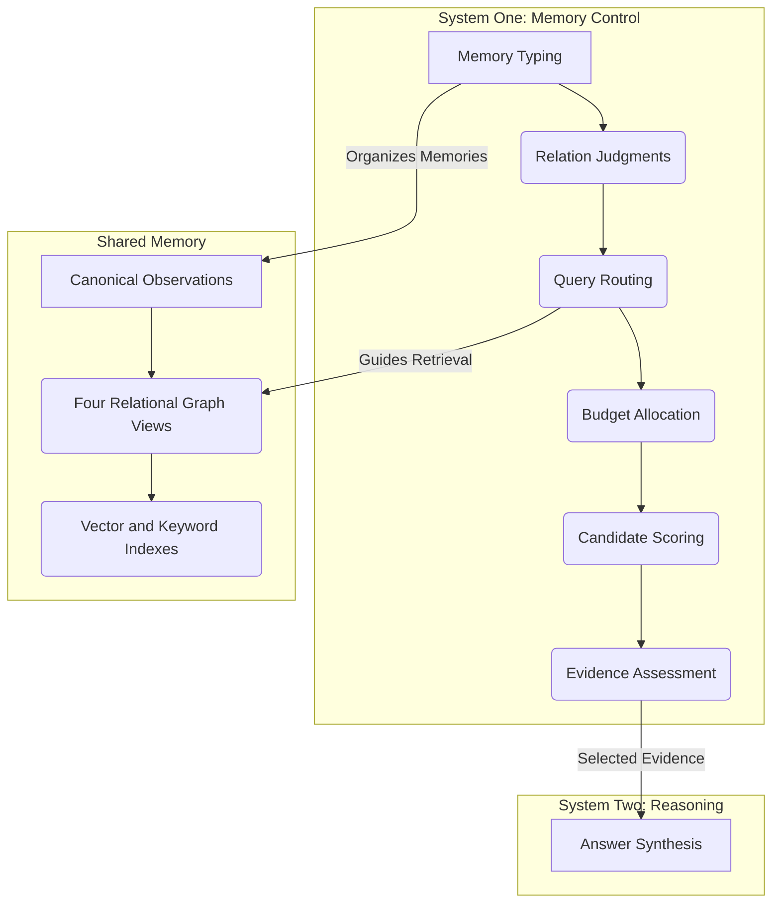

<!-- source: DeepWiki mcp.deepwiki.com · repo libingzheren/Jev-Mem · page 1 Overview · fetched 2026-10-13 -->

# Overview

<details>
<summary>Relevant source files</summary>

The following files were used as context for generating this wiki page:

- [CHANGELOG.md](CHANGELOG.md)
- [MANIFEST.in](MANIFEST.in)
- [README.md](README.md)
- [docs/architecture.md](docs/architecture.md)

</details>


Jev-Mem is a novel agentic memory system designed to enhance the performance of long-running AI agents by separating frequent memory management decisions from deeper reasoning tasks. It achieves this through a lightweight **System-One controller** that organizes memories and guides retrieval across semantic, temporal, causal, and entity relations, while a **System-Two language model** synthesizes answers from the retrieved evidence [README.md:13-17](). This architecture leads to significant improvements in answer quality, memory construction speed, and query latency compared to existing memory systems [README.md:19-22]().

This page provides a high-level overview of Jev-Mem's architecture, its core components, and the repository layout. For detailed instructions on installation, configuration, and running the system, please refer to the child pages.

## What is Jev-Mem?

Jev-Mem addresses the challenges faced by persistent AI agents in managing growing histories, remembering preferences, connecting events, and efficiently retrieving relevant evidence. It introduces a dedicated, structured controller to make decisions about how information connects, where to search, and when sufficient evidence has been found [README.md:30-36]().

The system is built around three core components:
*   **System One: memory control**: Responsible for memory typing, relation judgments, query routing, budget allocation, candidate scoring, and evidence assessment [README.md:101]().
*   **Shared memory**: Stores canonical observations, maintains four relational graph views (semantic, temporal, causal, and entity), and includes vector and keyword indexes [README.md:102]().
*   **System Two: reasoning**: Synthesizes the final answer from the selected evidence [README.md:103]().

This separation allows for fast decisions and focused reasoning, leading to improved performance across various metrics [README.md:7]().

Sources:
*   [README.md:7-22]()
*   [README.md:30-36]()
*   [README.md:101-103]()

### Jev-Mem Architecture

The Jev-Mem architecture is designed to provide a clear separation of concerns between the fast, decision-making System-One controller and the deeper reasoning System-Two language model.


**Diagram 1: High-Level Jev-Mem Architecture**
Sources:
*   [README.md:101-103]()

## Repository Layout

The Jev-Mem codebase is organized into several top-level directories, each serving a specific purpose. This structure helps in maintaining modularity and clarity, making it easier for developers to navigate and contribute.

```mermaid
graph TD
    A[jev_mem/] --> A1[system.py "Public build/query API"]
    A --> A2[cli.py "Application argument parsing and dispatch"]
    A --> A3[demo.py "Offline demonstration"]
    A --> A4[datasets/ "LoCoMo and LongMemEval schemas and loaders"]
    A --> A5[benchmarks/ "Benchmark runners"]
    B[memory/ "Graph storage, controllers, retrieval, and evaluation"]
    C[utils/ "Shared provider adapters and scoring utilities"]
    D[config/ "Checked-in experiment profiles"]
    E[examples/ "Original synthetic inputs"]
    F[data/ "Downloaded datasets (ignored by Git)"]
    G[tests/ "Offline regression and compatibility tests"]
    H[scripts/ "Release tools and retrieval diagnostics"]
    I[docs/ "Developer guides and figures"]
```
**Diagram 2: Jev-Mem Repository Layout**
Sources:
*   [docs/architecture.md:3-18]()
*   [MANIFEST.in:27-86]()

The `jev_mem/` directory contains the public API, CLI, demo, datasets, and benchmarks [docs/architecture.md:5-10](). The `memory/` directory is central to the system, housing the graph storage, controllers, retrieval mechanisms, and evaluation components [docs/architecture.md:10](). Configuration files are located in `config/`, while `examples/` provides synthetic inputs [docs/architecture.md:12-13](). `data/` is used for downloaded datasets and is ignored by Git [docs/architecture.md:14](). Testing infrastructure resides in `tests/`, and release/diagnostic tools are in `scripts/` [docs/architecture.md:15-16](). Documentation and figures are found in `docs/` [docs/architecture.md:17]().

For details on specific files and their roles, refer to the `MANIFEST.in` file [MANIFEST.in:1-86]() which lists all included files in the distribution.

Sources:
*   [docs/architecture.md:3-18]()
*   [MANIFEST.in:1-86]()

## Getting Started

To begin using Jev-Mem, you'll need Python 3.11+ [README.md:124](). The quick start guide in the README provides a simple way to set up a virtual environment, install dependencies, and run an offline demo that uses deterministic mock decisions and embeddings [README.md:126-131](). This demo does not require any API keys or model downloads [README.md:133]().

For details on installation, setting up the environment, running the demo, and configuring API keys for live models, see [Getting Started](#1.1).

Sources:
*   [README.md:124-134]()

## Configuration Reference

Jev-Mem's behavior can be customized through configuration files. The system uses `config/jev_mem.json` and `config/jev_mem_accuracy.json` for experiment profiles [MANIFEST.in:13-14](). The `JevMemConfig` class [docs/architecture.md:64]() manages these settings, including budgets and thresholds for various operations.

For a comprehensive guide to Jev-Mem's configuration options, including details on `JevMemConfig` fields, budgets, and thresholds, see [Configuration Reference](#1.2).

Sources:
*   [MANIFEST.in:13-14]()
*   [docs/architecture.md:64]()

---

