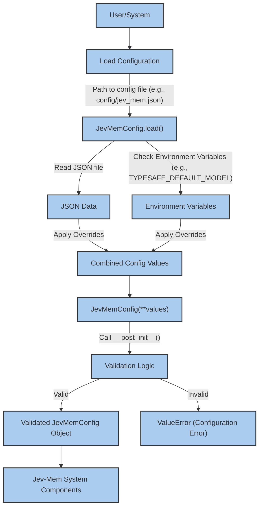
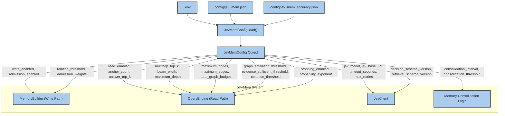

<!-- source: DeepWiki mcp.deepwiki.com · repo libingzheren/Jev-Mem · page 1.2 Configuration Reference · fetched 2026-10-13 -->

# Configuration Reference

<details>
<summary>Relevant source files</summary>

The following files were used as context for generating this wiki page:

- [.env.example](.env.example)
- [.gitignore](.gitignore)
- [CODE_OF_CONDUCT.md](CODE_OF_CONDUCT.md)
- [LICENSE](LICENSE)
- [config/README.md](config/README.md)
- [config/jev_mem.json](config/jev_mem.json)
- [config/jev_mem_accuracy.json](config/jev_mem_accuracy.json)
- [memory/jev_mem_config.py](memory/jev_mem_config.py)

</details>


This page details the configuration options for Jev-Mem, primarily focusing on the `JevMemConfig` class and the JSON configuration files `config/jev_mem.json` and `config/jev_mem_accuracy.json`. It covers the various fields, their purpose, and how they influence the system's behavior, including budgets and thresholds.

## JevMemConfig Class

The `JevMemConfig` class [memory/jev_mem_config.py:10-48]() is a dataclass that defines all configurable parameters for the Jev-Mem control plane. It provides type validation and ensures that configuration values adhere to specified constraints.

```python
@dataclass(frozen=True)
class JevMemConfig:
    write_enabled: bool = False
    read_enabled: bool = False
    admission_enabled: bool = False
    jev_mock: bool = False
    jev_model: str = "jev-latest"
    decision_schema_version: str = "noul-choice-v3-magma-temporal"
    retrieval_schema_version: str = "anchored-temporal-v1"
    jev_base_url: str = "https://api.typesafe.ai"
    timeout_seconds: float = 3.0
    max_retries: int = 2
    cache_size: int = 1024
    fallback_to_magma: bool = True
    admission_threshold: float = 0.60
    relation_threshold: float = 0.60
    candidate_top_k: int = 10
    admission_weights: tuple = (0.4, 0.3, 0.3, 0.2)
    total_graph_budget: int = 20
    probability_exponent: float = 1.5
    minimum_graph_budget: int = 1
    graph_activation_threshold: float = 0.15
    anchor_count: int = 5
    answer_top_k: int = 15
    multihop_top_k: int = 30
    beam_width: int = 5
    maximum_depth: int = 5
    maximum_nodes: int = 30
    maximum_edges: int = 200
    maximum_jev_calls: int = 10
    max_latency_seconds: float = 15.0
    transition_weights: tuple = (0.25, 0.35, 0.15, 0.15, 0.10)
    stopping_enabled: bool = True
    evidence_sufficient_threshold: float = 0.85
    continue_threshold: float = 0.40
    consolidation_interval: int = 0
    consolidation_threshold: float = 0.85
    audit_path: str = ""
```

The `__post_init__` method [memory/jev_mem_config.py:49-77]() performs validation on the fields to ensure they meet specific criteria, such as being within a certain range or being of a particular type. For example, thresholds like `admission_threshold` must be between 0 and 1 [memory/jev_mem_config.py:51-54](). Integer fields like `candidate_top_k` must be greater than or equal to 1 [memory/jev_mem_config.py:55-57]().

The `JevMemConfig.load` class method [memory/jev_mem_config.py:79-88]() is responsible for loading configuration from a JSON file and applying overrides. It also allows environment variables like `TYPESAFE_DEFAULT_MODEL` and `TYPESAFE_BASE_URL` to override `jev_model` and `jev_base_url` respectively [memory/jev_mem_config.py:84-86]().

Sources:
* [memory/jev_mem_config.py:10-48]()
* [memory/jev_mem_config.py:49-77]()
* [memory/jev_mem_config.py:51-54]()
* [memory/jev_mem_config.py:55-57]()
* [memory/jev_mem_config.py:79-88]()
* [memory/jev_mem_config.py:84-86]()

### Configuration Fields

The following table describes the key configuration fields in `JevMemConfig`:

| Field Name | Type | Default Value | Description |
|---|---|---|---|
| `write_enabled` | `bool` | `False` | Enables or disables memory write operations. |
| `read_enabled` | `bool` | `False` | Enables or disables memory read operations. |
| `admission_enabled` | `bool` | `False` | Enables or disables admission control for new memories. |
| `jev_mock` | `bool` | `False` | If `True`, uses a mock Jev client instead of making actual API calls. |
| `jev_model` | `str` | `"jev-latest"` | Specifies the Jev model to use. Can be overridden by `TYPESAFE_DEFAULT_MODEL` environment variable. |
| `decision_schema_version` | `str` | `"noul-choice-v3-magma-temporal"` | Version of the decision schema used by Jev. |
| `retrieval_schema_version` | `str` | `"anchored-temporal-v1"` | Version of the retrieval schema used by Jev. |
| `jev_base_url` | `str` | `"https://api.typesafe.ai"` | Base URL for the Jev API. Can be overridden by `TYPESAFE_BASE_URL` environment variable. |
| `timeout_seconds` | `float` | `3.0` | Timeout for Jev API calls in seconds. |
| `max_retries` | `int` | `2` | Maximum number of retries for failed Jev API calls. |
| `cache_size` | `int` | `1024` | Size of the internal cache. |
| `fallback_to_magma` | `bool` | `True` | If `True`, falls back to MAGMA if Jev fails. |
| `admission_threshold` | `float` | `0.60` | Threshold for admitting new memories. Must be in `[0, 1]`. |
| `relation_threshold` | `float` | `0.60` | Threshold for establishing relations between memories. Must be in `[0, 1]`. |
| `candidate_top_k` | `int` | `10` | Number of top candidates to consider during various selection processes. Must be `>= 1`. |
| `admission_weights` | `tuple` | `(0.4, 0.3, 0.3, 0.2)` | Weights used in the admission utility calculation. Sum of first three must be positive. |
| `total_graph_budget` | `int` | `20` | Maximum number of nodes/edges allowed in the graph traversal. Must be `>= 0`. |
| `probability_exponent` | `float` | `1.5` | Exponent for probability calculations in graph traversal. Must be positive and finite. |
| `minimum_graph_budget` | `int` | `1` | Minimum graph budget to ensure some traversal. Must be `>= 0`. |
| `graph_activation_threshold` | `float` | `0.15` | Threshold for activating graph traversal. Must be in `[0, 1]`. |
| `anchor_count` | `int` | `5` | Number of anchor memories to retrieve. Must be `>= 1`. |
| `answer_top_k` | `int` | `15` | Number of top answers to consider. Must be `>= 1`. |
| `multihop_top_k` | `int` | `30` | Number of top candidates for multi-hop retrieval. Must be `>= 1`. |
| `beam_width` | `int` | `5` | Beam width for beam search in graph traversal. Must be `>= 1`. |
| `maximum_depth` | `int` | `5` | Maximum depth for graph traversal. Must be `>= 0`. |
| `maximum_nodes` | `int` | `30` | Maximum number of nodes to explore in graph traversal. Must be `>= 1`. |
| `maximum_edges` | `int` | `200` | Maximum number of edges to explore in graph traversal. Must be `>= 1`. |
| `maximum_jev_calls` | `int` | `10` | Maximum number of Jev calls allowed during a single operation. Must be `>= 0`. |
| `max_latency_seconds` | `float` | `15.0` | Maximum allowed latency for an operation in seconds. Must be positive and finite. |
| `transition_weights` | `tuple` | `(0.25, 0.35, 0.15, 0.15, 0.10)` | Weights for different transition types in graph traversal. |
| `stopping_enabled` | `bool` | `True` | Enables or disables the stopping mechanism during retrieval. |
| `evidence_sufficient_threshold` | `float` | `0.85` | Threshold for considering evidence sufficient. Must be in `[0, 1]`. |
| `continue_threshold` | `float` | `0.40` | Threshold for continuing retrieval. Must be in `[0, 1]`. |
| `consolidation_interval` | `int` | `0` | Interval (in number of memories) at which consolidation is attempted. `0` means disabled. Must be `>= 0`. |
| `consolidation_threshold` | `float` | `0.85` | Threshold for consolidating memories. Must be in `[0, 1]`. |
| `audit_path` | `str` | `""` | Path to store audit logs. |

Sources:
* [memory/jev_mem_config.py:11-48]()

## Configuration Files

Jev-Mem uses JSON files to define configuration profiles. These files are typically located in the `config/` directory. The `config/README.md` [config/README.md:1-10]() explains the purpose of these files.

### `config/jev_mem.json`

This is the default live profile used in README examples [config/README.md:3](). It provides a balanced set of parameters for general use.

```json
{
  "write_enabled": true,
  "read_enabled": true,
  "admission_enabled": false,
  "jev_mock": false,
  "jev_model": "jev-latest",
  "timeout_seconds": 3.0,
  "max_retries": 2,
  "fallback_to_magma": true,
  "relation_threshold": 0.6,
  "candidate_top_k": 10,
  "anchor_count": 30,
  "answer_top_k": 40,
  "multihop_top_k": 50,
  "total_graph_budget": 80,
  "probability_exponent": 1.0,
  "minimum_graph_budget": 1,
  "graph_activation_threshold": 0.1,
  "beam_width": 10,
  "maximum_depth": 8,
  "maximum_nodes": 60,
  "maximum_edges": 2400,
  "maximum_jev_calls": 16,
  "max_latency_seconds": 15.0,
  "evidence_sufficient_threshold": 0.95,
  "continue_threshold": 0.15,
  "consolidation_interval": 20,
  "consolidation_threshold": 0.85
}
```

Sources:
* [config/jev_mem.json:1-29]()
* [config/README.md:3]()

### `config/jev_mem_accuracy.json`

This is an alternate experimental profile with different settings for anchor counts, evidence limits, graph activation, and stopping thresholds [config/README.md:4-6](). Its name does not imply a guaranteed accuracy advantage.

```json
{
  "write_enabled": true,
  "read_enabled": true,
  "admission_enabled": false,
  "jev_mock": false,
  "jev_model": "jev-latest",
  "timeout_seconds": 3.0,
  "max_retries": 2,
  "fallback_to_magma": true,
  "relation_threshold": 0.6,
  "candidate_top_k": 10,
  "anchor_count": 20,
  "answer_top_k": 30,
  "multihop_top_k": 40,
  "total_graph_budget": 80,
  "probability_exponent": 1.0,
  "minimum_graph_budget": 1,
  "graph_activation_threshold": 0.15,
  "beam_width": 10,
  "maximum_depth": 8,
  "maximum_nodes": 60,
  "maximum_edges": 1200,
  "maximum_jev_calls": 16,
  "max_latency_seconds": 15.0,
  "evidence_sufficient_threshold": 0.93,
  "continue_threshold": 0.2,
  "consolidation_interval": 20
}
```

Sources:
* [config/jev_mem_accuracy.json:1-28]()
* [config/README.md:4-6]()

### Loading Configuration

Configuration files can be loaded using the `--jev-config PATH` command-line argument. The `JevMemConfig.load` method [memory/jev_mem_config.py:79-88]() handles parsing the JSON and applying overrides.

Sources:
* [config/README.md:8]()
* [memory/jev_mem_config.py:79-88]()

## Budgets and Thresholds

Several configuration parameters define budgets and thresholds that control the behavior of the Jev-Mem system, particularly during memory admission, retrieval, and graph traversal.

### Admission Control

*   `admission_enabled`: A boolean flag to enable or disable the admission control mechanism [memory/jev_mem_config.py:13]().
*   `admission_threshold`: A float value (0.0 to 1.0) that determines the minimum score required for a new memory to be admitted into the system [memory/jev_mem_config.py:24]().
*   `admission_weights`: A tuple of floats `(0.4, 0.3, 0.3, 0.2)` [memory/jev_mem_config.py:27]() used in the calculation of the admission utility score. The sum of the first three weights must be positive [memory/jev_mem_config.py:67-68]().

### Graph Traversal and Retrieval

*   `total_graph_budget`: The maximum total number of nodes and edges that can be explored during graph traversal [memory/jev_mem_config.py:28]().
*   `minimum_graph_budget`: Ensures that at least this many graph elements are considered, even if other thresholds might suggest stopping earlier [memory/jev_mem_config.py:30]().
*   `graph_activation_threshold`: A float (0.0 to 1.0) that determines when graph traversal should be initiated [memory/jev_mem_config.py:31]().
*   `anchor_count`: The number of initial "anchor" memories retrieved to start a query or traversal [memory/jev_mem_config.py:32]().
*   `answer_top_k`: The number of top candidate answers to consider [memory/jev_mem_config.py:33]().
*   `multihop_top_k`: The number of top candidates to consider at each hop during multi-hop retrieval [memory/jev_mem_config.py:34]().
*   `beam_width`: The width of the beam used in beam search for graph traversal [memory/jev_mem_config.py:35]().
*   `maximum_depth`: The maximum depth of graph traversal [memory/jev_mem_config.py:36]().
*   `maximum_nodes`: The maximum number of nodes to visit during graph traversal [memory/jev_mem_config.py:37]().
*   `maximum_edges`: The maximum number of edges to traverse during graph traversal [memory/jev_mem_config.py:38]().
*   `maximum_jev_calls`: Limits the number of calls made to the Jev system during a single operation to prevent excessive latency or cost [memory/jev_mem_config.py:39]().
*   `max_latency_seconds`: A hard limit on the total time an operation can take [memory/jev_mem_config.py:40]().
*   `evidence_sufficient_threshold`: A float (0.0 to 1.0) indicating when enough evidence has been gathered to stop retrieval [memory/jev_mem_config.py:43]().
*   `continue_threshold`: A float (0.0 to 1.0) indicating the confidence level required to continue retrieval [memory/jev_mem_config.py:44]().
*   `stopping_enabled`: A boolean flag to enable or disable the dynamic stopping mechanism during retrieval [memory/jev_mem_config.py:42]().

### Consolidation

*   `consolidation_interval`: The frequency (in number of memories processed) at which the system attempts to consolidate memories. A value of `0` disables consolidation [memory/jev_mem_config.py:45]().
*   `consolidation_threshold`: A float (0.0 to 1.0) that determines the similarity score required for memories to be consolidated [memory/jev_mem_config.py:46]().

### Configuration Flow Diagram

The following diagram illustrates how configuration is loaded and validated within the Jev-Mem system.


**Diagram: Configuration Loading and Validation Flow**

Sources:
* [memory/jev_mem_config.py:13]()
* [memory/jev_mem_config.py:24]()
* [memory/jev_mem_config.py:27]()
* [memory/jev_mem_config.py:67-68]()
* [memory/jev_mem_config.py:28]()
* [memory/jev_mem_config.py:30]()
* [memory/jev_mem_config.py:31]()
* [memory/jev_mem_config.py:32]()
* [memory/jev_mem_config.py:33]()
* [memory/jev_mem_config.py:34]()
* [memory/jev_mem_config.py:35]()
* [memory/jev_mem_config.py:36]()
* [memory/jev_mem_config.py:37]()
* [memory/jev_mem_config.py:38]()
* [memory/jev_mem_config.py:39]()
* [memory/jev_mem_config.py:40]()
* [memory/jev_mem_config.py:43]()
* [memory/jev_mem_config.py:44]()
* [memory/jev_mem_config.py:42]()
* [memory/jev_mem_config.py:45]()
* [memory/jev_mem_config.py:46]()

### Environment Variables

Certain configuration values can be overridden by environment variables, as specified in the `.env.example` file [config/README.md:10](). This is particularly useful for sensitive information like API keys or for specifying different models or base URLs without modifying the JSON configuration files.

*   `TYPESAFE_API_KEY`: Used for authentication with the Typesafe API.
*   `TYPESAFE_DEFAULT_MODEL`: Overrides the `jev_model` setting in `JevMemConfig` [memory/jev_mem_config.py:84]().
*   `TYPESAFE_BASE_URL`: Overrides the `jev_base_url` setting in `JevMemConfig` [memory/jev_mem_config.py:85]().
*   `OPENAI_API_KEY`: Used for OpenAI API authentication.
*   `OPENAI_BASE_URL`: Optional, specifies a custom OpenAI-compatible endpoint.

Sources:
* [.env.example:1-6]()
* [config/README.md:10]()
* [memory/jev_mem_config.py:84]()
* [memory/jev_mem_config.py:85]()

### Configuration and System Interaction

The `JevMemConfig` object is central to how various components of the Jev-Mem system operate. It dictates policies for memory admission, retrieval strategies, and resource limits.


**Diagram: JevMemConfig Influence on System Components**

Sources:
* [memory/jev_mem_config.py:11-48]()
* [memory/jev_mem_config.py:79-88]()
* [.env.example:1-6]()
* [config/jev_mem.json:1-29]()
* [config/jev_mem_accuracy.json:1-28]()

---

