<!-- source: DeepWiki mcp.deepwiki.com · repo libingzheren/Jev-Mem · page 2.2 Command-Line Interface · fetched 2026-10-13 -->

# Command-Line Interface

<details>
<summary>Relevant source files</summary>

The following files were used as context for generating this wiki page:

- [jev_mem/__main__.py](jev_mem/__main__.py)
- [jev_mem/cli.py](jev_mem/cli.py)
- [main.py](main.py)

</details>


This page details the command-line interface (CLI) for Jev-Mem, focusing on the `jev_mem/cli.py` module, its entry points, and the various modes and ablation flags it supports. The CLI provides functionalities for building memory from observations, querying the memory, and running benchmarks.

## Entry Points

Jev-Mem can be invoked from the command line using several entry points:

*   **`python -m jev_mem`**: This is the primary and recommended way to run the application. It directly executes `jev_mem/__main__.py` [jev_mem/__main__.py:1-5](), which in turn calls the `main()` function from `jev_mem/cli.py` [jev_mem/__main__.py:2]().
*   **`python main.py`**: This serves as a compatibility shim. `main.py` [main.py:1-8]() imports `jev_mem/cli.py` as `_implementation` [main.py:3]() and then calls its `main()` function [main.py:6](). If `main.py` is imported as a module, it replaces itself in `sys.modules` with the `cli` module [main.py:8]().
*   **`jev_mem/cli.py` directly**: While possible, this is less common as it requires direct execution of the script. The shebang `#!/usr/bin/env python3` [jev_mem/cli.py:1]() allows it to be run as an executable script.

Sources:
* `jev_mem/__main__.py`
* `main.py`
* `jev_mem/cli.py`

## `jev_mem/cli.py` Overview

The `jev_mem/cli.py` [jev_mem/cli.py:1-80]() script is the core of the Jev-Mem command-line interface. It uses `argparse` [jev_mem/cli.py:20]() to define various command-line arguments that control the system's behavior, including operation mode, input data, model choices, and ablation flags.

### `main()` Function

The `main()` function [jev_mem/cli.py:19-76]() is the entry point for the CLI. It parses command-line arguments, loads environment variables using `dotenv` [jev_mem/cli.py:37](), configures logging, and then dispatches to the appropriate Jev-Mem system operations based on the chosen `mode`.

### Command-Line Arguments

The CLI supports the following arguments:

| Argument | Description | Default | Required for |
| :------- | :---------- | :------ | :----------- |
| `--mode` | Operation mode: `build`, `query`, or `test`. | `test` | |
| `--input` | Path to observation JSON for `build`; LoCoMo JSON for `test`. | | `build`, `test` |
| `--question` | Question string for `query` mode. | | `query` |
| `--model` | Language model to use (e.g., `gpt-4o-mini`). | `gpt-4o-mini` | |
| `--embedding-model` | Embedding model to use (`minilm` or `openai`). | `minilm` | |
| `--cache-dir` | Directory for caching memory and audit logs. | `./cache` | |
| `--jev-mem` | Enable Jev-Mem (write and read). | `False` | |
| `--jev-config` | Path to a Jev-Mem configuration file. | | |
| `--jev-mock` | Enable Jev-Mem mock client. | `False` | |
| `--no-jev-write` | Disable Jev-Mem write path. | `False` | |
| `--no-jev-read` | Disable Jev-Mem read path. | `False` | |

Sources:
* `jev_mem/cli.py`

## Modes of Operation

The `--mode` argument [jev_mem/cli.py:21]() determines the primary function of the CLI.

### Build Mode (`--mode build`)

In `build` mode, Jev-Mem constructs a memory graph from a provided observation JSON file.

1.  **Input**: Requires `--input` [jev_mem/cli.py:34]() pointing to a JSON file containing conversation data.
2.  **Cache Handling**: If a `graph.json` [jev_mem/cli.py:66]() already exists in the `cache_dir`, the system loads the existing memory.
3.  **Memory Construction**: Calls `system.build_memory_from_conversation(data)` [jev_mem/cli.py:69]() to process the input data.
4.  **Output**: Prints the result of the memory build to standard output.
5.  **Persistence**: Saves the constructed memory to disk using `system.save_memory()` [jev_mem/cli.py:70]().

Sources:
* `jev_mem/cli.py`

### Query Mode (`--mode query`)

In `query` mode, Jev-Mem retrieves information from a previously built memory graph based on a given question.

1.  **Input**: Requires `--question` [jev_mem/cli.py:36]() providing the query string.
2.  **Cache Handling**: Requires a `graph.json` [jev_mem/cli.py:72]() to exist in the `cache_dir`. If not found, an error is raised.
3.  **Memory Loading**: Loads the existing memory from disk using `system.load_memory()` [jev_mem/cli.py:74]().
4.  **Query Execution**: Calls `system.query(args.question)` [jev_mem/cli.py:75]() to perform the retrieval.
5.  **Output**: Prints the query result to standard output.

Sources:
* `jev_mem/cli.py`

### Test Mode (`--mode test`)

The `test` mode is designed for running benchmarks, specifically the LoCoMo benchmark.

1.  **Input**: Requires `--input` [jev_mem/cli.py:34]() pointing to a LoCoMo JSON dataset.
2.  **Subprocess Execution**: Instead of directly executing Jev-Mem logic, this mode constructs a command to run `jev_mem.benchmarks.locomo` [jev_mem/cli.py:40]() as a separate Python module using `subprocess.call()` [jev_mem/cli.py:48]().
3.  **Argument Forwarding**: All relevant arguments (e.g., `--dataset`, `--model`, `--embedding-model`, `--cache-dir`, and Jev-Mem specific flags) are forwarded to the `locomo` benchmark script [jev_mem/cli.py:41-47]().

Sources:
* `jev_mem/cli.py`

## Jev-Mem Configuration and Ablation Flags

The CLI allows for fine-grained control over Jev-Mem's behavior through configuration and ablation flags.

### Configuration Loading

The `JevMemConfig` [jev_mem/cli.py:16]() is loaded using `JevMemConfig.load()` [jev_mem/cli.py:58]().
*   If `--jev-config` is provided, it loads the configuration from the specified file.
*   Otherwise, it loads the default configuration.
*   Command-line flags can override specific configuration parameters.

### Ablation Flags

Ablation flags allow disabling specific components of the Jev-Mem system for experimental purposes or to compare performance against a baseline. These flags modify the `JevMemConfig` [jev_mem/cli.py:58]() before the `JevMemSystem` [jev_mem/cli.py:64]() is initialized.

*   **`--jev-mem`**: Enables both write and read paths for Jev-Mem [jev_mem/cli.py:51-52](). This sets `write_enabled=True` and `read_enabled=True`.
*   **`--jev-mock`**: Enables a mock Jev client [jev_mem/cli.py:53-54](), setting `jev_mock=True`.
*   **`--no-jev-write`**: Disables the Jev-Mem write path [jev_mem/cli.py:55-56](), setting `write_enabled=False`.
*   **`--no-jev-read`**: Disables the Jev-Mem read path [jev_mem/cli.py:57](), setting `read_enabled=False`.

### Cache Directory Management

The `cache_dir` [jev_mem/cli.py:26, 59]() is used to store persistent memory components (like the graph database) and audit logs.
If Jev-Mem is enabled (either `write_enabled` or `read_enabled` is true), a unique subdirectory is created within the specified `cache_dir`. This subdirectory's name includes a SHA256 hash of the `JevMemConfig` [jev_mem/cli.py:61-62](), ensuring that different configurations use separate cache locations. The `audit_path` in the configuration is also updated to point to `decisions.jsonl` within this unique cache directory [jev_mem/cli.py:63]().

Sources:
* `jev_mem/cli.py`
* `memory/jev_mem_config.py` (implied by `JevMemConfig`)

## CLI Data Flow and System Initialization

The following diagram illustrates the high-level data flow and component initialization within the Jev-Mem CLI.

```mermaid
graph TD
    subgraph "Command-Line Interface (jev_mem/cli.py)"
        A[Start: python -m jev_mem] --> B{Parse Arguments};
        B --> C{Load .env};
        B --> D{Determine Mode};
        D -- "mode = test" --> E[Run LoCoMo Benchmark (subprocess)];
        D -- "mode = build/query" --> F{Load JevMemConfig};
        F -- "Apply overrides from flags" --> G[Initialize JevMemSystem];
        G -- "mode = build" --> H[Load existing memory (if any)];
        H --> I[Read Input JSON];
        I --> J[system.build_memory_from_conversation()];
        J --> K[system.save_memory()];
        K --> L[Print Output];
        G -- "mode = query" --> M[Check for saved graph];
        M --> N[system.load_memory()];
        N --> O[system.query(question)];
        O --> P[Print Output];
    end

    subgraph "JevMemSystem (jev_mem/system.py)"
        G -- "JevMemSystem(model, embedding_model, cache_dir, config)" --> Q[MemoryBuilder];
        G --> R[QueryEngine];
        G --> S[Clients (LLM, Embedding)];
    end

    subgraph "Memory Subsystem"
        J --> T[MemoryBuilder.build_memory_from_conversation];
        N --> U[MemoryBuilder.load_memory];
        K --> V[MemoryBuilder.save_memory];
        O --> W[QueryEngine.query];
    end

    E -- "subprocess.call()" --> X[jev_mem.benchmarks.locomo];

    style A fill:#ace,stroke:#333,stroke-width:2px
    style E fill:#ace,stroke:#333,stroke-width:2px
    style J fill:#ace,stroke:#333,stroke-width:2px
    style O fill:#ace,stroke:#333,stroke-width:2px
    style X fill:#ace,stroke:#333,stroke-width:2px
```
Title: CLI Execution Flow
Sources:
* `jev_mem/cli.py`
* `jev_mem/system.py` (implied by `JevMemSystem`)
* `jev_mem/benchmarks/locomo.py` (implied by `test` mode)

## Bridging Natural Language Space to Code Entity Space

The CLI acts as the primary interface for users to interact with the Jev-Mem system. The arguments provided by the user in "natural language space" (e.g., `--mode build`, `--question "What is X?"`) are directly mapped to "code entities" within the `jev_mem/cli.py` script and subsequently to the `JevMemSystem`.

```mermaid
graph TD
    subgraph "Natural Language Space (User Input)"
        NL1["`--mode build`"] --> C1["`args.mode == 'build'`"];
        NL2["`--input path/to/observations.json`"] --> C2["`args.input`"];
        NL3["`--mode query`"] --> C3["`args.mode == 'query'`"];
        NL4["`--question 'Who is Alice?'`"] --> C4["`args.question`"];
        NL5["`--jev-mem`"] --> C5["`args.jev_mem`"];
        NL6["`--no-jev-write`"] --> C6["`args.no_jev_write`"];
        NL7["`--model gpt-4o-mini`"] --> C7["`args.model`"];
        NL8["`--cache-dir ./my_cache`"] --> C8["`args.cache_dir`"];
    end

    subgraph "Code Entity Space (jev_mem/cli.py)"
        C1 --> F1["`if args.mode == 'build':`"];
        C2 --> F2["`Path(args.input).read_text()`"];
        C3 --> F3["`if args.mode == 'query':`"];
        C4 --> F4["`system.query(args.question)`"];
        C5 --> F5["`overrides.update(write_enabled=True, read_enabled=True)`"];
        C6 --> F6["`overrides['write_enabled'] = False`"];
        C7 --> F7["`JevMemSystem(args.model, ...)`"];
        C8 --> F8["`cache_dir = Path(args.cache_dir)`"];
    end

    subgraph "JevMemSystem (jev_mem/system.py)"
        F1 --> S1["`system.build_memory_from_conversation()`"];
        F4 --> S2["`JevMemSystem.query()`"];
        F5 --> S3["`JevMemConfig.write_enabled`"];
        F6 --> S4["`JevMemConfig.read_enabled`"];
        F7 --> S5["`JevMemSystem.__init__(model_name=args.model, ...)`"];
        F8 --> S6["`JevMemSystem.__init__(..., cache_dir=str(cache_dir))`"];
    end

    style NL1 fill:#e0f7fa,stroke:#00796b,stroke-width:1px
    style NL2 fill:#e0f7fa,stroke:#00796b,stroke-width:1px
    style NL3 fill:#e0f7fa,stroke:#00796b,stroke-width:1px
    style NL4 fill:#e0f7fa,stroke:#00796b,stroke-width:1px
    style NL5 fill:#e0f7fa,stroke:#00796b,stroke-width:1px
    style NL6 fill:#e0f7fa,stroke:#00796b,stroke-width:1px
    style NL7 fill:#e0f7fa,stroke:#00796b,stroke-width:1px
    style NL8 fill:#e0f7fa,stroke:#00796b,stroke-width:1px

    style C1 fill:#fff3e0,stroke:#ff9800,stroke-width:1px
    style C2 fill:#fff3e0,stroke:#ff9800,stroke-width:1px
    style C3 fill:#fff3e0,stroke:#ff9800,stroke-width:1px
    style C4 fill:#fff3e0,stroke:#ff9800,stroke-width:1px
    style C5 fill:#fff3e0,stroke:#ff9800,stroke-width:1px
    style C6 fill:#fff3e0,stroke:#ff9800,stroke-width:1px
    style C7 fill:#fff3e0,stroke:#ff9800,stroke-width:1px
    style C8 fill:#fff3e0,stroke:#ff9800,stroke-width:1px

    style F1 fill:#e8f5e9,stroke:#4caf50,stroke-width:1px
    style F2 fill:#e8f5e9,stroke:#4caf50,stroke-width:1px
    style F3 fill:#e8f5e9,stroke:#4caf50,stroke-width:1px
    style F4 fill:#e8f5e9,stroke:#4caf50,stroke-width:1px
    style F5 fill:#e8f5e9,stroke:#4caf50,stroke-width:1px
    style F6 fill:#e8f5e9,stroke:#4caf50,stroke-width:1px
    style F7 fill:#e8f5e9,stroke:#4caf50,stroke-width:1px
    style F8 fill:#e8f5e9,stroke:#4caf50,stroke-width:1px

    style S1 fill:#f3e5f5,stroke:#9c27b0,stroke-width:1px
    style S2 fill:#f3e5f5,stroke:#9c27b0,stroke-width:1px
    style S3 fill:#f3e5f5,stroke:#9c27b0,stroke-width:1px
    style S4 fill:#f3e5f5,stroke:#9c27b0,stroke-width:1px
    style S5 fill:#f3e5f5,stroke:#9c27b0,stroke-width:1px
    style S6 fill:#f3e5f5,stroke:#9c27b0,stroke-width:1px
```


Title: Natural Language to Code Entity Mapping
Sources:
* `jev_mem/cli.py`
* `jev_mem/system.py` (implied by `JevMemSystem`)
* `memory/jev_mem_config.py` (implied by `JevMemConfig`)

---

