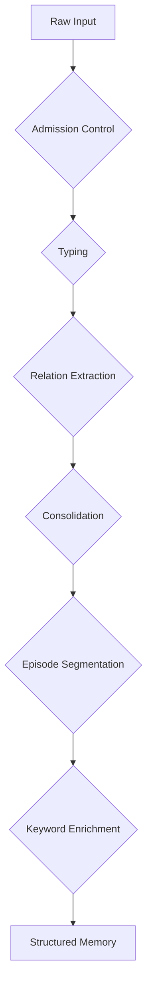
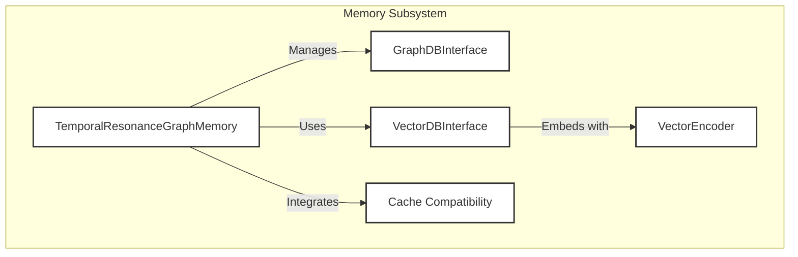
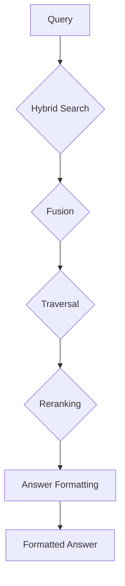

<!-- source: DeepWiki mcp.deepwiki.com · repo libingzheren/Jev-Mem · page 3 Memory Subsystem · fetched 2026-10-13 -->

# Memory Subsystem

Relevant source files

The following files were used as context for generating this wiki page:

- [MANIFEST.in](MANIFEST.in)
- [memory/__init__.py](memory/__init__.py)

The `memory/` package in Jev-Mem is the core of the agent's long-term memory. It encompasses the entire lifecycle of memory, from its initial construction (the "write path") to its storage, and finally to its retrieval and querying (the "read path"). This subsystem is designed to manage and process diverse forms of information, enabling the agent to learn, adapt, and respond effectively based on its accumulated experiences. It also includes various support utilities crucial for memory operations, such as temporal parsing and caching.

This page provides a high-level overview of the `memory/` package. For detailed information on each component, please refer to the linked child pages.

## Memory Construction (Write Path)

The memory construction process, often referred to as the "write path," is responsible for transforming raw input data into structured, retrievable memory representations. This involves a pipeline managed by the `MemoryBuilder` [memory/memory_builder.py]() that includes several stages: admission control, typing, relation extraction, consolidation, episode segmentation, and keyword enrichment. This pipeline ensures that incoming information is properly processed and integrated into the memory system.

For details, see [Memory Construction (Write Path)](#3.1).

### Memory Construction Pipeline

Sources: [memory/__init__.py:58](), [memory/memory_builder.py]()

## Storage Layer

The storage layer is responsible for persisting and organizing the structured memory. Jev-Mem utilizes a hybrid storage approach, primarily centered around the `TemporalResonanceGraphMemory` (TRG memory) [memory/trg_memory.py](). This graph-based memory is complemented by a `graph_db` [memory/graph_db.py]() for relational data and a `vector_db` [memory/vector_db.py]() for semantic similarity searches. The storage layer also handles `VectorEncoder` [memory/vector_db.py:14]() implementations, cache compatibility, and persistence mechanisms to ensure efficient and reliable memory operations.

For details, see [Storage Layer](#3.2).

### Storage Layer Components

Sources: [memory/__init__.py:12-14](), [memory/trg_memory.py](), [memory/graph_db.py](), [memory/vector_db.py](), [memory/cache_compat.py]()

## Retrieval and Query Engine

The retrieval and query engine, or the "read path," is responsible for efficiently accessing and synthesizing information from the memory. This involves a sophisticated process that includes hybrid search strategies, fusion of results, graph traversal, reranking of retrieved information, and ultimately, formatting the answer. The `QueryEngine` [memory/query_engine.py]() orchestrates these steps to provide relevant and coherent responses to queries.

For details, see [Retrieval and Query Engine](#3.3).

### Query Engine Flow

Sources: [memory/__init__.py:58](), [memory/query_engine.py]()

## Temporal Handling

Temporal handling is a critical aspect of the memory subsystem, managed by the `TemporalParser` [memory/temporal_parser.py](). This component is responsible for parsing and normalizing various temporal expressions, including both relative and absolute dates. It also applies temporal constraints and adheres to MAGMA temporal rules to ensure accurate and consistent temporal understanding within the memory system.

For details, see [Temporal Handling](#3.4).

Sources: [memory/__init__.py:16](), [memory/temporal_parser.py]()

---

