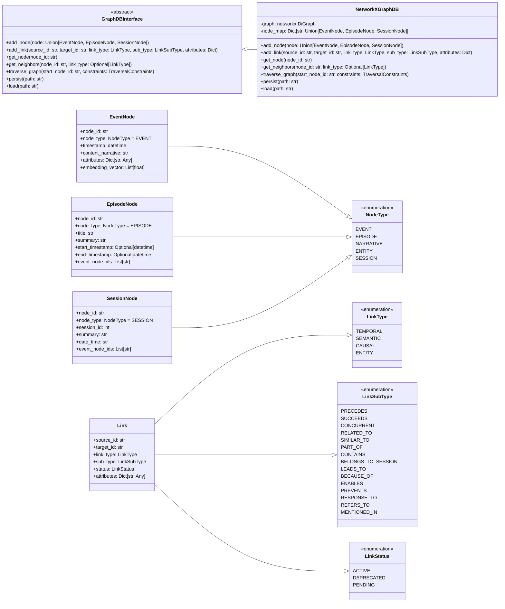
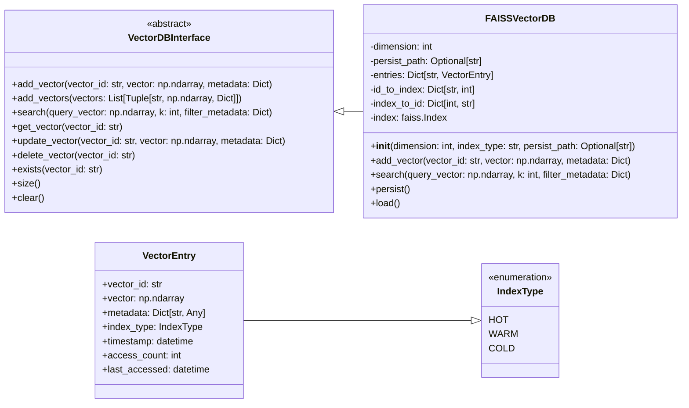
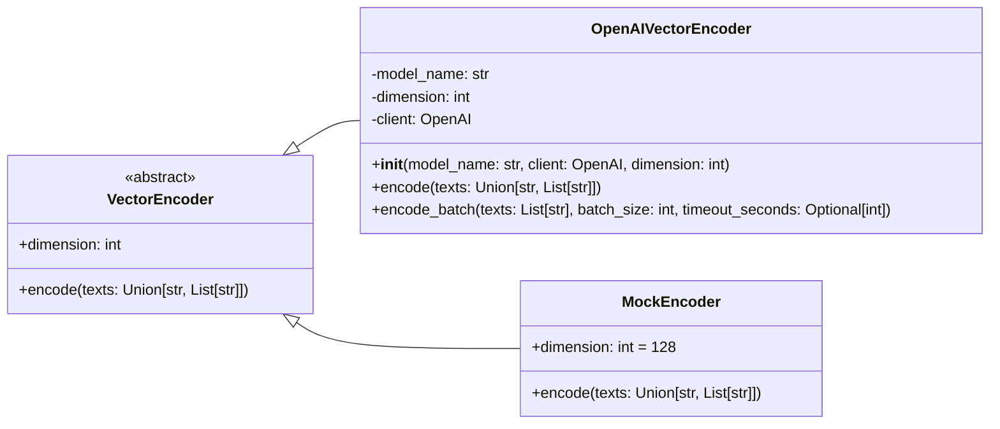

<!-- source: DeepWiki mcp.deepwiki.com · repo libingzheren/Jev-Mem · page 3.2 Storage Layer · fetched 2026-10-13 -->

# Storage Layer

<details>
<summary>Relevant source files</summary>

The following files were used as context for generating this wiki page:

- [memory/cache_compat.py](memory/cache_compat.py)
- [memory/graph_db.py](memory/graph_db.py)
- [memory/mock_encoder.py](memory/mock_encoder.py)
- [memory/openai_encoder.py](memory/openai_encoder.py)
- [memory/trg_memory.py](memory/trg_memory.py)
- [memory/vector_db.py](memory/vector_db.py)

</details>


The Storage Layer in Jev-Mem is responsible for the persistent and efficient management of all memory components. This includes the Temporal Resonance Graph (TRG) memory, the graph database (`graph_db`), the vector database (`vector_db`), various encoders for generating embeddings, and mechanisms for cache compatibility and persistence. Its primary purpose is to provide a robust foundation for storing, retrieving, and evolving the agent's memory.

## Temporal Resonance Graph (TRG) Memory

The `TemporalResonanceGraphMemory` class [memory/trg_memory.py:67-67]() serves as the central orchestrator for the memory subsystem. It integrates the graph database, vector database, and encoding mechanisms to form a cohesive memory structure. The TRG is designed to store events, episodes, and other memory constructs as nodes, connected by various types of links, enabling complex relational and temporal queries.

### Core Components

The `TemporalResonanceGraphMemory` [memory/trg_memory.py:67-67]() initializes and manages the following key components:

*   **Graph Database (`graph_db`)**: An instance of `GraphDBInterface` [memory/graph_db.py:690-690](), typically `NetworkXGraphDB` [memory/graph_db.py:692-692]() by default, which handles the storage and retrieval of nodes and links.
*   **Vector Database (`vector_db`)**: An instance of `VectorDBInterface` [memory/vector_db.py:82-82](), which stores vector embeddings of memory content for similarity search.
*   **Encoder (`encoder`)**: An instance of `VectorEncoder` [memory/trg_memory.py:101-104]() (or `OpenAIVectorEncoder` [memory/openai_encoder.py:8-8]()), responsible for converting textual content into numerical vector embeddings.
*   **Keyword Enricher (`keyword_enricher`)**: Used to enrich event content with keywords before encoding, improving retrieval accuracy [memory/trg_memory.py:96-96]().
*   **LLM Controller (`llm_controller`)**: Optionally integrates with an LLM for advanced event extraction and other language-based tasks [memory/trg_memory.py:112-128]().

### Data Flow for Adding an Event

When a new event is added via `add_event` [memory/trg_memory.py:152-152](), the following steps occur:

1.  **Event Extraction**: The raw interaction content is processed to extract narrative, entities, keywords, emotion, and timestamp using the `_extract_event` method [memory/trg_memory.py:167-167](). This step may involve an LLM if configured.
2.  **Node Creation**: An `EventNode` [memory/graph_db.py:66-74]() is created with a unique ID, timestamp, content, and extracted attributes [memory/trg_memory.py:170-181]().
3.  **Content Enrichment**: The event's narrative is enriched with keywords and other metadata by the `KeywordEnricher` [memory/trg_memory.py:185-193]().
4.  **Embedding Generation**: The enriched content is encoded into a vector embedding using the configured `encoder` [memory/trg_memory.py:196-199]().
5.  **Storage**:
    *   The `EventNode` is added to the `graph_db` [memory/trg_memory.py:202-202]().
    *   The generated embedding is added to the `vector_db`, linked to the `EventNode`'s ID [memory/trg_memory.py:203-203]().
6.  **Link Creation**: The new event is linked to previous events, sessions, or other relevant nodes based on temporal, semantic, or causal relationships [memory/trg_memory.py:206-210]().

```mermaid
graph TD
    A[Raw Interaction Content] --> B{_extract_event}
    B --> C{Create EventNode}
    C --> D{Enrich Content (KeywordEnricher)}
    D --> E{Generate Embedding (Encoder)}
    E --> F[Add EventNode to GraphDB]
    E --> G[Add Embedding to VectorDB]
    F --> H[Create Links (Temporal, Semantic, Causal)]
    G --> H
    H --> I[TRG Memory]

    style A fill:#f9f,stroke:#333,stroke-width:2px
    style I fill:#bbf,stroke:#333,stroke-width:2px
```
**Diagram: Event Addition Data Flow**

Sources:
* [memory/trg_memory.py:67-67]()
* [memory/trg_memory.py:152-152]()
* [memory/trg_memory.py:167-167]()
* [memory/trg_memory.py:170-181]()
* [memory/trg_memory.py:185-193]()
* [memory/trg_memory.py:196-199]()
* [memory/trg_memory.py:202-202]()
* [memory/trg_memory.py:203-203]()
* [memory/trg_memory.py:206-210]()
* [memory/graph_db.py:66-74]()
* [memory/graph_db.py:690-690]()
* [memory/graph_db.py:692-692]()
* [memory/vector_db.py:82-82]()
* [memory/openai_encoder.py:8-8]()

## Graph Database (`graph_db`)

The `graph_db` module [memory/graph_db.py:1-707]() provides an abstraction for graph database operations. It supports an in-memory `NetworkX` implementation and is designed to be swappable with other graph databases like Neo4j.

### Node Types

The graph database defines several `NodeType`s [memory/graph_db.py:19-26]() to categorize information:

*   `EVENT`: Represents individual interactions or observations [memory/graph_db.py:21-21](). Stored as `EventNode` [memory/graph_db.py:66-74]().
*   `EPISODE`: Semantic grouping of related events [memory/graph_db.py:22-22](). Stored as `EpisodeNode` [memory/graph_db.py:101-115]().
*   `NARRATIVE`: (Not explicitly shown in provided code, but implied by `content_narrative` in `EventNode` [memory/graph_db.py:72-72]()).
*   `ENTITY`: Represents named entities extracted from events [memory/graph_db.py:24-24]().
*   `SESSION`: Session-level summary grouping [memory/graph_db.py:25-25](). Stored as `SessionNode` [memory/graph_db.py:168-179]().

### Link Types

Relationships between nodes are defined by `LinkType`s [memory/graph_db.py:28-33]() and `LinkSubType`s [memory/graph_db.py:35-58]():

*   `TEMPORAL`: `PRECEDES`, `SUCCEEDS`, `CONCURRENT` [memory/graph_db.py:37-39]().
*   `SEMANTIC`: `RELATED_TO`, `SIMILAR_TO`, `PART_OF`, `CONTAINS`, `BELONGS_TO_SESSION` [memory/graph_db.py:42-46]().
*   `CAUSAL`: `LEADS_TO`, `BECAUSE_OF`, `ENABLES`, `PREVENTS`, `RESPONSE_TO` [memory/graph_db.py:49-53]().
*   `ENTITY`: `REFERS_TO`, `MENTIONED_IN` [memory/graph_db.py:56-57]().

### `NetworkXGraphDB` Implementation

The `NetworkXGraphDB` class [memory/graph_db.py:692-692]() implements the `GraphDBInterface` [memory/graph_db.py:690-690]() using the `networkx` library. It stores nodes and edges in memory.


**Diagram: Graph Database Class Diagram**

Sources:
* [memory/graph_db.py:1-707]()
* [memory/graph_db.py:19-26]()
* [memory/graph_db.py:21-21]()
* [memory/graph_db.py:22-22]()
* [memory/graph_db.py:24-24]()
* [memory/graph_db.py:25-25]()
* [memory/graph_db.py:28-33]()
* [memory/graph_db.py:35-58]()
* [memory/graph_db.py:37-39]()
* [memory/graph_db.py:42-46]()
* [memory/graph_db.py:49-53]()
* [memory/graph_db.py:56-57]()
* [memory/graph_db.py:66-74]()
* [memory/graph_db.py:72-72]()
* [memory/graph_db.py:101-115]()
* [memory/graph_db.py:168-179]()
* [memory/graph_db.py:690-690]()
* [memory/graph_db.py:692-692]()

## Vector Database (`vector_db`)

The `vector_db` module [memory/vector_db.py:1-624]() provides an interface for storing and searching vector embeddings. It supports both in-memory and persistent storage, with FAISS as the primary backend for efficient similarity search.

### `VectorDBInterface`

The `VectorDBInterface` [memory/vector_db.py:82-82]() defines abstract methods for common vector database operations:

*   `add_vector`: Adds a single vector [memory/vector_db.py:87-89]().
*   `add_vectors`: Adds a batch of vectors [memory/vector_db.py:91-93]().
*   `search`: Performs similarity search for a query vector [memory/vector_db.py:96-99]().
*   `get_vector`: Retrieves a vector by its ID [memory/vector_db.py:102-104]().
*   `update_vector`: Updates an existing vector [memory/vector_db.py:107-110]().
*   `delete_vector`: Deletes a vector [memory/vector_db.py:113-115]().
*   `exists`: Checks if a vector exists [memory/vector_db.py:118-120]().
*   `size`: Returns the number of vectors [memory/vector_db.py:123-125]().
*   `clear`: Clears all vectors [memory/vector_db.py:128-130]().

### `FAISSVectorDB` Implementation

The `FAISSVectorDB` class [memory/vector_db.py:133-133]() implements the `VectorDBInterface` using the FAISS library. It supports different FAISS index types (flat, IVF, HNSW) and can persist the index to disk [memory/vector_db.py:156-167](). If FAISS is not available, a NumPy-based fallback is used [memory/vector_db.py:20-28]().

Each vector is stored as a `VectorEntry` [memory/vector_db.py:42-52](), which includes the vector itself, its ID, metadata, and access statistics for potential caching strategies.


**Diagram: Vector Database Class Diagram**

Sources:
* [memory/vector_db.py:1-624]()
* [memory/vector_db.py:20-28]()
* [memory/vector_db.py:42-52]()
* [memory/vector_db.py:82-82]()
* [memory/vector_db.py:87-89]()
* [memory/vector_db.py:91-93]()
* [memory/vector_db.py:96-99]()
* [memory/vector_db.py:102-104]()
* [memory/vector_db.py:107-110]()
* [memory/vector_db.py:113-115]()
* [memory/vector_db.py:118-120]()
* [memory/vector_db.py:123-125]()
* [memory/vector_db.py:128-130]()
* [memory/vector_db.py:133-133]()
* [memory/vector_db.py:156-167]()

## Encoders

Encoders are crucial for converting raw text into numerical vector representations (embeddings) that can be stored and queried in the `vector_db`. Jev-Mem supports different encoder implementations.

### `VectorEncoder` (General Purpose)

The `VectorEncoder` class [memory/trg_memory.py:101-104]() in `trg_memory.py` acts as a wrapper, allowing selection between different embedding models. It can use `SentenceTransformer` for local models (e.g., `all-MiniLM-L6-v2`) or delegate to an OpenAI-compatible client.

### `OpenAIVectorEncoder`

The `OpenAIVectorEncoder` class [memory/openai_encoder.py:8-8]() specifically handles embeddings using OpenAI's API (or compatible services like Azure OpenAI).

*   It initializes with a `model_name` (defaulting to `text-embedding-3-small`) and a `dimension` [memory/openai_encoder.py:9-11]().
*   The `encode` method [memory/openai_encoder.py:16-17]() (which calls `encode_batch` [memory/openai_encoder.py:19-19]()) sends text inputs to the OpenAI API and retrieves the corresponding embeddings [memory/openai_encoder.py:30-31]().
*   It handles batching of texts for efficiency [memory/openai_encoder.py:28-29]() and ensures the output dimensions and data integrity [memory/openai_encoder.py:36-37]().

### `MockEncoder`

For testing and demonstration purposes, a `MockEncoder` [memory/mock_encoder.py:7-7]() is available. This encoder generates deterministic, lexical embeddings based on word hashes, ensuring consistent results without external API calls or complex model loading. It has a fixed `dimension` of 128 [memory/mock_encoder.py:8-8]().


**Diagram: Encoder Class Diagram**

Sources:
* [memory/trg_memory.py:101-104]()
* [memory/openai_encoder.py:8-8]()
* [memory/openai_encoder.py:9-11]()
* [memory/openai_encoder.py:16-17]()
* [memory/openai_encoder.py:19-19]()
* [memory/openai_encoder.py:28-29]()
* [memory/openai_encoder.py:30-31]()
* [memory/openai_encoder.py:36-37]()
* [memory/mock_encoder.py:7-7]()
* [memory/mock_encoder.py:8-8]()

## Cache Compatibility and Persistence

Jev-Mem includes mechanisms to ensure compatibility with older cache formats and to persist the memory state to disk.

### Cache Compatibility (`cache_compat.py`)

The `cache_compat.py` module [memory/cache_compat.py:1-26]() handles backward compatibility for cached data, particularly for metadata and configuration files.

*   `memory_config_path(directory)` [memory/cache_compat.py:8-12](): This function helps locate the correct configuration file, preferring the current `jev_mem_config.json` over the legacy `sys1mem_config.json`.
*   `normalize_metadata(metadata)` [memory/cache_compat.py:15-26](): This function migrates historical controller keys within metadata. It renames `sys1mem` keys to `jev_mem` and updates `source` and `controller` fields to reflect the current naming conventions. This ensures that older cached data can be read and integrated without loss of information.

### Persistence

Both the `NetworkXGraphDB` [memory/graph_db.py:692-692]() and `FAISSVectorDB` [memory/vector_db.py:133-133]() implementations support persistence:

*   **GraphDB Persistence**: The `NetworkXGraphDB` can `persist` its graph structure and node data to a specified path, and `load` it back [memory/graph_db.py:700-701](). This typically involves serializing the graph and its associated node objects (e.g., `EventNode`, `EpisodeNode`) to JSON or pickle files.
*   **VectorDB Persistence**: The `FAISSVectorDB` can `persist` its FAISS index and associated `VectorEntry` metadata to disk, and `load` them back [memory/vector_db.py:200-201](). This allows the vector index to be rebuilt quickly without re-embedding all content. The `persist_path` is configured during initialization [memory/vector_db.py:146-147]().

The `TemporalResonanceGraphMemory` [memory/trg_memory.py:67-67]() itself manages the persistence of its underlying `graph_db` and `vector_db` components through its `persist_dir` configuration [memory/trg_memory.py:130-130]().

Sources:
* [memory/cache_compat.py:1-26]()
* [memory/cache_compat.py:8-12]()
* [memory/cache_compat.py:15-26]()
* [memory/graph_db.py:692-692]()
* [memory/graph_db.py:700-701]()
* [memory/vector_db.py:133-133]()
* [memory/vector_db.py:146-147]()
* [memory/vector_db.py:200-201]()
* [memory/trg_memory.py:67-67]()
* [memory/trg_memory.py:130-130]()

---

