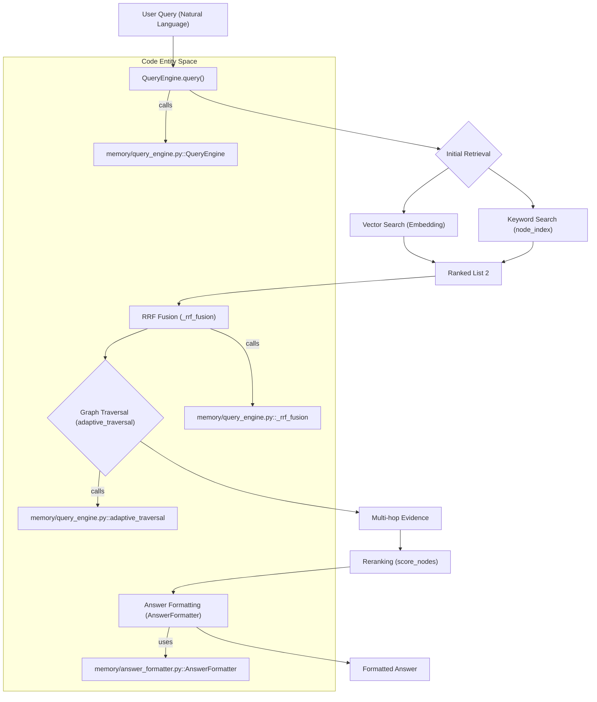
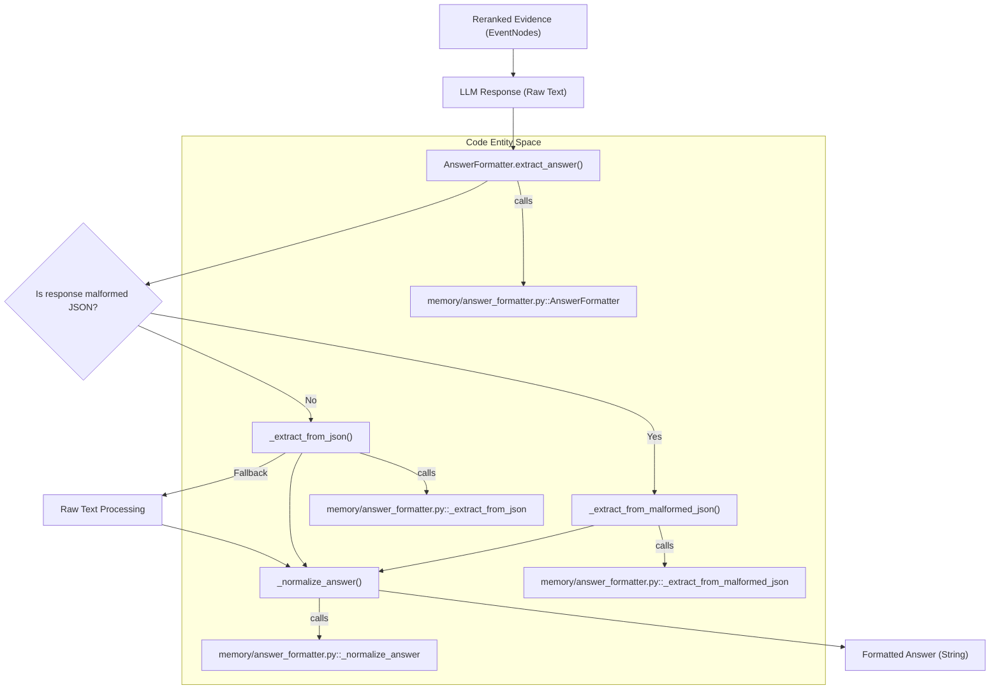

<!-- source: DeepWiki mcp.deepwiki.com · repo libingzheren/Jev-Mem · page 3.3 Retrieval and Query Engine · fetched 2026-10-13 -->

# Retrieval and Query Engine

Relevant source files

The following files were used as context for generating this wiki page:

- [memory/answer_formatter.py](memory/answer_formatter.py)
- [memory/query_engine.py](memory/query_engine.py)

This page provides a high-level overview of the read path in Jev-Mem, focusing on how information is retrieved and processed to answer queries. The process involves several stages: hybrid search, fusion of results, graph traversal, reranking, and finally, formatting the answer. Each stage contributes to efficiently and accurately extracting relevant information from the memory graph.

For detailed technical explanations of the query engine's internal mechanisms, including query typing, RRF fusion, adaptive traversal, multi-hop evidence, and reranking scoring, refer to [Query Engine Internals](#3.3.1). The specifics of how answers are shaped and candidate selections are made are covered in [Answer Formatting and Best-of-N](#3.3.2).

## High-Level Retrieval Process

The `QueryEngine` class in `memory/query_engine.py` orchestrates the entire retrieval process. It leverages various search mechanisms, including vector search, keyword search, and graph traversal, to identify relevant `EventNode` instances within the `TRGMemory`. The core idea is to combine the strengths of different retrieval methods to achieve comprehensive and accurate results.

The overall flow can be summarized as:
1.  **Initial Retrieval**: Perform vector and keyword searches to get an initial set of candidate `EventNode`s.
2.  **Fusion**: Combine results from different retrieval methods using Reciprocal Rank Fusion (RRF).
3.  **Graph Traversal**: Expand the initial set of nodes by traversing the memory graph, following various link types (e.g., temporal, causal, entity relations). This step is adaptive and can be multi-hop.
4.  **Reranking**: Score the retrieved nodes based on their relevance to the query and other contextual factors.
5.  **Answer Formatting**: Structure the final answer based on the reranked evidence.

### Retrieval and Query Engine Overview

Sources: `memory/query_engine.py:23-28`(), `memory/query_engine.py:59-119`(), `memory/answer_formatter.py:16-21`()

## Hybrid Search and Fusion

The `QueryEngine` initiates retrieval by performing both vector-based similarity search and keyword-based search. Vector search leverages embeddings to find semantically similar `EventNode`s, while keyword search uses a `node_index` for exact or partial keyword matches.

The results from these disparate search methods are then combined using Reciprocal Rank Fusion (RRF). RRF is a robust method for fusing ranked lists, as it handles different scoring scales and missing items across lists. The `_rrf_fusion` method [memory/query_engine.py:59-119]() implements this, assigning a combined score to each unique `EventNode` based on its rank in each individual list. This produces a unified set of candidate nodes for further processing.

For details on the implementation of RRF and its parameters, see [Query Engine Internals](#3.3.1).

Sources: `memory/query_engine.py:59-119`()

## Graph Traversal

Following the initial hybrid search and fusion, the system performs graph traversal to expand the set of relevant `EventNode`s. This is crucial for capturing multi-hop relationships and contextual information that might not be directly retrieved by initial searches. The `QueryEngine` uses an adaptive traversal strategy, which can adjust its behavior based on the query type and available evidence.

The traversal can follow various `LinkType`s, such as `CAUSAL`, `TEMPORAL`, `ENTITY_RELATION`, and others defined in `memory/trg_memory.py`. This allows the engine to explore the memory graph for related events, entities, and temporal sequences. The traversal can be multi-hop, meaning it can explore connections beyond immediate neighbors to find more distant but relevant information.

For a deeper dive into the adaptive traversal algorithm, including how it handles different query types and multi-hop evidence, refer to [Query Engine Internals](#3.3.1).

Sources: `memory/query_engine.py:4-8`(), `memory/trg_memory.py`()

## Reranking

After graph traversal, a potentially large set of `EventNode`s has been gathered. These nodes are then subjected to a reranking process to prioritize the most relevant ones. Reranking involves scoring each node based on various factors, including its initial RRF score, its proximity to the query in the graph, and its semantic relevance. This step ensures that the final set of evidence presented for answer generation is highly pertinent to the user's query.

The `QueryEngine`'s `score_nodes` method (not shown in provided snippet, but implied by the overall flow) is responsible for this critical step. It considers factors like query-node similarity, graph distance, and potentially other heuristics to produce a final ranked list of evidence.

For a detailed explanation of the reranking algorithms and scoring mechanisms, see [Query Engine Internals](#3.3.1).

Sources: `memory/query_engine.py:4-8`()

## Answer Formatting

The final stage of the retrieval process is to format the answer based on the reranked evidence. The `AnswerFormatter` class [memory/answer_formatter.py:16-21]() is responsible for taking the raw output from the retrieval and potentially an LLM, and transforming it into a consistent and user-friendly format. This includes extracting answers from LLM responses, handling malformed JSON, normalizing text, and applying identity mappings.

The `AnswerFormatter` can handle various types of questions (e.g., yes/no, counting, factual) and attempts to extract the most salient information. It also includes logic to identify and remove common prefixes and normalize specific terms for consistency.

For a comprehensive understanding of the `AnswerFormatter`'s capabilities, including its methods for extracting and normalizing answers, refer to [Answer Formatting and Best-of-N](#3.3.2).

### Answer Formatting Process

Sources: `memory/answer_formatter.py:16-21`(), `memory/answer_formatter.py:53-83`(), `memory/answer_formatter.py:84-171`()

---

