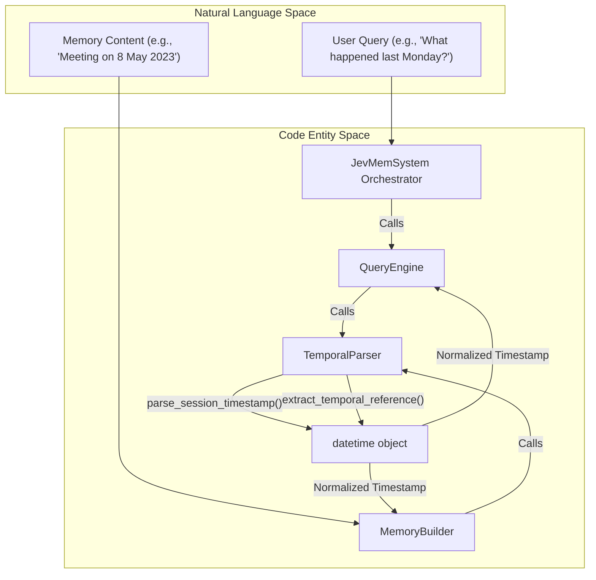

<!-- source: DeepWiki mcp.deepwiki.com · repo libingzheren/Jev-Mem · page 3.4 Temporal Handling · fetched 2026-10-13 -->

# Temporal Handling

<details>
<summary>Relevant source files</summary>

The following files were used as context for generating this wiki page:

- [memory/temporal_parser.py](memory/temporal_parser.py)

</details>


This page details the `TemporalParser` module, which is responsible for robust date and time extraction and normalization within Jev-Mem. It covers parsing of relative dates (e.g., "yesterday", "last week"), absolute dates, and their conversion into standardized `datetime` objects. The module also supports temporal constraints and is designed to integrate with MAGMA temporal rules, although the specific MAGMA integration details are not provided in the current code.

## TemporalParser Class

The `TemporalParser` class [memory/temporal_parser.py:16-427]() is the core component for handling temporal information. It provides methods to parse various date formats, both absolute and relative to a given `base_timestamp`.

### Initialization

Upon initialization, the `TemporalParser` [memory/temporal_parser.py:21-43]() sets up dictionaries for common relative date patterns and weekday names.
- `relative_patterns`: A dictionary mapping common phrases like "yesterday" or "next week" to lambda functions that calculate the corresponding `datetime` object relative to a `base_timestamp`. [memory/temporal_parser.py:24-37]()
- `weekday_names`: A dictionary mapping weekday names (e.g., "monday") to their integer representation (0-6). [memory/temporal_parser.py:39-43]()

### Session Timestamp Parsing

The `parse_session_timestamp` method [memory/temporal_parser.py:45-88]() is used to parse session-specific timestamps, often encountered in datasets like LoCoMo. It attempts to parse a given `date_str` using a predefined set of formats. If parsing fails, it defaults to `datetime.now()`. A special case is handled for the "1:56 pm on 8 May, 2023" format, which is specific to the LoCoMo dataset. [memory/temporal_parser.py:59-65]()

### Temporal Reference Extraction

The `extract_temporal_reference` method [memory/temporal_parser.py:90-118]() is the primary entry point for extracting temporal information from arbitrary text. It takes a `text` string and a `base_timestamp` as input. It prioritizes parsing in the following order:
1.  **Relative Date Patterns**: Checks for phrases defined in `self.relative_patterns` (e.g., "yesterday", "last week"). [memory/temporal_parser.py:103-106]()
2.  **Weekday References**: Calls `_extract_weekday_reference` to handle patterns like "last Monday" or "next Sunday". [memory/temporal_parser.py:108-111]()
3.  **Absolute Date Patterns**: Calls `_extract_absolute_date` to identify and parse explicit date strings (e.g., "8 May 2023"). [memory/temporal_parser.py:113-116]()

If no temporal reference is found, it returns `None`.

#### Weekday Reference Extraction

The `_extract_weekday_reference` method [memory/temporal_parser.py:120-158]() handles relative weekday references. It supports patterns like "last [weekday]", "previous [weekday]", "[weekday] before", "[weekday] prior", and "next [weekday]". It calculates the target date by determining the number of days back or forward from the `base_timestamp`'s weekday. [memory/temporal_parser.py:131-147](), [memory/temporal_parser.py:150-156]()

#### Absolute Date Extraction

The `_extract_absolute_date` method [memory/temporal_parser.py:160-191]() attempts to extract absolute dates from the text using regular expressions and `datetime.strptime`. It supports several common formats, including "DD Month YYYY", "Month DD, YYYY", and "Month YYYY". [memory/temporal_parser.py:170-191]()

### Data Flow for Temporal Parsing

The following diagram illustrates the data flow within the `TemporalParser` when extracting a temporal reference from text.

```mermaid
graph TD
    A[Input Text & Base Timestamp] --> B{extract_temporal_reference(text, base_timestamp)}
    B --> C{Check relative_patterns}
    C -- Match Found --> D[Apply relative_pattern transform]
    D --> E[Return datetime object]
    C -- No Match --> F{_extract_weekday_reference(text, base_timestamp)}
    F -- Match Found --> E
    F -- No Match --> G{_extract_absolute_date(text)}
    G -- Match Found --> E
    G -- No Match --> H[Return None]
```
Title: "Temporal Reference Extraction Data Flow"
Sources: [memory/temporal_parser.py:90-118]()

### Integration with Jev-Mem

The `TemporalParser` is a utility class that can be instantiated and used by other components of Jev-Mem that require temporal understanding. For instance, the `MemoryBuilder` [memory/memory_builder.py]() might use it during the admission or consolidation phases to normalize timestamps associated with memories or events. The `QueryEngine` [memory/retrieval/query_engine.py]() could use it to interpret temporal constraints in user queries.


Title: "Temporal Handling Integration with Jev-Mem Components"
Sources: [memory/temporal_parser.py:16-427]()

Sources:
[memory/temporal_parser.py:16-427]()
[memory/temporal_parser.py:21-43]()
[memory/temporal_parser.py:24-37]()
[memory/temporal_parser.py:39-43]()
[memory/temporal_parser.py:45-88]()
[memory/temporal_parser.py:59-65]()
[memory/temporal_parser.py:90-118]()
[memory/temporal_parser.py:103-106]()
[memory/temporal_parser.py:108-111]()
[memory/temporal_parser.py:113-116]()
[memory/temporal_parser.py:120-158]()
[memory/temporal_parser.py:131-147]()
[memory/temporal_parser.py:150-156]()
[memory/temporal_parser.py:160-191]()

---

