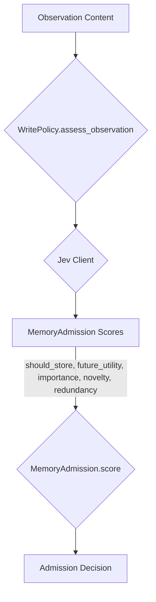
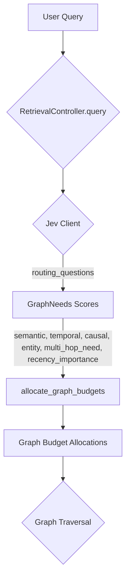

<!-- source: DeepWiki mcp.deepwiki.com · repo libingzheren/Jev-Mem · page 4.1 Write and Read Policies · fetched 2026-10-13 -->

# Write and Read Policies

Relevant source files

The following files were used as context for generating this wiki page:

- [memory/jev_mem_policies.py](memory/jev_mem_policies.py)
- [memory/jev_mem_retrieval.py](memory/jev_mem_retrieval.py)

This page details the write and read policies implemented in Jev-Mem, specifically focusing on the `jev_mem_policies.py` and `jev_mem_retrieval.py` modules. These policies govern critical aspects of memory management, including admission control for new observations, typing of memories, judgment of relationships between memories, allocation of computational budgets during retrieval, and assessment of evidence sufficiency. These mechanisms are crucial for the System-One controller (Jev) to efficiently manage and retrieve information from the memory system.

## Write Policies (`memory/jev_mem_policies.py`)

The `jev_mem_policies.py` module defines the policies and data structures used during the memory construction (write) path. It includes mechanisms for deciding whether to store an observation, classifying its type, and identifying relationships with existing memories.

### Memory Admission

The `MemoryAdmission` dataclass [memory/jev_mem_policies.py:11-18]() encapsulates the scores that determine whether an observation should be stored in memory. These scores are:
*   `should_store`: A direct indication of whether the observation is worth storing.
*   `future_utility`: The predicted usefulness of the observation in the future.
*   `importance`: The intrinsic significance of the observation.
*   `novelty`: How new or unique the observation is compared to existing memories.
*   `redundancy`: The degree to which the observation duplicates existing information.

The `score` method [memory/jev_mem_policies.py:19-22]() combines these factors using a weighted formula to produce a final admission score.

**Figure 1: Memory Admission Flow**
Sources: [memory/jev_mem_policies.py:11-22](), [memory/jev_mem_policies.py:108-124]()

The `WritePolicy.assess_observation` method [memory/jev_mem_policies.py:108-124]() is responsible for evaluating an observation for admission. It uses the Jev client to query the System-One controller with `observation_questions` [memory/jev_mem_policies.py:111](). The result includes both `MemoryAdmission` and `MemoryTypeScores`.

### Memory Typing

The `MemoryTypeScores` dataclass [memory/jev_mem_policies.py:25-31]() represents the classification of an observation into different memory types:
*   `episodic`: Memories related to specific events or experiences.
*   `semantic`: Memories of facts, concepts, and general knowledge.
*   `procedural`: Memories of skills and how to perform tasks.
*   `preference`: Memories related to likes, dislikes, and personal preferences.

The `WritePolicy.memory_type` method [memory/jev_mem_policies.py:100-106]() classifies an observation using `memory_type_questions` [memory/jev_mem_policies.py:102]() via the Jev client.

### Relation Judgment

The `WritePolicy.relations` method [memory/jev_mem_policies.py:125-149]() identifies potential relationships between a new `node` (observation) and a set of `candidates` (existing memories). It constructs `relation_questions` [memory/jev_mem_policies.py:128]() for each candidate pair and uses the Jev client to evaluate these questions. The results are used to create `Link` objects [memory/jev_mem_policies.py:147]() representing relationships like `SEMANTIC`, `TEMPORAL`, `CAUSAL`, and `ENTITY` [memory/jev_mem_policies.py:149](). A `relation_threshold` from the configuration [memory/jev_mem_policies.py:146]() determines if a relationship is strong enough to be established.

The `find_candidates` function [memory/jev_mem_policies.py:69-93]() helps in bounding the candidate set for relation judgment by leveraging existing vector, keyword, entity, and time signals. It searches the vector database and considers shared entities, keywords, and temporal proximity to rank potential candidates.

Sources: [memory/jev_mem_policies.py:11-31](), [memory/jev_mem_policies.py:69-93](), [memory/jev_mem_policies.py:96-149]()

## Read Policies (`memory/jev_mem_retrieval.py`)

The `jev_mem_retrieval.py` module implements the policies and control flow for retrieving information from memory. The `RetrievalController` class [memory/jev_mem_retrieval.py:17-19]() orchestrates the retrieval process, including query routing, budget allocation, and evidence assessment.

### Query Routing and Graph Needs

When a query is received, the `RetrievalController.query` method [memory/jev_mem_retrieval.py:21-128]() first determines the `GraphNeeds` [memory/jev_mem_retrieval.py:35]() of the query. This is done by evaluating `routing_questions` [memory/jev_mem_retrieval.py:27]() using the Jev client. The `GraphNeeds` dataclass [memory/jev_mem_policies.py:33-41]() quantifies the query's requirements across different graph dimensions:
*   `semantic`: Need for semantic similarity.
*   `temporal`: Need for temporal information.
*   `causal`: Need for causal relationships.
*   `entity`: Need for entity-based connections.
*   `multi_hop_need`: The extent to which multi-hop traversal is required.
*   `recency_importance`: How important recent memories are.

Based on these needs, `allocate_graph_budgets` [memory/jev_mem_retrieval.py:13]() (defined in `jev_mem_policies.py`) determines the budget for exploring different types of links in the graph. Ablation flags [memory/jev_mem_retrieval.py:38-44]() can override these allocations, for example, to disable causal or temporal links.

**Figure 2: Query Routing and Budget Allocation**
Sources: [memory/jev_mem_retrieval.py:21-45](), [memory/jev_mem_policies.py:33-41]()

### Budget Allocation

The `CallBudget` class [memory/jev_mem_retrieval.py:11]() manages the computational budget for Jev calls and overall latency. The `allocate_graph_budgets` function (from `jev_mem_policies.py`) takes the `GraphNeeds` and configuration to determine how many edges of each type (semantic, temporal, causal, entity) can be explored during retrieval. This ensures that retrieval efforts are focused on the most relevant aspects of the graph for a given query.

### Evidence Assessment and Stopping Conditions

During graph traversal, the `RetrievalController` continuously assesses the sufficiency of the gathered evidence. This is done by evaluating `stopping_questions` [memory/jev_mem_retrieval.py:83]() using the Jev client. The decision includes scores for:
*   `evidence_sufficient`: Whether the current evidence is enough to answer the query.
*   `continue_useful`: Whether further retrieval is likely to be helpful.
*   `missing_evidence`: The degree to which crucial evidence is still missing.
*   `contradiction`: Whether there are contradictions in the gathered evidence.

The retrieval process stops if any of the following conditions are met [memory/jev_mem_retrieval.py:77-109]():
*   Evidence is deemed sufficient (`evidence_sufficient_threshold`).
*   Further retrieval is deemed unhelpful (`continue_useful` below `continue_threshold`).
*   Maximum Jev calls are exceeded (`maximum_jev_calls`).
*   Maximum number of nodes is reached (`maximum_nodes`).
*   Maximum traversal depth is reached (`maximum_depth`).
*   Graph budget for all link types is exhausted.
*   Maximum latency is exceeded.

### Hybrid Retrieval and Traversal

The retrieval process starts by identifying anchor nodes using a hybrid approach [memory/jev_mem_retrieval.py:51-75]():
1.  **Vector Search**: The query is encoded into a vector, and the `vector_db` is searched for similar nodes.
2.  **Keyword Search**: Keywords from the query are used to find relevant nodes.
3.  **RRF Fusion**: Results from vector and keyword searches are combined using Reciprocal Rank Fusion (`_rrf_fusion`) to get an initial set of anchors.

From these anchors, a graph traversal begins. The `frontier` [memory/jev_mem_retrieval.py:75]() expands by exploring neighbors of current nodes, respecting the allocated graph budgets and stopping conditions. The `node_state` function [memory/jev_mem_policies.py:50-58]() is used to format node information for Jev client calls, optionally including temporal details.

Sources: [memory/jev_mem_retrieval.py:10-128](), [memory/jev_mem_policies.py:50-58]()

---

