<!-- source: DeepWiki mcp.deepwiki.com · repo libingzheren/Jev-Mem · page 4.2 Noul/Choice Question Protocol and Client · fetched 2026-10-13 -->

# Noul/Choice Question Protocol and Client

<details>
<summary>Relevant source files</summary>

The following files were used as context for generating this wiki page:

- [memory/jev_client.py](memory/jev_client.py)
- [memory/jev_questions.py](memory/jev_questions.py)

</details>


This page details the implementation of Jev-Mem's interaction with the System-One controller, specifically focusing on the Noul and Choice question protocols defined in `jev_questions.py` and the client responsible for communicating with the System-One API, `jev_client.py`. It covers the structured decision-making process and the transport layer for these decisions.

## Jev Questions: Typed Decision Structures

The `memory/jev_questions.py` file defines a set of structured questions using the `typesafe_sdk.Choice` and `typesafe_sdk.Noul` primitives. These questions are designed to elicit specific judgments from the System-One controller, guiding various memory operations such as admission control, memory typing, relation establishment, and consolidation. Each question is carefully crafted with `instructions` and `criteria` (for Noul) or `options` (for Choice) to ensure clear and unambiguous responses.

### Noul Questions

Noul questions are used for binary or probabilistic judgments. They define a proposition and ask the System-One controller to provide a probability for its truth. In Jev-Mem, Noul questions are primarily used for assessing various properties of observations and memories. The `noul` helper function [memory/jev_questions.py:10-11]() simplifies the creation of these questions.

**Admission Questions**
These questions determine whether an `observation` should be stored in memory. They assess the utility, importance, novelty, and redundancy of the observation.
| Question ID | Instructions | Yes Criteria | No Criteria |
|---|---|---|---|
| `should_store` | Does `observation` contain a specific detail worth retaining for future conversation recall? | A fact, experience, plan, preference, procedure or unresolved need attributable to a participant. | Only a greeting, acknowledgement, generic pleasantry, or content with no recallable detail. |
| `future_utility` | Could a future question about a participant or their activities be answered using a concrete detail in `observation`? | Identifies at least one concrete detail useful to a plausible future recall question. | No specific detail would help answer a future recall question. |
| `importance` | Does `observation` describe a participant's meaningful life event, commitment, goal, relationship, constraint, or stable preference? | At least one of these personally meaningful details is stated; ordinary personal facts can qualify. | Only conversational filler or incidental wording, without any of these details. |
| `novelty` | Does `observation` add a fact absent from `recent_memories`, given the `exact_duplicate` flag? | At least one new detail, correction or time-specific update; no exact duplicate. Novelty is relative to the supplied memories only. | An exact duplicate, or all recallable details are already in the supplied recent memories. |
| `redundancy` | Is all recallable information in `observation` already present in `recent_memories`, or is `exact_duplicate` true? | An exact duplicate or a paraphrase with no new detail or time-specific update. | Adds any new detail or meaningful update; shared topic alone does not imply redundancy. |
Sources: [memory/jev_questions.py:19-41]()

**Memory Type Questions**
These questions categorize memories into different types (episodic, semantic, procedural, preference). These scores do not influence whether a memory is stored but help in organizing and retrieving information.
| Question ID | Instructions | Yes Criteria | No Criteria |
|---|---|---|---|
| `episodic` | Does `observation` describe a particular experience or event involving a participant? | A specific past, current or planned event, even if its exact time is unstated. | Only a general fact, procedure or preference with no particular event. |
| `semantic` | Does `observation` state a fact about a person, entity or the world that remains useful beyond this conversational turn? | An attributable fact or relationship, even when it also appears in an episodic account. | Only a transient conversational acknowledgement or a question with no asserted fact. |
| `procedural` | Does `observation` describe how to carry out a task? | An instruction, ordered step, method or actionable rule for performing a task. | Merely mentions doing a task without describing how. |
| `preference` | Does `observation` express a participant's preference, aversion or habitual choice? | An attributable like, dislike, preferred option or habitual choice. | An isolated action alone, another person's unattributed preference, or no preference evidence. |
Sources: [memory/jev_questions.py:44-63]()

**Relation Questions**
These questions are used to establish relationships between a `new_memory` and existing `candidates`. They assess semantic links, causal relationships, and entity identity.
| Question ID | Instructions | Yes Criteria | No Criteria |
|---|---|---|---|
| `semantic` | Would a semantic link between these observations help retrieve a shared specific topic or fact? | A specific shared topic, fact or event makes the connection useful. | Only generic conversational vocabulary or no meaningful semantic connection. |
| `causes` | Does the event in `new_memory.content` cause, enable or explain the candidate event? | The supplied accounts support this direction of causal influence. | Only similarity, chronology, a shared entity, or insufficient causal evidence. |
| `caused_by` | Does the candidate event cause, enable or explain the event in `new_memory.content`? | The supplied accounts support this direction of causal influence. | Only similarity, chronology, a shared entity, or insufficient causal evidence. |
| `entity` (optional) | Using `new_memory.entities` and `candidates[{index}].entities`, do any names or aliases refer to the same real-world entity? | Context supports a shared identity despite differing names or aliases. | Distinct entities or insufficient evidence to resolve the alias; similar names alone are insufficient. |
Sources: [memory/jev_questions.py:66-83]()

**Consolidation Questions**
These questions guide the consolidation process, determining if memories are redundant, contradictory, obsolete, or should be linked.
| Question ID | Instructions | Yes Criteria | No Criteria |
|---|---|---|---|
| `redundant` | Do these observations repeat the same fact with no additional recallable detail? | One is a duplicate or paraphrase without a new detail or time-specific update. | They provide different details or describe distinct occurrences. |
| `contradiction` | Do these accounts assert incompatible facts about the same subject at the same time? | Claims cannot both hold at the stated time and context. | Compatible claims, uncertainty, or a change over time that explains the difference. |
| `obsolete` | Does the new memory explicitly replace the candidate's previously valid fact with an updated fact? | An explicit update supersedes the earlier fact for current-state questions. | No explicit replacement; mere recency or a separate event is insufficient. |
| `link` | Would following a link between these observations help answer a future recall question? | The connection supplies related, corroborating, correcting or contrasting evidence. | There is no specific connection useful for recall. |
Sources: [memory/jev_questions.py:86-100]()

### Choice Questions

Choice questions allow the System-One controller to select one option from a predefined set. The `consolidation_questions` function includes a `representation` Choice question [memory/jev_questions.py:101-105]() to determine how two observations should be handled during consolidation.

| Question ID | Instructions | Options |
|---|---|---|
| `representation` | Which representation best fits the relationship between these two observations? Judge from the supplied accounts; do not assume answers to other questions. | `keep_separate`: Contradictory accounts, unique details that a combined representation would lose, or distinct facts/events without a supported general pattern. <br> `merge`: Compatible accounts of the same fact or event can be combined without losing unique details. |
Sources: [memory/jev_questions.py:101-105]()

### Diagram: Jev Question Flow

```mermaid
graph TD
    subgraph "Jev-Mem Operations"
        A[New Observation] --> B{Admission Control};
        B -- "jev_questions.admission_questions()" --> C{Memory Typing};
        C -- "jev_questions.memory_type_questions()" --> D{Relation Judgment};
        D -- "jev_questions.relation_questions()" --> E{Consolidation};
        E -- "jev_questions.consolidation_questions()" --> F[Memory Storage/Update];
    end

    subgraph "System-One Controller (Jev)"
        Q1["Noul(should_store)"]
        Q2["Noul(future_utility)"]
        Q3["Noul(importance)"]
        Q4["Noul(novelty)"]
        Q5["Noul(redundancy)"]
        Q6["Noul(episodic)"]
        Q7["Noul(semantic)"]
        Q8["Noul(procedural)"]
        Q9["Noul(preference)"]
        Q10["Noul(semantic)"]
        Q11["Noul(causes)"]
        Q12["Noul(caused_by)"]
        Q13["Noul(entity)"]
        Q14["Noul(redundant)"]
        Q15["Noul(contradiction)"]
        Q16["Noul(obsolete)"]
        Q17["Noul(link)"]
        Q18["Choice(representation)"]
    end

    B --> Q1;
    B --> Q2;
    B --> Q3;
    B --> Q4;
    B --> Q5;

    C --> Q6;
    C --> Q7;
    C --> Q8;
    C --> Q9;

    D --> Q10;
    D --> Q11;
    D --> Q12;
    D --> Q13;

    E --> Q14;
    E --> Q15;
    E --> Q16;
    E --> Q17;
    E --> Q18;

    Q1 -- "Probabilities" --> B;
    Q2 -- "Probabilities" --> B;
    Q3 -- "Probabilities" --> B;
    Q4 -- "Probabilities" --> B;
    Q5 -- "Probabilities" --> B;

    Q6 -- "Probabilities" --> C;
    Q7 -- "Probabilities" --> C;
    Q8 -- "Probabilities" --> C;
    Q9 -- "Probabilities" --> C;

    Q10 -- "Probabilities" --> D;
    Q11 -- "Probabilities" --> D;
    Q12 -- "Probabilities" --> D;
    Q13 -- "Probabilities" --> D;

    Q14 -- "Probabilities" --> E;
    Q15 -- "Probabilities" --> E;
    Q16 -- "Probabilities" --> E;
    Q17 -- "Probabilities" --> E;
    Q18 -- "Choice Answer" --> E;
```


Sources: [memory/jev_questions.py:19-105]()

## Jev Client: Provider and Mock Transport

The `memory/jev_client.py` file implements `JevClient`, which acts as the primary interface for Jev-Mem to interact with the System-One controller. It handles API calls, retries, caching, and provides a mock implementation for testing and development.

### `JevClient` Class

The `JevClient` class [memory/jev_client.py:79-270]() is responsible for:
*   **Configuration**: Loads `JevMemConfig` [memory/jev_client.py:81]() for API keys, model names, base URLs, and retry policies.
*   **SDK Integration**: Uses `typesafe_sdk.TypeSafeClient` [memory/jev_client.py:95-99]() for actual API communication.
*   **Budget Management**: The `CallBudget` dataclass [memory/jev_client.py:37-51]() tracks the number of calls and remaining time, preventing API overuse.
*   **Caching**: Implements an `OrderedDict` cache [memory/jev_client.py:88]() to store previous responses, reducing redundant API calls.
*   **Decision Logging**: The `DecisionLog` class [memory/jev_client.py:63-77]() logs all decisions made by the Jev client, including cache hits and fallback events, to a specified audit path.
*   **Mocking**: Supports a mock mode (`self.config.jev_mock`) [memory/jev_client.py:153-160]() for local development and testing without requiring an active API connection.
*   **Error Handling**: Catches `TypeSafeAPIConnectionError`, `TypeSafeAPIError`, and `TypeSafeAPIResponseValidationError` [memory/jev_client.py:170-172]() and handles them according to the configured retry policy or by falling back.

### Key Methods

*   `__init__` [memory/jev_client.py:80-91()]: Initializes the client with configuration, API key, and optional transport/mock.
*   `_get_sdk` [memory/jev_client.py:93-100()]: Lazily initializes the `TypeSafeClient` instance.
*   `probabilities(self, operation, state, questions, *, mock_values=None, budget=None)` [memory/jev_client.py:114-119()]: A compatibility helper for Noul-only callers, converting string questions to `Noul` objects.
*   `evaluate(self, operation, state, questions, *, mock_values=None, budget=None)` [memory/jev_client.py:121-209()]: The core method for sending a batch of Noul/Choice questions to the System-One controller.
    *   It constructs the payload, checks the cache, manages the call budget, and handles retries.
    *   If `jev_mock` is enabled, it uses the provided `mock_values` or a mock function.
    *   Otherwise, it calls the `system_one` endpoint of the `TypeSafeClient` [memory/jev_client.py:162]().
    *   It validates the raw response and returns a `ProbabilityResult` [memory/jev_client.py:54-61]() containing the probabilities and choice answers.

### `ProbabilityResult`

The `ProbabilityResult` dataclass [memory/jev_client.py:54-61]() encapsulates the results from a Jev evaluation. It stores:
*   `values`: A dictionary of Noul probabilities (float).
*   `choices`: A dictionary of `ChoiceAnswer` objects for Choice questions.
*   `source`: Indicates whether the result came from "cache", "mock", or "jev".
*   `model`: The model used for the evaluation.
*   `usage`: API usage statistics.

### Diagram: JevClient Data Flow

```mermaid
graph TD
    subgraph "Jev-Mem Application"
        A[Memory Operation Request] --> B{JevClient.evaluate()};
    end

    subgraph "JevClient (memory/jev_client.py)"
        B --> C{Check CallBudget};
        C -- "Budget Exhausted" --> F[JevUnavailable];
        C -- "Budget Available" --> D{Check Cache};
        D -- "Cache Hit" --> E[Return Cached ProbabilityResult];
        D -- "Cache Miss" --> G{Prepare Payload};
        G --> H{Is Jev Mock Enabled?};
        H -- "Yes" --> I[Call Mock Function];
        H -- "No" --> J{Call TypeSafeClient.system_one()};
        I --> K[Raw Mock Response];
        J --> L[Raw API Response];
        K --> M{Validate Response};
        L --> M;
        M --> N[Create ProbabilityResult];
        N --> O{Log Decision};
        O --> P[Update Cache];
        P --> E;
    end

    subgraph "TypeSafe SDK"
        J -- "HTTP Request" --> Q[TypeSafe API Endpoint];
        Q -- "HTTP Response" --> L;
    end

    subgraph "Jev-Mem Configuration"
        R[JevMemConfig] --> B;
        R --> C;
        R --> H;
        R --> J;
        R --> O;
    end

    subgraph "Decision Logging"
        O --> S[DecisionLog.emit()];
        S --> T[Audit File];
    end

    style A fill:#f9f,stroke:#333,stroke-width:2px
    style B fill:#bbf,stroke:#333,stroke-width:2px
    style C fill:#bbf,stroke:#333,stroke-width:2px
    style D fill:#bbf,stroke:#333,stroke-width:2px
    style E fill:#bbf,stroke:#333,stroke-width:2px
    style F fill:#fbb,stroke:#333,stroke-width:2px
    style G fill:#bbf,stroke:#333,stroke-width:2px
    style H fill:#bbf,stroke:#333,stroke-width:2px
    style I fill:#bbf,stroke:#333,stroke-width:2px
    style J fill:#bbf,stroke:#333,stroke-width:2px
    style K fill:#ddf,stroke:#333,stroke-width:2px
    style L fill:#ddf,stroke:#333,stroke-width:2px
    style M fill:#bbf,stroke:#333,stroke-width:2px
    style N fill:#bbf,stroke:#333,stroke-width:2px
    style O fill:#bbf,stroke:#333,stroke-width:2px
    style P fill:#bbf,stroke:#333,stroke-width:2px
    style Q fill:#ccf,stroke:#333,stroke-width:2px
    style R fill:#fcf,stroke:#333,stroke-width:2px
    style S fill:#bbf,stroke:#333,stroke-width:2px
    style T fill:#ddf,stroke:#333,stroke-width:2px
```
Sources: [memory/jev_client.py:79-209]()

---

