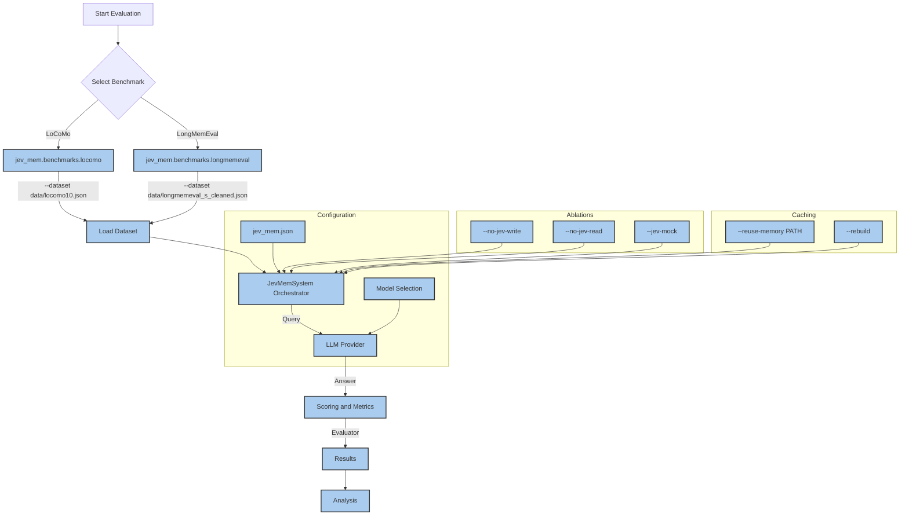
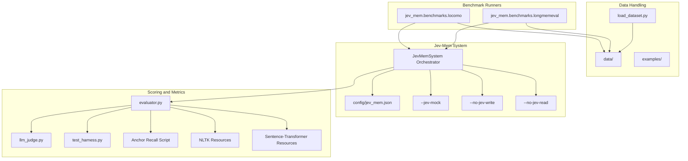

<!-- source: DeepWiki mcp.deepwiki.com · repo libingzheren/Jev-Mem · page 5 Benchmarks and Evaluation · fetched 2026-10-13 -->

# Benchmarks and Evaluation

Relevant source files

The following files were used as context for generating this wiki page:

- [docs/evaluation.md](docs/evaluation.md)
- [docs/releasing.md](docs/releasing.md)
- [jev_mem/benchmarks/__init__.py](jev_mem/benchmarks/__init__.py)

This page provides a high-level overview of the evaluation infrastructure and datasets used to benchmark the Jev-Mem system. It introduces the primary benchmarks, scoring mechanisms, and data conventions, with links to child pages for detailed technical information. Understanding these components is crucial for reproducing results, conducting new experiments, and evaluating system performance.

The Jev-Mem system's performance is primarily assessed using two benchmarks: LoCoMo and LongMemEval. Evaluation involves a sophisticated scoring system that can leverage LLM judges and various metrics. All benchmark data adheres to specific conventions for loading and usage.

## LoCoMo Benchmark
The LoCoMo (Long-Context Memory) benchmark is a key tool for evaluating Jev-Mem's ability to handle long conversational contexts and complex memory interactions. It involves running the system against predefined datasets with various categories of questions. The benchmark runner allows for configuration of dataset paths, question limits, Jev-Mem configuration, and the LLM model used for answering [docs/evaluation.md:7-10]().

For details on running the LoCoMo benchmark, its dataset structure, caching mechanisms, question categories, and specific flags, see [LoCoMo Benchmark](#5.1).

Sources:
* [docs/evaluation.md:7-10]()

## LongMemEval Benchmark
The LongMemEval benchmark focuses on evaluating the system's performance in scenarios requiring long-term memory and retrieval across extended interactions. Similar to LoCoMo, it uses specific datasets and allows for configuration of the Jev-Mem system and the LLM model [docs/evaluation.md:12-14](). A key characteristic of LongMemEval is that it constructs memory separately for each question's history [docs/evaluation.md:34-34]().

For a deeper dive into the LongMemEval runner, its dataset loader, the `longmemeval_jev.py` script, and its evaluator, see [LongMemEval Benchmark](#5.2).

Sources:
* [docs/evaluation.md:12-14]()
* [docs/evaluation.md:34-34]()

## Scoring, Judges and Metrics
Evaluating Jev-Mem's performance involves a comprehensive scoring system. This system utilizes various components, including an `evaluator.py` for overall assessment, `llm_judge.py` for leveraging large language models as judges, and `test_harness.py` for orchestrating evaluation runs. Additionally, an anchor recall script is used for specific metric calculations. Optional NLTK and sentence-transformer scoring resources can be initialized on demand for specific metrics [docs/evaluation.md:22-24]().

For detailed information on the `evaluator.py`, `llm_judge.py`, `test_harness.py`, the anchor recall script, and other metric resources, see [Scoring, Judges and Metrics](#5.3).

Sources:
* [docs/evaluation.md:22-24]()

## Datasets and Examples
The integrity and reproducibility of benchmarks rely heavily on well-defined datasets and examples. The `data/` directory follows specific conventions for organizing benchmark data. The `load_dataset.py` utility is responsible for loading these datasets. The `examples/` directory contains observations and synthetic samples that can be used for testing and understanding system behavior.

For a comprehensive understanding of the `data/` conventions, the `load_dataset.py` script, and the observations and synthetic samples found in `examples/`, see [Datasets and Examples](#5.4).

### Evaluation Workflow

**Diagram 1: High-Level Evaluation Workflow**

This diagram illustrates the general flow of an evaluation run, from selecting a benchmark to analyzing results. It highlights the interaction between the benchmark runners, the Jev-Mem system, LLM providers, and the scoring components. Configuration options and ablation flags are also shown as inputs influencing the system's behavior during evaluation.

Sources:
* [docs/evaluation.md:7-14]()
* [docs/evaluation.md:40-41]()
* [docs/evaluation.md:50-54]()

### Evaluation Components and Code Entities

**Diagram 2: Evaluation Code Entity Map**

This diagram maps the conceptual components of the evaluation framework to their corresponding code entities and files within the Jev-Mem codebase. It shows how benchmark runners interact with data, the core Jev-Mem system, and the various scoring and metric components.

Sources:
* [jev_mem/benchmarks/__init__.py:1]()
* [docs/evaluation.md:7-14]()
* [docs/evaluation.md:22-24]()
* [docs/evaluation.md:40-41]()
* [docs/evaluation.md:50-54]()

---

