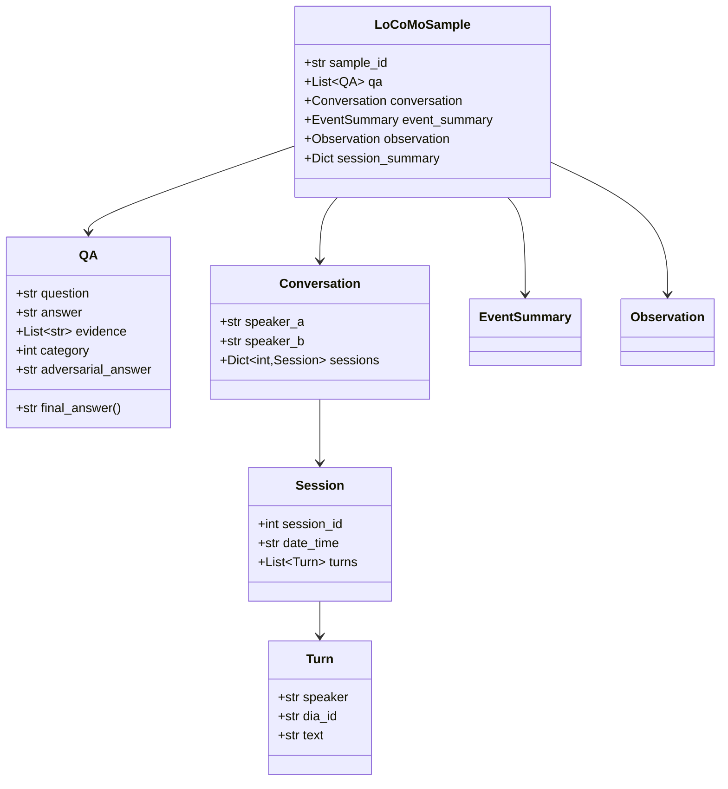
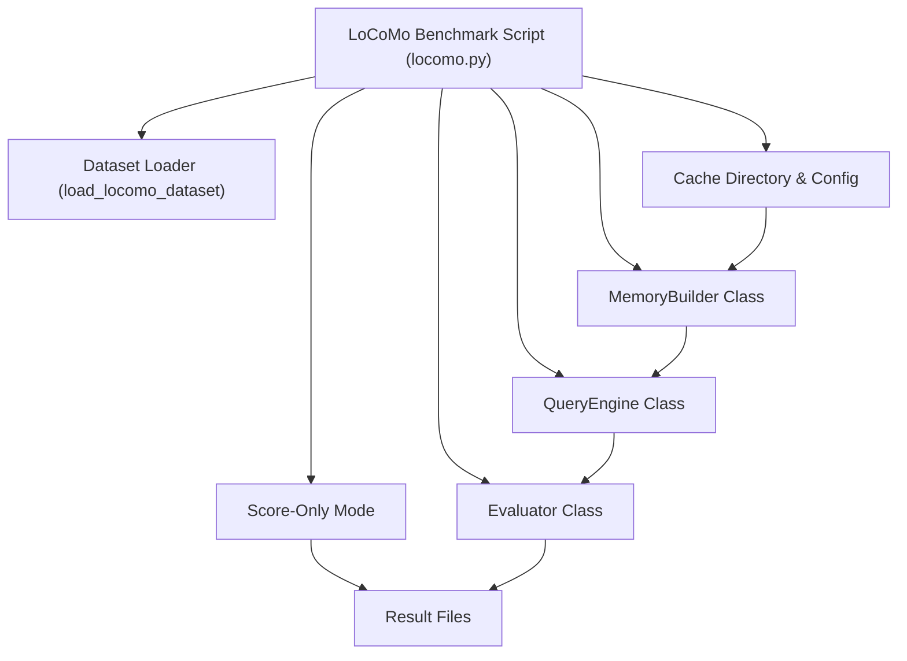
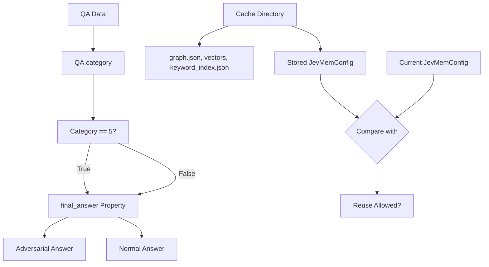

<!-- source: DeepWiki mcp.deepwiki.com · repo libingzheren/Jev-Mem · page 5.1 LoCoMo Benchmark · fetched 2026-10-13 -->

# LoCoMo Benchmark

<details>
<summary>Relevant source files</summary>

The following files were used as context for generating this wiki page:

- [examples/locomo_synthetic.json](examples/locomo_synthetic.json)
- [jev_mem/benchmarks/locomo.py](jev_mem/benchmarks/locomo.py)
- [jev_mem/datasets/locomo.py](jev_mem/datasets/locomo.py)

</details>


This section 5.1 documents the implementation and technical details of the **LoCoMo Benchmark** within the Jev-Mem codebase. The benchmark is designed to evaluate the memory and retrieval systems of Jev-Mem, particularly using the LoCoMo dataset, which features dialog sessions annotated with question-answer pairs grounded in multimodal conversation data including image evidence.

This page covers the following key components:

- The dataset representation and loader defined in `datasets/locomo.py`
- The benchmark runner logic implemented in `jev_mem/benchmarks/locomo.py`
- Related caching mechanisms, categories, and flag handling for controlling how memory is reused and scored

---

## 1. Dataset Implementation (`datasets/locomo.py`)

The LoCoMo dataset models conversations with a rich structure to support multimodal and multi-session data. The Python module `jev_mem.datasets.locomo` defines the data classes and parsing logic:

### Primary Data Classes

- **QA**: Represents an individual question-answer datum with:
  - `question`: the question text
  - `answer`: the ground-truth answer (may be None)
  - `evidence`: list of evidence IDs referencing conversation turns
  - `category`: optional integer for the question's category
  - `adversarial_answer`: alternate answer for adversarial category (category 5)

  The property `final_answer` returns either the normal answer or adversarial answer depending on category.
  
- **Turn**: Represents a single turn in a dialog with:
  - `speaker`: speaker identifier (e.g., "Mira")
  - `dia_id`: dialogue turn ID (e.g., "D1:1")
  - `text`: utterance text, which may include embedded captions for images when applicable
  
- **Session**: Represents a session of the conversation consisting of an ordered list of turns, with:
  - `session_id`: integer identifier for the session
  - `date_time`: string timestamp of the session
  - `turns`: list of `Turn` objects

- **Conversation**: Aggregates multiple sessions and speakers:
  - `speaker_a` and `speaker_b`: participant names
  - `sessions`: dictionary mapping session ids to `Session` objects

- **EventSummary**, **Observation**: Mappings from session and speaker to event/observation data structures.
  
- **LoCoMoSample**: The container for a full sample in the dataset:
  - `sample_id`: unique string ID
  - `qa`: list of `QA` instances
  - `conversation`: `Conversation` object
  - `event_summary`: `EventSummary`
  - `observation`: `Observation`
  - `session_summary`: dictionary of session summary strings

### Parsing Logic

- The loader function `load_locomo_dataset(file_path)` reads a JSON file containing multiple samples.
- For each sample, it parses:
  - The QA list, while detecting presence of image evidence by checking referenced turns for image URLs or captions.
  - The conversation as nested sessions and turns. During turn parsing, if an image caption is found, the text is amended to include a caption token.
  - Event summaries, observations, and session summaries directly from the raw JSON.
- The function collects statistics during loading such as the count of image-based QA pairs per sample.

This design cleanly separates the multi-session, multi-turn dialog structure with multimodal annotations for use in the benchmark and downstream retrieval evaluation.

### Example from Dataset

A sample question-answer pair might look as follows:

```python
QA(
  question="What did Mira plant?",
  answer="Basil",
  evidence=["D1:1"],
  category=4
)
```

with the dialogue turn "D1:1" possibly containing image caption data for richer grounding.

---
### Diagram: Dataset Data Classes and Flow



**Sources:** `jev_mem/datasets/locomo.py:8-59, 79-195`  

---

## 2. Benchmark Runner (`jev_mem/benchmarks/locomo.py`)

This module implements the core evaluation driver for the LoCoMo Benchmark in Jev-Mem, coordinating memory construction, querying, and scoring over the dataset.

### Key Functionalities

- **Dataset Loading**: Imports and calls `load_locomo_dataset` from the dataset module to get parsed samples.
- **Memory Reuse Validation (`validate_reuse_memory`)**: Permits using an existing cached memory graph if the stored configuration matches the current build config. It verifies presence of graph files and settings compatibility to avoid stale or mismatched memory reuse.
- **Score-Only Mode (`score_only_mode`)**: Allows re-scoring previously generated result files with different evaluator settings or models without rebuilding the memory or queries.
- **Memory Lifecycle**: Orchestrates building the memory graph, consolidation, and indexing, through the `MemoryBuilder` and querying via `QueryEngine`.
- **Evaluator Integration**: Uses an `Evaluator` instance to score answer correctness and compute metrics including LLM-based judgment.

### Configuration and Caching

- Environment and logging configurations are set up.
- Reads environment variables like API keys for OpenAI to support LLM-based evaluation.
- Caching paths and reuse detection minimize repeated heavy memory rebuilds.
- Admission control flags and parameters are checked to ensure memory config compatibility on reuse attempts.

### Workflow (at a high level)

1. **Load Samples**: Call dataset loader.
2. **Optionally Reuse Memory Cache**: Validate reuse if applicable.
3. **Build Memory If Needed**: Use `MemoryBuilder` with config.
4. **Run Queries**: Use `QueryEngine` on loaded memory to answer QA.
5. **Score Answers**: Use `Evaluator` with metrics and LLM judge.
6. **Output Results and Summaries** with detailed statistics, including per-category breakdown.

This logic abstracts away complex memory construction and retrieval into modular components while managing dataset ingestion, reuse, and scoring coherently.

---
### Diagram: LoCoMo Benchmark Runner Components



**Sources:** `jev_mem/benchmarks/locomo.py:1-170`  
`jev_mem/datasets/locomo.py` (general context)  

---

## 3. Caching, Categories, and Flags

### Caching

- The memory reuse mechanism verifies that all necessary files (`graph.json`, `vectors`, `keyword_index.json`) exist in a cache directory.
- The stored Jev-Mem configuration is read and validated against the current configuration to prevent incongruent reuse.
- Admission control status, decision schema version, consolidation intervals, and thresholds are key config fields checked.
- If discrepancies are found, reuse is denied with an error message listing the conflicting fields.

### Categories

- Question categories classify QAs semantically for analysis and scoring.
- Category 5 is special and often relates to adversarial examples, triggering different answer selection (`final_answer` property).
- Score statistics often break down performance by category to identify strengths and weaknesses in reasoning or retrieval.

### Flags and Options

- Environment flag `OPENAI_API_KEY` controls access to LLM-based evaluation.
- CLI arguments control which samples to process, score-only mode, and choice of scoring model.
- The evaluation flags influence whether memory is rebuilt or only results rescored.
- Debugging and warning suppression are configured at module startup.

---
### Diagram: LoCoMo Dataset QA Category Influence and Caching



**Sources:** `jev_mem/benchmarks/locomo.py:38-61`  
`jev_mem/datasets/locomo.py:9-21`  

---

## Summary

The LoCoMo benchmark in Jev-Mem is a robust evaluation framework integrating:

- A richly annotated multimodal conversation dataset with hierarchical dialog structure and image evidence
- Modular dataset parsing with dataclasses for structured QA and conversation representation
- A runner coordinating memory construction, querying, caching reuse, and detailed scoring
- Flexible scoring including traditional metrics and LLM-based judgment, supporting re-scoring workflows
- Category-aware evaluation and strict configuration validation for reproducible benchmarks

This design enables systematic performance measurement of memory-based QA systems on complex dialog and multimodal benchmarks.

---

# References

- `jev_mem/datasets/locomo.py:1-195` — Dataset definitions and loader
- `jev_mem/benchmarks/locomo.py:1-170` — Benchmark runner and scoring logic

---

