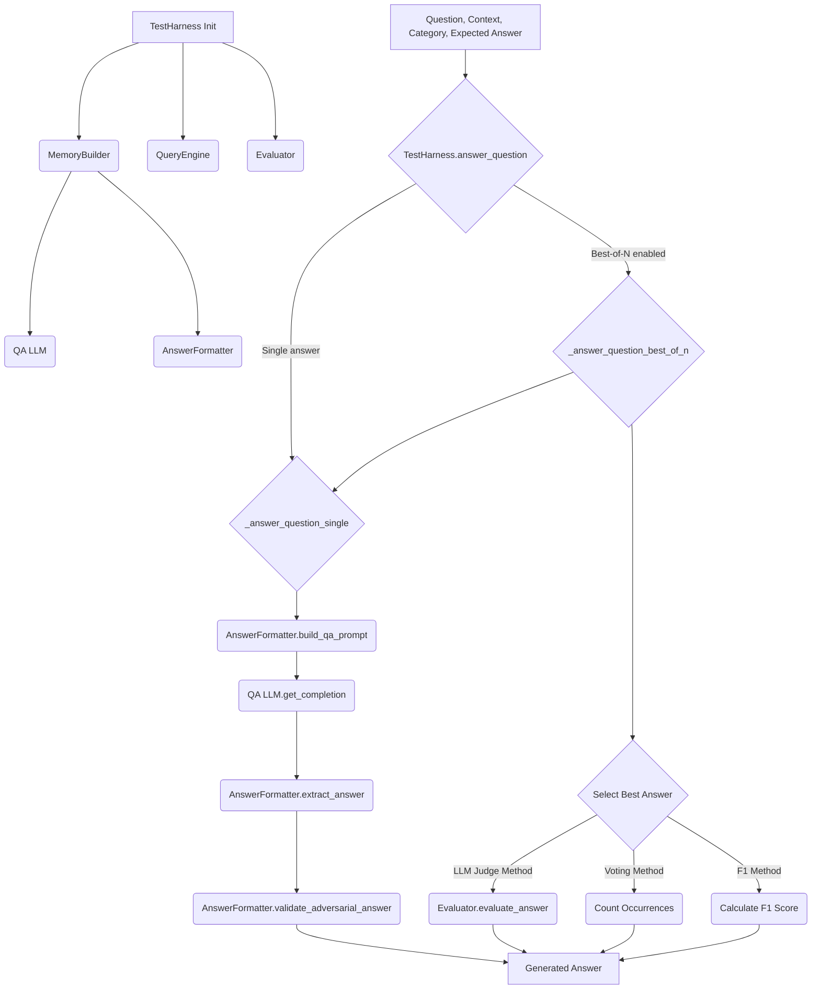
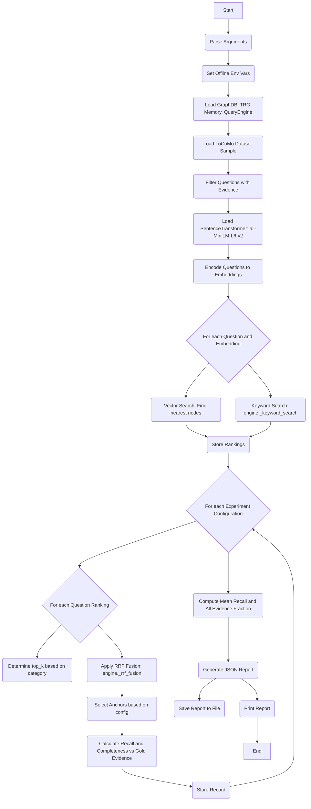

<!-- source: DeepWiki mcp.deepwiki.com · repo libingzheren/Jev-Mem · page 5.3 Scoring, Judges and Metrics · fetched 2026-10-13 -->

# Scoring, Judges and Metrics

<details>
<summary>Relevant source files</summary>

The following files were used as context for generating this wiki page:

- [memory/evaluator.py](memory/evaluator.py)
- [memory/llm_judge.py](memory/llm_judge.py)
- [memory/test_harness.py](memory/test_harness.py)
- [scripts/evaluate_anchor_recall.py](scripts/evaluate_anchor_recall.py)

</details>


This page details the components responsible for evaluating the performance of the Jev-Mem system. It covers the `Evaluator` class, the `LLMJudge` for LLM-based scoring, the `TestHarness` for orchestrating evaluations, and a script for measuring anchor recall. These modules are designed to provide comprehensive metrics for assessing answer quality and retrieval effectiveness.

Sources:
- [memory/evaluator.py:1-12]()
- [memory/llm_judge.py:1-12]()
- [memory/test_harness.py:1-10]()
- [scripts/evaluate_anchor_recall.py:1-5]()

## Evaluator Module

The `Evaluator` module ([memory/evaluator.py]()) is a standalone component designed to assess the quality of answers from any Question Answering (QA) system, including Jev-Mem. It supports both traditional metrics and LLM-based judging.

### Key Features

*   **LLM-based Answer Evaluation**: Integrates with an `LLMJudge` for semantic scoring.
*   **Metrics Calculation**: Computes F1, BLEU, and Exact Match scores.
*   **Category-aware Scoring**: Allows for evaluation based on question categories.
*   **Result Aggregation**: Provides aggregate and category-wise statistics.

### `Evaluator` Class

The `Evaluator` class ([memory/evaluator.py:21-208]()) is the primary interface for evaluation.

#### Initialization

The constructor `__init__` ([memory/evaluator.py:28-44]()) takes an optional `llm_controller` and a `use_llm_judge` flag. If `use_llm_judge` is `True` and an `llm_controller` is provided, an `LLMJudge` instance is created.

#### `evaluate_answer` Method

The `evaluate_answer` method ([memory/evaluator.py:46-94]()) evaluates a single question-answer pair. It calculates traditional metrics using `utils.utils.calculate_metrics` and, if enabled, uses the `LLMJudge` to provide a semantic score.

#### `evaluate_batch` Method

For batch processing, `evaluate_batch` ([memory/evaluator.py:96-129]()) iterates through lists of questions, gold answers, predicted answers, and categories, calling `evaluate_answer` for each.

#### `compute_aggregate_stats` and `compute_category_stats` Methods

These methods ([memory/evaluator.py:131-164](), [memory/evaluator.py:165-197]()) calculate overall and per-category statistics, respectively, from a list of individual evaluation results. They compute accuracy, average F1, BLEU-1, and LLM judge scores.

### Evaluator Data Flow

The following diagram illustrates the data flow within the `Evaluator` module.

```mermaid
graph TD
    A[Input: Question, Gold Answer, Predicted Answer, Category] --> B{Evaluator.evaluate_answer}
    B --> C{Calculate Traditional Metrics}
    C --> D[Metrics: Exact Match, F1, BLEU1]
    B --> E{LLMJudge.evaluate_answer (if enabled)}
    E --> F[LLM Judge Score, Reasoning]
    D & F --> G[Single Evaluation Result Dict]
    H[Input: Batch of Q/A Pairs] --> I{Evaluator.evaluate_batch}
    I --> B
    I --> J[List of Evaluation Result Dicts]
    J --> K{Evaluator.compute_aggregate_stats}
    J --> L{Evaluator.compute_category_stats}
    K --> M[Aggregate Statistics]
    L --> N[Category-wise Statistics]
```

Sources:
- [memory/evaluator.py:21-208]()
- [memory/evaluator.py:28-44]()
- [memory/evaluator.py:46-94]()
- [memory/evaluator.py:96-129]()
- [memory/evaluator.py:131-164]()
- [memory/evaluator.py:165-197]()

## LLM Judge

The `LLMJudge` module ([memory/llm_judge.py]()) provides a mechanism for continuous, semantic evaluation of answers using a Large Language Model (LLM). It assigns a score between 0.0 and 1.0 based on the correctness and completeness of the predicted answer compared to the gold answer.

### `LLMJudge` Class

The `LLMJudge` class ([memory/llm_judge.py:46-127]()) is responsible for orchestrating LLM-based evaluations.

#### Initialization

The `__init__` method ([memory/llm_judge.py:52-55]()) takes an optional `llm_controller`, though it currently uses a global OpenAI client.

#### `evaluate_answer` Method

The core of the `LLMJudge` is the `evaluate_answer` method ([memory/llm_judge.py:57-91]()). This method formats a prompt using the `ACCURACY_PROMPT` template ([memory/llm_judge.py:14-44]()) and sends it to an LLM (specifically, "gpt-4o-mini" as configured in `evaluate_llm_judge` [memory/llm_judge.py:139]()). It handles special logic for adversarial questions (category 5), where it checks if the predicted answer correctly identifies the question as unanswerable using the `_is_unanswerable` helper method ([memory/llm_judge.py:93-127]()).

#### `evaluate_llm_judge` Function

The standalone `evaluate_llm_judge` function ([memory/llm_judge.py:128-158]()) directly interacts with the OpenAI API to get a score and reasoning. It ensures the score is clamped between 0.0 and 1.0.

### LLM Judge Prompt Structure

The `ACCURACY_PROMPT` ([memory/llm_judge.py:14-44]()) provides detailed instructions to the LLM on how to score answers, including guidelines for time-related and factual questions, and a scoring scale. The LLM is instructed to return a JSON object containing a `score` and `reasoning`.

### LLM Judge Workflow

```mermaid
graph TD
    A[Question, Gold Answer, Predicted Answer] --> B{LLMJudge.evaluate_answer}
    B -- Category 5 --> C{_is_unanswerable Check}
    C -- True --> D[Score: 1.0, Reasoning: "Correctly unanswerable"]
    C -- False --> E[Score: 0.0, Reasoning: "Hallucinated answer"]
    B -- Other Categories --> F{Format ACCURACY_PROMPT}
    F --> G[Call OpenAI API (gpt-4o-mini)]
    G --> H[Parse LLM Response (JSON)]
    H --> I[Extract Score and Reasoning]
    I --> J[Return Score (0.0-1.0) and Reasoning]
```

Sources:
- [memory/llm_judge.py:1-12]()
- [memory/llm_judge.py:46-127]()
- [memory/llm_judge.py:52-55]()
- [memory/llm_judge.py:57-91]()
- [memory/llm_judge.py:14-44]()
- [memory/llm_judge.py:93-127]()
- [memory/llm_judge.py:128-158]()
- [memory/llm_judge.py:139]()

## Test Harness

The `TestHarness` module ([memory/test_harness.py]()) is responsible for orchestrating the question-answering process during testing. It delegates evaluation to the `Evaluator` module.

### Key Responsibilities

*   **Question Answering**: Uses the QA LLM and `QueryEngine` to generate answers.
*   **Best-of-N Selection**: Supports generating multiple answers and selecting the best one based on various strategies (LLM judge, voting, F1 score).
*   **Retrieval Diagnostics**: Provides insights into evidence coverage after retrieval.

### `TestHarness` Class

The `TestHarness` class ([memory/test_harness.py:24-62]()) is initialized with a `MemoryBuilder`, `QueryEngine`, and an optional `Evaluator`. It stores references to the QA LLM and `AnswerFormatter`.

#### `retrieval_top_k` Method

This method ([memory/test_harness.py:48-52]()) determines the `top_k` value for retrieval based on the question category and `jev_config` settings.

#### `retrieval_diagnostics` Method

The static method `retrieval_diagnostics` ([memory/test_harness.py:54-62]()) calculates the `evidence_recall` by comparing retrieved dialogue IDs (`dia_id`) with gold evidence. This is a diagnostic tool and not used for selection.

#### `answer_question` Method

The `answer_question` method ([memory/test_harness.py:64-79]()) is the main entry point for answering a question. It can either call `_answer_question_single` or `_answer_question_best_of_n` if best-of-N is configured.

#### `_answer_question_single` Method

This private method ([memory/test_harness.py:81-114]()) generates a single answer. It builds a QA prompt using the `AnswerFormatter` ([memory/test_harness.py:88]()) and sends it to the QA LLM. It also includes logic for auditing LLM calls ([memory/test_harness.py:97-102]()) and validating adversarial answers ([memory/test_harness.py:106-107]()).

#### `_answer_question_best_of_n` Method

This method ([memory/test_harness.py:116-175]()) generates `best_of_n` answers and selects the best one using strategies like LLM judge scoring, voting, or F1 score comparison against an `expected` answer.

### Test Harness Workflow



Sources:
- [memory/test_harness.py:1-10]()
- [memory/test_harness.py:24-62]()
- [memory/test_harness.py:48-52]()
- [memory/test_harness.py:54-62]()
- [memory/test_harness.py:64-79]()
- [memory/test_harness.py:81-114]()
- [memory/test_harness.py:88]()
- [memory/test_harness.py:97-102]()
- [memory/test_harness.py:106-107]()
- [memory/test_harness.py:116-175]()

## Anchor Recall Script

The `evaluate_anchor_recall.py` script ([scripts/evaluate_anchor_recall.py]()) is a diagnostic tool used to measure the recall of retrieved "anchors" (dialogue IDs) against gold evidence. This script operates offline, using a pre-built graph and a local MiniLM model, and does not involve Jev traversal or answer generation.

### Purpose

The script's primary purpose is to evaluate evidence coverage after retrieval, specifically focusing on how well the system retrieves relevant dialogue IDs (`dia_id`) that serve as anchors for questions. It's an anchor diagnostic, not an end-to-end benchmark.

### Workflow

1.  **Argument Parsing**: Takes `memory` path, `dataset` path, `sample` index, and `output` path as arguments ([scripts/evaluate_anchor_recall.py:17-23]()).
2.  **Offline Setup**: Sets `HF_HUB_OFFLINE` and `TRANSFORMERS_OFFLINE` environment variables to `1` to ensure local file usage ([scripts/evaluate_anchor_recall.py:24-25]()).
3.  **Load Components**:
    *   Loads `NetworkXGraphDB` from the specified memory path ([scripts/evaluate_anchor_recall.py:36-37]()).
    *   Initializes `TemporalResonanceGraphMemory` with the loaded graph, a `MockEncoder`, `NumpyVectorDB`, and `None` for `llm_backend` ([scripts/evaluate_anchor_recall.py:38-39]()).
    *   Loads the keyword index ([scripts/evaluate_anchor_recall.py:40-41]()).
    *   Initializes `QueryEngine` with the TRG memory and keyword index ([scripts/evaluate_anchor_recall.py:42]()).
4.  **Load Dataset**: Loads a specific sample from the LoCoMo dataset ([scripts/evaluate_anchor_recall.py:43-44]()).
5.  **Embed Questions**: Uses a `SentenceTransformer` ("all-MiniLM-L6-v2") to encode questions into embeddings ([scripts/evaluate_anchor_recall.py:46-48]()). It checks for embedding dimension compatibility with the graph's node vectors ([scripts/evaluate_anchor_recall.py:51-52]()).
6.  **Retrieve and Rank**: For each question, it performs:
    *   Vector search to find similar nodes.
    *   Keyword search using `engine._keyword_search` ([scripts/evaluate_anchor_recall.py:55]()).
    *   Stores the question, vector-ranked nodes, and keyword-ranked nodes.
7.  **Experimentation**: Runs multiple experiments with varying `anchors`, `normal_k`, `multihop_k`, and `maximum_nodes` parameters ([scripts/evaluate_anchor_recall.py:58-59]()).
8.  **RRF Fusion and Selection**: Within each experiment, it applies Reciprocal Rank Fusion (`engine._rrf_fusion` [scripts/evaluate_anchor_recall.py:64]()) to combine vector and keyword search results. It then selects a subset of nodes as "anchors."
9.  **Recall Calculation**: Compares the `dia_id`s of the selected anchors with the `gold` evidence for each question to calculate `recall` and `complete` (whether all gold evidence was retrieved) ([scripts/evaluate_anchor_recall.py:65-67]()).
10. **Report Generation**: Aggregates results into a JSON report, including mean evidence recall and fraction of complete evidence for each experiment ([scripts/evaluate_anchor_recall.py:70-75]()).

### Anchor Recall Script Flow



Sources:
- [scripts/evaluate_anchor_recall.py:1-5]()
- [scripts/evaluate_anchor_recall.py:17-23]()
- [scripts/evaluate_anchor_recall.py:24-25]()
- [scripts/evaluate_anchor_recall.py:36-37]()
- [scripts/evaluate_anchor_recall.py:38-39]()
- [scripts/evaluate_anchor_recall.py:40-41]()
- [scripts/evaluate_anchor_recall.py:42]()
- [scripts/evaluate_anchor_recall.py:43-44]()
- [scripts/evaluate_anchor_recall.py:46-48]()
- [scripts/evaluate_anchor_recall.py:51-52]()
- [scripts/evaluate_anchor_recall.py:55]()
- [scripts/evaluate_anchor_recall.py:58-59]()
- [scripts/evaluate_anchor_recall.py:64]()
- [scripts/evaluate_anchor_recall.py:65-67]()
- [scripts/evaluate_anchor_recall.py:70-75]()

---

