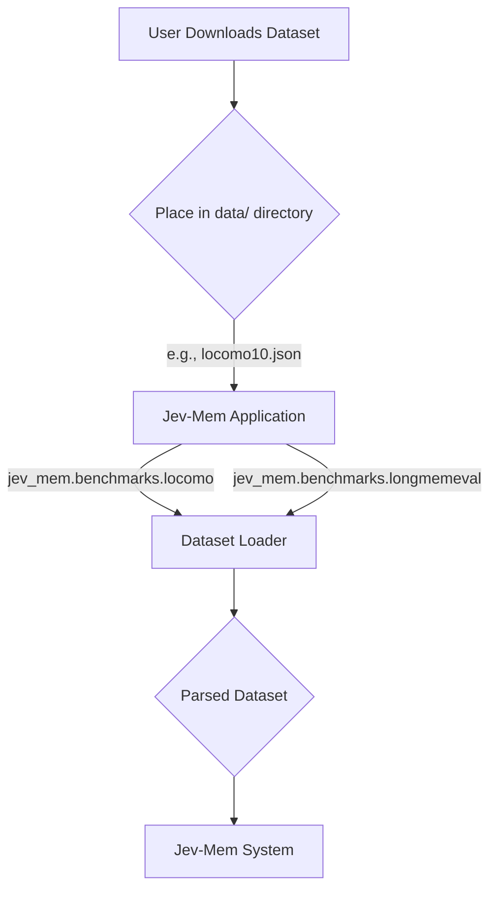
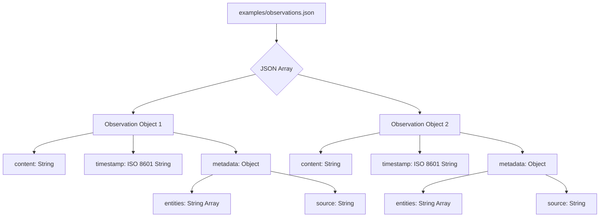

<!-- source: DeepWiki mcp.deepwiki.com · repo libingzheren/Jev-Mem · page 5.4 Datasets and Examples · fetched 2026-10-13 -->

# Datasets and Examples

<details>
<summary>Relevant source files</summary>

The following files were used as context for generating this wiki page:

- [data/README.md](data/README.md)
- [examples/README.md](examples/README.md)
- [examples/observations.json](examples/observations.json)
- [load_dataset.py](load_dataset.py)

</details>


This page details the conventions for handling datasets within Jev-Mem, the role of `load_dataset.py`, and the purpose of the synthetic examples provided in the `examples/` directory. It covers how external datasets are integrated and how internal examples are structured for testing and demonstration.

## Data Conventions

The `data/` directory is designated for external datasets. However, these datasets are explicitly excluded from the repository and its release archives due to licensing and distribution restrictions [data/README.md:3-3](). Users are expected to download these datasets from their original distributors and place them in the `data/` directory according to the specified naming conventions.

Currently, two primary external datasets are supported:

*   **LoCoMo**: The `locomo10.json` file should be placed at `data/locomo10.json` [data/README.md:6-7](). This dataset is used for benchmarking and its format is a JSON list of samples with `conversation` and `qa` fields [data/README.md:14-15]().
*   **LongMemEval**: The cleaned JSON file, typically named `longmemeval_s_cleaned.json`, should be placed at `data/longmemeval_s_cleaned.json` [data/README.md:8-9](). Instructions for downloading and cleaning this dataset are provided by its upstream distributor.

It is crucial to keep downloaded data and derived outputs local, as the public source repository does not grant redistribution rights for third-party datasets [data/README.md:18-19]().

### Dataset Loading Process


**Figure 1: External Dataset Loading Flow**

Sources:
- [data/README.md:3-3]()
- [data/README.md:6-7]()
- [data/README.md:8-9]()
- [data/README.md:14-15]()
- [data/README.md:18-19]()

## `load_dataset.py`

The `load_dataset.py` file serves as a compatibility entry point [load_dataset.py:1-1](). Its primary function is to redirect imports and execution to the actual dataset loading implementation located at `jev_mem.datasets.locomo` [load_dataset.py:3-3]().

If `load_dataset.py` is executed directly as a script, it raises a `SystemExit` and calls the `main()` function of the underlying `_implementation` module [load_dataset.py:5-6](). Otherwise, it preserves class identity, module globals, and legacy monkeypatch targets by replacing its own module in `sys.modules` with the `_implementation` module [load_dataset.py:8-9](). This ensures that any code importing `load_dataset` will effectively be using `jev_mem.datasets.locomo`.

```mermaid
graph TD
    A["load_dataset.py"] --> B{Is __name__ == "__main__"?};
    B -- "Yes" --> C["_implementation.main()"];
    B -- "No" --> D["sys.modules[__name__] = _implementation"];
    C --> E["SystemExit"];
    D --> F["Module Identity Preserved"];
```
**Figure 2: `load_dataset.py` Execution Flow**

Sources:
- [load_dataset.py:1-1]()
- [load_dataset.py:3-3]()
- [load_dataset.py:5-6]()
- [load_dataset.py:8-9]()

## Examples Directory

The `examples/` directory contains original, fictional examples that are distinct from the LoCoMo or LongMemEval benchmarks [examples/README.md:3-3](). These examples are designed to demonstrate schemas and system behavior rather than benchmark quality [examples/README.md:8-8]().

The key files in this directory are:

*   `observations.json`: This file provides input for the `jev_mem` system when run in `build` mode (`python -m jev_mem --mode build`) [examples/README.md:5-5](). It contains a list of observations, each with `content`, `timestamp`, and `metadata` fields [examples/observations.json:1-12](). The `metadata` can include entities and a source identifier.
*   `locomo_synthetic.json`: This file contains a small sample formatted according to the LoCoMo loader's expectations [examples/README.md:6-6](). It serves as a template for understanding the LoCoMo data structure.

Running these examples through the live pipeline may involve paid providers [examples/README.md:8-9](). For a fully offline demonstration with mocked decisions and embeddings, users can utilize `python -m jev_mem.demo` [examples/README.md:9-10]().

### `observations.json` Structure

The `observations.json` file is a JSON array of objects, where each object represents an observation.

```json
[
  {
    "content": "Mira planted basil in her kitchen on September 1.",
    "timestamp": "2026-09-01T10:00:00Z",
    "metadata": {"entities": ["person:mira"], "source": "synthetic_example"}
  },
  {
    "content": "Mira prefers a weekly reminder to water her basil.",
    "timestamp": "2026-09-02T10:00:00Z",
    "metadata": {"entities": ["person:mira"], "source": "synthetic_example"}
  }
]
```

Each observation object has the following fields:
*   `content`: A string describing the observation.
*   `timestamp`: An ISO 8601 formatted string indicating when the observation occurred.
*   `metadata`: An object containing additional information, such as:
    *   `entities`: A list of strings identifying entities mentioned in the content (e.g., "person:mira").
    *   `source`: A string indicating the origin of the observation (e.g., "synthetic_example").


**Figure 3: `observations.json` Data Structure**

Sources:
- [examples/README.md:3-3]()
- [examples/README.md:5-5]()
- [examples/README.md:6-6]()
- [examples/README.md:8-8]()
- [examples/README.md:8-9]()
- [examples/README.md:9-10]()
- [examples/observations.json:1-12]()

---

