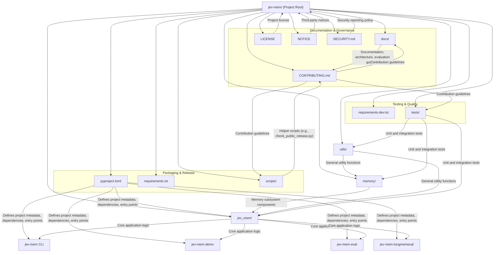

<!-- source: DeepWiki mcp.deepwiki.com · repo libingzheren/Jev-Mem · page 6 Project Infrastructure · fetched 2026-10-13 -->

# Project Infrastructure

<details>
<summary>Relevant source files</summary>

The following files were used as context for generating this wiki page:

- [CONTRIBUTING.md](CONTRIBUTING.md)
- [pyproject.toml](pyproject.toml)

</details>


This page provides a high-level overview of the infrastructure supporting the Jev-Mem project, including how the project is packaged and released, its testing strategy, and general contribution guidelines. For detailed information on each topic, please refer to the linked child pages.

## Packaging and Public Release

The Jev-Mem project is packaged using `setuptools` and defined by the `pyproject.toml` file [pyproject.toml:1-38](). This configuration specifies project metadata such as the name (`jev-mem`), version (`0.1.0`), description, and required Python version (`>=3.11`) [pyproject.toml:6-10](). It also defines entry points for command-line scripts like `jev-mem`, `jev-mem-demo`, `jev-mem-eval`, and `jev-mem-longmemeval` [pyproject.toml:23-27](). The `pyproject.toml` also manages dependencies by referencing `requirements.txt` [pyproject.toml:38]() and specifies which packages and modules are included in the distribution [pyproject.toml:33-34]().

For details on the packaging configuration, release files, and associated scripts, see [Packaging and Public Release](#6.1).

Sources:
- [pyproject.toml:1-38]()

## Testing

The Jev-Mem project includes a comprehensive test suite to ensure reliability and correctness. Tests are located in the `tests/` directory and cover various aspects of the system, including core `jev_mem` functionalities and public release components. The testing framework is configured using `pytest`, and root-level test scripts facilitate execution. The development environment setup described in `CONTRIBUTING.md` includes steps to run tests using `python -m pytest -q` [CONTRIBUTING.md:15](). It emphasizes using mocks for tests and the demo, eliminating the need for API keys or model downloads [CONTRIBUTING.md:20]().

For an in-depth look at the test suite, project layout for tests, and `pytest` configuration, see [Testing](#6.2).

Sources:
- [CONTRIBUTING.md:15]()
- [CONTRIBUTING.md:20]()

## Utilities and Docs

The project includes a `utils/` directory for helper functions and common utilities, such as those related to the `memory_layer`. The `docs/` directory contains documentation, including architectural overviews and evaluation guidance [CONTRIBUTING.md:25, 33](). Additionally, important governance files like `LICENSE`, `NOTICE`, `SECURITY.md`, and `CITATION` are part of the project, outlining licensing, security reporting procedures, and how to cite the work [pyproject.toml:11-12, CONTRIBUTING.md:40-43]().

For more information on the utility modules, documentation structure, and governance files, see [Utilities and Docs](#6.3).

Sources:
- [pyproject.toml:11-12]()
- [CONTRIBUTING.md:25]()
- [CONTRIBUTING.md:33]()
- [CONTRIBUTING.md:40-42]()

### Project Structure Overview

The following diagram illustrates the high-level organization of the Jev-Mem project, highlighting key directories and their roles in the project infrastructure.


Sources:
- [pyproject.toml:1-38]()
- [CONTRIBUTING.md:1-42]()

### Development Workflow

The typical development workflow for Jev-Mem, as outlined in `CONTRIBUTING.md`, involves setting up a virtual environment, installing development dependencies, running tests, and checking the public release status.

```mermaid
graph TD
    A[Start Development] --> B{Python 3.11+ installed?};
    B -- Yes --> C[python3.11 -m venv .venv];
    B -- No --> D[Install Python 3.11+];
    D --> C;
    C --> E[source .venv/bin/activate];
    E --> F[python -m pip install -r requirements-dev.txt];
    F --> G[python -m pip install --no-deps -e .];
    G --> H[python -m pytest -q];
    H -- Tests Pass --> I[python -m jev_mem.demo];
    H -- Tests Fail --> J[Debug and Fix];
    J --> H;
    I --> K[Make Changes / Add Features];
    K --> L[Run Tests (H)];
    L -- Tests Pass --> M[Staged Changes?];
    M -- Yes --> N[python scripts/check_public_release.py --tracked];
    M -- No --> O[Stage Changes];
    O --> N;
    N -- Checks Pass --> P[Create Pull Request];
    N -- Checks Fail --> Q[Address Release Issues];
    Q --> K;
    P --> R[End Development Cycle];
```
Sources:
- [CONTRIBUTING.md:10-18]()
- [CONTRIBUTING.md:37-38]()

---

